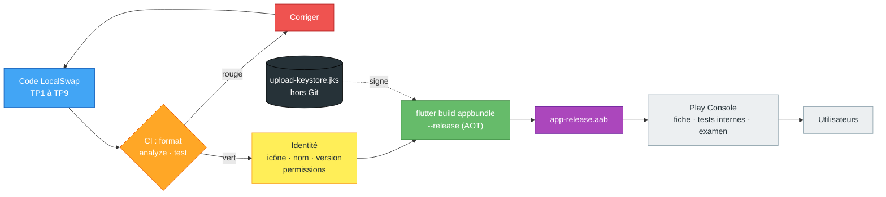

# TP10 — Build de production, publication et soutenance

> **Séance :** 3 h (+ soutenance lors d'une séance dédiée) · **Environnement :** Flutter 3.x stable (≥ 3.29), Dart 3, JDK fourni avec Android Studio (`keytool`), émulateur ou téléphone Android, compte GitHub
> **Fil rouge :** LocalSwap — identité visuelle, build release signé, chaîne qualité automatique, fiche de présentation et soutenance.

| Repère | Partie | Durée |
|---|---|---|
| 📘🗺️ | Rappel de cours + diagramme | 10 min |
| 🧪 | Partie A : exercices indépendants (5) | 75 min |
| 🏗️ | Partie B : LocalSwap prêt à livrer | 50 min |
| 🤖 | Partie C : comprendre et maîtriser le code | 30 min |
| 📝 | Quiz de fin de TP | 10 min |
| 🎤 | Soutenance (10 min + 5 min de questions par binôme) | séance dédiée |
| 🚀 | Partie D : défis bonus | hors temps |
| | **Total (hors soutenance)** | **175 min** |

Difficulté : 🟢 facile · 🟡 moyen · 🔴 difficile

---

## 🎯 Objectifs pédagogiques

À la fin de ce TP, vous serez capable de :

1. **Distinguer** les modes debug, profile et release, et les formats APK et AAB.
2. **Configurer** l'identité d'une application (nom, icône, identifiant, version) et ses **permissions** de release.
3. **Signer** une application avec une clé privée **sans** l'exposer dans Git.
4. **Automatiser** une vérification qualité (format, analyse, tests) avant chaque livraison.
5. **Présenter** et **défendre** l'architecture et les choix techniques de LocalSwap devant un jury.

## 📋 Prérequis

- **TP1 à TP9** : LocalSwap complet (widgets, navigation, formulaires, Provider, API, tests).
- **TP1** : `pubspec.yaml` (`version: x.y.z+n`), Git. **TP8** : `--dart-define=API_URL`, *cleartext* en debug. **TP9** : `flutter test`.

> [!IMPORTANT]
> **Règle sur l'IA.** Les commandes de publication changent souvent ; les IA proposent volontiers des commandes et des fichiers **périmés** (Groovy au lieu de Kotlin, options supprimées). **60 % de la note** porte sur votre compréhension (Partie C, soutenance, quiz). Tenez le **📓 Journal IA** (C7).

---

## 📘 Rappel de cours

> [!NOTE]
> **Les 3 modes de compilation**

| Mode | Commande | Compilation | Usage |
|---|---|---|---|
| **debug** | `flutter run` | JIT, assertions, Hot Reload | Développer |
| **profile** | `flutter run --profile` | AOT + outils de mesure | Mesurer les performances |
| **release** | `flutter build apk` / `appbundle` | AOT optimisé, sans assertions ni outils de debug | Livrer |

> [!NOTE]
> **APK ou AAB ?** L'**APK** s'installe directement (`adb install`, envoi du fichier). L'**AAB** (*Android App Bundle*) est le format **exigé par Google Play** : le store en tire des APK optimisés pour chaque appareil.

> [!NOTE]
> **Identité d'une application Android**
> - **`applicationId`** (ex. `tn.iset.localswap`) : identifiant **unique et définitif** sur le store (TP1, `--org`).
> - **Nom affiché** : `android:label` dans `android/app/src/main/AndroidManifest.xml`.
> - **Version** : `version: 1.2.0+5` dans `pubspec.yaml` → `versionName` **1.2.0** (visible) et `versionCode` **5** (entier qui doit **augmenter** à chaque envoi sur le store).

> [!WARNING]
> **Permissions** : le manifeste **debug** (TP8) contient `INTERNET` et autorise le HTTP non chiffré, mais **pas** le manifeste **main** utilisé en release. Une application release sans `<uses-permission android:name="android.permission.INTERNET"/>` dans `main` ne peut **pas** accéder au réseau.

> [!CAUTION]
> **Signature.** Chaque mise à jour d'une application publiée doit être signée avec la **même** clé (*keystore*). La clé et ses mots de passe ne doivent **jamais** être commités : `key.properties` et `*.jks` vont dans `.gitignore`. Perdre la clé ou la publier sur GitHub sont deux incidents graves.

> [!NOTE]
> **Intégration continue (CI)** : à chaque `push`, un serveur (ex. GitHub Actions) exécute `dart format`, `flutter analyze` et `flutter test`. Si une commande échoue (code de sortie ≠ 0), le commit est signalé en rouge.

## 🗺️ Diagramme — Du code au store



---

## 🧪 Partie A — Exercices pédagogiques indépendants (sans LocalSwap) · 75 min

On s'entraîne sur une **petite application de démonstration** avant de toucher à LocalSwap.

```bash
flutter create --org tn.iset --platforms android,web tp10_demo
cd tp10_demo
flutter pub add http
```

`lib/main.dart` (application « Ping » qui affiche le mode de compilation et teste le réseau)

```dart
import 'package:flutter/foundation.dart';
import 'package:flutter/material.dart';
import 'package:http/http.dart' as http;

/// URL testée, modifiable au build : --dart-define=PING_URL=https://...
const String pingUrl = String.fromEnvironment('PING_URL', defaultValue: 'https://example.com');

void main() => runApp(const PingApp());

class PingApp extends StatelessWidget {
  const PingApp({super.key});

  @override
  Widget build(BuildContext context) {
    return MaterialApp(
      title: 'Ping ISET',
      theme: ThemeData(colorScheme: ColorScheme.fromSeed(seedColor: Colors.teal)),
      home: const PingPage(),
    );
  }
}

class PingPage extends StatefulWidget {
  const PingPage({super.key});

  @override
  State<PingPage> createState() => _PingPageState();
}

class _PingPageState extends State<PingPage> {
  String _status = 'Pas encore testé';

  String get _mode => kReleaseMode ? 'release' : (kProfileMode ? 'profile' : 'debug');

  Future<void> _ping() async {
    setState(() => _status = 'En cours…');
    String result;
    try {
      final http.Response r =
          await http.get(Uri.parse(pingUrl)).timeout(const Duration(seconds: 8));
      result = 'HTTP ${r.statusCode}';
    } catch (e) {
      result = 'Échec : $e';
    }
    if (!mounted) return;
    setState(() => _status = result);
  }

  @override
  Widget build(BuildContext context) {
    final TextTheme text = Theme.of(context).textTheme;
    return Scaffold(
      appBar: AppBar(title: const Text('Ping ISET')),
      body: Center(
        child: Column(
          mainAxisSize: MainAxisSize.min,
          children: [
            Text('Mode : $_mode', style: text.headlineSmall),
            const SizedBox(height: 8),
            Text(pingUrl),
            const SizedBox(height: 24),
            FilledButton.icon(
              onPressed: _ping,
              icon: const Icon(Icons.wifi_tethering),
              label: const Text('Tester le réseau'),
            ),
            const SizedBox(height: 16),
            Text(_status, textAlign: TextAlign.center),
          ],
        ),
      ),
    );
  }
}
```

---

### Exercice 10.1 — Identité : icône, nom, version 🟢 · 12 min

**Notions nouvelles :** génération d'icônes (`flutter_launcher_icons`), nom affiché et version.

1. Placez une image **carrée** de 1024 × 1024 px dans `assets/icon/icon.png`, et une version **sans fond** (motif centré, marges ≈ 25 %) dans `assets/icon/icon_foreground.png`.
2. Ajoutez le générateur (outil de développement uniquement) :
   ```bash
   flutter pub add dev:flutter_launcher_icons
   ```
3. Ajoutez à la fin de `pubspec.yaml` (indentation : 2 espaces) :
   ```yaml
   flutter_launcher_icons:
     android: true
     image_path: "assets/icon/icon.png"
     adaptive_icon_background: "#00897B"
     adaptive_icon_foreground: "assets/icon/icon_foreground.png"
     web:
       generate: true
       image_path: "assets/icon/icon.png"
   ```
4. Générez les icônes, puis relancez complètement l'application :
   ```bash
   dart run flutter_launcher_icons
   ```
5. Nom affiché : dans `android/app/src/main/AndroidManifest.xml`, `android:label="Ping ISET"`.
6. Version : dans `pubspec.yaml`, `version: 1.0.0+1`.

**🔍 Observer & répondre**

1. Quels dossiers et fichiers la commande a-t-elle modifiés (`git status`) ?
2. Pourquoi une icône **adaptative** a-t-elle besoin de deux images ? Que se passe-t-il sur un lanceur qui affiche des icônes rondes ?
3. Pourquoi `flutter_launcher_icons` est-il une dépendance **de développement** ?

---

### Exercice 10.2 — Builds de release et permission réseau 🟡 · 18 min

**Notions nouvelles :** modes debug/profile/release et tailles, permissions du manifeste **main**.

1. Construisez et notez les tailles :

```bash
flutter build apk --debug
flutter build apk --release
flutter build apk --release --split-per-abi
flutter build appbundle --release
```

| Artefact | Chemin | Taille |
|---|---|---|
| APK debug | `build/app/outputs/flutter-apk/app-debug.apk` | |
| APK release (universel) | `…/app-release.apk` | |
| APK release arm64 | `…/app-arm64-v8a-release.apk` | |
| AAB release | `build/app/outputs/bundle/release/app-release.aab` | |

2. Installez l'APK release : `flutter install --release` (ou `adb install build/app/outputs/flutter-apk/app-release.apk`). Ouvrez l'application, cliquez sur « Tester le réseau ». **Notez le résultat.**
3. Ouvrez `android/app/src/main/AndroidManifest.xml`. Ajoutez, juste avant `<application`, la ligne :
   ```xml
   <uses-permission android:name="android.permission.INTERNET"/>
   ```
   Reconstruisez, réinstallez, testez de nouveau.

**🔍 Observer & répondre**

1. Pourquoi l'APK release est-il beaucoup plus petit que l'APK debug ? Et l'APK arm64 que l'APK universel ?
2. Pourquoi le test réseau fonctionnait-il avec `flutter run` (debug) mais pas en release (étape 2) ?
3. Lancez `flutter run --profile` : quel mode l'application affiche-t-elle ? À quoi sert ce mode ?

---

### Exercice 10.3 — Signer sans exposer la clé 🔴 · 20 min

**Notions nouvelles :** *keystore* + `signingConfigs` (Gradle Kotlin), secrets hors de Git.

1. Générez une clé d'envoi (*upload key*). `keytool` est fourni par le JDK d'Android Studio (`flutter doctor -v` affiche son chemin).

   **Linux / macOS** :
   ```bash
   keytool -genkey -v -keystore ~/upload-keystore.jks -keyalg RSA -keysize 2048 -validity 10000 -alias upload
   ```
   **Windows (PowerShell)** :
   ```powershell
   keytool -genkey -v -keystore $env:USERPROFILE\upload-keystore.jks -storetype JKS -keyalg RSA -keysize 2048 -validity 10000 -alias upload
   ```
   La clé est créée **hors du projet** (dossier personnel).

2. Créez `android/key.properties` (**jamais commité**) :
   ```properties
   storePassword=votre_mot_de_passe
   keyPassword=votre_mot_de_passe
   keyAlias=upload
   storeFile=/home/etudiant/upload-keystore.jks
   ```
   (Sous Windows : `storeFile=C:\\Users\\etudiant\\upload-keystore.jks`.)

3. Ajoutez dans `android/.gitignore` (vérifiez que ces lignes y sont) :
   ```text
   key.properties
   **/*.jks
   **/*.keystore
   ```

4. Dans `android/app/build.gradle.kts` (format **Kotlin**, par défaut depuis Flutter 3.29) :

   ```kotlin
   import java.io.FileInputStream
   import java.util.Properties

   // … bloc plugins { } inchangé …

   val keystoreProperties = Properties()
   val keystorePropertiesFile = rootProject.file("key.properties")
   if (keystorePropertiesFile.exists()) {
       keystoreProperties.load(FileInputStream(keystorePropertiesFile))
   }

   android {
       // … namespace, compileSdk, defaultConfig inchangés …

       signingConfigs {
           create("release") {
               keyAlias = keystoreProperties["keyAlias"] as String
               keyPassword = keystoreProperties["keyPassword"] as String
               storeFile = keystoreProperties["storeFile"]?.let { file(it) }
               storePassword = keystoreProperties["storePassword"] as String
           }
       }

       buildTypes {
           release {
               // Remplace la ligne du modèle : signingConfig = signingConfigs.getByName("debug")
               signingConfig = signingConfigs.getByName("release")
           }
       }
   }
   ```

   > [!WARNING]
   > Les imports Kotlin vont **en haut** du fichier. Si votre projet a un `build.gradle` (Groovy, ancien format), la syntaxe est différente : ne mélangez pas les deux.

5. Reconstruisez (`flutter build apk --release`) et vérifiez la signature :
   ```bash
   keytool -printcert -jarfile build/app/outputs/flutter-apk/app-release.apk
   ```

**🔍 Observer & répondre**

1. Avant l'étape 4, avec quelle clé l'APK release était-il signé ? Pourquoi est-ce interdit pour une publication ?
2. Que se passe-t-il si `key.properties` est absent (autre poste, CI) ? Le build échoue-t-il ? À quel moment ?
3. `git status` : le keystore et `key.properties` apparaissent-ils ? Que faire si un keystore a **déjà** été poussé sur GitHub ?
4. La clé est perdue alors que l'application est publiée : que se passe-t-il ? (indice : *Play App Signing*, clé d'envoi vs clé de signature)

---

### Exercice 10.4 — Chaîne qualité : vérifier avant de livrer 🟡 · 15 min

**Notions nouvelles :** codes de sortie des commandes, intégration continue (GitHub Actions).

1. En local, exécutez cette « porte de qualité » (Git Bash, Linux ou macOS) :
   ```bash
   dart format --output=none --set-exit-if-changed . \
     && flutter analyze \
     && flutter test \
     && flutter build apk --release \
     && echo "✅ Prêt à livrer"
   ```
   Désindentez volontairement une ligne de `main.dart` et relancez. À quelle étape la chaîne s'arrête-t-elle ? Pourquoi ?

2. Créez `.github/workflows/ci.yml` :
   ```yaml
   name: CI
   on: [push, pull_request]

   jobs:
     qualite:
       runs-on: ubuntu-latest
       steps:
         - uses: actions/checkout@v4
         - uses: subosito/flutter-action@v2
           with:
             channel: stable
         - run: flutter pub get
         - run: dart format --output=none --set-exit-if-changed .
         - run: flutter analyze
         - run: flutter test
   ```
   Poussez sur GitHub, puis ouvrez l'onglet **Actions**.

**🔍 Observer & répondre**

1. Que signifie `--set-exit-if-changed` ? Pourquoi `&&` plutôt que `;` ?
2. Pourquoi la CI ne fait-elle **pas** le build signé ? (indice : où est la clé ?)
3. Une PR rend la CI rouge à cause d'un test. Faut-il « désactiver le test pour que ça passe » ? Justifiez.

---

### Exercice 10.5 — Fiche store et permissions 🟢 · 10 min

**Notions nouvelles :** métadonnées de store, justification des permissions.

Rédigez (sans soumettre) la fiche de *Ping ISET* :

| Champ | Contrainte | Votre texte |
|---|---|---|
| Titre | ≤ 30 caractères | |
| Description courte | ≤ 80 caractères | |
| Description longue | 3 à 5 phrases, sans promesse fausse | |
| Catégorie | | |
| Permissions et justification | une ligne par permission | |
| Données collectées | (politique de confidentialité) | |

**🔍 Observer & répondre**

1. Ouvrez `build/app/intermediates/merged_manifests/release/…/AndroidManifest.xml` (ou utilisez l'*APK Analyzer* d'Android Studio) : quelles permissions l'APK final déclare-t-il ? En avez-vous ajouté d'autres sans le savoir ?
2. Pourquoi le Play Store refuse-t-il une application qui demande des permissions inutiles ?

---

## 🏗️ Partie B — LocalSwap prêt à livrer · 50 min

### B.1 — Identité 🟢 · 10 min

- Icône adaptative avec la couleur graine de LocalSwap (TP1/TP3) : `adaptive_icon_background` = votre couleur graine.
- `android:label="LocalSwap"` ; Web : `name`/`short_name` dans `web/manifest.json` et `<title>` dans `web/index.html`.
- `version: 1.0.0+1`. Vérifiez l'`applicationId` (`tn.iset.localswap`, TP1).

### B.2 — Réseau en release 🟡 · 10 min

- Permission `INTERNET` dans le manifeste **main**.
- L'API de démonstration (`json-server`, TP8) est en **HTTP** sur le réseau local. Pour la **démonstration seulement**, autorisez le HTTP **vers cette seule adresse** :

`android/app/src/main/res/xml/network_security_config.xml`

```xml
<?xml version="1.0" encoding="utf-8"?>
<network-security-config>
    <!-- DÉMO PÉDAGOGIQUE : HTTP autorisé uniquement vers le PC de démonstration.
         En production : HTTPS obligatoire, et ce fichier disparaît. -->
    <domain-config cleartextTrafficPermitted="true">
        <domain includeSubdomains="false">192.168.1.20</domain>
    </domain-config>
</network-security-config>
```

et dans la balise `<application …>` du manifeste main : `android:networkSecurityConfig="@xml/network_security_config"`.

- Build avec l'adresse du PC de démonstration :
  ```bash
  flutter build apk --release --dart-define=API_URL=http://192.168.1.20:3000
  ```

### B.3 — Signature et build final 🟡 · 10 min

Même configuration que l'exercice 10.3 (vous pouvez réutiliser votre clé d'envoi). Produisez :
- l'**AAB** signé (format store) ;
- l'**APK** release signé (pour l'installer sur le téléphone de démonstration).

Vérifiez : `keytool -printcert -jarfile …/app-release.apk`.

### B.4 — Porte qualité + CI 🟢 · 10 min

`ci.yml` (ex. 10.4) dans le dépôt LocalSwap ; la CI doit être **verte** (format, analyse, **vos tests du TP9**). Ajoutez le badge de statut dans le `README.md`.

### B.5 — Test de recette sur l'APK release 🟡 · 10 min

Sur un **téléphone réel** ou un émulateur, avec l'APK **release** (pas `flutter run`), cochez :

| # | Scénario | OK ? |
|---|---|---|
| 1 | Lancement : icône, nom, pas de bannière « DEBUG » | |
| 2 | Chargement des annonces depuis l'API | |
| 3 | Recherche + filtre de catégorie | |
| 4 | Publication (validation, date, vérification du titre) | |
| 5 | Réservation avec confirmation + « Annuler » | |
| 6 | Mes échanges → Terminer → réputation mise à jour | |
| 7 | Serveur arrêté : message d'erreur + « Réessayer » ; réservation annulée proprement | |
| 8 | Fermeture complète puis réouverture : données conservées | |

### Livrables de la soutenance (à préparer pour la séance dédiée)

1. **APK** release signé + **AAB**.
2. **Fiche de présentation (2 pages)** : objectif, fonctionnalités, **schéma d'architecture** (écrans → Provider → `AnnoncesApi` → `json-server`), captures (clair + sombre), résultats des tests (nombre, couverture), limites connues et pistes.
3. **Dépôt GitHub** : README à jour, CI verte, tags `v1.0.0`.
4. **Journal IA** consolidé du semestre (les tableaux C7 de chaque TP).

---

## 🤖 Partie C — Comprendre et maîtriser le code · 30 min

> [!CAUTION]
> Pour C1, C2 et C3, **répondez d'abord sur papier, sans exécuter et sans IA**. Vérifiez ensuite.

### C1 — Prédire 🟡 · 6 min

Que se passe-t-il dans chaque cas ?
1. On envoie sur Google Play une mise à jour avec `version: 1.1.0+1`, alors que la version publiée est `1.0.0+3`.
2. On compile en release **sans** `INTERNET` dans le manifeste main, puis on charge les annonces.
3. On exécute `flutter build appbundle` sur un poste **sans** `key.properties`, avec la configuration de l'ex. 10.3.
4. On envoie un `.apk` (et non un `.aab`) sur la Play Console pour une nouvelle application.
5. On lance `flutter build apk --release --dart-define=API_URL=http://10.0.2.2:3000` et on installe l'APK sur un **téléphone réel**.

### C2 — Trouver les erreurs de configuration 🟡 · 8 min

Un étudiant prépare sa release. Il y a **4 erreurs** (certaines graves pour la sécurité). Pour chacune : fichier, conséquence, correction.

`android/app/src/main/AndroidManifest.xml` (extrait)
```xml
<manifest xmlns:android="http://schemas.android.com/apk/res/android">
    <application
        android:label="localswap"
        android:usesCleartextTraffic="true"
        android:icon="@mipmap/ic_launcher">
```

`android/app/build.gradle.kts` (extrait)
```kotlin
signingConfigs {
    create("release") {
        storeFile = file("upload-keystore.jks")   // fichier dans android/app/
        storePassword = "iset2026"
        keyAlias = "upload"
        keyPassword = "iset2026"
    }
}
buildTypes {
    release {
        signingConfig = signingConfigs.getByName("debug")
    }
}
```

`pubspec.yaml` (mise à jour publiée la semaine dernière en `1.0.0+1`)
```yaml
version: 1.0.1+1
```

### C3 — Critiquer une procédure générée par une IA 🔴 · 8 min

Prompt : *« Comment publier mon app Flutter sur le Play Store ? Donne les commandes »*. Réponse de l'IA :

> 1. Lance `flutter pub run flutter_launcher_icons:main`.
> 2. Pour éviter les problèmes de réseau, ajoute `android:usesCleartextTraffic="true"` dans le manifeste.
> 3. Crée ta clé : `keytool -genkey -keystore android/app/key.jks …` et ajoute dans `android/app/build.gradle` :
>    ```groovy
>    signingConfigs { release { storeFile file('key.jks'); storePassword 'motdepasse'; keyAlias 'key'; keyPassword 'motdepasse' } }
>    ```
> 4. Compile avec `flutter build apk --release --no-sound-null-safety`.
> 5. Envoie le fichier `app-release.apk` sur la Play Console.
> 6. Commite tout pour ne rien perdre : `git add . && git commit -m "release"`.

1. Trouvez **au moins 7 problèmes** (périmé, faux, ou dangereux) et classez-les.
2. Quelle étape cause l'incident de sécurité le plus grave ? Décrivez le scénario.
3. Réécrivez la procédure correcte en 6 étapes.

### C4 — Modifier sous contrainte 🟡 · 3 min

1. Produisez un AAB en version **1.1.0**, *versionCode* **2**, **sans modifier** `pubspec.yaml`.
2. Produisez un APK qui pointe vers `http://192.168.1.50:3000`, **sans modifier** aucun fichier `.dart`.

### C5 — Expliquer ligne par ligne 🟢 · 2 min

Recopiez votre bloc `signingConfigs` et commentez chaque ligne. Répondez : *« Pourquoi lire les mots de passe dans `key.properties` plutôt que de les écrire dans `build.gradle.kts` ? »*

### C6 — Exercice papier ✍️ 🟡 · 3 min (à terminer pour la fiche)

Sans machine, dessinez le **schéma d'architecture** de LocalSwap qui figurera dans votre fiche : écrans, `AnnoncesProvider`, `AnnoncesApi`, `http.Client`, `json-server`, modèles ; et, en couleur, ce qui est **testé** (TP9) et **par quel type de test**.

### C7 — Journal IA 📓

| # | Exercice | Prompt (copié tel quel) | Ce que j'ai gardé | Ce que j'ai rejeté ou corrigé, et pourquoi |
|---|---|---|---|---|
| 1 | | | | |

---

## 🚀 Partie D — Défis bonus

| Défi | Niveau | Énoncé |
|---|---|---|
| D1 — Web | 🟢 | `flutter build web --dart-define=API_URL=http://localhost:3000` puis servez `build/web` (ex. `npx serve build/web`). Quelles différences de comportement par rapport à Android ? |
| D2 — Obfuscation | 🟡 | `flutter build appbundle --obfuscate --split-debug-info=build/symbols`. À quoi servent les fichiers de symboles ? Que faut-il en faire ? |
| D3 — Saveurs (*flavors*) | 🔴 | Créez deux configurations `dev` et `demo` (URL d'API et nom d'application différents) avec `--dart-define-from-file=config/dev.json`. |
| D4 — Release automatique | 🔴 | Ajoutez à la CI un job qui, sur un tag `v*`, construit l'APK **non signé** et le publie en artefact téléchargeable. |
| D5 — Pour aller plus loin | — | Internationalisation (`.arb`), animations, capteurs, cartes, authentification JWT : choisissez un sujet et présentez une preuve de concept de 2 minutes. |

---

## 🎤 Soutenance (10 min de démonstration + 5 min de questions, par binôme)

**Déroulé imposé**

1. **(1 min)** Le problème que résout LocalSwap, le public visé.
2. **(5 min)** Démonstration sur l'**APK release** : les 8 scénarios de recette (B.5), y compris **serveur arrêté**.
3. **(2 min)** Architecture (schéma de la fiche) et un choix technique justifié (ex. optimiste ou pessimiste, `select`, `sealed`).
4. **(2 min)** Qualité : `flutter test` en direct, couverture, ce que la CI vérifie.

**Questions possibles du jury** (individuelles)

- Montrez la ligne qui vérifie le code HTTP. Que se passe-t-il sans ?
- Pourquoi `CarteAnnonce` est-elle Stateless ?
- **Modifiez en direct** un libellé, relancez les tests : que se passe-t-il ?
- Où est votre clé de signature ? Qui y a accès ?
- Que se passe-t-il si la réservation échoue côté serveur ?
- Montrez un exemple de code proposé par une IA que vous avez **refusé** (journal IA), et pourquoi.
- Quelle est la limite principale de votre application aujourd'hui ?

> [!IMPORTANT]
> Chaque membre du binôme présente une partie **et** répond seul à au moins deux questions. La note de soutenance est **individuelle**.

---

## ✅ Checklist de validation — le TP est réussi si…

- [ ] Les 5 exercices de la Partie A sont faits, et les questions 🔍 ont une réponse.
- [ ] LocalSwap a son icône, son nom, sa version, et la permission `INTERNET` en release.
- [ ] Le HTTP non chiffré n'est autorisé que vers l'adresse de démonstration, et c'est justifié.
- [ ] AAB et APK release **signés avec votre clé** ; aucune clé ni mot de passe dans Git.
- [ ] CI verte (format, analyse, tests) ; badge dans le README.
- [ ] Les 8 scénarios de recette passent sur l'APK release.
- [ ] Fiche de présentation et journal IA consolidé prêts.
- [ ] Les réponses aux exercices C1 à C6 sont rédigées.

## ⚠️ Erreurs fréquentes et corrections

| Symptôme | Cause | Correction |
|---|---|---|
| Release : `Failed host lookup` / aucune donnée | Pas de permission `INTERNET` dans le manifeste **main** | L'ajouter |
| Release : `Cleartext HTTP traffic not permitted` | HTTP bloqué en release | HTTPS ; pour la démo, `network_security_config` limité à une adresse |
| `Keystore file not set for signing config release` / `NullPointerException` à la lecture des propriétés | `key.properties` absent ou chemin `storeFile` faux | Vérifier le fichier et le chemin absolu |
| Play Console : « Version code 1 has already been used » | `versionCode` non incrémenté | `+n` plus grand dans `pubspec.yaml` ou `--build-number` |
| Play Console : « You uploaded an APK… use an Android App Bundle » | Mauvais format | `flutter build appbundle` |
| Erreurs Gradle « Unresolved reference » après un copier-coller | Syntaxe Groovy dans un `.kts` | Syntaxe Kotlin (`=`, guillemets doubles, `create("release")`) |
| `Could not find an option named "--no-sound-null-safety"` | Option supprimée (Dart 3) | La retirer ; le code doit être *null safe* |
| L'icône ne change pas | Application non réinstallée / cache du lanceur | Désinstaller puis réinstaller |
| CI rouge sur `dart format` | Fichiers non formatés | `dart format .` puis commit |

## 📝 Quiz de fin de TP · 10 min

**Q1.** Quel format faut-il envoyer sur Google Play pour une nouvelle application ?
- A. Un APK debug.
- B. Un APK release universel.
- C. Un Android App Bundle (`.aab`) signé.
- D. Le dossier `build/` compressé.

**Q2.** Dans `version: 2.3.0+14`, que représente `14` ?
- A. Le numéro de version visible par l'utilisateur.
- B. Le `versionCode`, un entier qui doit augmenter à chaque envoi sur le store.
- C. Le niveau d'API Android minimum.
- D. Le nombre de tests.

**Q3.** L'application fonctionne avec `flutter run`, mais la version release n'accède pas au réseau. Cause la plus probable ?
- A. Le Hot Reload est désactivé en release.
- B. La permission `INTERNET` n'est déclarée que dans le manifeste debug.
- C. L'AOT ne supporte pas HTTP.
- D. Il manque `debugShowCheckedModeBanner: false`.

**Q4.** Où doit se trouver la clé de signature (`.jks`) ?
- A. Dans `android/app/`, commitée pour ne pas la perdre.
- B. Dans le README, pour l'équipe.
- C. Hors du dépôt Git, sauvegardée de façon sécurisée ; le projet ne contient que la configuration qui la lit.
- D. Sur le Play Store uniquement.

**Q5.** Quel est le rôle de la CI (`flutter analyze`, `flutter test` à chaque push) ?
- A. Publier automatiquement sur le Play Store.
- B. Détecter automatiquement, avant la livraison, les régressions et les problèmes de qualité.
- C. Remplacer les tests manuels de recette.
- D. Signer l'application.

## 📊 Barème indicatif (sur 20)

| Bloc | Détail | Points |
|---|---|---|
| **Code et livrables (40 %)** | Partie A : 5 exercices + réponses 🔍 | 2 |
| | Identité + réseau release + configuration réseau justifiée | 2 |
| | AAB/APK signés, secrets hors Git | 2 |
| | CI verte + recette des 8 scénarios | 2 |
| **Compréhension (60 %)** | Partie C (C1 à C6) | 4 |
| | Soutenance : démonstration, architecture, réponses individuelles | 6 |
| | Quiz (5 × 0,4) | 2 |
| | **Total** | **20** |

> [!CAUTION]
> Une clé de signature ou un mot de passe trouvé dans le dépôt Git entraîne **0** au critère « signés, secrets hors Git ». Du code utilisé sans être déclaré dans le journal IA vaut **0** pour l'exercice concerné.

## 🎓 Bilan du semestre

| TP | Ce que LocalSwap a gagné |
|---|---|
| 1 | Projet, Git, thème |
| 2 | Modèles immuables, JSON validé |
| 3 | Écran d'accueil, gabarit de carte |
| 4 | `CarteAnnonce`, listes, grille |
| 5 | Navigation, détail, confirmation |
| 6 | Formulaire de publication, recherche |
| 7 | État partagé (Provider) |
| 8 | API REST, optimiste/pessimiste |
| 9 | Suite de tests |
| 10 | Release signée, CI, soutenance |
