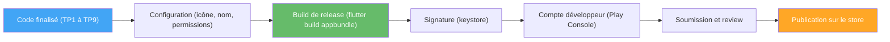

# TP10 — Publication et soutenance

## Objectifs
- Préparer LocalSwap pour un déploiement (icône, nom, signature).
- Comprendre les grandes étapes de publication sur le Google Store.
- Présenter le projet final devant le jury/enseignant.

## Prérequis
- TP9 terminé. Application fonctionnelle et complète (widgets, navigation, état, API, tests).

---

## Rappel de cours — Notions et définitions

**Build de debug vs build de release** : le build de debug (`flutter run`, utilisé tout le semestre) inclut des outils de diagnostic et n'est pas optimisé ; le build de release (`flutter build apk`/`appbundle`) est optimisé (AOT complet) — seule forme acceptée par les stores.

**APK vs AAB (Android App Bundle)** : l'APK est un paquet d'installation direct ; l'AAB est le format requis par Google Play, qui génère lui-même des APK optimisés selon l'appareil cible.

**Signature d'application** : toute application publiée doit être signée avec une clé (*keystore*) propre au développeur, garantissant l'authenticité des mises à jour futures.

**Compte développeur et review** : la publication sur le Google Play Store nécessite un compte développeur et le respect de règles de contenu et de permissions, vérifiées lors d'une phase de *review*.

**Icône et métadonnées** : nom affiché, icône, description, captures d'écran — à préparer avant toute soumission.

## Diagramme — Étapes vers la publication



---

## Partie A — Guidée

### Exercice 10.1 — Icône et nom de l'application
**Objectif :** personnaliser l'identité de l'application avant le build final.

1. Préparer une image carrée (1024x1024 px recommandé) servant d'icône, la placer dans `assets/icon/icon.png`.
2. Ajouter le package `flutter_launcher_icons` en `dev_dependencies`, configurer `pubspec.yaml` :
   ```yaml
   flutter_launcher_icons:
     android: true
     ios: true
     image_path: "assets/icon/icon.png"
   ```
3. Exécuter `flutter pub run flutter_launcher_icons` et vérifier, en relançant l'application (`flutter run`), que la nouvelle icône apparaît bien sur l'écran d'accueil de l'appareil/émulateur.
4. Modifier le nom affiché de l'application (`android:label` dans `AndroidManifest.xml`, `CFBundleName` dans `Info.plist` pour iOS) et vérifier le changement.

### Exercice 10.2 — Premier build de release
**Objectif :** générer et inspecter un artefact de production.

1. Exécuter :
   ```bash
   flutter build apk --release
   ```
   puis localiser le fichier généré (`build/app/outputs/flutter-apk/app-release.apk`).
2. Comparer la taille de ce fichier avec celle d'un build de debug (`flutter build apk --debug`) et expliquer la différence observée (optimisation AOT, suppression des outils de diagnostic).
3. Installer manuellement l'APK de release sur un appareil physique ou un émulateur (`adb install app-release.apk`) et vérifier que l'application fonctionne normalement (sans les bannières de debug).
4. Générer également un Android App Bundle : `flutter build appbundle`, et repérer le fichier `.aab` produit.

### Exercice 10.3 — Signature de l'application
**Objectif :** comprendre concrètement la notion de signature, sans nécessairement publier réellement.

1. Générer un keystore de test avec `keytool` :
   ```bash
   keytool -genkey -v -keystore ~/localswap-key.jks -keyalg RSA -keysize 2048 -validity 10000 -alias localswap
   ```
2. Créer le fichier `android/key.properties` référençant ce keystore, et configurer `android/app/build.gradle` pour l'utiliser lors des builds de release.
3. Régénérer le build de release (`flutter build apk --release`) et vérifier, avec un outil comme `apksigner verify`, que l'APK est bien signé avec la clé attendue.
4. **Discussion collective :** que se passerait-il si cette clé était perdue avant une mise à jour future de l'application déjà publiée sur un store ?

### Exercice 10.4 — Étapes de publication (présentation/simulation)
**Objectif :** comprendre le parcours complet sans nécessairement le réaliser intégralement (compte développeur payant).

1. Étudier ensemble une capture des étapes de la Google Play Console (création d'une fiche d'application, remplissage de la description courte/longue, ajout de captures d'écran, catégorisation, politique de confidentialité).
2. Lister, à partir des permissions réellement utilisées par LocalSwap (réseau, éventuellement stockage), les explications qu'il faudrait fournir dans la fiche du store pour chacune.
3. Simuler la rédaction d'une fiche store complète pour LocalSwap (titre, description courte de 80 caractères, description longue, catégorie) comme exercice écrit, sans nécessairement la soumettre réellement.

## Partie B — Finalisation du projet LocalSwap

1. **Identité visuelle** : nom d'affichage définitif, icône, palette de couleurs cohérente (thème du TP3).
2. **Build final** : générer le build de release et vérifier son bon fonctionnement (navigation, état, appels API, gestion d'erreur réseau).
3. **Fiche de présentation** (1-2 pages) : objectif de l'application, fonctionnalités implémentées, schéma d'architecture global (widgets → Provider → API REST), captures d'écran.
4. **Soutenance orale (10 minutes)** : démonstration complète — parcours du fil d'annonces, filtrage/recherche, publication d'une annonce (formulaire avec DatePicker), réservation avec confirmation, onglet "Mes échanges", redémarrage de l'application pour montrer la persistance via l'API.

## Livrables
- Build de release fonctionnel (APK/AAB).
- Fiche de présentation du projet.
- Soutenance orale avec démonstration.

## Grille d'évaluation

| Critère | Points |
|---|---|
| Build de release fonctionnel et identité visuelle soignée | 5 |
| Qualité et clarté de la fiche de présentation | 5 |
| Démonstration complète et fluide en soutenance | 6 |
| Pertinence des réponses aux questions du jury | 4 |
| **Total** | **20** |

---

## Pour aller plus loin (hors semestre, en option)
La playlist source couvre des sujets avancés non traités faute de temps, envisageables en bonus ou en approfondissement individuel :
- **Internationalisation** (fichiers `.arb`, sélecteur de langue).
- **Animations** (`AnimationController`, `Hero`, `AnimatedContainer`...).
- **Interaction avec le hardware** (capteurs du smartphone).
- **Google Maps** (localisation des annonces sur une carte).
- **Authentification JWT** (inscription/connexion sécurisées, remplaçant l'utilisateur "simulé" utilisé pendant le semestre).
