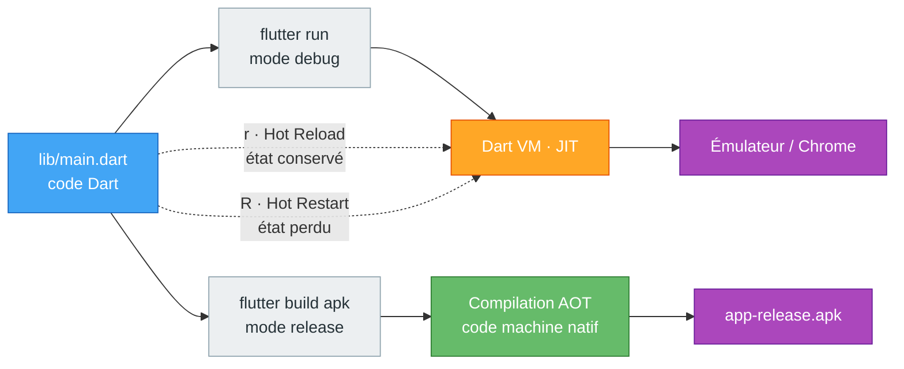

# TP1 — Découverte de Flutter/Dart et lancement de LocalSwap

> **Séance :** 3 h · **Environnement :** Flutter 3.x stable (≥ 3.27), Dart 3, VS Code / Android Studio, émulateur Android ou Chrome
> **Fil rouge :** LocalSwap — création du projet, premier écran, premier commit.

| Repère | Partie | Durée |
|---|---|---|
| 📘🗺️ | Rappel de cours + diagramme | 10 min |
| 🧪 | Partie A : exercices indépendants (5) | 70 min |
| 🏗️ | Partie B : lancement de LocalSwap | 35 min |
| 🤖 | Partie C : comprendre et maîtriser le code | 45 min |
| 📝 | Quiz de fin de TP | 10 min |
| 🎤 | Validation orale (5 min par binôme, **pendant** les parties B et C) | — |
| 🚀 | Partie D : défis bonus | hors temps |
| | **Total** | **170 min** |

Difficulté : 🟢 facile · 🟡 moyen · 🔴 difficile

> [!IMPORTANT]
> **Installation avant la séance.** Le SDK Flutter, un IDE et un émulateur doivent être installés **avant** le TP (machines du labo ou PC personnel). L'exercice 1.1 consiste à **vérifier et diagnostiquer** l'environnement, pas à tout télécharger pendant la séance.

---

## 🎯 Objectifs pédagogiques

À la fin de ce TP, vous serez capable de :

1. **Diagnostiquer** un environnement Flutter avec `flutter doctor` et **corriger** une alerte.
2. **Écrire** de zéro une application minimale (`main` → `runApp` → `MaterialApp` → `Scaffold`).
3. **Prédire** l'effet d'un *Hot Reload* et d'un *Hot Restart* sur l'état d'une application.
4. **Expliquer** le rôle de `pubspec.yaml`, `pubspec.lock` et `analysis_options.yaml`, et **utiliser** `flutter analyze`.
5. **Créer** et **versionner** le projet LocalSwap avec Git.

## 📋 Prérequis

- Bases de la programmation orientée objet (classe, objet, méthode).
- Utilisation d'un terminal (`cd`, `ls`/`dir`) et notions de Git (`init`, `add`, `commit`).

> [!IMPORTANT]
> **Règle sur l'IA (valable tout le semestre).** Vous avez le droit d'utiliser une IA. Mais **60 % de la note** porte sur votre compréhension : Partie C, oral devant votre code, quiz. Un code que vous ne savez pas expliquer ne rapporte presque rien. Si vous utilisez une IA, tenez le **📓 Journal IA** (exercice C7).

---

## 📘 Rappel de cours

> [!NOTE]
> **Flutter** : framework open source de Google pour créer, à partir d'**une seule base de code**, des applications Android, iOS, Web et Desktop. Flutter dessine lui-même chaque pixel de l'interface (moteur de rendu), au lieu d'utiliser les composants natifs de chaque système.
>
> **Dart** : langage orienté objet, typé statiquement, avec *null safety*. Il est compilé de deux façons :
> - **JIT** (*Just In Time*) en développement : compilation à la volée, ce qui permet le Hot Reload ;
> - **AOT** (*Ahead Of Time*) en production : code machine natif, rapide au démarrage.

> [!NOTE]
> **Point d'entrée.** Toute application commence par `main()`, qui appelle `runApp(widgetRacine)`. Le widget racine est en général un **`MaterialApp`** (thème, navigation, style Material Design), dont le `home` est un **`Scaffold`** (structure de page : `appBar`, `body`, bouton flottant…).
>
> **Tout est widget** : un widget est une *description* immuable d'un morceau d'interface. Les widgets s'emboîtent pour former un **arbre de widgets**.

> [!NOTE]
> **Hot Reload (`r`)** : réinjecte le code modifié **sans** redémarrer l'application. La méthode `build()` est réexécutée, mais **l'état est conservé** (les valeurs des variables restent).
> **Hot Restart (`R`)** : redémarre l'application depuis `main()` ; **l'état est perdu**.
> **Arrêt complet + `flutter run`** : nécessaire après un changement de dépendances natives, d'assets ou de configuration Android/iOS.

> [!NOTE]
> **Fichiers clés d'un projet**
> - `lib/main.dart` : votre code (point d'entrée).
> - `pubspec.yaml` : nom, version, dépendances, assets. **Vous** le modifiez.
> - `pubspec.lock` : versions **exactes** résolues par `flutter pub get`. **Généré**, ne jamais le modifier à la main. Pour une application, on le versionne dans Git.
> - `analysis_options.yaml` : règles de qualité (*lints*) vérifiées par `flutter analyze`.
> - `android/`, `ios/`, `web/`… : projets natifs de chaque plateforme.
> - `test/` : tests automatisés (TP9).

> [!TIP]
> Trois commandes à connaître par cœur : `flutter doctor` (diagnostic), `flutter analyze` (qualité du code), `dart format .` (mise en forme automatique).

## 🗺️ Diagramme — Du code Dart à l'application



Légende : 🔵 code source · 🟠 chaîne de développement (debug) · 🟢 chaîne de production (release) · 🟣 cible d'exécution.

---

## 🧪 Partie A — Exercices pédagogiques indépendants (sans LocalSwap) · 70 min

Créez un projet de démonstration ; chaque exercice est dans son propre fichier avec son propre `main()` :

```bash
flutter create tp1_demos
cd tp1_demos
flutter run -t lib/ex2_hello.dart      # lance un exercice précis
```

> [!TIP]
> **Tapez** le code au lieu de le copier-coller, puis répondez aux questions **🔍 Observer & répondre** dans votre compte rendu : elles reviennent à l'oral.

---

### Exercice 1.1 — Carte d'identité de mon environnement 🟢 · 15 min

**Contexte :** un développeur qui rejoint une équipe doit d'abord prouver que son poste est opérationnel.
**Notions nouvelles :** `flutter doctor`, cibles d'exécution (`devices`).

1. Exécutez et conservez la sortie de :
   ```bash
   flutter --version
   dart --version
   flutter doctor -v
   flutter devices
   flutter emulators
   ```
2. Remplissez ce tableau dans votre compte rendu :

| Élément | Valeur sur mon poste |
|---|---|
| Version de Flutter / canal (*channel*) | |
| Version de Dart | |
| Nombre de ✓ / ! / ✗ dans `flutter doctor` | |
| Cibles disponibles (`flutter devices`) | |
| Une alerte (!) et sa cause | |

3. Si une alerte concerne les licences Android, exécutez `flutter doctor --android-licenses`, puis relancez `flutter doctor`.

**🔍 Observer & répondre**

1. Pourquoi `flutter --version` affiche-t-il aussi une version de Dart ? Qui fournit Dart dans votre installation ?
2. `flutter doctor` peut signaler « Visual Studio not installed » sous Windows. Est-ce bloquant pour ce semestre ? Justifiez.
3. Quelle différence faites-vous entre un *device* et un *emulator* dans les sorties précédentes ?

---

### Exercice 1.2 — « Hello ISET » écrit de zéro 🟢 · 15 min

**Contexte :** comprendre le strict minimum d'une application, sans le code d'exemple généré.
**Notions nouvelles :** `main`/`runApp`, `MaterialApp`/`Scaffold`.

Créez `lib/ex2_hello.dart` :

```dart
import 'package:flutter/material.dart'; // bibliothèque des widgets Material

// 1) Point d'entrée de TOUT programme Dart.
void main() {
  // 2) runApp attache le widget racine à l'écran.
  runApp(const HelloApp());
}

// 3) Un widget : une classe qui sait se « décrire » avec build().
class HelloApp extends StatelessWidget {
  const HelloApp({super.key});

  @override
  Widget build(BuildContext context) {
    // 4) MaterialApp : thème + navigation + style Material.
    return MaterialApp(
      title: 'Hello ISET',
      debugShowCheckedModeBanner: false,
      theme: ThemeData(colorScheme: ColorScheme.fromSeed(seedColor: Colors.teal)),
      // 5) Scaffold : la structure d'une page.
      home: Scaffold(
        appBar: AppBar(title: const Text('Hello ISET')),
        body: const Center(
          child: Text(
            'Bonjour, je suis <Prénom> 👋',
            style: TextStyle(fontSize: 24),
          ),
        ),
      ),
    );
  }
}
```

Lancez-le : `flutter run -t lib/ex2_hello.dart`. Remplacez `<Prénom>` par votre prénom.

**🔍 Observer & répondre**

1. Retirez temporairement `runApp(...)` de `main` (gardez `const HelloApp();`). Que voyez-vous ? Pourquoi ?
2. Retirez `Center(...)` pour mettre le `Text` directement dans `body`. Où s'affiche le texte maintenant ?
3. Changez `Colors.teal` en `Colors.deepPurple`. Quels éléments ont changé de couleur, alors que vous n'avez touché qu'**une** ligne ?
4. Lancez le même fichier sur **Chrome** (`-d chrome`). Qu'est-ce qui change, qu'est-ce qui ne change pas ?

---

### Exercice 1.3 — Compteur de cafés : Hot Reload vs Hot Restart 🟡 · 15 min

**Contexte :** observer ce que conservent les deux mécanismes de rechargement.
**Notions nouvelles :** Hot Reload, Hot Restart (le `StatefulWidget` sera expliqué au TP4 ; ici on l'**observe**).

Créez `lib/ex3_coffee.dart` et lancez-le **depuis un terminal** (`flutter run -t lib/ex3_coffee.dart`) pour utiliser les touches `r` et `R` :

```dart
import 'package:flutter/material.dart';

void main() => runApp(const CoffeeApp());

class CoffeeApp extends StatelessWidget {
  const CoffeeApp({super.key});

  @override
  Widget build(BuildContext context) {
    return MaterialApp(
      debugShowCheckedModeBanner: false,
      theme: ThemeData(colorScheme: ColorScheme.fromSeed(seedColor: Colors.brown)),
      home: const CoffeePage(),
    );
  }
}

// Widget avec ÉTAT (mémoire) : expliqué en détail au TP4.
class CoffeePage extends StatefulWidget {
  const CoffeePage({super.key});

  @override
  State<CoffeePage> createState() => _CoffeePageState();
}

class _CoffeePageState extends State<CoffeePage> {
  int _cups = 0; // ← valeur initiale (question 2)

  @override
  Widget build(BuildContext context) {
    return Scaffold(
      appBar: AppBar(title: const Text('Compteur de cafés')),
      body: Center(
        child: Text(
          "Tasses aujourd'hui : $_cups",
          style: Theme.of(context).textTheme.headlineMedium,
        ),
      ),
      floatingActionButton: FloatingActionButton(
        onPressed: () => setState(() => _cups++), // +1 et redessine
        child: const Icon(Icons.coffee),
      ),
    );
  }
}
```

**🔍 Observer & répondre** — avant chaque manipulation, **écrivez votre prédiction**, puis vérifiez.

| # | Manipulation (le compteur est à 3) | Ma prédiction | Observé |
|---|---|---|---|
| 1 | Changer `"Tasses aujourd'hui"` en `"Cafés bus"`, puis `r` | | |
| 2 | Changer `int _cups = 0;` en `int _cups = 10;`, puis `r` | | |
| 3 | Même modification, puis `R` | | |
| 4 | Changer `Colors.brown` en `Colors.orange`, puis `r` | | |

5. Expliquez le résultat de la ligne 2 avec la phrase « l'état est conservé ».

---

### Exercice 1.4 — Anatomie d'un projet et qualité du code 🟢 · 15 min

**Contexte :** un projet professionnel est jugé aussi sur sa configuration et sa qualité, pas seulement sur l'écran.
**Notions nouvelles :** `pubspec.yaml`/`pubspec.lock`, `flutter analyze`.

1. Ouvrez `pubspec.yaml` :
   - modifiez `description:` (une phrase sur le projet) ;
   - lisez `version: 1.0.0+1` : que signifient `1.0.0` et `+1` ? (indice : *versionName* / *versionCode* Android) ;
   - repérez les sections `dependencies` et `dev_dependencies`. Dans laquelle se trouve `flutter_lints` ? Pourquoi ?
2. Exécutez `flutter pub get`, puis ouvrez `pubspec.lock` et cherchez `flutter_lints` : quelle version **exacte** a été choisie ?
3. Dans `lib/ex2_hello.dart`, ajoutez au début de `main()` : `print('démarrage');`. Exécutez :
   ```bash
   flutter analyze
   ```
   Recopiez le message obtenu. Remplacez `print` par `debugPrint` et relancez jusqu'à obtenir `No issues found!`.
4. Désindentez volontairement quelques lignes de `ex2_hello.dart`, puis exécutez `dart format lib/`. Que s'est-il passé ?

**🔍 Observer & répondre**

1. Pourquoi ne faut-il jamais modifier `pubspec.lock` à la main ?
2. `flutter analyze` affiche « info », « warning » ou « error ». Lequel empêche la compilation ?
3. Quel dossier, créé par `flutter run`, ne doit **pas** être versionné dans Git ? Vérifiez dans `.gitignore`.

---

### Exercice 1.5 — Material, Cupertino et thème sombre 🟢 · 10 min

**Contexte :** une même base de code peut adopter le style Android (Material) ou iOS (Cupertino).
**Notions nouvelles :** widgets Cupertino, `darkTheme`/`themeMode`.

`lib/ex5_styles.dart`

```dart
import 'package:flutter/cupertino.dart'; // widgets style iOS
import 'package:flutter/material.dart'; // widgets style Material (Android)

void main() => runApp(const StylesApp());

class StylesApp extends StatelessWidget {
  const StylesApp({super.key});

  @override
  Widget build(BuildContext context) {
    return MaterialApp(
      debugShowCheckedModeBanner: false,
      theme: ThemeData(colorScheme: ColorScheme.fromSeed(seedColor: Colors.indigo)),
      darkTheme: ThemeData(
        colorScheme: ColorScheme.fromSeed(
          seedColor: Colors.indigo,
          brightness: Brightness.dark,
        ),
      ),
      themeMode: ThemeMode.light, // essayez ThemeMode.dark puis ThemeMode.system
      home: Scaffold(
        appBar: AppBar(title: const Text('Material vs Cupertino')),
        body: Center(
          child: Column(
            mainAxisSize: MainAxisSize.min,
            children: [
              FilledButton(onPressed: () {}, child: const Text('Voir (Material)')),
              const SizedBox(height: 16),
              CupertinoButton.filled(
                onPressed: () {},
                child: const Text('Voir (Cupertino)'),
              ),
              const SizedBox(height: 24),
              const CircularProgressIndicator(), // Material
              const SizedBox(height: 16),
              const CupertinoActivityIndicator(), // Cupertino
            ],
          ),
        ),
      ),
    );
  }
}
```

**🔍 Observer & répondre**

1. Décrivez en une ligne la différence visuelle entre les deux boutons (forme, couleur, effet au clic).
2. Passez en `ThemeMode.dark`. Lequel des deux boutons s'adapte au thème ? Pourquoi l'autre non ?
3. Remplacez `onPressed: () {}` par `onPressed: null` sur le bouton Material. Que se passe-t-il ?

---

## 🏗️ Partie B — Lancement du projet LocalSwap · 35 min

> **LocalSwap** : application de troc et d'entraide de quartier. Les habitants publient des annonces (objets, services, covoiturage), les réservent, puis finalisent l'échange. Un système de réputation valorise les membres actifs.
> C'est le **seul projet** du semestre : chaque TP le fait progresser.

### B.1 — Création du projet 🟢

```bash
flutter create --org tn.iset --project-name localswap --platforms android,web localswap
cd localswap
git init
git add .
git commit -m "chore: création du projet LocalSwap"
```

Vérifiez dans `.gitignore` que `build/` et `.dart_tool/` sont ignorés.

### B.2 — Arborescence de départ 🟢

```text
lib/
├── main.dart              ← uniquement main() et LocalSwapApp
└── screens/
    └── ecran_accueil.dart ← premier écran
```

### B.3 — `main.dart` et thème 🟡

Écrivez `main.dart` **de zéro** (supprimez le code du compteur) :
- `LocalSwapApp` est un `StatelessWidget` qui retourne un `MaterialApp` ;
- `title: 'LocalSwap'`, bannière debug masquée ;
- `theme` **et** `darkTheme` créés avec `ColorScheme.fromSeed` à partir d'une **couleur graine** que vous choisissez pour LocalSwap (déclarée une seule fois, en constante) ;
- `themeMode: ThemeMode.system` ;
- `home: const EcranAccueil()`.

### B.4 — Écran d'accueil minimal 🟢

Dans `lib/screens/ecran_accueil.dart`, créez `EcranAccueil` (`StatelessWidget`) : un `Scaffold` avec une `AppBar` « LocalSwap » et, au centre, une icône `Icons.swap_horiz` (taille 96, couleur `primary` du thème) au-dessus du slogan « Échangez près de chez vous ».

> [!TIP]
> Couleur du thème dans un widget : `Theme.of(context).colorScheme.primary`.

### B.5 — Qualité et versionnement 🟢

1. `dart format lib/` puis `flutter analyze` → `No issues found!`
2. Ajoutez un `README.md` : pitch de LocalSwap en 3 lignes, puis la commande pour lancer le projet.
3. Commit : `git commit -am "feat: écran d'accueil et thème LocalSwap"` (utilisez `git add` si de nouveaux fichiers ne sont pas suivis).
4. Faites deux captures d'écran : thème clair et thème sombre.

---

## 🤖 Partie C — Comprendre et maîtriser le code · 45 min

> [!CAUTION]
> Pour C1, C2 et C3, **répondez d'abord sur papier, sans exécuter et sans IA**. Vérifiez ensuite sur machine. À l'oral, l'enseignant vous fera refaire un raisonnement du même type.

### C1 — Prédire avant d'exécuter 🟡 · 8 min

Reprenez `ex3_coffee.dart`, compteur à **5**. Pour chaque manipulation, prédisez l'écran **puis** vérifiez :

1. On remplace `runApp(const CoffeeApp());` par `runApp(const StylesApp());` (en important `ex5_styles.dart`), puis `r`.
2. Même chose, puis `R`.
3. On remplace `_cups++` par `_cups += 2`, puis `r`, puis un clic sur le bouton.
4. On ajoute une faute de syntaxe (un `;` manquant), puis `r`. L'application plante-t-elle ? Que se passe-t-il quand on corrige et relance `r` ?

### C2 — Trouver les bugs 🟢 · 10 min

Un étudiant envoie ce projet qui « ne marche pas ». Il contient **3 erreurs**. Pour chacune : fichier, symptôme, cause, correction.

`pubspec.yaml` (extrait)

```yaml
dependencies:
flutter:
  sdk: flutter

dev_dependencies:
  flutter_lints: ^5.0.0
```

`lib/main.dart`

```dart
import 'package:flutter/material.dart';

void main() {
  const LocalSwapApp();
}

class LocalSwapApp extends StatelessWidget {
  const LocalSwapApp({super.key});

  @override
  Widget build(BuildContext context) {
    return const MaterialApp(
      title: 'LocalSwap',
      home: EcranAccueil,
    );
  }
}

class EcranAccueil extends StatelessWidget {
  const EcranAccueil({super.key});

  @override
  Widget build(BuildContext context) {
    return Scaffold(appBar: AppBar(title: const Text('LocalSwap')));
  }
}
```

### C3 — Critiquer du code généré par une IA 🔴 · 12 min

Un étudiant a demandé à une IA : *« Donne-moi le code d'une application Flutter compteur »*. Voici la réponse, tirée d'exemples anciens. **Elle ne compile pas avec Flutter 3.x.**

```dart
import 'package:flutter/material.dart';

void main() {
  runApp(new MyApp());
}

class MyApp extends StatelessWidget {
  @override
  Widget build(BuildContext context) {
    return new MaterialApp(
      title: 'Flutter Demo',
      theme: new ThemeData(
        primarySwatch: Colors.blue,
        useMaterial3: false,
      ),
      home: new MyHomePage(title: 'Flutter Demo Home Page'),
    );
  }
}

class MyHomePage extends StatefulWidget {
  MyHomePage({Key? key, required this.title}) : super(key: key);

  final String title;

  @override
  _MyHomePageState createState() => _MyHomePageState();
}

class _MyHomePageState extends State<MyHomePage> {
  int _counter = 0;

  void _incrementCounter() {
    setState(() {
      _counter++;
    });
  }

  @override
  Widget build(BuildContext context) {
    return Scaffold(
      appBar: AppBar(title: Text(widget.title)),
      body: Center(
        child: Column(
          mainAxisAlignment: MainAxisAlignment.center,
          children: <Widget>[
            Text('You have pushed the button this many times:'),
            Text('$_counter', style: Theme.of(context).textTheme.headline4),
            RaisedButton(onPressed: _incrementCounter, child: Text('+')),
          ],
        ),
      ),
    );
  }
}
```

1. Lancez `flutter analyze` sur ce fichier. Classez chaque message : 🔴 erreur de compilation, 🟠 API dépréciée / style ancien, 🟡 qualité.
2. Trouvez **au moins 2 problèmes que l'analyseur ne signale pas** (style Material 2, textes non traduits…).
3. Corrigez le code pour qu'il compile **et** respecte Material 3, avec le moins de modifications possible.
4. Rédigez le prompt qui aurait évité ces problèmes (3 contraintes précises).

### C4 — Modifier sous contrainte 🟡 · 5 min

Dans le **code généré par `flutter create`** (`lib/main.dart` de `tp1_demos`), en modifiant **au plus 3 lignes** et sans rien ajouter d'autre :
- le compteur démarre à 10 ;
- le bouton **décrémente** au lieu d'incrémenter ;
- l'icône du bouton devient `Icons.remove`.

Indiquez les numéros des lignes modifiées.

### C5 — Expliquer ligne par ligne 🟢 · 4 min

Recopiez votre `main.dart` de LocalSwap (Partie B) et commentez **chaque ligne** avec vos propres mots. Puis répondez : *« Que se passerait-il si `LocalSwapApp` n'avait pas de `const` devant son constructeur ? »*

### C6 — Exercice papier ✍️ 🟡 · 6 min

**Sans machine :**
1. Dessinez l'**arbre de widgets** de l'application compteur générée par `flutter create`, de `MyApp` jusqu'aux feuilles (`Text`, `Icon`).
2. Sur le diagramme du rappel de cours, entourez le chemin suivi par votre code quand vous appuyez sur `r`, puis celui de `flutter build apk`. Expliquez pourquoi l'application est plus fluide en *release* qu'en *debug*.

### C7 — Journal IA 📓 · tout au long du TP

| # | Exercice | Prompt (copié tel quel) | Ce que j'ai gardé | Ce que j'ai rejeté ou corrigé, et pourquoi |
|---|---|---|---|---|
| 1 | | | | |

---

## 🚀 Partie D — Défis bonus

| Défi | Niveau | Énoncé |
|---|---|---|
| D1 — Appareil réel | 🟢 | Lancez LocalSwap sur votre téléphone Android (mode développeur + débogage USB). Notez les étapes et le temps du premier lancement. |
| D2 — Taille de l'APK | 🟡 | Comparez la taille de `flutter build apk --debug` et `flutter build apk --release`. Expliquez l'écart avec JIT/AOT. |
| D3 — DevTools | 🟡 | Ouvrez Flutter DevTools (lien affiché par `flutter run`) et retrouvez l'arbre de widgets de LocalSwap dans l'*Inspector*. |
| D4 — Lints plus stricts | 🔴 | Dans `analysis_options.yaml`, activez les règles `prefer_single_quotes`, `prefer_const_constructors` et `require_trailing_commas`. Corrigez tout le projet jusqu'à `No issues found!`. |

---

## 🎤 Validation orale (5 min par binôme)

Exemples de questions posées **devant votre poste** :

1. Montrez-moi la sortie de `flutter doctor`. Expliquez une ligne avec « ! ».
2. Je change la valeur initiale du compteur et j'appuie sur `r` : que va-t-il se passer ? Et avec `R` ?
3. Où est le point d'entrée de LocalSwap ? Que fait `runApp` ?
4. **Modifiez en direct** la couleur graine du thème. Pourquoi tous les widgets changent-ils ?
5. À quoi sert `pubspec.lock` ? Faut-il le commiter ? Et le dossier `build/` ?
6. Quelle différence entre `flutter analyze` et la compilation ?
7. Pourquoi l'application est-elle plus lente en debug ?

> [!IMPORTANT]
> Chaque membre du binôme doit pouvoir répondre seul. La note d'oral est **individuelle**.

---

## ✅ Checklist de validation — le TP est réussi si…

- [ ] Le tableau « carte d'identité » (1.1) est rempli, avec au plus des alertes non bloquantes justifiées.
- [ ] Les exercices 1.2 à 1.5 se lancent, et les questions 🔍 ont une réponse.
- [ ] Le tableau de prédictions de l'exercice 1.3 est rempli **avant** les vérifications.
- [ ] Le projet `localswap` existe, avec au moins 2 commits, un `README.md` et un `.gitignore` correct.
- [ ] `flutter analyze` affiche `No issues found!` sur LocalSwap.
- [ ] L'écran d'accueil s'affiche en thème clair et en thème sombre.
- [ ] Les réponses aux exercices C1 à C6 sont rédigées, et le journal IA est tenu si une IA a été utilisée.

## ⚠️ Erreurs fréquentes et corrections

| Symptôme | Cause | Correction |
|---|---|---|
| `Android license status unknown` | Licences du SDK Android non acceptées | `flutter doctor --android-licenses` |
| `No devices found` / `No supported devices connected` | Émulateur non démarré | `flutter emulators --launch <id>` ou lancer l'AVD ; ou `-d chrome` |
| Le Hot Reload « ne marche pas » après une modification de `main()` | `main()` n'est pas réexécuté par le Hot Reload | Hot Restart (`R`) |
| `Error on line X ... pubspec.yaml` | Indentation YAML incorrecte (2 espaces, pas de tabulation) | Réindenter, puis `flutter pub get` |
| `The argument type 'Type' can't be assigned to 'Widget?'` | `home: EcranAccueil` sans parenthèses | `home: const EcranAccueil()` |
| Écran noir ou blanc, aucune erreur | `runApp` jamais appelé | `runApp(const MonApp());` |
| `Avoid print calls in production code` | Lint `avoid_print` | `debugPrint(...)` |
| `Gradle task assembleDebug failed` au premier lancement | Téléchargements Gradle interrompus, proxy, JDK | Relancer avec une bonne connexion ; vérifier le JDK dans `flutter doctor -v` |

## 📝 Quiz de fin de TP · 10 min

**Q1.** Le compteur affiche 4. Vous changez `int _cups = 0;` en `int _cups = 100;` puis faites un **Hot Reload**. Qu'affiche l'écran ?
- A. 100, car le code a été rechargé.
- B. 0, car l'application a redémarré.
- C. 4, car l'état est conservé et l'initialisation n'est pas réexécutée.
- D. Une erreur, car on ne peut pas modifier une variable pendant l'exécution.

**Q2.** Pourquoi l'application est-elle plus fluide et démarre-t-elle plus vite en mode *release* ?
- A. Parce que le code est compilé à l'avance (AOT) en code machine natif.
- B. Parce que le mode release désactive le thème.
- C. Parce que le mode release utilise le Hot Reload.
- D. Parce que Dart est interprété en release.

**Q3.** Un camarade modifie à la main la version de `flutter_lints` dans `pubspec.lock`. Quel est le problème ?
- A. Aucun, c'est la bonne méthode pour changer de version.
- B. Ce fichier est régénéré par `flutter pub get` ; la contrainte de version se change dans `pubspec.yaml`.
- C. `pubspec.lock` ne contient pas de versions.
- D. Il faut aussi supprimer le dossier `lib/`.

**Q4.** `flutter analyze` affiche `No issues found!`. Que peut-on en conclure ?
- A. L'application fonctionne sans bug.
- B. L'application a été testée.
- C. Le code respecte les règles de l'analyseur, mais il peut encore contenir des erreurs de logique.
- D. L'application est prête à être publiée.

**Q5.** Quel est le rôle de `runApp()` ?
- A. Il compile le code Dart.
- B. Il attache le widget racine à l'écran et lance le rendu de l'interface.
- C. Il installe l'application sur l'émulateur.
- D. Il remplace `main()` dans les applications Flutter.

## 📊 Barème indicatif (sur 20)

| Bloc | Détail | Points |
|---|---|---|
| **Code fonctionnel (40 %)** | Partie A : environnement (1.1) + exercices 1.2 à 1.5 lancés | 3 |
| | LocalSwap : projet, arborescence, Git (≥ 2 commits), README | 2 |
| | LocalSwap : `main.dart` + thème clair/sombre + écran d'accueil, `analyze` propre | 3 |
| **Compréhension (60 %)** | C1 Prédire | 1 |
| | C2 Bugs | 1 |
| | C3 Critique du code IA | 1,5 |
| | C4 Modifier sous contrainte | 0,5 |
| | C5 + C6 Explication et papier | 1 |
| | Oral individuel | 5 |
| | Quiz (5 × 0,4) | 2 |
| | **Total** | **20** |

> [!CAUTION]
> Un code fonctionnel que vous ne savez pas expliquer à l'oral est noté au plus **la moitié** des points de son bloc. Du code utilisé sans être déclaré dans le journal IA vaut **0** pour l'exercice concerné.

## 🔜 Vers le TP2

Au TP2, vous apprendrez le langage **Dart** (types, null safety, collections, classes, `async`) et vous créerez les **modèles de données** de LocalSwap : `Annonce`, `Utilisateur`, `Echange`.
