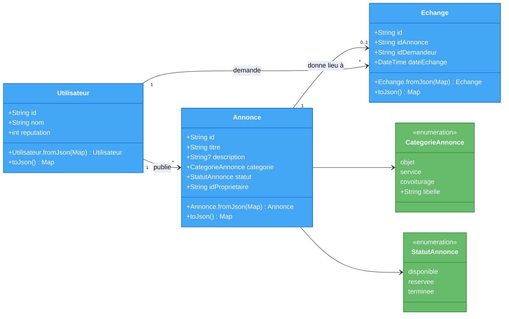

# TP2 — Le langage Dart 3 et les modèles de LocalSwap

> **Séance :** 3 h · **Environnement :** Dart 3 (fourni avec Flutter ≥ 3.27), VS Code / Android Studio, DartPad possible pour la Partie A
> **Fil rouge :** LocalSwap — modèles `Annonce`, `Utilisateur`, `Echange`, chargement simulé des annonces.

| Repère | Partie | Durée |
|---|---|---|
| 📘🗺️ | Rappel de cours + diagramme | 10 min |
| 🧪 | Partie A : exercices indépendants (5) | 70 min |
| 🏗️ | Partie B : modèles LocalSwap | 40 min |
| 🤖 | Partie C : comprendre et maîtriser le code | 45 min |
| 📝 | Quiz de fin de TP | 10 min |
| 🎤 | Validation orale (5 min par binôme, **pendant** les parties B et C) | — |
| 🚀 | Partie D : défis bonus | hors temps |
| | **Total** | **175 min** |

Difficulté : 🟢 facile · 🟡 moyen · 🔴 difficile

---

## 🎯 Objectifs pédagogiques

À la fin de ce TP, vous serez capable de :

1. **Choisir** entre `var`, `final` et `const`, et **sécuriser** un accès à une valeur nullable (`?`, `??`, `?.`, promotion de type).
2. **Transformer** une collection avec `where`, `map`, `fold` et les *collection if/for*.
3. **Utiliser** les nouveautés de Dart 3 : enums enrichis, records, expressions `switch`, patterns et classes `sealed`.
4. **Écrire** une classe immuable avec `fromJson`/`toJson` qui **rejette** un JSON invalide.
5. **Ordonner** l'exécution d'un code asynchrone (`Future`, `async`/`await`, `Future.wait`, `try/catch`).

## 📋 Prérequis

- **TP1** : projet `localswap` créé et versionné, `flutter analyze` maîtrisé.
- Bases de POO : classe, constructeur, méthode, héritage.

> [!IMPORTANT]
> **Règle sur l'IA.** Vous avez le droit d'utiliser une IA. Mais **60 % de la note** porte sur votre compréhension (Partie C, oral, quiz). Tenez le **📓 Journal IA** (C7) si vous l'utilisez.

---

## 📘 Rappel de cours

> [!NOTE]
> **Déclarations**
> - `var` : type **inféré** à la première affectation, puis fixé. Réaffectable.
> - `final` : affecté **une seule fois**, valeur connue à l'**exécution** (`final now = DateTime.now();`).
> - `const` : valeur connue à la **compilation**, profondément immuable, et **partagée** (deux `const` identiques sont le même objet).

> [!NOTE]
> **Null safety** : un type sans `?` ne peut **jamais** valoir `null`.
> - `String?` : peut valoir `null`.
> - `a ?? b` : `a` si non nul, sinon `b`. `x ??= v` : affecte `v` seulement si `x` est nul.
> - `a?.length` : `null` si `a` est nul, sinon `a.length`.
> - `a!` : « je garantis que ce n'est pas nul » ; plante à l'exécution si c'est faux. **À éviter.**
> - **Promotion de type** : après `if (a != null)`, une variable **locale** `a` est traitée comme `String`. Cela ne marche pas sur un champ d'objet : on le copie d'abord dans une variable locale.

> [!NOTE]
> **Collections**
> - `List<T>`, `Set<T>`, `Map<K, V>`.
> - `where` (filtrer), `map` (transformer), `fold`/`reduce` (agréger) retournent souvent un `Iterable` **paresseux** : terminez par `.toList()`.
> - Dans un littéral : `if` et `for` de collection, et l'opérateur *spread* `...`.
> - Fonctions : paramètres positionnels, nommés (`{required String titre}`), optionnels (`[String x = 'défaut']`), fonctions fléchées `=>`, et *tear-off* (`liste.map(mention)` passe la fonction sans l'appeler).

> [!NOTE]
> **Dart 3**
> - **Enum enrichi** : un `enum` peut avoir des champs et un constructeur `const` : `enum Ciel { soleil('☀️'); const Ciel(this.icone); final String icone; }`.
> - **Record** : plusieurs valeurs groupées sans classe : `(double, double)`, `({String ville, double temperature})`.
> - **Expression `switch`** : retourne une valeur ; sur un `enum` ou une classe `sealed`, le compilateur **exige** que tous les cas soient traités.
> - **Patterns** : déstructurer (`final (min, max) = extremes();`), comparer (`< 5`), tester un type (`EnTransit(:final ville)`), vérifier une `Map` (`{'id': String id}`), avec une garde `when`.
> - **`sealed class`** : la liste des sous-classes est **fermée** (même fichier) : idéal pour représenter « chargement / succès / erreur » (TP8).

> [!NOTE]
> **Asynchrone**
> - `Future<T>` : une valeur `T` disponible **plus tard**.
> - `await` suspend la fonction `async` **sans bloquer** le programme ; le reste de l'application continue.
> - Une exception dans un `Future` n'est attrapée par `try/catch` **que si on fait `await`**.
> - `Future.wait([...])` lance plusieurs `Future` **en parallèle** et attend qu'ils soient tous terminés.

> [!NOTE]
> **Modules** : `import 'fichier.dart';` utilise un fichier ; `export 'fichier.dart';` le ré-expose. Un fichier `models.dart` qui exporte tous les modèles devient l'**unique point d'entrée** : `import 'package:localswap/models/models.dart';`.

## 🗺️ Diagramme — Modèle de données LocalSwap



Légende : 🔵 classes immuables (`final` + constructeur `const`) · 🟢 enums.

---

## 🧪 Partie A — Exercices pédagogiques indépendants (sans LocalSwap) · 70 min

Créez un projet **Dart pur** (sans Flutter) ; chaque exercice est un fichier de `bin/` :

```bash
dart create -t console tp2_demos
cd tp2_demos
dart run bin/ex1_fiche.dart
```

> [!TIP]
> Tout fonctionne aussi dans [DartPad](https://dartpad.dev). Mais `dart analyze` sur votre machine vous montre des avertissements que DartPad n'affiche pas toujours.

---

### Exercice 2.1 — Fiche étudiant : types et null safety 🟢 · 12 min

**Notions nouvelles :** `final`/`const`, opérateurs de null safety.

`bin/ex1_fiche.dart`

```dart
void main() {
  // var : type inféré (String), réaffectable
  var nom = 'Amira';
  // nom = 42; // ❌ (1) décommentez : quelle erreur ?
  nom = 'Amira Ben Salah';

  // final : une seule affectation, valeur calculée à l'EXÉCUTION
  final DateTime inscription = DateTime.now();

  // const : valeur connue à la COMPILATION
  const int noteMax = 20;
  // const DateTime debut = DateTime.now(); // ❌ (2) décommentez : pourquoi ?

  // Valeurs pouvant être absentes (simulent une base de données)
  String? telephone = trouverTelephone(nom);
  final String? email = trouverEmail(nom);

  print('Nom : $nom');
  print('Inscrite le ${inscription.day}/${inscription.month}');
  print('Note maximale : $noteMax');

  // print(telephone.length); // ❌ (3) décommentez : quelle erreur ?
  print('Téléphone : ${telephone ?? 'non renseigné'}'); // ??
  print('Longueur du téléphone : ${telephone?.length ?? 0}'); // ?. puis ??

  if (email != null) {
    // Promotion de type : ici, email est un String (plus besoin de !)
    print('Domaine : ${email.split('@').last}');
  }

  telephone ??= '+216 00 000 000'; // affecte seulement si null
  print('Téléphone : $telephone');

  print(initiales('Amira Ben Salah'));
  print(initiales('  '));
  print(initiales(null));
}

String? trouverTelephone(String nom) => null; // pas de téléphone enregistré
String? trouverEmail(String nom) => nom.startsWith('Amira') ? 'amira@iset.tn' : null;

/// Retourne les initiales, ou '?' si le nom est absent ou vide.
String initiales(String? nomComplet) {
  if (nomComplet == null || nomComplet.trim().isEmpty) return '?';
  return nomComplet
      .trim()
      .split(' ')
      .where((mot) => mot.isNotEmpty)
      .map((mot) => mot[0].toUpperCase())
      .join();
}
```

**🔍 Observer & répondre**

1. Décommentez une à une les lignes ❌ (1), (2) et (3). Recopiez chaque erreur et expliquez-la en une phrase.
2. Pourquoi `noteMax` peut-il être `const` alors que `inscription` ne peut être que `final` ?
3. Dans `initiales`, pourquoi peut-on écrire `nomComplet.trim()` sans `!` après le `if` ?
4. Remplacez `telephone ?? 'non renseigné'` par `telephone!`. Que se passe-t-il **à l'exécution** ? Pourquoi l'analyseur ne vous a-t-il pas prévenu ?

---

### Exercice 2.2 — Notes de la classe : collections et fonctions 🟡 · 15 min

**Notions nouvelles :** `where`/`map`/`fold`, paramètres nommés.

`bin/ex2_notes.dart`

```dart
void main() {
  final List<double> notes = [12.5, 8, 15, 17.25, 9.5, 11];
  final Map<String, double> parEtudiant = {
    'Amira': 15,
    'Youssef': 8,
    'Sarra': 17.25,
    'Mehdi': 9.5,
    'Ines': 12.5,
    'Karim': 11,
  };

  // where : FILTRER (résultat paresseux → toList)
  final List<double> admis = notes.where((n) => n >= 10).toList();

  // map : TRANSFORMER. On passe la fonction `mention` sans l'appeler (tear-off).
  final List<String> mentions = notes.map(mention).toList();

  // fold : AGRÉGER en partant de 0
  final double somme = notes.fold(0, (total, n) => total + n);
  final double moyenne = somme / notes.length;

  print('Admis : $admis');
  print('Mentions : $mentions');
  print('Moyenne : ${moyenne.toStringAsFixed(2)}');

  // Parcourir une Map
  for (final entree in parEtudiant.entries) {
    print('${entree.key} → ${entree.value}');
  }

  // Le major de promotion
  final major = parEtudiant.entries.reduce((a, b) => a.value >= b.value ? a : b);
  print('Major : ${major.key} (${major.value})');

  // Collection if / for + spread
  const bool avecRattrapage = true;
  final List<String> calendrier = [
    'Examen principal',
    if (avecRattrapage) 'Session de rattrapage',
    for (final nom in parEtudiant.keys) 'Copie de $nom',
  ];
  final List<String> toutesLesEtapes = [...calendrier, 'Délibération'];
  print(toutesLesEtapes);

  // Paramètres nommés
  print(formaterNote(note: 15, sur: 20));
  print(formaterNote(note: 7.5)); // `sur` prend sa valeur par défaut
}

String mention(double note) {
  if (note >= 16) return 'Très bien';
  if (note >= 14) return 'Bien';
  if (note >= 12) return 'Assez bien';
  if (note >= 10) return 'Passable';
  return 'Ajourné';
}

/// `note` est obligatoire et nommée ; `sur` est optionnelle (20 par défaut).
String formaterNote({required double note, double sur = 20}) =>
    '${note.toStringAsFixed(2)} / ${sur.toStringAsFixed(0)}';
```

**🔍 Observer & répondre**

1. Retirez `.toList()` après `where`. Que devient le type de `admis` ? Qu'affiche `print(admis)` ?
2. Remplacez `notes.map(mention)` par `notes.map(mention())`. Que dit le compilateur ? Pourquoi ?
3. Que retourne `fold` si `notes` est vide ? Et la moyenne ? Corrigez pour afficher « Aucune note ».
4. Écrivez en **une** expression la liste des **noms** des étudiants admis, triés par ordre alphabétique.

---

### Exercice 2.3 — Station météo : enums, records et patterns (Dart 3) 🟡 · 15 min

**Notions nouvelles :** records, expressions `switch` avec patterns.

`bin/ex3_meteo.dart`

```dart
/// Enum enrichi : chaque valeur porte une icône.
enum Ciel {
  soleil('☀️'),
  nuages('☁️'),
  pluie('🌧️'),
  orage('⛈️');

  const Ciel(this.icone);
  final String icone;
}

/// Record nommé : un relevé, sans écrire de classe.
typedef Releve = ({String ville, double temperature, Ciel ciel, int ventKmh});

const List<Releve> releves = [
  (ville: 'Tunis', temperature: 24.5, ciel: Ciel.soleil, ventKmh: 15),
  (ville: 'Bizerte', temperature: 19.0, ciel: Ciel.pluie, ventKmh: 45),
  (ville: 'Tozeur', temperature: 38.0, ciel: Ciel.soleil, ventKmh: 10),
  (ville: 'Tabarka', temperature: 14.0, ciel: Ciel.orage, ventKmh: 70),
  (ville: 'Aïn Draham', temperature: 2.5, ciel: Ciel.nuages, ventKmh: 20),
];

/// Expression switch EXHAUSTIVE sur un enum.
String conseil(Ciel ciel) => switch (ciel) {
      Ciel.soleil => 'Crème solaire',
      Ciel.nuages => 'Petite veste',
      Ciel.pluie => 'Parapluie',
      Ciel.orage => 'Restez à l’intérieur',
    };

/// Patterns sur un record positionnel, avec gardes `when` et pattern relationnel.
String alerte(Releve r) => switch ((r.ciel, r.ventKmh, r.temperature)) {
      (Ciel.orage, _, _) => 'ALERTE : orage',
      (_, final vent, _) when vent >= 60 => 'Vent violent ($vent km/h)',
      (_, _, final t) when t >= 35 => 'Canicule ($t °C)',
      (_, _, < 5.0) => 'Risque de gel',
      _ => 'RAS',
    };

/// Retourne DEUX valeurs grâce à un record positionnel.
(double, double) extremes(List<Releve> liste) {
  var min = liste.first.temperature;
  var max = min;
  for (final r in liste) {
    if (r.temperature < min) min = r.temperature;
    if (r.temperature > max) max = r.temperature;
  }
  return (min, max);
}

void main() {
  for (final releve in releves) {
    // Déstructuration d'un record nommé (ventKmh ignoré avec _)
    final (:ville, :temperature, :ciel, ventKmh: _) = releve;
    print('${ciel.icone} $ville : $temperature °C → ${conseil(ciel)} | ${alerte(releve)}');
  }

  final (min, max) = extremes(releves);
  print('Minimum $min °C, maximum $max °C');
}
```

**🔍 Observer & répondre**

1. Ajoutez une valeur `neige('❄️')` à `Ciel`. Quelle fonction ne compile plus ? Pourquoi est-ce une **bonne** nouvelle ?
2. Dans `alerte`, inversez les deux premières lignes du `switch`. Que devient l'alerte de Tabarka ? Qu'en déduisez-vous sur l'ordre des cas ?
3. Quel avantage a `extremes` qui retourne un record, par rapport à deux fonctions `min()` et `max()` ?

---

### Exercice 2.4 — Bibliothèque : classe immuable et JSON 🟡 · 15 min

**Notions nouvelles :** `fromJson` avec *map pattern*, `copyWith`.

`bin/ex4_livre.dart`

```dart
import 'dart:convert'; // jsonEncode / jsonDecode

enum Genre { roman, informatique, histoire }

/// Classe IMMUABLE : tous les champs sont final, constructeur const.
class Livre {
  const Livre({
    required this.isbn,
    required this.titre,
    required this.genre,
    this.resume,
    this.disponible = true,
  });

  final String isbn;
  final String titre;
  final Genre genre;
  final String? resume; // facultatif
  final bool disponible;

  /// Le map pattern vérifie la PRÉSENCE et le TYPE des champs obligatoires.
  factory Livre.fromJson(Map<String, dynamic> json) {
    return switch (json) {
      {'isbn': String isbn, 'titre': String titre, 'genre': String genre} => Livre(
          isbn: isbn,
          titre: titre,
          genre: Genre.values.byName(genre), // 'roman' → Genre.roman
          resume: json['resume'] as String?,
          disponible: json['disponible'] as bool? ?? true,
        ),
      _ => throw FormatException('Livre JSON invalide : $json'),
    };
  }

  Map<String, dynamic> toJson() => {
        'isbn': isbn,
        'titre': titre,
        'genre': genre.name,
        if (resume != null) 'resume': resume,
        'disponible': disponible,
      };

  /// On ne modifie pas un objet immuable : on crée une COPIE modifiée.
  Livre copyWith({bool? disponible}) => Livre(
        isbn: isbn,
        titre: titre,
        genre: genre,
        resume: resume,
        disponible: disponible ?? this.disponible,
      );

  @override
  String toString() =>
      'Livre($titre, ${genre.name}, ${disponible ? 'disponible' : 'emprunté'})';
}

void main() {
  const texte = '''
[
  {"isbn": "978-1", "titre": "Le Petit Prince", "genre": "roman"},
  {"isbn": "978-2", "titre": "Flutter en action", "genre": "informatique",
   "resume": "Guide pratique", "disponible": false},
  {"isbn": "978-3", "genre": "histoire"}
]''';

  final List<dynamic> donnees = jsonDecode(texte) as List<dynamic>;
  for (final element in donnees) {
    try {
      final Livre livre = Livre.fromJson(element as Map<String, dynamic>);
      print(livre);
    } on FormatException catch (e) {
      print('⚠️ ${e.message}');
    }
  }

  const original = Livre(isbn: '978-1', titre: 'Le Petit Prince', genre: Genre.roman);
  final Livre emprunte = original.copyWith(disponible: false);
  print('$original → $emprunte');

  // Aller-retour : objet → texte JSON → objet
  final String json = jsonEncode(emprunte.toJson());
  print(json);
  final Livre copie = Livre.fromJson(jsonDecode(json) as Map<String, dynamic>);
  print('Même titre et même disponibilité ? '
      '${copie.titre == emprunte.titre && copie.disponible == emprunte.disponible}');
}
```

**🔍 Observer & répondre**

1. Pourquoi le 3ᵉ livre est-il rejeté ? Quelle ligne précise le rejette ?
2. Remplacez `"genre": "roman"` par `"genre": "poesie"` dans le JSON. Quelle exception obtenez-vous ? Est-elle attrapée ? Corrigez pour qu'elle le soit.
3. **Prédisez**, puis vérifiez : `print(copie == emprunte);` et `print(original == const Livre(isbn: '978-1', titre: 'Le Petit Prince', genre: Genre.roman));`.
4. Pourquoi `copyWith` plutôt qu'un champ `disponible` non `final` ?

---

### Exercice 2.5 — Suivi de colis : asynchrone et classe `sealed` 🔴 · 13 min

**Notions nouvelles :** `async`/`await` + `Future.wait`, `sealed class`.

`bin/ex5_colis.dart`

```dart
import 'dart:math';

/// sealed : les sous-classes sont toutes dans CE fichier → switch exhaustif.
sealed class Suivi {
  const Suivi();
}

class EnTransit extends Suivi {
  const EnTransit(this.ville);
  final String ville;
}

class Recu extends Suivi {
  const Recu(this.date);
  final DateTime date;
}

class Introuvable extends Suivi {
  const Introuvable();
}

final Random _hasard = Random();

/// Simule un appel réseau de 300 à 1000 ms, qui échoue si le numéro commence par X.
Future<Suivi> suivreColis(String numero) async {
  await Future.delayed(Duration(milliseconds: 300 + _hasard.nextInt(700)));
  if (numero.startsWith('X')) throw Exception('Serveur indisponible');
  return switch (numero.length) {
    < 5 => const Introuvable(),
    < 8 => const EnTransit('Sousse'),
    _ => Recu(DateTime.now()),
  };
}

/// Switch exhaustif sur la classe sealed, avec déstructuration des champs.
String decrire(Suivi suivi) => switch (suivi) {
      EnTransit(:final ville) => '🚚 En transit à $ville',
      Recu(:final date) => '✅ Reçu à ${date.hour}h${date.minute.toString().padLeft(2, '0')}',
      Introuvable() => '❓ Numéro inconnu',
    };

Future<void> main() async {
  print('Début');

  // 1) Un appel : on ATTEND le résultat
  final Suivi premier = await suivreColis('TN12345');
  print(decrire(premier));

  // 2) Une erreur dans un Future est attrapée grâce à await
  try {
    await suivreColis('X999');
  } catch (e) {
    print('Erreur gérée : $e');
  }

  // 3) Trois appels EN PARALLÈLE
  final chrono = Stopwatch()..start();
  final List<Suivi> resultats = await Future.wait([
    suivreColis('TN1'),
    suivreColis('TN12345'),
    suivreColis('TN12345678'),
  ]);
  print('${resultats.map(decrire).toList()} en ${chrono.elapsedMilliseconds} ms');

  print('Fin');
}
```

**🔍 Observer & répondre**

1. Exécutez 3 fois. Le temps de l'étape 3 est-il proche de la **somme** ou du **maximum** des trois délais ? Réécrivez l'étape 3 avec trois `await` successifs et comparez.
2. Retirez `await` dans l'étape 2. Que se passe-t-il ? Pourquoi le `catch` n'attrape-t-il plus rien ?
3. Ajoutez une sous-classe `Retourne extends Suivi`. Quelle fonction ne compile plus ? Ce comportement existerait-il avec une classe abstraite **non** `sealed` ?

---

## 🏗️ Partie B — Modèles LocalSwap · 40 min

Dans votre projet `localswap` (TP1) :

```text
lib/
├── models/
│   ├── annonce.dart       ← Annonce, CategorieAnnonce, StatutAnnonce, peutReserver()
│   ├── utilisateur.dart
│   ├── echange.dart
│   └── models.dart        ← export des 3 fichiers
└── data/
    └── annonces_test.dart ← chargerAnnonces()
tool/
└── verif_modeles.dart     ← script de vérification (dart run)
```

> [!NOTE]
> Les identifiants **métier** de LocalSwap sont en français (`Annonce`, `titre`…) et le resteront tout le semestre : ce sont eux que les TP suivants utilisent.

### B.1 — Enums 🟢

Dans `annonce.dart` :
- `enum CategorieAnnonce` (`objet`, `service`, `covoiturage`), **enrichi** d'un champ `libelle` (« Objet », « Service », « Covoiturage ») ;
- `enum StatutAnnonce` (`disponible`, `reservee`, `terminee`).

### B.2 — `Annonce` immuable 🟡

- Champs `final` : `id`, `titre`, `description` (`String?`), `categorie`, `statut`, `idProprietaire` ; constructeur `const` à paramètres **nommés**.
- `factory Annonce.fromJson(Map<String, dynamic> json)` avec un **map pattern** : lève une `FormatException` si un champ obligatoire manque ou a le mauvais type ; enums lus avec `values.byName`.
- `Map<String, dynamic> toJson()` (enums écrits avec `.name`, `description` omise si nulle).
- `toString()` lisible.
- Fonction top-level : `bool peutReserver(Annonce annonce)` → `true` uniquement si le statut est `disponible`. Écrivez-la **en une ligne**.

> [!TIP]
> Pas de `copyWith` pour l'instant : vous l'ajouterez au TP4, au moment où l'application en aura besoin.

### B.3 — `Utilisateur` et `Echange` 🟢

- `Utilisateur` : `id`, `nom`, `reputation` (entier de 0 à 5). Ajoutez dans le constructeur `assert(reputation >= 0 && reputation <= 5)`.
- `Echange` : `id`, `idAnnonce`, `idDemandeur`, `dateEchange` (`DateTime`). En JSON, la date est une chaîne **ISO 8601** (`toIso8601String()` / `DateTime.parse`).
- `fromJson` / `toJson` pour les deux, sur le même modèle qu'`Annonce`.

### B.4 — `models.dart` 🟢

Un seul fichier qui `export` les trois modèles. Partout ailleurs, on importera **uniquement** `package:localswap/models/models.dart`.

### B.5 — Chargement simulé 🟡

Dans `lib/data/annonces_test.dart` :
- une constante `String` contenant un **tableau JSON de 6 annonces** variées (3 catégories, 3 statuts, au moins une sans description) ;
- `Future<List<Annonce>> chargerAnnonces()` : attend 800 ms (`Future.delayed`), décode le JSON, convertit chaque élément avec `Annonce.fromJson` et retourne une liste **non modifiable** (`List.unmodifiable`).

### B.6 — Script de vérification 🟡

`tool/verif_modeles.dart` (lancé avec `dart run tool/verif_modeles.dart`) :
1. charge les annonces et affiche leur nombre et le temps écoulé ;
2. affiche le nombre d'annonces **réservables** (avec `where` + `peutReserver`) ;
3. affiche le nombre d'annonces **par catégorie** (une `Map<CategorieAnnonce, int>`) ;
4. fait un **aller-retour JSON** sur une annonce et vérifie que les champs sont identiques ;
5. vérifie qu'un JSON sans `titre` lève bien une `FormatException`.

> [!WARNING]
> `flutter_lints` interdit `print` (`avoid_print`). Pour ce **script en ligne de commande**, ajoutez en première ligne `// ignore_for_file: avoid_print` et justifiez-le en commentaire. Dans `lib/`, `print` reste interdit.

Terminez par `flutter analyze` (aucun problème) et un commit : `feat: modèles de données LocalSwap`.

---

## 🤖 Partie C — Comprendre et maîtriser le code · 45 min

> [!CAUTION]
> Pour C1, C2 et C3, **répondez d'abord sur papier, sans exécuter et sans IA**. Vérifiez ensuite sur machine.

### C1 — Prédire avant d'exécuter 🟡 · 10 min

Écrivez **exactement** ce qu'affiche chaque programme (ou « erreur de compilation » / « exception » avec son type).

```dart
// C1.a
Future<void> main() async {
  print('A');
  final f = Future.delayed(Duration.zero, () => print('B'));
  print('C');
  await f;
  print('D');
  Future(() => print('E'));
  print('F');
}
```

```dart
// C1.b
void main() {
  final liste1 = [1, 2];
  liste1.add(3);
  print(liste1);

  const liste2 = [1, 2];
  print(identical(liste2, const [1, 2]));
  liste2.add(3);
  print(liste2);
}
```

```dart
// C1.c
void main() {
  String? ville;
  final longueur = ville?.length ?? -1;
  print(longueur);
  ville ??= 'Bizerte';
  ville ??= 'Tunis';
  print('${ville.length} $ville');
}
```

```dart
// C1.d
String classer(Object valeur) => switch (valeur) {
      int n when n < 0 => 'négatif',
      int() => 'entier',
      String(:final length) when length > 3 => 'long texte',
      String() => 'texte',
      (int a, int b) => 'paire ${a + b}',
      _ => 'autre',
    };

void main() {
  print([classer(-4), classer(7), classer('ok'), classer('Bizerte'), classer((2, 3)), classer(1.5)]);
}
```

### C2 — Trouver les bugs 🟡 · 10 min

Ce programme compile, mais son comportement est faux. Il contient **3 erreurs**. Pour chacune : ligne, symptôme, cause, correction.

```dart
Future<int> chargerNombre(bool echec) async {
  await Future.delayed(const Duration(milliseconds: 100));
  if (echec) throw Exception('réseau');
  return 42;
}

Future<void> main() async {
  // Partie 1
  try {
    chargerNombre(true);
  } catch (e) {
    print('Erreur gérée : $e');
  }

  // Partie 2
  final villes = ['Tunis', 'Sfax', 'Gabès'];
  villes.forEach((v) async {
    await Future.delayed(const Duration(milliseconds: 50));
    print('Ville traitée : $v');
  });
  print('Toutes les villes sont traitées');

  // Partie 3
  final Map<String, int> stock = {'stylo': 3};
  final int cahiers = stock['cahier']!;
  print('Cahiers : $cahiers');
}
```

> [!TIP]
> Lancez `dart analyze`. Lequel des 3 bugs est signalé, et le message explique-t-il **vraiment** le bug ?

### C3 — Critiquer du code généré par une IA 🔴 · 12 min

Prompt d'un étudiant : *« Écris une classe Dart Annonce pour une application de troc avec fromJson et toJson »*. Réponse de l'IA :

```dart
class Annonce {
  String id;
  String titre;
  String description;
  String categorie; // 'objet', 'service', 'covoiturage'
  String statut;
  DateTime date;

  Annonce(this.id, this.titre, this.description, this.categorie, this.statut, this.date);

  Annonce.fromJson(Map json)
      : id = json['id'],
        titre = json['titre'],
        description = json['description'],
        categorie = json['categorie'],
        statut = json['statut'],
        date = DateTime.parse(json['date']);

  Map toJson() => {
        'id': id,
        'titre': titre,
        'description': description,
        'categorie': categorie,
        'statut': statut,
        'date': date.toString(),
      };

  bool estDisponible() {
    if (statut == 'Disponible') return true;
    else return false;
  }
}
```

1. Trouvez **au moins 7 problèmes**, classés : 🔴 bug (comportement faux ou plantage), 🟠 non-respect de Dart 3 / null safety, 🟡 qualité.
2. Donnez un JSON **réaliste** qui fait planter `fromJson`, et un autre qui fait répondre `estDisponible()` de travers.
3. Comparez avec votre `Annonce` de la Partie B : listez 3 choix de votre version qui évitent ces problèmes.
4. Écrivez le prompt qui aurait produit une bonne classe dès le départ.

### C4 — Modifier sous contrainte 🟡 · 6 min

1. Dans **LocalSwap**, ajoutez la catégorie `evenement` (« Événement ») à `CategorieAnnonce`. Listez **tous** les endroits que le compilateur ou `flutter analyze` vous oblige à modifier. Combien y en a-t-il ? Annulez ensuite la modification.
2. Dans l'exercice 2.2, modifiez **une seule expression** pour que `moyenne` vaille `0` quand la liste est vide (sans `if`).

### C5 — Expliquer ligne par ligne 🟢 · 4 min

Recopiez votre `Annonce.fromJson` et commentez **chaque ligne** avec vos propres mots. Répondez : *« Que se passe-t-il si le JSON contient `"statut": "Disponible"` (avec une majuscule) ? Est-ce le bon comportement ? »*

### C6 — Exercice papier ✍️ 🟡 · 5 min

Sans machine, complétez le tableau pour la fonction `alerte` de l'exercice 2.3 :

| `ciel` | `ventKmh` | `temperature` | Cas qui s'applique | Résultat |
|---|---|---|---|---|
| `pluie` | 80 | 40 | | |
| `orage` | 10 | 40 | | |
| `soleil` | 30 | 36 | | |
| `nuages` | 10 | 5 | | |
| `nuages` | 10 | -1 | | |

### C7 — Journal IA 📓

| # | Exercice | Prompt (copié tel quel) | Ce que j'ai gardé | Ce que j'ai rejeté ou corrigé, et pourquoi |
|---|---|---|---|---|
| 1 | | | | |

---

## 🚀 Partie D — Défis bonus

| Défi | Niveau | Énoncé |
|---|---|---|
| D1 — Égalité de valeur | 🟡 | Redéfinissez `==` et `hashCode` dans `Annonce` (égalité sur `id`). Vérifiez que `{a1, a1Copie}` (un `Set`) ne contient qu'un élément. |
| D2 — Extension | 🟢 | Écrivez `extension StatsAnnonces on List<Annonce>` avec un getter `reservables` et une méthode `parCategorie()`. Réécrivez `tool/verif_modeles.dart` avec. |
| D3 — Résultat typé | 🔴 | Créez `sealed class Resultat<T>` avec `Succes<T>(T valeur)` et `Echec<T>(String message)`. Écrivez `Future<Resultat<List<Annonce>>> chargerAnnoncesSur()` qui ne lève jamais d'exception. Vous la retrouverez au TP8. |
| D4 — Stream | 🔴 | Écrivez `Stream<int> compteARebours(int depart)` avec `async*` et `yield`, et consommez-le avec `await for`. |

---

## 🎤 Validation orale (5 min par binôme)

1. Pourquoi les champs d'`Annonce` sont-ils `final` ? Comment change-t-on le statut d'une annonce, alors ?
2. `const` ou `final` pour `DateTime.now()` ? Et pour la liste des catégories ?
3. **Montrez** votre `fromJson`. Que se passe-t-il si `titre` manque ? Et si `description` manque ?
4. **Ajoutez en direct** un statut `annulee`. Que dit le compilateur ?
5. Pourquoi un `enum` plutôt qu'un `String` pour le statut ?
6. Dans `chargerAnnonces`, que se passe-t-il si on retire `await` devant `Future.delayed` ?
7. Que fait `Future.wait` ? Pourquoi est-ce plus rapide que trois `await` à la suite ?
8. Expliquez `telephone?.length ?? 0` à quelqu'un qui ne connaît pas Dart.

> [!IMPORTANT]
> La note d'oral est **individuelle**.

---

## ✅ Checklist de validation — le TP est réussi si…

- [ ] Les 5 exercices de la Partie A s'exécutent, et les questions 🔍 ont une réponse.
- [ ] `lib/models/` contient les 3 modèles + `models.dart`, avec des champs `final` et des enums.
- [ ] `fromJson` rejette un JSON incomplet avec une `FormatException`.
- [ ] `dart run tool/verif_modeles.dart` affiche les 5 vérifications correctement.
- [ ] `flutter analyze` affiche `No issues found!`.
- [ ] Un commit `feat: modèles de données LocalSwap` est présent.
- [ ] Les réponses aux exercices C1 à C6 sont rédigées, et le journal IA est tenu si une IA a été utilisée.

## ⚠️ Erreurs fréquentes et corrections

| Symptôme | Cause | Correction |
|---|---|---|
| `A value of type 'String?' can't be assigned to 'String'` | Valeur nullable utilisée là où il faut une valeur sûre | `??`, test `if (x != null)`, ou rendre le type nullable |
| `Null check operator used on a null value` | `!` sur une valeur nulle | Supprimer `!` et traiter le cas `null` |
| `The property 'x' can't be unconditionally accessed` sur un **champ** après un `if` | Pas de promotion de type sur les champs | Copier dans une variable locale : `final d = annonce.description;` |
| `type 'Null' is not a subtype of type 'String'` dans `fromJson` | Champ absent du JSON, cast direct | Map pattern ou `as String?` + gestion de l'absence |
| `Invalid argument (name): No enum value with that name` | `byName` avec une valeur inconnue | Attraper l'erreur et la convertir en `FormatException` |
| `print` exécuté avant la fin du traitement | `await` oublié, ou `forEach` avec une fonction `async` | `await` ; `for (final x in liste) { await ... }` |
| Exception non attrapée malgré `try/catch` | `Future` non attendu dans le `try` | `await` dans le `try` |
| `Unsupported operation: Cannot add to an unmodifiable list` | Liste `const` ou `List.unmodifiable` | Copier : `List.of(liste)` |
| `The type 'X' is not exhaustively matched` | Cas manquant dans un `switch` sur un enum ou une classe sealed | Ajouter le cas (c'est voulu !) |

## 📝 Quiz de fin de TP · 10 min

**Q1.** Quelle déclaration est **impossible** ?
- A. `final now = DateTime.now();`
- B. `const now = DateTime.now();`
- C. `const max = 20;`
- D. `final List<int> notes = [];` suivi de `notes.add(12);`

**Q2.** `String? ville;` (valeur `null`). Que vaut `ville?.length ?? 0` ?
- A. Une exception, car `ville` est nul.
- B. `null`.
- C. `0`.
- D. Erreur de compilation.

**Q3.** Que garantit une expression `switch` sur un `enum` sans cas `_` ?
- A. Qu'elle est plus rapide qu'un `if`.
- B. Que le programme ne compile plus si une valeur de l'enum n'est pas traitée.
- C. Que les cas sont triés automatiquement.
- D. Qu'aucune exception ne peut être levée.

**Q4.** Dans un `try`, on écrit `chargerAnnonces();` **sans** `await`, et la fonction lève une exception. Que se passe-t-il ?
- A. L'exception est attrapée par le `catch`.
- B. L'exception est ignorée silencieusement.
- C. Le programme ne compile pas.
- D. Le `catch` ne l'attrape pas : l'exception survient plus tard, hors du `try`.

**Q5.** Pourquoi déclarer `Suivi` comme `sealed class` plutôt que comme `abstract class` ?
- A. Pour que le compilateur connaisse la liste complète des sous-classes et vérifie l'exhaustivité des `switch`.
- B. Pour interdire de créer des objets `EnTransit`.
- C. Pour rendre les objets immuables.
- D. Parce que `abstract` n'existe plus en Dart 3.

## 📊 Barème indicatif (sur 20)

| Bloc | Détail | Points |
|---|---|---|
| **Code fonctionnel (40 %)** | Partie A : 5 exercices exécutés + réponses 🔍 | 2 |
| | `Annonce` + enums + `peutReserver` (immuable, map pattern, JSON) | 3 |
| | `Utilisateur`, `Echange`, `models.dart`, `chargerAnnonces()` | 2 |
| | Script de vérification + `analyze` propre + commit | 1 |
| **Compréhension (60 %)** | C1 Prédire | 1 |
| | C2 Bugs | 1 |
| | C3 Critique du code IA | 1,5 |
| | C4 Modifier sous contrainte | 0,5 |
| | C5 + C6 Explication et papier | 1 |
| | Oral individuel | 5 |
| | Quiz (5 × 0,4) | 2 |
| | **Total** | **20** |

> [!CAUTION]
> Un code fonctionnel que vous ne savez pas expliquer à l'oral est noté au plus **la moitié** des points de son bloc. Du code utilisé sans être déclaré dans le journal IA vaut **0** pour l'exercice concerné.

## 🔜 Vers le TP3

Au TP3, vous construirez l'**écran d'accueil** de LocalSwap avec les widgets de mise en page, et un premier **gabarit visuel** de carte d'annonce. Les modèles d'aujourd'hui y seront affichés au TP4.
