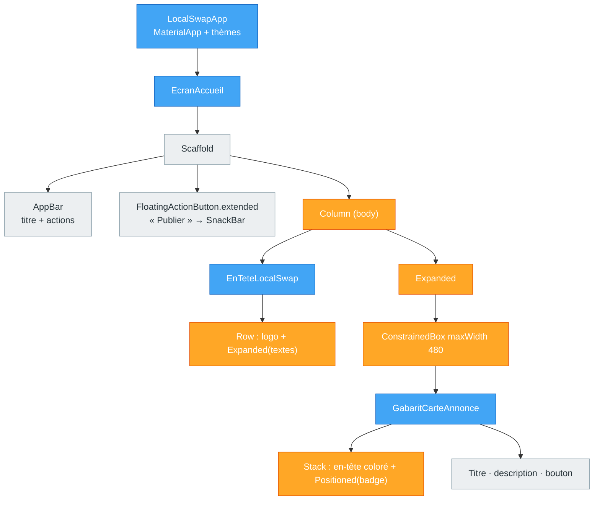

# TP3 — Widgets fondamentaux, mise en page et Material 3

> **Séance :** 3 h · **Environnement :** Flutter 3.x stable (≥ 3.27), Dart 3, VS Code / Android Studio, émulateur Android ou Chrome
> **Fil rouge :** LocalSwap — écran d'accueil, en-tête et premier gabarit visuel de carte d'annonce.

| Repère | Partie | Durée |
|---|---|---|
| 📘🗺️ | Rappel de cours + diagramme | 10 min |
| 🧪 | Partie A : exercices indépendants (5) | 70 min |
| 🏗️ | Partie B : écran d'accueil LocalSwap | 40 min |
| 🤖 | Partie C : comprendre et maîtriser le code | 45 min |
| 📝 | Quiz de fin de TP | 10 min |
| 🎤 | Validation orale (5 min par binôme, **pendant** les parties B et C) | — |
| 🚀 | Partie D : défis bonus | hors temps |
| | **Total** | **175 min** |

Difficulté : 🟢 facile · 🟡 moyen · 🔴 difficile

---

## 🎯 Objectifs pédagogiques

À la fin de ce TP, vous serez capable de :

1. **Expliquer** la règle de mise en page de Flutter (« les contraintes descendent, les tailles remontent, le parent positionne ») et **prédire** la taille d'un widget.
2. **Composer** une interface avec `Container`, `Padding`, `Center`, `Column`, `Row`, `Expanded` et `Stack`.
3. **Afficher** une image réseau ou locale avec gestion du chargement et de l'erreur.
4. **Styliser** sans valeur en dur, avec `Theme.of(context).colorScheme` et `textTheme`.
5. **Assembler** une page Material (`Scaffold`, `AppBar`, FAB, `SnackBar`) qui s'adapte à l'orientation avec `MediaQuery`.

## 📋 Prérequis

- **TP1** : projet `localswap`, `main.dart` avec thème clair/sombre, `EcranAccueil` minimal.
- **TP2** : modèles LocalSwap (non utilisés pour l'affichage avant le TP4).

> [!IMPORTANT]
> **Règle sur l'IA.** Vous avez le droit d'utiliser une IA. Mais **60 % de la note** porte sur votre compréhension (Partie C, oral, quiz). Tenez le **📓 Journal IA** (C7) si vous l'utilisez.

---

## 📘 Rappel de cours

> [!IMPORTANT]
> **La règle d'or de la mise en page Flutter**
> 1. **Les contraintes descendent** : le parent dit à l'enfant « tu peux mesurer entre *min* et *max* ».
> 2. **Les tailles remontent** : l'enfant choisit sa taille **dans** ces limites et la renvoie au parent.
> 3. **Le parent positionne** : le parent décide où placer l'enfant.
>
> Conséquence : un widget ne connaît pas sa position, et ne peut pas être plus grand que ce que son parent autorise. La plupart des erreurs de layout (*overflow*, *unbounded*) viennent de là.

> [!NOTE]
> **Widgets de base**
> - `Text` : texte, stylé avec `style:` ; préférez les rôles du thème : `Theme.of(context).textTheme.titleLarge`, `bodyMedium`…
> - `Image.network` / `Image.asset` : image depuis une URL ou depuis un fichier déclaré dans `pubspec.yaml` ; `fit:` (`BoxFit.cover`, `contain`, `fill`).
> - `Container` : boîte « tout-en-un » (taille, `padding`, `margin`, `decoration`). Sans enfant ni taille, il prend **toute la place** autorisée.
> - `Padding`, `Center`, `SizedBox` : un seul rôle chacun (plus lisible qu'un `Container`).

> [!NOTE]
> **Flex : `Column` et `Row`**
> - **Axe principal** (vertical pour `Column`, horizontal pour `Row`) : `mainAxisAlignment`.
> - **Axe secondaire** : `crossAxisAlignment`.
> - `Expanded(flex: n)` : l'enfant prend une part de l'espace **restant** ; `Spacer()` : un espace vide extensible.
> - Un enfant sans `Expanded` prend sa taille naturelle ; s'il est trop grand → bandes jaunes et noires (*overflow*).

> [!NOTE]
> **`Stack` + `Positioned`** : superposition ; le premier enfant est dessous. `Positioned(top:, right:, …)` place un enfant par rapport aux bords du `Stack`. Les enfants non positionnés déterminent la taille du `Stack`.

> [!NOTE]
> **Page Material** : `Scaffold` (structure) → `appBar` (titre + `actions`), `body`, `floatingActionButton`. `ScaffoldMessenger.of(context).showSnackBar(...)` affiche un message temporaire.
> **`MediaQuery.sizeOf(context)`** : taille de l'écran en *pixels logiques* (dp), pour adapter la mise en page (portrait/paysage, téléphone/tablette).

> [!TIP]
> **Material 3 et couleurs** : toutes les couleurs viennent de `Theme.of(context).colorScheme` (`primary`, `onPrimary`, `primaryContainer`, `surface`, `error`…). La règle : un texte posé sur `xxx` utilise `onXxx`. Ainsi, le mode sombre fonctionne **sans changer le code**.

## 🗺️ Diagramme — Arbre de widgets de l'écran d'accueil LocalSwap



Légende : 🔵 vos widgets · 🟠 widgets de mise en page · ⚪ widgets Material du framework.

---

## 🧪 Partie A — Exercices pédagogiques indépendants (sans LocalSwap) · 70 min

```bash
flutter create tp3_demos
cd tp3_demos
flutter run -t lib/ex1_business_card.dart
```

> [!TIP]
> **Tapez** le code, puis répondez aux questions **🔍** dans votre compte rendu. Activez **Flutter Inspector → Show Guidelines** (*Debug Paint*) pour voir les boîtes.

---

### Exercice 3.1 — Carte de visite : Container et textTheme 🟢 · 12 min

**Notions nouvelles :** `Container` + `BoxDecoration`, rôles typographiques `textTheme`.

`lib/ex1_business_card.dart`

```dart
import 'package:flutter/material.dart';

void main() => runApp(const BusinessCardApp());

class BusinessCardApp extends StatelessWidget {
  const BusinessCardApp({super.key});

  @override
  Widget build(BuildContext context) {
    return MaterialApp(
      debugShowCheckedModeBanner: false,
      theme: ThemeData(colorScheme: ColorScheme.fromSeed(seedColor: Colors.blueGrey)),
      home: const Scaffold(body: Center(child: BusinessCard())),
    );
  }
}

class BusinessCard extends StatelessWidget {
  const BusinessCard({super.key});

  @override
  Widget build(BuildContext context) {
    final ColorScheme colors = Theme.of(context).colorScheme;
    final TextTheme text = Theme.of(context).textTheme;

    return Container(
      width: 320,
      padding: const EdgeInsets.all(20), // espace INTÉRIEUR
      margin: const EdgeInsets.all(16), // espace EXTÉRIEUR
      decoration: BoxDecoration(
        color: colors.primaryContainer,
        borderRadius: BorderRadius.circular(16),
        border: Border.all(color: colors.primary, width: 2),
        boxShadow: const [
          BoxShadow(color: Colors.black26, blurRadius: 12, offset: Offset(0, 6)),
        ],
      ),
      child: Column(
        mainAxisSize: MainAxisSize.min, // la colonne prend la hauteur de son contenu
        crossAxisAlignment: CrossAxisAlignment.start,
        children: [
          Text(
            'Sarra Jlassi',
            style: text.headlineSmall?.copyWith(
              color: colors.onPrimaryContainer,
              fontWeight: FontWeight.bold,
            ),
          ),
          Text(
            'Développeuse Flutter',
            style: text.titleMedium?.copyWith(color: colors.onPrimaryContainer),
          ),
          const SizedBox(height: 12),
          Text('sarra.jlassi@exemple.tn', style: text.bodyMedium),
          Text('+216 71 000 000', style: text.bodyMedium),
          const SizedBox(height: 12),
          Text(
            'Spécialiste des applications mobiles multiplateformes, '
            'passionnée par le design et l’accessibilité.',
            maxLines: 2,
            overflow: TextOverflow.ellipsis,
            style: text.bodySmall?.copyWith(fontStyle: FontStyle.italic),
          ),
        ],
      ),
    );
  }
}
```

**🔍 Observer & répondre**

1. Avec *Debug Paint* activé, repérez la `margin` et le `padding`. Échangez leurs valeurs (`4` et `40`) : qu'est-ce qui change visuellement ?
2. Retirez `width: 320`. Quelle largeur prend la carte ? Expliquez avec la règle « contraintes / tailles ».
3. Dans les paramètres de l'émulateur, augmentez la **taille de police** du système. Les textes grandissent-ils ? Que risque-t-il d'arriver au dernier texte sans `maxLines` ?
4. Pourquoi `text.headlineSmall?.copyWith(...)` contient-il un `?` ?

---

### Exercice 3.2 — Fiche produit : images réseau et locales 🟡 · 15 min

**Notions nouvelles :** `Image.network` (chargement/erreur), `Image.asset` + `BoxFit`.

1. Placez une image de votre choix dans `assets/images/sac.png`.
2. Déclarez le dossier dans `pubspec.yaml` (indentation : **2 espaces**), puis faites un **arrêt complet** et relancez :

```yaml
flutter:
  uses-material-design: true
  assets:
    - assets/images/
```

`lib/ex2_product_images.dart`

```dart
import 'package:flutter/material.dart';

void main() => runApp(const ProductApp());

class ProductApp extends StatelessWidget {
  const ProductApp({super.key});

  @override
  Widget build(BuildContext context) {
    return MaterialApp(
      debugShowCheckedModeBanner: false,
      theme: ThemeData(colorScheme: ColorScheme.fromSeed(seedColor: Colors.amber)),
      home: const ProductPage(),
    );
  }
}

class ProductPage extends StatelessWidget {
  const ProductPage({super.key});

  @override
  Widget build(BuildContext context) {
    final ColorScheme colors = Theme.of(context).colorScheme;

    return Scaffold(
      appBar: AppBar(title: const Text('Sac de randonnée')),
      body: Column(
        children: [
          // 1) Image réseau : on gère le chargement ET l'erreur
          Image.network(
            'https://picsum.photos/seed/sac/800/500',
            height: 200,
            width: double.infinity,
            fit: BoxFit.cover,
            loadingBuilder: (context, child, progress) {
              if (progress == null) return child; // chargement terminé
              final int? total = progress.expectedTotalBytes;
              return SizedBox(
                height: 200,
                child: Center(
                  child: CircularProgressIndicator(
                    value: total == null ? null : progress.cumulativeBytesLoaded / total,
                  ),
                ),
              );
            },
            errorBuilder: (context, error, stackTrace) => Container(
              height: 200,
              color: colors.errorContainer,
              alignment: Alignment.center,
              child: Icon(Icons.wifi_off, size: 48, color: colors.onErrorContainer),
            ),
          ),
          const SizedBox(height: 24),
          // 2) Image locale avec trois valeurs de BoxFit
          Row(
            mainAxisAlignment: MainAxisAlignment.spaceEvenly,
            children: [
              for (final BoxFit fit in [BoxFit.cover, BoxFit.contain, BoxFit.fill])
                Column(
                  children: [
                    Container(
                      width: 100,
                      height: 100,
                      decoration: BoxDecoration(border: Border.all(color: colors.outline)),
                      child: Image.asset('assets/images/sac.png', fit: fit),
                    ),
                    const SizedBox(height: 4),
                    Text(fit.name),
                  ],
                ),
            ],
          ),
        ],
      ),
    );
  }
}
```

**🔍 Observer & répondre**

1. Coupez le Wi-Fi de l'émulateur (mode avion) puis faites un Hot Restart. Que s'affiche-t-il ? Que se passerait-il sans `errorBuilder` ?
2. Décrivez en une phrase chacun des trois `BoxFit`. Lequel déforme l'image ?
3. Retirez la déclaration `assets:` du `pubspec.yaml` et relancez. Quel message obtenez-vous, et **quand** (compilation ou exécution) ?

---

### Exercice 3.3 — Ticket de bus : Row, Column, Expanded 🟡 · 15 min

**Notions nouvelles :** axes principal/secondaire, `Expanded(flex:)` et `Spacer`.

`lib/ex3_bus_ticket.dart`

```dart
import 'package:flutter/material.dart';

void main() => runApp(const TicketApp());

class TicketApp extends StatelessWidget {
  const TicketApp({super.key});

  @override
  Widget build(BuildContext context) {
    return MaterialApp(
      debugShowCheckedModeBanner: false,
      theme: ThemeData(colorScheme: ColorScheme.fromSeed(seedColor: Colors.green)),
      home: const Scaffold(body: Center(child: BusTicket())),
    );
  }
}

class BusTicket extends StatelessWidget {
  const BusTicket({super.key});

  @override
  Widget build(BuildContext context) {
    final ColorScheme colors = Theme.of(context).colorScheme;
    final TextTheme text = Theme.of(context).textTheme;

    return Container(
      margin: const EdgeInsets.all(16),
      padding: const EdgeInsets.all(16),
      decoration: BoxDecoration(
        color: colors.surfaceContainerHigh,
        borderRadius: BorderRadius.circular(16),
      ),
      child: Column(
        mainAxisSize: MainAxisSize.min,
        children: [
          // Ligne 1 : icône + compagnie ... prix tout à droite
          Row(
            children: [
              Icon(Icons.directions_bus, color: colors.primary),
              const SizedBox(width: 8),
              Text('SRT Bizerte · Ligne 20', style: text.titleMedium),
              const Spacer(), // pousse le prix à droite
              Text(
                '2,500 DT',
                style: text.titleMedium?.copyWith(fontWeight: FontWeight.bold),
              ),
            ],
          ),
          const Divider(height: 24),
          // Ligne 2 : départ → arrivée, chaque côté prend la moitié de l'espace restant
          const Row(
            children: [
              Expanded(child: StopInfo(label: 'Départ', city: 'Bizerte', time: '07:00')),
              Icon(Icons.arrow_forward),
              Expanded(
                child: StopInfo(label: 'Arrivée', city: 'Tunis', time: '08:15', alignEnd: true),
              ),
            ],
          ),
          const SizedBox(height: 16),
          // Ligne 3 : répartition 2 / 1 / 1
          const Row(
            children: [
              Expanded(flex: 2, child: InfoCell(title: 'Passager', value: 'Mehdi Gharbi')),
              Expanded(child: InfoCell(title: 'Siège', value: '14B')),
              Expanded(child: InfoCell(title: 'Quai', value: '3')),
            ],
          ),
        ],
      ),
    );
  }
}

class StopInfo extends StatelessWidget {
  const StopInfo({
    super.key,
    required this.label,
    required this.city,
    required this.time,
    this.alignEnd = false,
  });

  final String label;
  final String city;
  final String time;
  final bool alignEnd;

  @override
  Widget build(BuildContext context) {
    final TextTheme text = Theme.of(context).textTheme;
    return Column(
      crossAxisAlignment: alignEnd ? CrossAxisAlignment.end : CrossAxisAlignment.start,
      children: [
        Text(label, style: text.labelSmall),
        Text(city, style: text.titleLarge),
        Text(time, style: text.bodyMedium),
      ],
    );
  }
}

class InfoCell extends StatelessWidget {
  const InfoCell({super.key, required this.title, required this.value});

  final String title;
  final String value;

  @override
  Widget build(BuildContext context) {
    final TextTheme text = Theme.of(context).textTheme;
    return Column(
      crossAxisAlignment: CrossAxisAlignment.start,
      children: [
        Text(title, style: text.labelSmall),
        Text(value, style: text.bodyLarge, overflow: TextOverflow.ellipsis),
      ],
    );
  }
}
```

**🔍 Observer & répondre**

1. Retirez le `Spacer()`. Où se place le prix ? Remplacez-le par `mainAxisAlignment: MainAxisAlignment.spaceBetween` sur la `Row` : le résultat est-il identique ? Pourquoi ?
2. Ligne 3 : quelle fraction de la largeur prend « Passager » ? Mettez `flex: 1` partout, puis remplacez « Mehdi Gharbi » par un nom très long : que se passe-t-il ?
3. Ligne 2 : retirez les deux `Expanded`. Le résultat change-t-il ? Ajoutez un nom de ville très long : que se passe-t-il maintenant ?
4. Pourquoi les deux `Row` du bas peuvent-ils être `const`, mais pas la première ?

---

### Exercice 3.4 — Badges : Stack et Positioned 🟢 · 13 min

**Notions nouvelles :** `Stack`, `Positioned` (et `clipBehavior`).

`lib/ex4_badges.dart`

```dart
import 'package:flutter/material.dart';

void main() => runApp(const BadgesApp());

class BadgesApp extends StatelessWidget {
  const BadgesApp({super.key});

  @override
  Widget build(BuildContext context) {
    return MaterialApp(
      debugShowCheckedModeBanner: false,
      theme: ThemeData(colorScheme: ColorScheme.fromSeed(seedColor: Colors.purple)),
      home: Scaffold(
        appBar: AppBar(title: const Text('Badges')),
        body: const Center(
          child: Row(
            mainAxisAlignment: MainAxisAlignment.spaceEvenly,
            children: [
              CartIcon(count: 3),
              CartIcon(count: 120),
              CartIcon(count: 0),
              OnlineAvatar(initials: 'AB', online: true),
              OnlineAvatar(initials: 'YT', online: false),
            ],
          ),
        ),
      ),
    );
  }
}

class CartIcon extends StatelessWidget {
  const CartIcon({super.key, required this.count});

  final int count;

  @override
  Widget build(BuildContext context) {
    final ColorScheme colors = Theme.of(context).colorScheme;
    return Stack(
      clipBehavior: Clip.none, // autorise le badge à dépasser du Stack
      children: [
        // Enfant NON positionné : il donne sa taille au Stack
        Icon(Icons.shopping_cart_outlined, size: 48, color: colors.onSurface),
        if (count > 0)
          Positioned(
            top: -4,
            right: -8,
            child: Container(
              padding: const EdgeInsets.symmetric(horizontal: 6, vertical: 2),
              constraints: const BoxConstraints(minWidth: 22),
              decoration: BoxDecoration(
                color: colors.error,
                borderRadius: BorderRadius.circular(11),
              ),
              child: Text(
                count > 99 ? '99+' : '$count',
                textAlign: TextAlign.center,
                style: TextStyle(
                  color: colors.onError,
                  fontSize: 12,
                  fontWeight: FontWeight.bold,
                ),
              ),
            ),
          ),
      ],
    );
  }
}

class OnlineAvatar extends StatelessWidget {
  const OnlineAvatar({super.key, required this.initials, required this.online});

  final String initials;
  final bool online;

  @override
  Widget build(BuildContext context) {
    final ColorScheme colors = Theme.of(context).colorScheme;
    return Stack(
      children: [
        Container(
          width: 56,
          height: 56,
          alignment: Alignment.center,
          decoration: BoxDecoration(
            shape: BoxShape.circle,
            color: colors.secondaryContainer,
          ),
          child: Text(initials, style: TextStyle(color: colors.onSecondaryContainer)),
        ),
        Positioned(
          bottom: 0,
          right: 0,
          child: Container(
            width: 16,
            height: 16,
            decoration: BoxDecoration(
              shape: BoxShape.circle,
              color: online ? Colors.green : colors.outline,
              border: Border.all(color: colors.surface, width: 2),
            ),
          ),
        ),
      ],
    );
  }
}
```

**🔍 Observer & répondre**

1. Retirez `clipBehavior: Clip.none`. Qu'arrive-t-il au badge ? Pourquoi ?
2. Inversez l'ordre des deux enfants du `Stack` de `OnlineAvatar`. Que voit-on ?
3. Pourquoi le badge de `count: 0` n'apparaît-il pas, sans aucun `Visibility` ni couleur transparente ?

---

### Exercice 3.5 — Accueil de bibliothèque : Scaffold et MediaQuery 🟡 · 15 min

**Notions nouvelles :** emplacements du `Scaffold` (`actions`, FAB), mise en page adaptative avec `MediaQuery`.

`lib/ex5_library_home.dart`

```dart
import 'package:flutter/material.dart';

void main() => runApp(const LibraryApp());

class LibraryApp extends StatelessWidget {
  const LibraryApp({super.key});

  @override
  Widget build(BuildContext context) {
    return MaterialApp(
      debugShowCheckedModeBanner: false,
      theme: ThemeData(colorScheme: ColorScheme.fromSeed(seedColor: Colors.indigo)),
      darkTheme: ThemeData(
        colorScheme: ColorScheme.fromSeed(
          seedColor: Colors.indigo,
          brightness: Brightness.dark,
        ),
      ),
      home: const LibraryHomePage(),
    );
  }
}

void showMessage(BuildContext context, String message) {
  ScaffoldMessenger.of(context)
    ..hideCurrentSnackBar()
    ..showSnackBar(SnackBar(content: Text(message)));
}

class LibraryHomePage extends StatelessWidget {
  const LibraryHomePage({super.key});

  @override
  Widget build(BuildContext context) {
    final Size size = MediaQuery.sizeOf(context); // taille en pixels logiques
    final bool landscape = size.width > size.height;

    return Scaffold(
      appBar: AppBar(
        title: const Text('Bibliothèque ISET'),
        actions: [
          IconButton(
            tooltip: 'Rechercher',
            onPressed: () => showMessage(context, 'Recherche : bientôt'),
            icon: const Icon(Icons.search),
          ),
          IconButton(
            tooltip: 'Notifications',
            onPressed: () => showMessage(context, 'Aucune notification'),
            icon: const Icon(Icons.notifications_outlined),
          ),
        ],
      ),
      body: Padding(
        padding: const EdgeInsets.all(16),
        // Même contenu, disposition différente selon l'orientation
        child: landscape
            ? const Row(
                crossAxisAlignment: CrossAxisAlignment.start,
                children: [
                  Expanded(child: WelcomeBanner()),
                  SizedBox(width: 16),
                  Expanded(child: StatsRow()),
                ],
              )
            : const Column(
                children: [WelcomeBanner(), SizedBox(height: 16), StatsRow()],
              ),
      ),
      floatingActionButton: FloatingActionButton.extended(
        onPressed: () => showMessage(context, 'Nouvel emprunt'),
        icon: const Icon(Icons.add),
        label: const Text('Emprunter'),
      ),
    );
  }
}

class WelcomeBanner extends StatelessWidget {
  const WelcomeBanner({super.key});

  @override
  Widget build(BuildContext context) {
    final ColorScheme colors = Theme.of(context).colorScheme;
    final Size size = MediaQuery.sizeOf(context);
    return Container(
      width: double.infinity,
      padding: const EdgeInsets.all(20),
      decoration: BoxDecoration(
        color: colors.primary,
        borderRadius: BorderRadius.circular(20),
      ),
      child: Column(
        crossAxisAlignment: CrossAxisAlignment.start,
        children: [
          Text(
            'Bonjour 👋',
            style: Theme.of(context).textTheme.headlineSmall?.copyWith(color: colors.onPrimary),
          ),
          Text(
            'Écran : ${size.width.toStringAsFixed(0)} × ${size.height.toStringAsFixed(0)} dp',
            style: TextStyle(color: colors.onPrimary),
          ),
        ],
      ),
    );
  }
}

class StatsRow extends StatelessWidget {
  const StatsRow({super.key});

  @override
  Widget build(BuildContext context) {
    return const Row(
      children: [
        Expanded(child: StatTile(icon: Icons.menu_book, value: '1 240', label: 'Livres')),
        SizedBox(width: 8),
        Expanded(child: StatTile(icon: Icons.people, value: '318', label: 'Lecteurs')),
        SizedBox(width: 8),
        Expanded(child: StatTile(icon: Icons.schedule, value: '27', label: 'En retard')),
      ],
    );
  }
}

class StatTile extends StatelessWidget {
  const StatTile({super.key, required this.icon, required this.value, required this.label});

  final IconData icon;
  final String value;
  final String label;

  @override
  Widget build(BuildContext context) {
    final ColorScheme colors = Theme.of(context).colorScheme;
    final TextTheme text = Theme.of(context).textTheme;
    return Container(
      padding: const EdgeInsets.all(12),
      decoration: BoxDecoration(
        color: colors.secondaryContainer,
        borderRadius: BorderRadius.circular(12),
      ),
      child: Column(
        children: [
          Icon(icon, color: colors.onSecondaryContainer),
          Text(value, style: text.titleLarge?.copyWith(color: colors.onSecondaryContainer)),
          Text(label, style: text.labelSmall?.copyWith(color: colors.onSecondaryContainer)),
        ],
      ),
    );
  }
}
```

**🔍 Observer & répondre**

1. Faites pivoter l'émulateur. Quelles valeurs de l'écran changent ? Pourquoi la disposition change-t-elle **sans** aucun Hot Reload ?
2. Passez l'émulateur en thème sombre. Une couleur reste-t-elle illisible ? Laquelle et pourquoi ?
3. Sur Chrome, réduisez la fenêtre à 300 px de large. Que se passe-t-il pour `StatsRow` ? Proposez une solution.

---

## 🏗️ Partie B — Écran d'accueil LocalSwap · 40 min

```text
lib/
├── main.dart
├── theme/
│   └── theme_localswap.dart        ← NOUVEAU
├── screens/
│   └── ecran_accueil.dart          ← enrichi
└── widgets/
    ├── en_tete_localswap.dart      ← NOUVEAU
    └── gabarit_carte_annonce.dart  ← NOUVEAU (deviendra CarteAnnonce au TP4)
```

### B.1 — Thème centralisé 🟢

Dans `lib/theme/theme_localswap.dart`, écrivez `ThemeData construireTheme(Brightness luminosite)` qui retourne un `ThemeData` basé sur `ColorScheme.fromSeed` (votre couleur graine du TP1 et la `luminosite` reçue). Dans `main.dart` : `theme: construireTheme(Brightness.light)`, `darkTheme: construireTheme(Brightness.dark)`. Plus aucune couleur graine en double.

### B.2 — `EnTeteLocalSwap` 🟢

Un `StatelessWidget` avec un `Padding` de 16 contenant une `Row` :
- à gauche, un cercle de 56 dp (`primaryContainer`) contenant `Icons.swap_horiz` (`onPrimaryContainer`) ;
- à droite, dans un `Expanded`, une `Column` alignée à gauche : « LocalSwap » (`titleLarge`) puis « Échangez près de chez vous » (`bodyMedium`, sur une ligne, avec `ellipsis`).

### B.3 — `GabaritCarteAnnonce` (statique) 🟡

Gabarit **visuel** d'une annonce, avec des données écrites en dur (une perceuse disponible, par exemple) :
1. Boîte (`Container`) : fond `surface`, coins arrondis 16, bordure `outlineVariant`, `clipBehavior: Clip.antiAlias` pour que l'en-tête suive les coins arrondis.
2. **En-tête** de 120 dp : `Stack` avec un fond `primaryContainer` et une icône centrée (`Icons.inventory_2_outlined`), plus un **badge** « Disponible » vert en haut à droite (`Positioned`).
3. Corps (`Padding` 12) : titre (`titleMedium`, 2 lignes max), description (`bodySmall`, 2 lignes max), puis une `Row` : icône personne + nom du propriétaire, `Spacer`, bouton `FilledButton.tonal` « Réserver » **désactivé** (`onPressed: null` : il sera branché au TP4).

### B.4 — Assemblage de `EcranAccueil` 🟡

- `AppBar` « LocalSwap » avec deux `actions` (recherche, notifications) qui affichent une `SnackBar` « Bientôt disponible ».
- `body` : `Column` → `EnTeteLocalSwap`, puis un `Expanded` qui contient le gabarit, **centré en haut** et limité à **480 dp de large** (`ConstrainedBox(constraints: BoxConstraints(maxWidth: 480))`), pour ne pas être étiré sur tablette ou sur Chrome.
- `FloatingActionButton.extended` « Publier » (`Icons.add`) → `SnackBar` « Publication : TP6 ».

> [!NOTE]
> La zone sous l'en-tête accueillera au TP4 la **liste** des annonces (`ListView.builder`). Gardez bien le `Expanded` : une liste ne peut pas être placée directement dans une `Column` sans lui.

### B.5 — Vérifications 🟢

Testez en portrait, en paysage, en thème sombre et sur Chrome (fenêtre étroite et large). Puis `flutter analyze` → aucun problème, et commit : `feat: écran d'accueil et gabarit de carte`.

---

## 🤖 Partie C — Comprendre et maîtriser le code · 45 min

> [!CAUTION]
> Pour C1, C2 et C3, **répondez d'abord sur papier, sans exécuter et sans IA**. Vérifiez ensuite sur machine.

### C1 — Prédire avant d'exécuter 🟡 · 10 min

Pour chaque `body:` de `Scaffold`, **dessinez** le résultat (boîtes et dimensions approximatives, écran de 400 × 800 dp), **puis** vérifiez.

```dart
// C1.a
body: Center(
  child: Container(color: Colors.red),
),
```

```dart
// C1.b
body: Center(
  child: Container(color: Colors.red, child: const Text('Salut')),
),
```

```dart
// C1.c
body: Row(
  children: [
    Expanded(child: Container(height: 100, color: Colors.red)),
    Expanded(flex: 3, child: Container(height: 100, color: Colors.blue)),
    Container(width: 100, height: 100, color: Colors.green),
  ],
),
```

```dart
// C1.d
body: Column(
  mainAxisAlignment: MainAxisAlignment.center,
  children: [
    Container(width: 50, height: 50, color: Colors.red),
    Container(width: 50, height: 50, color: Colors.blue),
  ],
),
```

```dart
// C1.e
body: const Row(
  children: [
    Icon(Icons.info),
    Text('Ce texte est beaucoup trop long pour tenir sur une seule ligne de téléphone'),
  ],
),
```

### C2 — Trouver les bugs 🟡 · 10 min

Ce code contient **4 erreurs** (plantage, erreur de layout ou d'asset). Pour chacune : ligne, message ou symptôme, cause, correction.

```dart
class ProfileHeader extends StatelessWidget {
  const ProfileHeader({super.key});

  @override
  Widget build(BuildContext context) {
    return Padding(
      padding: const EdgeInsets.all(16),
      child: Expanded(
        child: Container(
          color: Colors.white,
          decoration: BoxDecoration(borderRadius: BorderRadius.circular(12)),
          child: Row(
            children: [
              Image.asset('images/avatar.png', width: 48), // fichier : assets/images/avatar.png
              const SizedBox(width: 12),
              const Text('Youssef Trabelsi — Responsable du club informatique de l’ISET de Bizerte'),
            ],
          ),
        ),
      ),
    );
  }
}
```

### C3 — Critiquer du code généré par une IA 🔴 · 12 min

Prompt : *« Fais-moi un écran d'accueil Flutter joli pour une application de troc »*. Réponse de l'IA :

```dart
class HomeScreen extends StatelessWidget {
  const HomeScreen({super.key});

  @override
  Widget build(BuildContext context) {
    return Scaffold(
      backgroundColor: Colors.white,
      appBar: AppBar(
        backgroundColor: Colors.blue,
        elevation: 10,
        title: Text('Troc', style: TextStyle(color: Colors.white, fontSize: 22)),
      ),
      body: Column(
        children: [
          Container(
            width: 400,
            height: 250,
            child: Image.network('https://exemple.com/banniere.jpg', fit: BoxFit.cover),
          ),
          Container(
            padding: EdgeInsets.all(16),
            child: Text(
              'Bienvenue',
              style: Theme.of(context).textTheme.headline6,
            ),
          ),
          Container(
            margin: EdgeInsets.all(16),
            color: Colors.blue.withOpacity(0.1),
            child: Row(
              children: [
                Icon(Icons.swap_horiz, color: Colors.blue, size: 40),
                Text('Échangez vos objets avec vos voisins facilement et gratuitement !',
                    style: TextStyle(color: Colors.black87, fontSize: 16)),
              ],
            ),
          ),
          FlatButton(
            onPressed: () {},
            child: Text('Commencer'),
          ),
        ],
      ),
    );
  }
}
```

1. Trouvez **au moins 8 problèmes**, classés : 🔴 ne compile pas / plante, 🟠 API dépréciée ou Material 2, 🟡 mise en page fragile / mode sombre / accessibilité.
2. Sur quel téléphone (largeur) l'image provoque-t-elle un problème ? Lequel ?
3. Réécrivez l'écran corrigé.
4. Écrivez le prompt qui aurait évité ces problèmes.

### C4 — Modifier sous contrainte 🟡 · 6 min

Sur **votre** `GabaritCarteAnnonce` :
1. Sans ajouter de widget, faites passer le badge **en bas à gauche** de l'en-tête. Combien de valeurs avez-vous changées ?
2. En modifiant **une seule ligne**, faites en sorte que l'en-tête mesure **un quart de la hauteur de l'écran** au lieu de 120 dp.

### C5 — Expliquer ligne par ligne 🟢 · 4 min

Recopiez votre `EnTeteLocalSwap` et commentez **chaque ligne** avec vos propres mots. Répondez : *« Que se passe-t-il si on retire l'`Expanded` autour de la colonne de textes, avec un slogan très long ? »*

### C6 — Exercice papier ✍️ 🟡 · 5 min

Voici la maquette d'une carte « membre ». **Sans machine**, écrivez l'arbre de widgets (indentation ou schéma) qui la produit, en n'utilisant que les widgets de ce TP.

```text
┌──────────────────────────────────────────┐
│  (AB)●   Amira Ben Salah          ★ 4,8  │
│          Membre depuis 2021              │
│  ──────────────────────────────────────  │
│   12 échanges   │   3 en cours   │  0 ⚠  │
└──────────────────────────────────────────┘
```

### C7 — Journal IA 📓

| # | Exercice | Prompt (copié tel quel) | Ce que j'ai gardé | Ce que j'ai rejeté ou corrigé, et pourquoi |
|---|---|---|---|---|
| 1 | | | | |

---

## 🚀 Partie D — Défis bonus

| Défi | Niveau | Énoncé |
|---|---|---|
| D1 — Widget `Badge` natif | 🟢 | Remplacez `CartIcon` par le widget Material 3 `Badge(label: Text('3'), child: Icon(...))`. Comparez le nombre de lignes. |
| D2 — `LayoutBuilder` | 🟡 | Dans l'exercice 3.5, remplacez `MediaQuery` par `LayoutBuilder` : la disposition dépend alors de la place **disponible pour le widget**, pas de l'écran. Dans quel cas la différence est-elle visible ? |
| D3 — Police personnalisée | 🟡 | Ajoutez une police (fichier `.ttf` dans `assets/fonts/`, déclarée dans `pubspec.yaml`) et appliquez-la à tout LocalSwap via `construireTheme`. |
| D4 — Tablette | 🔴 | Sur Chrome, au-delà de 900 dp de large, affichez **deux** gabarits côte à côte sur l'accueil. |

---

## 🎤 Validation orale (5 min par binôme)

1. Énoncez la règle « contraintes / tailles / position » et appliquez-la à votre en-tête.
2. Pourquoi `Expanded` autour des textes de l'en-tête ? **Retirez-le en direct** avec un slogan long.
3. Pourquoi `colorScheme.onPrimaryContainer` et pas `Colors.black` ?
4. **Modifiez en direct** la position du badge du gabarit.
5. `Container` ou `Padding` pour ajouter seulement un espace ? Pourquoi ?
6. Que fait `ConstrainedBox(maxWidth: 480)` sur téléphone ? Et sur tablette ?
7. Que se passe-t-il si l'image de l'en-tête ne charge pas ?
8. Pourquoi faut-il un arrêt complet après avoir ajouté un asset ?

> [!IMPORTANT]
> La note d'oral est **individuelle**.

---

## ✅ Checklist de validation — le TP est réussi si…

- [ ] Les 5 exercices de la Partie A se lancent, et les questions 🔍 ont une réponse.
- [ ] `construireTheme` est utilisé pour les thèmes clair et sombre.
- [ ] `EnTeteLocalSwap` et `GabaritCarteAnnonce` sont dans `lib/widgets/`, sans couleur en dur (sauf le vert du badge).
- [ ] L'accueil fonctionne en portrait, en paysage, en sombre et sur Chrome, **sans** bande jaune et noire.
- [ ] Les `actions` et le FAB affichent une `SnackBar`.
- [ ] `flutter analyze` affiche `No issues found!`, et le commit est fait.
- [ ] Les réponses aux exercices C1 à C6 sont rédigées, et le journal IA est tenu si une IA a été utilisée.

## ⚠️ Erreurs fréquentes et corrections

| Symptôme | Cause | Correction |
|---|---|---|
| Bandes jaunes et noires `RIGHT OVERFLOWED BY … PIXELS` | Enfant de `Row` trop large | `Expanded`/`Flexible` + `overflow: TextOverflow.ellipsis` |
| `Incorrect use of ParentDataWidget` | `Expanded` ou `Positioned` hors d'un `Row`/`Column`/`Stack` | Le placer directement dans le bon parent |
| `Cannot provide both a color and a decoration` | `Container(color:, decoration:)` | Mettre `color` dans la `BoxDecoration` |
| `Unable to load asset` | Chemin faux ou dossier non déclaré dans `pubspec.yaml` | Chemin complet (`assets/images/x.png`), déclaration, arrêt complet |
| `Error on line … pubspec.yaml` | Indentation YAML | 2 espaces, pas de tabulation |
| Image réseau qui ne s'affiche pas sur Chrome | CORS | Autre source d'image, `errorBuilder` |
| Texte illisible en mode sombre | Couleur en dur (`Colors.black`, `Colors.white`) | `colorScheme.onSurface`, `onPrimary`… |
| `The getter 'headline6' isn't defined` | Ancien nom de `TextTheme` | `titleLarge` (tableau de correspondance dans la documentation) |
| Le contenu est étiré sur tablette | Aucune largeur maximale | `ConstrainedBox(maxWidth: …)` |

## 📝 Quiz de fin de TP · 10 min

**Q1.** Un `Container(color: Colors.red)` **sans enfant ni taille** est placé dans un `Center`. Quelle taille prend-il ?
- A. 0 × 0 : il n'a pas de contenu.
- B. Toute la taille disponible.
- C. 100 × 100 par défaut.
- D. La taille de l'écran, moins l'`AppBar` et la barre de statut, mais seulement en mode sombre.

**Q2.** Dans une `Row`, trois enfants : `Expanded(flex: 1)`, `Expanded(flex: 2)`, et un `SizedBox(width: 90)`. L'écran fait 390 dp. Quelle largeur prend l'enfant `flex: 2` ?
- A. 260 dp
- B. 130 dp
- C. 200 dp
- D. 195 dp

**Q3.** Pourquoi utiliser `Theme.of(context).colorScheme.onPrimary` plutôt que `Colors.white` pour un texte sur un fond `primary` ?
- A. C'est plus rapide à l'exécution.
- B. `Colors.white` n'existe pas en Material 3.
- C. La couleur reste lisible et cohérente quel que soit le thème (clair, sombre, autre graine).
- D. Pour éviter un *overflow*.

**Q4.** `Image.asset('assets/images/logo.png')` affiche une erreur alors que le fichier existe. Cause la plus probable ?
- A. Le dossier n'est pas déclaré dans `pubspec.yaml`, ou l'application n'a pas été relancée complètement.
- B. Il faut utiliser `Image.network`.
- C. Les images PNG ne sont pas supportées sur Android.
- D. Il manque un `setState`.

**Q5.** D'après la règle de mise en page, qui décide de la **position** d'un widget à l'écran ?
- A. Le widget lui-même, avec ses propriétés `top` et `left`.
- B. Son parent.
- C. Le `MaterialApp`.
- D. Le thème.

## 📊 Barème indicatif (sur 20)

| Bloc | Détail | Points |
|---|---|---|
| **Code fonctionnel (40 %)** | Partie A : 5 exercices lancés + réponses 🔍 | 2 |
| | Thème centralisé + `EnTeteLocalSwap` | 2 |
| | `GabaritCarteAnnonce` (Stack, badge, coins, couleurs du thème) | 2 |
| | Accueil assemblé, adaptatif, `analyze` propre, commit | 2 |
| **Compréhension (60 %)** | C1 Prédire | 1 |
| | C2 Bugs | 1 |
| | C3 Critique du code IA | 1,5 |
| | C4 Modifier sous contrainte | 0,5 |
| | C5 + C6 Explication et papier | 1 |
| | Oral individuel | 5 |
| | Quiz (5 × 0,4) | 2 |
| | **Total** | **20** |

> [!CAUTION]
> Un code fonctionnel que vous ne savez pas expliquer à l'oral est noté au plus **la moitié** des points de son bloc. Du code utilisé sans être déclaré dans le journal IA vaut **0** pour l'exercice concerné.

## 🔜 Vers le TP4

Au TP4, votre `GabaritCarteAnnonce` deviendra **`CarteAnnonce`** : alimentée par une vraie `Annonce`, cliquable (`InkWell`), avec un bouton « Réserver » actif, et affichée en **liste** puis en **grille** dans la zone `Expanded` de l'accueil.
