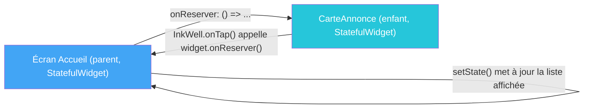

# TP4 — Stateless, Stateful et widgets de listes

## Objectifs
- Distinguer `StatelessWidget` et `StatefulWidget`.
- Utiliser `Card`, `Stack`, `Ink` et `InkWell` pour des cartes interactives.
- Mettre en place la communication enfant → parent via callback.
- Afficher une collection avec `ListView`, `ListTile`, `CircleAvatar` et `GridView`.

## Prérequis
- TP3 terminé (gabarit visuel de carte d'annonce disponible).

---

## Rappel de cours — Notions et définitions

**`StatelessWidget`** : widget immuable — son affichage ne dépend que des paramètres reçus. Pas de mémoire interne.

**`StatefulWidget`** : widget associé à un objet `State`, capable de changer via `setState()`, qui déclenche une reconstruction (*rebuild*) du widget.

**`Card`** : widget Material présentant un contenu sur une surface surélevée (ombre, coins arrondis) — idéal pour représenter une entité (ici, une annonce).

**`Ink` et `InkWell`** : `InkWell` rend une zone cliquable avec un effet visuel "ripple" (onde au toucher) typique de Material Design ; `Ink` permet de dessiner cet effet même par-dessus un `Container` avec une couleur de fond.

**Communication enfant → parent (callback)** : un widget enfant ne peut pas modifier directement l'état de son parent ; il reçoit une fonction callback en paramètre (ex. `VoidCallback onReserver`) que le parent définit, et l'enfant l'appelle au moment voulu (ex. au clic sur un bouton).

**`ListView` / `ListView.builder`** : affichage d'une liste scrollable ; `.builder` construit les éléments à la demande (*lazy loading*), essentiel pour des listes potentiellement longues.

**`ListTile`** : widget préformaté pour une ligne de liste standard (icône/avatar à gauche, titre, sous-titre, élément à droite).

**`CircleAvatar`** : widget circulaire pour afficher une image ou une initiale (ex. avatar d'un utilisateur).

**`GridView`** : équivalent de `ListView` en grille, utile pour un affichage en vignettes plutôt qu'en liste verticale.

## Diagramme — Communication callback dans CarteAnnonce

---

## Partie A — Guidée

### Exercice 4.1 — StatelessWidget vs StatefulWidget
**Objectif :** observer concrètement pourquoi certains widgets ont besoin d'un état interne.

1. Créer un `StatelessWidget` `MonBadge` affichant un simple `Text` de couleur fixe passé en paramètre du constructeur. Vérifier qu'aucune interaction n'en modifie l'affichage.
2. Créer un `StatefulWidget` `MonCompteur` avec un `int compteur = 0` dans sa classe `State`, un `Text` affichant sa valeur, et un `ElevatedButton` qui appelle `setState(() => compteur++)`.
3. **Expérience volontaire :** dans `MonCompteur`, remplacer `setState(() => compteur++)` par un simple `compteur++` (sans `setState`). Observer que le texte affiché **ne change pas** malgré l'incrémentation réelle de la variable. En déduire le rôle exact de `setState()`.
4. Ajouter un deuxième bouton "Réinitialiser" qui remet `compteur` à 0 via `setState`.

### Exercice 4.2 — Card, Stack et Image
**Objectif :** construire une carte visuelle avant de la rendre interactive.

1. Créer une `Card` contenant une `Image.network(...)` en haut et un `Text` (titre) en dessous, dans une `Column`.
2. Ajouter de l'élévation (`elevation: 4`) et des coins arrondis (`shape: RoundedRectangleBorder(...)`) à la `Card`.
3. Superposer, avec un `Stack`, un petit badge coloré (`Positioned` en haut à droite de l'image) indiquant une catégorie fictive.
4. Ajouter un padding interne autour du texte pour améliorer la lisibilité.

### Exercice 4.3 — Ink et InkWell (interactivité tactile)
**Objectif :** rendre une carte réactive au toucher, avec le style Material attendu.

1. Envelopper la `Card` de l'exercice 4.2 dans un `InkWell`, avec un `onTap` qui affiche une `SnackBar` ("Carte pressée").
2. Observer l'effet visuel "ripple" au clic ; comparer avec un simple `GestureDetector` (qui ne produit pas cet effet).
3. Remplacer le `Container` de fond du badge (exercice 4.2) par un `Ink` avec `decoration: BoxDecoration(color: ...)`, envelopper son contenu dans un `InkWell` avec son propre `onTap`, et vérifier que l'effet ripple s'applique bien même par-dessus la couleur de fond.

### Exercice 4.4 — Communication enfant → parent par callback
**Objectif :** comprendre le sens de circulation des données entre widgets.

1. Créer un widget enfant `BoutonAction` (`StatelessWidget`) qui reçoit un paramètre `final VoidCallback onPresse;` dans son constructeur et un `Text` à afficher, et qui déclenche `onPresse()` dans un `ElevatedButton.onPressed`.
2. Dans l'écran parent (`StatefulWidget`), instancier `BoutonAction(texte: 'Valider', onPresse: () => setState(() => ...))` et vérifier que l'état du parent change bien suite à l'action de l'enfant.
3. **Variante avec paramètre :** modifier le callback pour qu'il transmette une valeur à l'enfant vers le parent, par exemple `final ValueChanged<int> onValeurChangee;`, appelé avec `onValeurChangee(5)`.

### Exercice 4.5 — ListView, ListTile et CircleAvatar
**Objectif :** afficher une collection de données de façon idiomatique.

1. Créer une liste Dart de 10 chaînes de caractères (noms fictifs) et l'afficher avec un `ListView` classique (tous les éléments construits directement).
2. Remplacer par un `ListView.builder` et ajouter un `print()` dans le `itemBuilder` pour observer, en scrollant, que les éléments hors écran ne sont pas tous construits immédiatement (lazy loading).
3. Remplacer chaque ligne par un `ListTile` avec `leading: CircleAvatar(child: Text(initiale))`, `title` (le nom) et `subtitle` (un texte complémentaire, ex. "Membre depuis 2024").
4. Ajouter un `trailing: Icon(Icons.chevron_right)` à chaque `ListTile`.

### Exercice 4.6 — GridView
**Objectif :** afficher la même collection en grille et comparer les deux modes d'affichage.

1. Remplacer la liste de l'exercice 4.5 par un `GridView.builder`, avec `SliverGridDelegateWithFixedCrossAxisCount(crossAxisCount: 2)`, chaque cellule affichant un `CircleAvatar` + un `Text`.
2. Faire varier `crossAxisCount` (2, 3, 4) et `childAspectRatio` pour observer l'effet sur la disposition.
3. Ajouter un bouton dans l'`AppBar` qui bascule entre l'affichage `ListView` et `GridView` d'un même jeu de données (avec un booléen d'état `bool afficherEnGrille` et `setState`).

## Partie B — Application au projet LocalSwap

1. Transformer le gabarit du TP3 en widget réutilisable **`CarteAnnonce`** (`StatefulWidget`), utilisant `Card` + `Ink`/`InkWell` pour l'effet de clic, et `Stack` pour le badge de statut (vert/orange/gris selon `disponible`/`reservee`/`terminee`).
2. `CarteAnnonce` reçoit un callback `onReserver` (communication enfant → parent) appelé lorsqu'on clique sur le bouton "Réserver".
3. Sur l'écran d'accueil, afficher la liste des annonces (issues de `chargerAnnonces()` du TP2) avec `ListView.builder`, chaque élément étant une `CarteAnnonce`.
4. Créer une variante d'affichage en `GridView` (vignettes) activable par un bouton bascule liste/grille dans l'`AppBar`.
5. Ajouter un petit écran "Profil utilisateur" listant les utilisateurs de test avec `ListTile` + `CircleAvatar` (initiale du nom) + réputation en sous-titre.

## Livrables
- Widget `CarteAnnonce` complet, interactif, avec callback fonctionnel.
- Écran d'accueil avec bascule liste (`ListView.builder`) / grille (`GridView`).
- Écran "Profil utilisateur" avec `ListTile`/`CircleAvatar`.

## Grille d'évaluation

| Critère | Points |
|---|---|
| Distinction correcte Stateless/Stateful | 4 |
| `CarteAnnonce` interactive (Ink/InkWell, Stack, callback) | 8 |
| Liste dynamique + bascule GridView | 6 |
| Écran Profil (ListTile/CircleAvatar) | 2 |
| **Total** | **20** |
