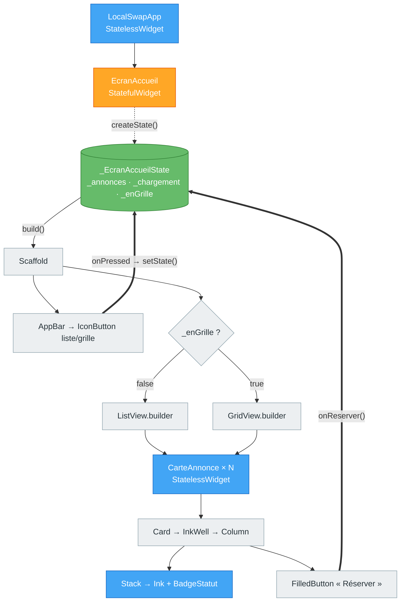
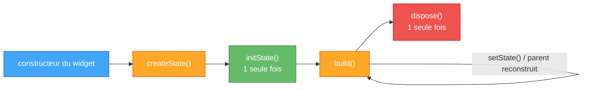

# TP4 — Stateless, Stateful, interactions et listes

> **Séance :** 3 h · **Environnement :** Flutter 3.x stable (≥ 3.27), Dart 3, VS Code / Android Studio, émulateur Android ou Chrome
> **Fil rouge :** LocalSwap — la carte d'annonce devient interactive et la liste des annonces s'affiche.

| Repère | Partie | Durée |
|---|---|---|
| 📘🗺️ | Rappel de cours + diagrammes | 10 min |
| 🧪 | Partie A : exercices indépendants (5) | 65 min |
| 🏗️ | Partie B : application à LocalSwap | 45 min |
| 🤖 | Partie C : comprendre et maîtriser le code | 45 min |
| 📝 | Quiz de fin de TP | 10 min |
| 🎤 | Validation orale (5 min par binôme, **pendant** les parties B et C) | — |
| 🚀 | Partie D : défis bonus (si vous avez terminé) | hors temps |
| | **Total** | **175 min** |

Difficulté des exercices : 🟢 facile · 🟡 moyen · 🔴 difficile

---

## 🎯 Objectifs pédagogiques

À la fin de ce TP, vous serez capable de :

1. **Justifier** le choix entre `StatelessWidget` et `StatefulWidget` pour un widget donné, et **expliquer** ce que déclenche `setState()`.
2. **Ordonner** les étapes du cycle de vie d'un `State` (`initState` → `build` → `dispose`) et **libérer** une ressource (`Timer`) au bon moment.
3. **Construire** une carte interactive avec `Card`, `InkWell` et `Ink`, avec un effet *ripple* visible.
4. **Faire remonter** une action d'un widget enfant vers son parent avec un callback (`VoidCallback`, `ValueChanged<T>`).
5. **Afficher** une collection avec `ListView.builder` / `GridView.builder`, et **expliquer** le rôle d'une `Key` dans une liste.

## 📋 Prérequis

- **TP2** : classes, `enum`, `Future`/`async`/`await`, modèles LocalSwap (`Annonce`, `Utilisateur`, `chargerAnnonces()`, `peutReserver()`).
- **TP3** : widgets de layout (`Container`, `Padding`, `Column`, `Row`, `Expanded`, `Stack`, `Positioned`), `Scaffold`, `AppBar`, FAB, `SnackBar`, `Theme.of(context)`, `MediaQuery`, gabarit visuel de la carte d'annonce.

> [!IMPORTANT]
> **Règle sur l'IA de ce TP.** Vous avez le droit d'utiliser une IA (ChatGPT, Copilot, Claude…). Mais **60 % de la note** porte sur votre compréhension : Partie C, oral devant votre code, quiz. Un code que vous ne savez pas expliquer ne rapporte presque rien. Si vous utilisez une IA, tenez le **📓 Journal IA** (exercice C7).

---

## 📘 Rappel de cours

> [!NOTE]
> **`StatelessWidget`** : widget **immuable**. Ce qu'il affiche dépend uniquement des paramètres reçus du parent (des champs `final`). Il n'a pas de mémoire propre.
>
> **`StatefulWidget`** : widget associé à un objet **`State`** qui, lui, **survit aux reconstructions**. Le widget porte la *configuration* (`final`) et le `State` porte les *données qui changent*.
>
> **`setState(() { ... })`** : modifie l'état **puis** marque le `State` comme « à reconstruire ». Flutter rappelle alors `build()` au prochain frame. Si vous modifiez une variable sans `setState`, la variable change bien, mais l'écran ne se met pas à jour.

> [!NOTE]
> **Cycle de vie d'un `State`**
> - `initState()` : appelé **une seule fois**, à l'insertion dans l'arbre. On y démarre ce qui doit vivre aussi longtemps que le widget (timer, chargement initial…). On appelle `super.initState()` **en premier**.
> - `build()` : appelé **à chaque reconstruction**. Il doit seulement *décrire* l'interface : on n'y démarre jamais de timer ni de requête.
> - `dispose()` : appelé **une seule fois**, au retrait définitif de l'arbre. On y libère tout ce qu'on a créé (`timer.cancel()`, et plus tard les `controller.dispose()` du TP6). On appelle `super.dispose()` **en dernier**.
> - `mounted` : vaut `true` tant que le `State` est dans l'arbre. On le vérifie **après un `await`**, avant d'appeler `setState` ou d'utiliser `context`.

> [!NOTE]
> **`Card`** est une surface Material (couleur, ombre, coins arrondis).
> **`InkWell`** rend une zone cliquable et dessine l'onde *ripple* **sur le `Material` le plus proche au-dessus de lui dans l'arbre**.
> **`Ink`** dessine une couleur ou une décoration **sur ce même `Material`** : le ripple reste donc visible par-dessus. Un `Container(color: …)` opaque, lui, le **cache**.

> [!NOTE]
> **Communication enfant → parent.** Un enfant ne modifie jamais directement l'état de son parent. Le parent lui passe une **fonction** (callback) et l'enfant l'**appelle** :
> - `VoidCallback` = `void Function()` : « il s'est passé quelque chose ».
> - `ValueChanged<T>` = `void Function(T value)` : « voici la nouvelle valeur ».
> - Convention Flutter : un callback **`null`** désactive le bouton (`onPressed: null`).

> [!NOTE]
> **Listes.** `ListView.builder` / `GridView.builder` construisent les éléments **à la demande** (seulement ceux qui sont visibles) : c'est indispensable pour les longues listes. `ListTile` est une ligne de liste préformatée (`leading`, `title`, `subtitle`, `trailing`). `CircleAvatar` affiche une initiale ou une image dans un cercle.
>
> **`Key`** : sans clé, Flutter associe un `State` existant à un widget selon son **type et sa position**. Si une liste d'éléments *Stateful* change d'ordre ou perd un élément, l'état peut « glisser » vers le mauvais élément. `ValueKey(id)` associe l'état à l'**identité** de la donnée.

> [!TIP]
> **Dart 3 express** (utilisé en Partie B). Une **expression `switch`** retourne une valeur, et le compilateur vérifie que tous les cas d'un `enum` sont traités :
> `final couleur = switch (statut) { StatutAnnonce.disponible => Colors.green, StatutAnnonce.reservee => Colors.orange, StatutAnnonce.terminee => Colors.grey };`
> Un **record** regroupe plusieurs valeurs sans créer de classe : `final (String libelle, Color couleur) = ('Disponible', Colors.green);`

## 🗺️ Diagrammes

**Arbre de widgets de l'écran d'accueil LocalSwap (Partie B) et circulation des données.** Les flèches épaisses représentent les **callbacks** qui remontent vers le `State`.



Légende : 🔵 vos widgets Stateless · 🟠 vos widgets Stateful · 🟢 état (`State`) · ⚪ widgets du framework.

**Cycle de vie d'un `State`** (à connaître par cœur pour l'oral) :



---

## 🧪 Partie A — Exercices pédagogiques indépendants (sans LocalSwap) · 65 min

Créez **un seul projet de démonstration** et placez chaque exercice dans son propre fichier, avec son propre `main()` :

```bash
flutter create tp4_demos
cd tp4_demos
# créer lib/ex1_room_counter.dart, lib/ex2_talk_timer.dart, ...
flutter run -t lib/ex1_room_counter.dart      # lance un exercice précis
```

> [!TIP]
> Dans chaque exercice, **tapez** le code au lieu de le copier-coller : c'est plus lent, mais vous lisez chaque ligne. Puis répondez aux questions **🔍 Observer & répondre** dans votre compte rendu : elles reviennent à l'oral.

---

### Exercice 4.1 — Compteur de salle : Stateless vs Stateful 🟢 · 10 min

**Contexte :** un agent compte les personnes qui entrent dans une salle de capacité limitée.
**Notions nouvelles :** `StatefulWidget`/`State`, `setState`.

`lib/ex1_room_counter.dart`

```dart
import 'package:flutter/material.dart';

void main() => runApp(const RoomCounterApp());

/// Racine de l'application : rien ne change jamais ici → StatelessWidget.
class RoomCounterApp extends StatelessWidget {
  const RoomCounterApp({super.key});

  @override
  Widget build(BuildContext context) {
    return MaterialApp(
      title: 'Room counter',
      debugShowCheckedModeBanner: false,
      // Material 3 : toute la palette est dérivée d'une seule couleur « graine ».
      theme: ThemeData(colorScheme: ColorScheme.fromSeed(seedColor: Colors.teal)),
      darkTheme: ThemeData(
        colorScheme: ColorScheme.fromSeed(
          seedColor: Colors.teal,
          brightness: Brightness.dark,
        ),
      ),
      themeMode: ThemeMode.system, // suit le réglage clair/sombre de l'appareil
      home: const RoomCounterPage(capacity: 5),
    );
  }
}

/// Le widget porte la CONFIGURATION (capacity), qui ne change pas.
class RoomCounterPage extends StatefulWidget {
  const RoomCounterPage({super.key, required this.capacity});

  final int capacity;

  @override
  State<RoomCounterPage> createState() => _RoomCounterPageState();
}

/// Le State porte les DONNÉES QUI CHANGENT (_count). Il survit aux reconstructions.
class _RoomCounterPageState extends State<RoomCounterPage> {
  int _count = 0;

  void _enter() {
    setState(() => _count++); // modifie l'état ET demande un nouveau build()
    debugPrint('_enter() → _count = $_count');
  }

  void _reset() => setState(() => _count = 0);

  @override
  Widget build(BuildContext context) {
    debugPrint('build() appelé, _count = $_count');
    final bool isFull = _count >= widget.capacity; // widget.xxx = accès à la config

    return Scaffold(
      appBar: AppBar(title: const Text('Salle B12')),
      body: Center(
        child: Column(
          mainAxisSize: MainAxisSize.min,
          children: [
            CountLabel(value: _count, capacity: widget.capacity),
            const SizedBox(height: 24),
            Row(
              mainAxisSize: MainAxisSize.min,
              children: [
                FilledButton.icon(
                  onPressed: isFull ? null : _enter, // null → bouton désactivé
                  icon: const Icon(Icons.person_add),
                  label: const Text('Entrée'),
                ),
                const SizedBox(width: 12),
                OutlinedButton(
                  onPressed: _reset,
                  child: const Text('Réinitialiser'),
                ),
              ],
            ),
          ],
        ),
      ),
    );
  }
}

/// Affichage pur : il reçoit tout de son parent → StatelessWidget.
class CountLabel extends StatelessWidget {
  const CountLabel({super.key, required this.value, required this.capacity});

  final int value;
  final int capacity;

  @override
  Widget build(BuildContext context) {
    final ColorScheme colors = Theme.of(context).colorScheme;
    final bool isFull = value >= capacity;
    return Text(
      '$value / $capacity',
      style: Theme.of(context).textTheme.displayMedium?.copyWith(
            color: isFull ? colors.error : colors.primary,
          ),
    );
  }
}
```

**🔍 Observer & répondre**

1. Dans `_enter()`, remplacez `setState(() => _count++);` par `_count++;`. Cliquez 3 fois sur « Entrée » : que montrent l'écran et la console ? Faites ensuite un **Hot Reload** : que s'affiche-t-il et pourquoi ? Remettez `setState`.
2. Pourquoi `capacity` est-il un champ du **widget** alors que `_count` est dans le **State** ?
3. Amenez le compteur à 2, puis changez `capacity: 5` en `capacity: 1` dans `main` et faites un Hot Reload. La valeur du compteur est-elle conservée ? Qu'en déduisez-vous sur la durée de vie du `State` par rapport à celle du widget ?
4. Remplacez `ThemeMode.system` par `ThemeMode.dark`. Quelles lignes de `CountLabel` ont permis l'adaptation au mode sombre **sans aucune modification** ?

---

### Exercice 4.2 — Chronomètre de présentation : le cycle de vie 🟡 · 15 min

**Contexte :** pendant une soutenance, un chronomètre s'affiche et passe en rouge après le temps autorisé.
**Notions nouvelles :** `initState` / `dispose`, `Timer`.

`lib/ex2_talk_timer.dart`

```dart
import 'dart:async'; // Timer

import 'package:flutter/material.dart';

void main() => runApp(const TalkTimerApp());

class TalkTimerApp extends StatelessWidget {
  const TalkTimerApp({super.key});

  @override
  Widget build(BuildContext context) {
    return MaterialApp(
      debugShowCheckedModeBanner: false,
      theme: ThemeData(
        colorScheme: ColorScheme.fromSeed(seedColor: Colors.deepOrange),
      ),
      home: const TalkTimerPage(),
    );
  }
}

/// Page qui affiche ou masque le chronomètre.
class TalkTimerPage extends StatefulWidget {
  const TalkTimerPage({super.key});

  @override
  State<TalkTimerPage> createState() => _TalkTimerPageState();
}

class _TalkTimerPageState extends State<TalkTimerPage> {
  bool _showTimer = false;

  @override
  Widget build(BuildContext context) {
    return Scaffold(
      appBar: AppBar(title: const Text('Chrono de présentation')),
      body: Center(
        child: Column(
          mainAxisSize: MainAxisSize.min,
          children: [
            Row(
              mainAxisSize: MainAxisSize.min,
              children: [
                const Text('Afficher le chrono'),
                Switch(
                  value: _showTimer,
                  onChanged: (value) => setState(() => _showTimer = value),
                ),
              ],
            ),
            const SizedBox(height: 24),
            // Quand _showTimer passe à false, TalkTimer est RETIRÉ de l'arbre.
            if (_showTimer)
              const TalkTimer(limitSeconds: 10)
            else
              const Text('Chrono masqué'),
          ],
        ),
      ),
    );
  }
}

class TalkTimer extends StatefulWidget {
  const TalkTimer({super.key, required this.limitSeconds});

  final int limitSeconds;

  @override
  State<TalkTimer> createState() => _TalkTimerState();
}

class _TalkTimerState extends State<TalkTimer> {
  int _seconds = 0;
  Timer? _timer; // nullable : il n'existe pas avant initState

  @override
  void initState() {
    super.initState(); // TOUJOURS en premier
    debugPrint('TalkTimer.initState()');
    // Démarré UNE SEULE FOIS, à l'insertion dans l'arbre.
    _timer = Timer.periodic(const Duration(seconds: 1), (_) {
      setState(() => _seconds++);
    });
  }

  @override
  void dispose() {
    debugPrint('TalkTimer.dispose()');
    _timer?.cancel(); // libère la ressource : sinon le timer continue de tourner
    super.dispose(); // TOUJOURS en dernier
  }

  @override
  Widget build(BuildContext context) {
    debugPrint('TalkTimer.build() — $_seconds s');
    final ColorScheme colors = Theme.of(context).colorScheme;
    final bool overtime = _seconds > widget.limitSeconds;
    return Text(
      '${_seconds}s',
      style: Theme.of(context).textTheme.displayLarge?.copyWith(
            color: overtime ? colors.error : colors.onSurface,
          ),
    );
  }
}
```

**🔍 Observer & répondre**

1. Activez le chrono, attendez 3 s, puis désactivez-le. Recopiez **dans l'ordre** les lignes affichées dans la console. Réactivez-le : repart-il de 0 ? Pourquoi ?
2. Mettez en commentaire `_timer?.cancel();`, relancez, activez puis désactivez le chrono. Quelle erreur apparaît dans la console, et à quelle fréquence ? Expliquez-la avec vos mots. Remettez la ligne.
3. Pourquoi `super.initState()` est-il appelé **en premier** et `super.dispose()` **en dernier** ?
4. (Sur papier) Un camarade démarre le `Timer.periodic` dans `build()` au lieu de `initState()`. Décrivez ce qui se passe après 1 s, 2 s, puis 3 s.

---

### Exercice 4.3 — Carte recette : Card, InkWell et Ink 🟡 · 15 min

**Contexte :** un site de recettes affiche des cartes cliquables, avec un badge de catégorie et un bouton « Favori ».
**Notions nouvelles :** `Card`, `InkWell`/`Ink` (le `Stack`/`Positioned` vient du TP3).

`lib/ex3_recipe_card.dart`

```dart
import 'package:flutter/material.dart';

void main() => runApp(const RecipeApp());

class RecipeApp extends StatelessWidget {
  const RecipeApp({super.key});

  @override
  Widget build(BuildContext context) {
    return MaterialApp(
      debugShowCheckedModeBanner: false,
      theme: ThemeData(colorScheme: ColorScheme.fromSeed(seedColor: Colors.green)),
      home: Scaffold(
        appBar: AppBar(title: const Text('Recettes')),
        body: const Padding(
          padding: EdgeInsets.all(16),
          child: RecipeCard(
            title: 'Couscous aux légumes',
            category: 'Plat',
            imageUrl: 'https://picsum.photos/seed/couscous/600/400',
          ),
        ),
      ),
    );
  }
}

/// Affiche une SnackBar (vu au TP3).
void showMessage(BuildContext context, String message) {
  ScaffoldMessenger.of(context)
    ..hideCurrentSnackBar()
    ..showSnackBar(SnackBar(content: Text(message)));
}

class RecipeCard extends StatelessWidget {
  const RecipeCard({
    super.key,
    required this.title,
    required this.category,
    required this.imageUrl,
  });

  final String title;
  final String category;
  final String imageUrl;

  @override
  Widget build(BuildContext context) {
    final ColorScheme colors = Theme.of(context).colorScheme;

    // La Card EST un Material : l'InkWell placé DEDANS y dessine son ripple.
    return Card(
      elevation: 4,
      clipBehavior: Clip.antiAlias, // découpe l'image ET le ripple aux coins arrondis
      shape: RoundedRectangleBorder(borderRadius: BorderRadius.circular(16)),
      child: InkWell(
        onTap: () => showMessage(context, 'Carte « $title » pressée'),
        child: Column(
          mainAxisSize: MainAxisSize.min,
          crossAxisAlignment: CrossAxisAlignment.stretch,
          children: [
            // 1) Image + badge superposé (Stack, TP3)
            Stack(
              children: [
                Image.network(
                  imageUrl,
                  height: 160,
                  width: double.infinity,
                  fit: BoxFit.cover,
                  errorBuilder: (context, error, stackTrace) => Container(
                    height: 160,
                    color: colors.surfaceContainerHighest,
                    child: const Icon(Icons.broken_image, size: 48),
                  ),
                ),
                Positioned(
                  top: 8,
                  right: 8,
                  // Le badge est AU-DESSUS de l'image : il lui faut son propre
                  // Material pour que son ripple soit visible.
                  child: Material(
                    color: colors.tertiaryContainer,
                    shape: const StadiumBorder(),
                    clipBehavior: Clip.antiAlias,
                    child: InkWell(
                      onTap: () => showMessage(context, 'Catégorie : $category'),
                      child: Padding(
                        padding: const EdgeInsets.symmetric(horizontal: 12, vertical: 4),
                        child: Text(
                          category,
                          style: TextStyle(color: colors.onTertiaryContainer),
                        ),
                      ),
                    ),
                  ),
                ),
              ],
            ),
            // 2) Titre
            Padding(
              padding: const EdgeInsets.all(12),
              child: Text(title, style: Theme.of(context).textTheme.titleLarge),
            ),
            // 3) Pied de carte coloré : Ink (et pas Container) pour garder le ripple
            Ink(
              color: colors.primaryContainer,
              child: InkWell(
                onTap: () => showMessage(context, 'Ajouté aux favoris'),
                child: Padding(
                  padding: const EdgeInsets.all(12),
                  child: Row(
                    mainAxisAlignment: MainAxisAlignment.center,
                    children: [
                      Icon(Icons.favorite_border, color: colors.onPrimaryContainer),
                      const SizedBox(width: 8),
                      Text(
                        'Favori',
                        style: TextStyle(color: colors.onPrimaryContainer),
                      ),
                    ],
                  ),
                ),
              ),
            ),
          ],
        ),
      ),
    );
  }
}
```

**🔍 Observer & répondre**

1. Cliquez sur l'image, sur le badge, puis sur « Favori ». Combien de `SnackBar` différentes obtenez-vous ? Quand deux `InkWell` sont imbriqués, lequel gagne ?
2. Dans le pied de carte, remplacez `Ink(color: …)` par `Container(color: …)`. Le ripple de « Favori » est-il encore visible ? Expliquez avec la définition d'`Ink` du rappel de cours.
3. Déplacez l'`InkWell` principal **autour** de la `Card` (`InkWell(child: Card(...))`). Où le ripple est-il dessiné maintenant ? Le voit-on ? Remettez la version d'origine.
4. Retirez `clipBehavior: Clip.antiAlias` de la `Card`. Qu'arrive-t-il aux coins de l'image et au ripple ?

> [!WARNING]
> Sur **Chrome**, certaines images réseau peuvent être bloquées (CORS). C'est à ça que sert `errorBuilder` : il affiche une icône à la place.

---

### Exercice 4.4 — Panier du café : callbacks enfant → parent 🟡 · 12 min

**Contexte :** la cafétéria de l'ISET prend des commandes. Chaque produit a un sélecteur de quantité, et le total est calculé par la page.
**Notions nouvelles :** `ValueChanged<T>`, `VoidCallback` (callback `null` = désactivé).

`lib/ex4_cart.dart`

```dart
import 'package:flutter/material.dart';

void main() => runApp(const CartApp());

class Product {
  const Product(this.name, this.price);

  final String name;
  final double price; // en dinars
}

const List<Product> products = [
  Product('Thé à la menthe', 1.5),
  Product('Café express', 2.0),
  Product("Jus d'orange", 3.5),
];

class CartApp extends StatelessWidget {
  const CartApp({super.key});

  @override
  Widget build(BuildContext context) {
    return MaterialApp(
      debugShowCheckedModeBanner: false,
      theme: ThemeData(colorScheme: ColorScheme.fromSeed(seedColor: Colors.brown)),
      home: const CartPage(),
    );
  }
}

/// Le PARENT possède l'état : les quantités (source unique de vérité).
class CartPage extends StatefulWidget {
  const CartPage({super.key});

  @override
  State<CartPage> createState() => _CartPageState();
}

class _CartPageState extends State<CartPage> {
  final List<int> _quantities = List.filled(products.length, 0);

  double get _total {
    double total = 0;
    for (var i = 0; i < products.length; i++) {
      total += products[i].price * _quantities[i];
    }
    return total;
  }

  void _clear() {
    setState(() => _quantities.fillRange(0, _quantities.length, 0));
  }

  @override
  Widget build(BuildContext context) {
    return Scaffold(
      appBar: AppBar(title: const Text('Cafétéria ISET')),
      body: Padding(
        padding: const EdgeInsets.all(16),
        child: Column(
          children: [
            for (var i = 0; i < products.length; i++)
              Padding(
                padding: const EdgeInsets.symmetric(vertical: 4),
                child: Row(
                  children: [
                    Expanded(
                      child: Text(
                        '${products[i].name} — ${products[i].price.toStringAsFixed(1)} DT',
                      ),
                    ),
                    QuantityStepper(
                      quantity: _quantities[i],
                      // L'enfant nous ENVOIE la nouvelle valeur ; c'est NOUS qui décidons.
                      onChanged: (value) => setState(() => _quantities[i] = value),
                    ),
                  ],
                ),
              ),
            const Divider(),
            Text(
              'Total : ${_total.toStringAsFixed(2)} DT',
              style: Theme.of(context).textTheme.headlineSmall,
            ),
            const SizedBox(height: 8),
            // On passe la MÉTHODE (_clear), pas son résultat (_clear()).
            ClearCartButton(onClear: _total > 0 ? _clear : null),
          ],
        ),
      ),
    );
  }
}

/// Enfant SANS état : il affiche la quantité reçue et SIGNALE les clics.
class QuantityStepper extends StatelessWidget {
  const QuantityStepper({
    super.key,
    required this.quantity,
    required this.onChanged,
    this.max = 10,
  });

  final int quantity;
  final ValueChanged<int> onChanged; // void Function(int value)
  final int max;

  @override
  Widget build(BuildContext context) {
    return Row(
      mainAxisSize: MainAxisSize.min,
      children: [
        IconButton.outlined(
          onPressed: quantity > 0 ? () => onChanged(quantity - 1) : null,
          icon: const Icon(Icons.remove),
        ),
        SizedBox(
          width: 32,
          child: Text('$quantity', textAlign: TextAlign.center),
        ),
        IconButton.filled(
          onPressed: quantity < max ? () => onChanged(quantity + 1) : null,
          icon: const Icon(Icons.add),
        ),
      ],
    );
  }
}

class ClearCartButton extends StatelessWidget {
  const ClearCartButton({super.key, required this.onClear});

  final VoidCallback? onClear; // null → bouton désactivé (convention Flutter)

  @override
  Widget build(BuildContext context) {
    return TextButton.icon(
      onPressed: onClear,
      icon: const Icon(Icons.delete_outline),
      label: const Text('Vider le panier'),
    );
  }
}
```

**🔍 Observer & répondre**

1. `QuantityStepper` n'a **aucun** état et pourtant la quantité change à l'écran. Expliquez le trajet complet d'un clic sur « + », jusqu'au nouvel affichage (au moins 4 étapes).
2. Remplacez `onClear: _total > 0 ? _clear : null` par `onClear: _clear()`. Que dit le compilateur ? Pourquoi ?
3. Pourquoi le bouton « Vider le panier » est-il grisé au démarrage, sans aucun `if` dans `ClearCartButton` ?

---

### Exercice 4.5 — Annuaire du club : ListView, ListTile et GridView 🟡 · 13 min

**Contexte :** le club informatique affiche ses 50 membres, en liste ou en vignettes.
**Notions nouvelles :** construction à la demande (`ListView.builder`), grille (`GridView.builder`).

`lib/ex5_directory.dart`

```dart
import 'package:flutter/material.dart';

void main() => runApp(const DirectoryApp());

class Member {
  const Member({required this.name, required this.city, required this.since});

  final String name;
  final String city;
  final int since;
}

const List<String> _firstNames = [
  'Amira', 'Youssef', 'Sarra', 'Mehdi', 'Ines',
  'Karim', 'Nour', 'Aziz', 'Rania', 'Hamza',
];
const List<String> _cities = ['Tunis', 'Bizerte', 'Sousse', 'Sfax', 'Nabeul'];

/// 50 membres fictifs (List.generate appelle la fonction pour i = 0..49).
final List<Member> members = List.generate(
  50,
  (i) => Member(
    name: '${_firstNames[i % _firstNames.length]} ${i + 1}',
    city: _cities[i % _cities.length],
    since: 2015 + i % 10,
  ),
);

class DirectoryApp extends StatelessWidget {
  const DirectoryApp({super.key});

  @override
  Widget build(BuildContext context) {
    return MaterialApp(
      debugShowCheckedModeBanner: false,
      theme: ThemeData(colorScheme: ColorScheme.fromSeed(seedColor: Colors.indigo)),
      home: const DirectoryPage(),
    );
  }
}

class DirectoryPage extends StatefulWidget {
  const DirectoryPage({super.key});

  @override
  State<DirectoryPage> createState() => _DirectoryPageState();
}

class _DirectoryPageState extends State<DirectoryPage> {
  bool _showGrid = false;

  @override
  Widget build(BuildContext context) {
    return Scaffold(
      appBar: AppBar(
        title: const Text('Annuaire du club'),
        actions: [
          IconButton(
            tooltip: _showGrid ? 'Afficher en liste' : 'Afficher en grille',
            onPressed: () => setState(() => _showGrid = !_showGrid),
            icon: Icon(_showGrid ? Icons.view_list : Icons.grid_view),
          ),
        ],
      ),
      body: _showGrid ? _buildGrid() : _buildList(),
    );
  }

  Widget _buildList() {
    return ListView.builder(
      itemCount: members.length,
      // itemBuilder n'est appelé QUE pour les éléments visibles (ou presque).
      itemBuilder: (context, index) {
        debugPrint("ListView construit l'élément $index");
        final Member member = members[index];
        return ListTile(
          leading: MemberAvatar(name: member.name),
          title: Text(member.name),
          subtitle: Text('${member.city} · membre depuis ${member.since}'),
          trailing: const Icon(Icons.chevron_right),
        );
      },
    );
  }

  Widget _buildGrid() {
    return GridView.builder(
      padding: const EdgeInsets.all(12),
      gridDelegate: const SliverGridDelegateWithFixedCrossAxisCount(
        crossAxisCount: 2, // nombre de colonnes
        mainAxisSpacing: 12,
        crossAxisSpacing: 12,
        childAspectRatio: 1, // largeur / hauteur d'une cellule
      ),
      itemCount: members.length,
      itemBuilder: (context, index) {
        final Member member = members[index];
        return Card(
          child: Column(
            mainAxisAlignment: MainAxisAlignment.center,
            children: [
              MemberAvatar(name: member.name, radius: 32),
              const SizedBox(height: 8),
              Text(member.name, textAlign: TextAlign.center),
              Text(member.city, style: Theme.of(context).textTheme.bodySmall),
            ],
          ),
        );
      },
    );
  }
}

class MemberAvatar extends StatelessWidget {
  const MemberAvatar({super.key, required this.name, this.radius = 20});

  final String name;
  final double radius;

  @override
  Widget build(BuildContext context) {
    final ColorScheme colors = Theme.of(context).colorScheme;
    return CircleAvatar(
      radius: radius,
      backgroundColor: colors.secondaryContainer,
      foregroundColor: colors.onSecondaryContainer,
      child: Text(name[0].toUpperCase()),
    );
  }
}
```

**🔍 Observer & répondre**

1. Au démarrage, combien de lignes « ListView construit l'élément … » voyez-vous ? Faites défiler jusqu'en bas puis remontez : que remarquez-vous ?
2. Remplacez `ListView.builder(...)` par `ListView(children: [for (final m in members) ListTile(title: Text(m.name))])`. Combien d'éléments sont construits au démarrage ? Lequel des deux choisiriez-vous pour 5 000 membres ?
3. Essayez `crossAxisCount: 3` puis `childAspectRatio: 2`. Quel message d'erreur jaune et noir apparaît ? Que signifie-t-il ?

---

## 🏗️ Partie B — Application au projet LocalSwap · 45 min

**But :** transformer le gabarit statique du TP3 en **`CarteAnnonce`** réutilisable et interactive, puis afficher toutes les annonces en liste ou en grille.

> [!IMPORTANT]
> **Choix d'architecture du TP :** `CarteAnnonce` est un **`StatelessWidget`**. Le statut d'une annonce appartient à la **liste** (dans `_EcranAccueilState`). La carte se contente de l'afficher et de **signaler** le clic par un callback. On garde ainsi une seule source de vérité : c'est exactement ce que le TP7 (Provider) généralisera.

> [!NOTE]
> Les identifiants LocalSwap restent en **français** (`Annonce`, `titre`, `CarteAnnonce`…) pour rester cohérents avec vos modèles du TP2. On suppose que `Annonce` a des champs `final` : `id`, `titre`, `description` (`String?`), `categorie`, `statut`, `idProprietaire`. Adaptez les noms si votre modèle est différent.

**Arborescence visée :**

```text
lib/
├── main.dart
├── models/            ← TP2 (annonce.dart, utilisateur.dart, echange.dart, models.dart)
├── data/
│   └── donnees_test.dart
├── widgets/
│   ├── badge_statut.dart
│   └── carte_annonce.dart
└── screens/
    ├── ecran_accueil.dart
    └── ecran_profil.dart
```

### B.1 — `copyWith` dans `Annonce` 🟢

Une annonce est **immuable** : pour la « réserver », on crée une **copie modifiée**. Ajoutez dans `lib/models/annonce.dart` :

```dart
  Annonce copyWith({StatutAnnonce? statut}) {
    return Annonce(
      id: id,
      titre: titre,
      description: description,
      categorie: categorie,
      statut: statut ?? this.statut, // nouvelle valeur, sinon l'ancienne
      idProprietaire: idProprietaire,
    );
  }
```

### B.2 — `BadgeStatut` 🟢

Créez `lib/widgets/badge_statut.dart` : un `StatelessWidget` qui reçoit un `StatutAnnonce` et affiche une pastille arrondie **verte** « Disponible », **orange** « Réservée » ou **grise** « Terminée ».

- Contrainte : utilisez **une expression `switch`** qui retourne un **record** `(String libelle, Color couleur)` (voir l'encadré *Dart 3 express*).
- Vérification : ajoutez temporairement une 4ᵉ valeur à l'`enum StatutAnnonce`. Que dit le compilateur ? Retirez-la.

### B.3 — `CarteAnnonce` 🟡

Créez `lib/widgets/carte_annonce.dart` à partir de votre gabarit du TP3 :

| Paramètre | Type | Rôle |
|---|---|---|
| `annonce` | `Annonce` (requis) | données affichées |
| `onReserver` | `VoidCallback?` | appelé au clic sur « Réserver » ; **`null` → bouton désactivé** |
| `onTap` | `VoidCallback?` | clic sur la carte (servira au TP5 pour ouvrir le détail) |
| `compacte` | `bool` (défaut `false`) | mode vignette pour la grille |

Exigences :

1. `Card(clipBehavior: Clip.antiAlias)` → `InkWell(onTap: onTap)` → `Column`.
2. En-tête coloré avec **`Ink`** (couleur `primaryContainer`) contenant une icône qui dépend de la catégorie (expression `switch`), et `BadgeStatut` superposé en haut à droite (`Stack` + `Positioned`).
3. En mode normal, l'en-tête mesure 120 px de haut. En mode `compacte`, il occupe l'espace restant (`Expanded`) et la description est masquée.
4. Titre sur 2 lignes au maximum (`maxLines`, `overflow: TextOverflow.ellipsis`), description facultative, puis un `FilledButton.tonal` « Réserver » branché sur `onReserver`.
5. Couleurs : **uniquement** `Theme.of(context).colorScheme` (sauf les couleurs de statut).

### B.4 — Écran d'accueil : chargement et liste 🟡

Dans `lib/screens/ecran_accueil.dart`, faites évoluer l'écran d'accueil du TP3 en `StatefulWidget` :

1. État : `List<Annonce> _annonces`, `bool _chargement`, `bool _enGrille`.
2. Dans `initState`, appelez une méthode `_charger()` qui fait `await chargerAnnonces()` (TP2), **vérifie `mounted`**, puis met à jour l'état avec `setState`. Pendant le chargement, affichez un `CircularProgressIndicator` centré.
3. Gardez l'en-tête du TP3 (logo/slogan) et remplacez la zone réservée (`Expanded`) par un `ListView.builder` de `CarteAnnonce`, avec `key: ValueKey(annonce.id)`.
4. `onReserver` : passez `() => _reserver(annonce)` **seulement si** `peutReserver(annonce)` (TP2), sinon `null`. `_reserver` remplace l'annonce par `annonce.copyWith(statut: StatutAnnonce.reservee)` dans `setState`, puis affiche une `SnackBar`.

> [!WARNING]
> `chargerAnnonces()` peut renvoyer une liste **non modifiable**. Copiez-la (`List.of(annonces)`) avant de remplacer des éléments, sinon vous obtiendrez `Unsupported operation: Cannot modify an unmodifiable list`.

### B.5 — Bascule liste / grille 🟢

Ajoutez dans l'`AppBar` un `IconButton` qui inverse `_enGrille`. En mode grille : `GridView.builder` sur 2 colonnes, `childAspectRatio: 0.75`, cartes en `compacte: true`.

### B.6 — Écran « Membres » 🟢

Dans `lib/data/donnees_test.dart`, créez une liste `utilisateursTest` de 6 `Utilisateur`. Dans `lib/screens/ecran_profil.dart`, affichez-la avec `ListView.builder` + `ListTile` : `CircleAvatar` (initiale), nom, « Réputation : X ★ » en sous-titre, et une icône `Icons.verified` si la réputation est ≥ 4.

> [!NOTE]
> La navigation n'est vue qu'au **TP5**. Pour tester cet écran, mettez temporairement `home: const EcranProfil()` dans `main.dart`, puis remettez `EcranAccueil`. Au TP5, cet écran deviendra l'onglet *Profil* de la `BottomNavigationBar`.

### B.7 — Thème clair / sombre 🟢

Dans `main.dart`, définissez `theme` **et** `darkTheme` avec `ColorScheme.fromSeed` (même couleur graine que votre thème du TP3) et `themeMode: ThemeMode.system`. Basculez l'émulateur en mode sombre : rien ne doit devenir illisible.

---

## 🤖 Partie C — Comprendre et maîtriser le code · 45 min

> [!CAUTION]
> Pour C1, C2 et C3, **répondez d'abord sur papier ou dans votre compte rendu, sans exécuter et sans IA**. Vous vérifierez ensuite sur machine. À l'oral, l'enseignant vous fera refaire un raisonnement du même type sur un autre code.

### C1 — Prédire avant d'exécuter 🟡 · 8 min

**C1.a — Cycle de vie.** Voici une page qui affiche ou masque un widget `Child`.

```dart
class Parent extends StatefulWidget {
  const Parent({super.key});

  @override
  State<Parent> createState() => _ParentState();
}

class _ParentState extends State<Parent> {
  bool _visible = true;

  @override
  Widget build(BuildContext context) {
    debugPrint('Parent.build');
    return Column(
      children: [
        if (_visible) const Child(label: 'A'),
        TextButton(
          onPressed: () => setState(() => _visible = !_visible),
          child: const Text('Basculer'),
        ),
        TextButton(
          onPressed: () => setState(() {}),
          child: const Text('Rafraîchir'),
        ),
      ],
    );
  }
}

class Child extends StatefulWidget {
  const Child({super.key, required this.label});

  final String label;

  @override
  State<Child> createState() => _ChildState();
}

class _ChildState extends State<Child> {
  @override
  void initState() {
    super.initState();
    debugPrint('Child ${widget.label}.initState');
  }

  @override
  void dispose() {
    debugPrint('Child ${widget.label}.dispose');
    super.dispose();
  }

  @override
  Widget build(BuildContext context) {
    debugPrint('Child ${widget.label}.build');
    return Text(widget.label);
  }
}
```

Écrivez **exactement** ce qu'affiche la console :
1. au démarrage ;
2. après un clic sur « Rafraîchir » ;
3. après un clic sur « Basculer » ;
4. après un second clic sur « Basculer ».
5. Que change la réponse 2 si l'on retire le mot `const` devant `Child(label: 'A')` ?

**C1.b — Les clés.** Une liste de tâches, chaque ligne a sa propre case à cocher (état **local**).

```dart
class TaskTile extends StatefulWidget {
  const TaskTile({super.key, required this.title, required this.onDelete});

  final String title;
  final VoidCallback onDelete;

  @override
  State<TaskTile> createState() => _TaskTileState();
}

class _TaskTileState extends State<TaskTile> {
  bool _done = false;

  @override
  Widget build(BuildContext context) {
    return CheckboxListTile(
      value: _done,
      onChanged: (value) => setState(() => _done = value ?? false),
      title: Text(widget.title),
      secondary: IconButton(
        icon: const Icon(Icons.delete_outline),
        onPressed: widget.onDelete,
      ),
    );
  }
}

// Dans le State du parent :
final List<String> _tasks = ['Acheter du pain', 'Réviser Flutter', 'Appeler Sami'];

// Dans son build() :
Column(
  children: [
    for (final task in _tasks)
      TaskTile(
        title: task,
        onDelete: () => setState(() => _tasks.remove(task)),
      ),
  ],
)
```

On coche « Acheter du pain », puis on supprime « Acheter du pain ».
1. **Prédisez** : quelles tâches restent affichées, et laquelle apparaît cochée ?
2. Vérifiez sur machine. Expliquez le résultat en une phrase avec les mots « type », « position » et « State ».
3. Corrigez en ajoutant **une seule** chose à une seule ligne.

### C2 — Trouver les bugs 🟡 · 10 min

Ce code compile, mais il contient **4 erreurs**. Pour chacune, donnez : la ligne, le symptôme observé, la cause et la correction.

```dart
class ShoppingPage extends StatefulWidget {
  const ShoppingPage({super.key});

  @override
  State<ShoppingPage> createState() => _ShoppingPageState();
}

class _ShoppingPageState extends State<ShoppingPage> {
  final List<String> _items = ['Lait', 'Œufs'];

  @override
  Widget build(BuildContext context) {
    int tapCount = 0;
    return Scaffold(
      appBar: AppBar(title: Text('Courses (${_items.length})')),
      body: Column(
        children: [
          Text('Articles touchés : $tapCount'),
          ListView.builder(
            itemCount: _items.length,
            itemBuilder: (context, index) => ItemRow(
              label: _items[index],
              onSelected: () => setState(() => tapCount++),
            ),
          ),
        ],
      ),
      floatingActionButton: FloatingActionButton(
        onPressed: () {
          _items.add('Article ${_items.length + 1}');
        },
        child: const Icon(Icons.add),
      ),
    );
  }
}

class ItemRow extends StatelessWidget {
  const ItemRow({super.key, required this.label, required this.onSelected});

  final String label;
  final VoidCallback onSelected;

  @override
  Widget build(BuildContext context) {
    return ListTile(
      title: Text(label),
      onTap: () => onSelected,
    );
  }
}
```

> [!TIP]
> Lancez `flutter analyze` sur ce fichier. **Combien** de ces 4 bugs l'analyseur détecte-t-il ? Qu'en concluez-vous sur la confiance à accorder à un code « qui compile sans warning » ?

### C3 — Critiquer du code généré par une IA 🔴 · 12 min

Un étudiant a demandé : *« Génère un widget Flutter carte de profil avec un compteur de likes, un chronomètre de session et un bouton Partager »*. L'IA a répondu ceci. Le code fonctionne en apparence.

```dart
import 'dart:async';
import 'package:flutter/material.dart';

class ProfileCard extends StatefulWidget {
  final String name;
  final String avatarUrl;

  ProfileCard({Key? key, required this.name, required this.avatarUrl})
      : super(key: key);

  @override
  _ProfileCardState createState() => _ProfileCardState();
}

class _ProfileCardState extends State<ProfileCard> {
  int likes = 0;
  int seconds = 0;

  @override
  Widget build(BuildContext context) {
    Timer.periodic(Duration(seconds: 1), (timer) {
      setState(() {
        seconds++;
      });
    });

    return GestureDetector(
      onTap: () {
        likes++;
        setState(() {});
      },
      child: Container(
        color: Colors.white,
        child: Column(
          children: [
            CircleAvatar(backgroundImage: NetworkImage(widget.avatarUrl)),
            Text(widget.name, style: TextStyle(color: Colors.black)),
            Text('Session : $seconds s'),
            ElevatedButton(
              style: ButtonStyle(
                backgroundColor:
                    MaterialStateProperty.all(Colors.blue.withOpacity(0.8)),
              ),
              onPressed: () async {
                await Future.delayed(Duration(seconds: 1));
                ScaffoldMessenger.of(context).showSnackBar(
                  SnackBar(content: Text('$likes likes !')),
                );
              },
              child: Text('Partager'),
            ),
          ],
        ),
      ),
    );
  }
}
```

1. Listez **au moins 7 problèmes** et classez-les : 🔴 bug (comportement faux), 🟠 API dépréciée / style ancien, 🟡 qualité / Material 3 / accessibilité.
2. Lequel est le **plus grave** ? Décrivez ce qu'on observe après 10 secondes d'utilisation.
3. Réécrivez le widget corrigé (`initState`/`dispose`, `Card` + `InkWell`, `colorScheme`, vérification de `mounted`…).
4. Rédigez le **prompt** que vous auriez dû donner à l'IA pour obtenir directement un meilleur code (3 à 5 contraintes précises).

### C4 — Modifier sous contrainte 🟡 · 7 min

Reprenez le code de la Partie A **sans le réécrire**.

1. **Exercice 4.5 — Grille adaptative.** En modifiant **au plus 3 lignes** de `_buildGrid()`, affichez **3 colonnes en paysage** et **2 en portrait** (indice : `MediaQuery`, vu au TP3). Pourquoi avez-vous dû retirer un mot-clé ?
2. **Exercice 4.4 — Plafond du panier.** Le panier ne doit pas dépasser **10 articles au total**, tous produits confondus. Contrainte : **ne modifiez pas `QuantityStepper`**, seulement `_CartPageState`. Combien de lignes avez-vous changées ?

### C5 — Expliquer ligne par ligne 🟢 · 4 min

Recopiez votre méthode `_charger()` et votre `initState()` de la Partie B, puis commentez **chaque ligne** avec vos propres mots (pas de copie du cours). Répondez ensuite : *« Pourquoi ne peut-on pas écrire `initState` avec `async` et faire `await chargerAnnonces()` directement dedans ? »*

### C6 — Exercice papier : l'arbre de widgets ✍️ 🟡 · 6 min

**Sans machine**, dessinez l'arbre de widgets de **votre** écran d'accueil en **mode grille**, de `MaterialApp` jusqu'à `BadgeStatut`.
- Coloriez en bleu les Stateless, en orange les Stateful et en vert l'endroit où est stocké chaque état.
- Tracez en rouge le trajet d'un clic sur « Réserver », jusqu'au changement de couleur du badge.
- Entourez les widgets dont `build()` est rappelé quand on clique sur le bouton liste/grille.

### C7 — Journal IA 📓 · tout au long du TP

Si vous avez utilisé une IA, remplissez ce tableau dans votre compte rendu (une ligne par usage). **Aucune pénalité** si l'IA est utilisée et le journal tenu honnêtement.

| # | Exercice | Prompt (copié tel quel) | Ce que j'ai gardé | Ce que j'ai rejeté ou corrigé, et pourquoi |
|---|---|---|---|---|
| 1 | | | | |

---

## 🚀 Partie D — Défis bonus (étudiants rapides)

| Défi | Niveau | Énoncé |
|---|---|---|
| D1 — Favoris et état perdu | 🔴 | Ajoutez un cœur ♥ sur `CarteAnnonce`. **Version 1** : rendez la carte Stateful avec un `bool _favori` local. Générez 40 annonces, cochez la 1ʳᵉ, descendez tout en bas puis remontez : que constatez-vous ? Pourquoi ? **Version 2** : remontez l'état dans `_EcranAccueilState` (`Set<String> _favoris`) avec un callback `onFavori`. |
| D2 — Glisser pour supprimer | 🟡 | Sur l'écran Membres, enveloppez chaque `ListTile` dans un `Dismissible`. Quelle propriété est obligatoire, et pourquoi (lien avec C1.b) ? Ajoutez une `SnackBar` avec une action « Annuler » qui restaure l'élément. |
| D3 — Grille responsive | 🟡 | Remplacez `SliverGridDelegateWithFixedCrossAxisCount` par `SliverGridDelegateWithMaxCrossAxisExtent(maxCrossAxisExtent: 220)`. Testez sur Chrome en redimensionnant la fenêtre. Comparez avec votre solution C4.1. |
| D4 — Bouton clair/sombre | 🟡 | Ajoutez dans l'`AppBar` de l'accueil un bouton qui bascule le thème de **toute** l'application. Où doit vivre l'état `ThemeMode` ? Combien de widgets devez-vous traverser avec des callbacks ? Notez cette difficulté : le TP7 (Provider) la résout. |
| D5 — Chrono pause/reprise | 🟢 | Dans l'exercice 4.2, un tap sur le nombre met le chrono en pause ou le relance, **sans** retirer `TalkTimer` de l'arbre. |

---

## 🎤 Validation orale (5 min par binôme)

L'enseignant passe pendant les Parties B et C. Il pose 3 à 4 questions **devant votre code**, par exemple :

1. Pourquoi `CarteAnnonce` est-elle un `StatelessWidget` ? Où est stocké le statut d'une annonce ?
2. Montrez-moi où se trouve `_enGrille`. Racontez ce qui se passe, étape par étape, quand je clique sur l'icône grille.
3. **Modifiez cette ligne** pour que le bouton affiche « Indisponible » quand la réservation est impossible.
4. Que se passe-t-il si on retire `if (!mounted) return;` ?
5. Que se passe-t-il si on retire `key: ValueKey(annonce.id)` ? Et si la carte avait un état local ?
6. Pourquoi `ListView.builder` plutôt que `ListView(children: …)` ?
7. Remplacez `Ink` par `Container` dans l'en-tête de la carte : que voit-on, et pourquoi ?
8. Expliquez `onReserver: peutReserver(annonce) ? () => _reserver(annonce) : null`. Que se passe-t-il si on écrit `_reserver(annonce)` sans `() =>` ?

> [!IMPORTANT]
> À l'oral, chaque membre du binôme doit pouvoir répondre seul. La note d'oral est **individuelle**.

---

## ✅ Checklist de validation — le TP est réussi si…

- [ ] Les 5 exercices de la Partie A se lancent avec `flutter run -t …`, et les questions 🔍 ont une réponse dans le compte rendu.
- [ ] `flutter analyze` ne signale **aucun** problème dans `lib/` de LocalSwap.
- [ ] `CarteAnnonce` est Stateless, a un ripple visible sur l'en-tête **et** sur le reste de la carte, affiche le bon badge, et son bouton « Réserver » est désactivé pour une annonce non disponible.
- [ ] Réserver une annonce change son badge en orange et affiche une `SnackBar`.
- [ ] Un indicateur de chargement s'affiche avant la liste.
- [ ] La bascule liste/grille fonctionne, sans erreur d'*overflow* jaune et noir.
- [ ] L'écran Membres s'affiche (via `home:` temporaire).
- [ ] Le mode sombre reste lisible.
- [ ] Les réponses aux exercices C1 à C6 sont rédigées, et le journal IA est tenu si une IA a été utilisée.

## ⚠️ Erreurs fréquentes et corrections

| Symptôme | Cause | Correction |
|---|---|---|
| L'écran ne se met pas à jour | Variable modifiée sans `setState` | Mettre la modification **dans** `setState(() { … })` |
| La valeur revient toujours à 0 | Variable déclarée **dans** `build()` | La déclarer comme champ du `State` |
| `Vertical viewport was given unbounded height` | `ListView` directement dans une `Column` | Envelopper dans `Expanded` (ou donner une hauteur) |
| `setState() called after dispose()` | `Timer` non annulé, ou `setState` après un `await` | `cancel()` dans `dispose()` ; `if (!mounted) return;` après `await` |
| Le ripple est invisible | `InkWell` autour de la `Card`, ou `Container(color:)` opaque | `InkWell` **dans** la `Card` ; `Ink` au lieu de `Container` |
| Coins de l'image carrés, ripple qui déborde | `clipBehavior` absent | `Card(clipBehavior: Clip.antiAlias, …)` |
| `A RenderFlex overflowed by … pixels` dans la grille | Cellule trop petite pour son contenu | Ajuster `childAspectRatio`, utiliser `Expanded`, `maxLines` |
| Le mauvais élément reste coché après une suppression | Pas de `Key` sur des éléments Stateful | `key: ValueKey(element.id)` |
| `The expression here has a type of 'void'` | `onPressed: maFonction()` | `onPressed: maFonction` ou `() => maFonction(x)` |
| Clic sans effet, aucune erreur | `onTap: () => callback` (la fonction n'est pas **appelée**) | `onTap: callback` ou `() => callback()` |
| `Cannot modify an unmodifiable list` | Liste reçue non modifiable | `List.of(liste)` avant de la modifier |

## 📝 Quiz de fin de TP · 10 min

**Q1.** Que fait **exactement** `setState(() => _n++)` ?
- A. Il incrémente `_n` et redessine immédiatement tout l'écran.
- B. Il incrémente `_n`, puis marque ce `State` comme « à reconstruire » : `build()` sera rappelé au prochain frame.
- C. Il crée un nouvel objet `State` avec la nouvelle valeur.
- D. Il incrémente `_n` dans le widget, qui est ensuite recréé avec `const`.

**Q2.** Un widget doit rafraîchir une horloge chaque seconde tant qu'il est affiché. Où démarrer et arrêter le `Timer` ?
- A. Le démarrer dans `build()` et l'arrêter dans `dispose()`.
- B. Le démarrer dans le constructeur du `StatefulWidget`.
- C. Le démarrer dans `initState()` et l'arrêter dans `dispose()`.
- D. Le démarrer dans `initState()` : il s'arrête tout seul quand le widget disparaît.

**Q3.** Un `StatelessWidget` enfant doit informer son parent que l'utilisateur a choisi une note entre 1 et 5. Quelle déclaration est la plus adaptée ?
- A. `final int note;` que l'enfant modifie directement.
- B. `final VoidCallback onNoteChoisie;` puis le parent lit la note dans l'enfant.
- C. Rendre l'enfant Stateful et appeler `setState` sur le parent.
- D. `final ValueChanged<int> onNoteChoisie;` que l'enfant appelle avec la note.

**Q4.** Dans une liste de `StatefulWidget` **sans clé**, on supprime le premier élément. L'état du 1ᵉʳ élément se retrouve sur le nouvel élément en 1ʳᵉ position. Pourquoi ?
- A. Parce que Flutter réassocie les `State` existants aux widgets selon leur **type et leur position** quand il n'y a pas de clé.
- B. Parce que `setState` n'a pas été appelé.
- C. Parce que `ListView` met en cache les widgets supprimés.
- D. Parce que les `StatefulWidget` doivent être `const`.

**Q5.** Une `Card` contient un `Container(color: Colors.amber, child: InkWell(onTap: …))`. Au clic, la fonction est bien appelée, mais aucun ripple n'est visible. Pourquoi ?
- A. `InkWell` ne fonctionne qu'avec `ElevatedButton`.
- B. Il manque `setState` dans `onTap`.
- C. Le ripple est dessiné sur le `Material` de la `Card`, **sous** le `Container` opaque qui le cache.
- D. Les ripples sont désactivés en Material 3.

## 📊 Barème indicatif (sur 20)

| Bloc | Détail | Points |
|---|---|---|
| **Code fonctionnel (40 %)** | Partie A : 5 exercices lancés + réponses 🔍 | 2 |
| | `CarteAnnonce` + `BadgeStatut` (Ink/InkWell, Stack, callback, switch) | 3 |
| | Accueil : chargement, liste, réservation, bascule grille | 2 |
| | Écran Membres + thème clair/sombre | 1 |
| **Compréhension (60 %)** | C1 Prédire (cycle de vie + clés) | 1 |
| | C2 Bugs (4 bugs, cause + correction) | 1 |
| | C3 Critique du code IA (problèmes + version corrigée + prompt) | 1,5 |
| | C4 Modifier sous contrainte | 0,5 |
| | C5 + C6 Explication et arbre papier | 1 |
| | Oral individuel | 5 |
| | Quiz (5 × 0,4) | 2 |
| | **Total** | **20** |

> [!CAUTION]
> Un code fonctionnel que vous ne savez pas expliquer à l'oral est noté au plus **la moitié** des points de son bloc. Du code utilisé sans être déclaré dans le journal IA vaut **0** pour l'exercice concerné.

## 🔜 Vers le TP5

Au TP5, vous ajouterez la **navigation** : `onTap` de `CarteAnnonce` ouvrira l'écran *Détail*, le bouton « Réserver » demandera une confirmation (`AlertDialog`), et l'écran Membres deviendra l'onglet *Profil* d'une `BottomNavigationBar`. Gardez vos callbacks propres : ils seront branchés tels quels.
