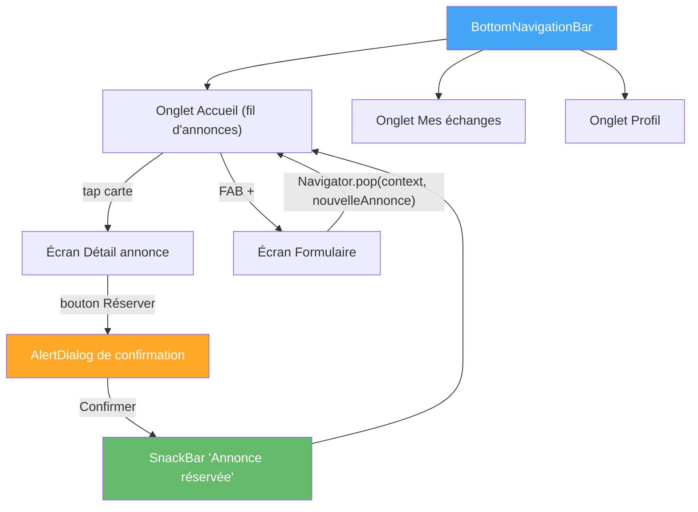

# TP5 — Navigation, Dialog, SnackBar, Drawer et Tabs

## Objectifs
- Mettre en place la navigation entre écrans avec routes nommées et passage de données.
- Retourner des données depuis un écran vers l'écran précédent.
- Utiliser `Dialog`, `SnackBar`, `Drawer` et `Tabs` pour enrichir l'expérience utilisateur.
- Mettre en place la structure de navigation principale de LocalSwap (`BottomNavigationBar`).

## Prérequis
- TP4 terminé (liste d'annonces affichée avec `CarteAnnonce`).

---

## Rappel de cours — Notions et définitions

**Navigation impérative** : `Navigator.push(context, MaterialPageRoute(builder: (_) => EcranB()))` empile un écran ; `Navigator.pop(context)` revient en arrière.

**Routes nommées et passage de données** : routes déclarées dans `MaterialApp(routes: {...})`, appelées par `Navigator.pushNamed(context, '/detail', arguments: annonce)`, données récupérées via `ModalRoute.of(context)!.settings.arguments`.

**Routes générées dynamiquement (`onGenerateRoute`)** : permet de construire une route dont le contenu dépend des arguments reçus, utile quand une route nommée doit varier selon l'objet transmis (ex. écran détail selon l'annonce cliquée).

**Retourner des données depuis une route** : `Navigator.pop(context, valeurDeRetour)` permet à l'écran appelant de récupérer une valeur via `await Navigator.push(...)` (ex. un formulaire qui retourne la nouvelle annonce créée à l'écran d'accueil).

**`showDialog()` / `AlertDialog` / `SimpleDialog`** : boîtes de dialogue modales, utiles pour une confirmation (ex. "Confirmer la réservation ?").

**`SnackBar`** : message temporaire affiché en bas de l'écran (ex. "Annonce réservée avec succès").

**`Drawer`** : tiroir de navigation latéral, généralement ouvert depuis l'icône "hamburger" de l'`AppBar`.

**`TabBar` / `TabBarView`** : navigation par onglets au sein d'un même écran (ex. onglets "Toutes / Mes annonces / Réservées").

**`BottomNavigationBar`** : barre de navigation principale en bas d'écran, pour basculer entre les sections majeures de l'application (ex. Accueil / Mes échanges / Profil).

## Diagramme — Navigation principale de LocalSwap

---

## Partie A — Guidée

### Exercice 5.1 — Navigation impérative simple
**Objectif :** comprendre la pile de navigation avant les routes nommées.

1. Créer deux écrans `EcranA` et `EcranB` (simples `Scaffold` avec un `Text` différent).
2. Depuis `EcranA`, ajouter un bouton qui exécute `Navigator.push(context, MaterialPageRoute(builder: (_) => EcranB()))`.
3. Dans `EcranB`, ajouter un bouton "Retour" qui exécute `Navigator.pop(context)`.
4. **Observation :** utiliser le bouton "retour" natif du téléphone/émulateur en plus du bouton applicatif ; constater qu'il produit le même effet (dépilement de la pile de navigation).

### Exercice 5.2 — Routes nommées et passage de données
**Objectif :** structurer la navigation de façon déclarative et transmettre un objet.

1. Déclarer dans `MaterialApp` : `routes: {'/a': (_) => EcranA(), '/b': (_) => EcranB()}`.
2. Naviguer avec `Navigator.pushNamed(context, '/b')`.
3. Créer une classe simple `Produit { String nom; double prix; }`, puis naviguer avec `Navigator.pushNamed(context, '/b', arguments: unProduit)`.
4. Dans `EcranB`, récupérer l'argument avec `final produit = ModalRoute.of(context)!.settings.arguments as Produit;` et l'afficher.
5. **Erreur à observer volontairement :** oublier le `as Produit` (cast) et constater l'erreur de type à l'exécution — corriger ensuite.

### Exercice 5.3 — Routes générées dynamiquement (`onGenerateRoute`)
**Objectif :** construire une route dont le contenu dépend de l'argument reçu, sans passer par la table `routes` statique.

1. Retirer `EcranB` de la table `routes` et le gérer plutôt via `onGenerateRoute` dans `MaterialApp`, en inspectant `settings.name` et `settings.arguments` pour construire dynamiquement `MaterialPageRoute(builder: (_) => EcranB(produit: ...))`.
2. Vérifier que la navigation `Navigator.pushNamed(context, '/b', arguments: unProduit)` fonctionne toujours à l'identique.
3. **Question :** quel avantage `onGenerateRoute` apporte-t-il par rapport à la table `routes` classique, en particulier si l'écran cible nécessite un argument obligatoire dans son constructeur ?

### Exercice 5.4 — Retour de données depuis une route
**Objectif :** faire remonter une information de l'écran enfant vers l'écran parent.

1. Dans `EcranB`, ajouter un champ de saisie et un bouton "Valider" qui exécute `Navigator.pop(context, texteSaisi)`.
2. Dans `EcranA`, remplacer l'appel `Navigator.push` par : `final resultat = await Navigator.push(context, MaterialPageRoute(builder: (_) => EcranB())); if (resultat != null) { ... afficher resultat ... }`.
3. Vérifier le comportement si l'utilisateur revient en arrière sans valider (bouton retour natif) : que reçoit `resultat` dans ce cas ? En déduire l'importance du test `if (resultat != null)`.

### Exercice 5.5 — AlertDialog et SnackBar
**Objectif :** manipuler les deux mécanismes de feedback les plus courants.

1. Ajouter un bouton "Supprimer" qui ouvre un `showDialog` avec un `AlertDialog` proposant "Annuler" / "Confirmer".
2. Sur "Confirmer", fermer le dialogue (`Navigator.pop(context)`) puis afficher une `SnackBar` ("Élément supprimé") avec `ScaffoldMessenger.of(context).showSnackBar(...)`.
3. Ajouter une action "Annuler" à la `SnackBar` elle-même (`SnackBarAction`) qui affiche un second message ("Suppression annulée").
4. Remplacer l'`AlertDialog` par un `SimpleDialog` proposant 3 choix (ex. "Signaler", "Modifier", "Supprimer") et observer la différence d'usage entre les deux widgets.

### Exercice 5.6 — Drawer et Tabs
**Objectif :** mettre en place deux mécanismes de navigation secondaire.

1. Ajouter un `Drawer` au `Scaffold` (`drawer: Drawer(child: ListView(children: [...]))`) avec 2-3 `ListTile` de menu, ouvert via l'icône hamburger automatique de l'`AppBar`.
2. Créer un écran avec `TabBar`/`TabBarView` à 3 onglets (ex. "Onglet 1", "Onglet 2", "Onglet 3"), chaque onglet affichant un contenu différent, en utilisant un `DefaultTabController` (ou un `TabController` explicite avec `SingleTickerProviderStateMixin`).
3. **Question de synthèse :** dans quel cas choisirait-on un `Drawer` plutôt que des `Tabs`, et inversement, pour organiser la navigation d'une application ?

### Exercice 5.7 — BottomNavigationBar
**Objectif :** mettre en place le squelette de navigation principale, réutilisable pour LocalSwap.

1. Créer un `Scaffold` avec `bottomNavigationBar: BottomNavigationBar(items: [...])` à 3 items (icônes + labels).
2. Gérer l'`int _indexSelectionne` dans un `StatefulWidget`, mis à jour par `onTap` avec `setState`.
3. Afficher un widget différent dans le `body` du `Scaffold` selon `_indexSelectionne` (via une `List<Widget>` d'écrans et un `IndexedStack` ou un simple accès par index).
4. Vérifier que changer d'onglet ne recrée pas les écrans depuis zéro si on utilise `IndexedStack` (comparer avec un accès par index simple qui reconstruit l'écran à chaque changement).

## Partie B — Application au projet LocalSwap

1. **Navigation principale** : structurer l'application autour d'une `BottomNavigationBar` à 3 onglets : *Accueil* (fil d'annonces, TP4), *Mes échanges* (écran à compléter au TP7/TP8), *Profil* (TP4).
2. **Écran Détail** : accessible depuis une `CarteAnnonce`, via route nommée `/detail` avec passage de l'objet `Annonce`. Afficher tous les détails (titre, description, catégorie, statut, propriétaire).
3. **Confirmation de réservation** : au clic sur "Réserver", afficher un `AlertDialog` ("Confirmer la réservation de cette annonce ?"). Si confirmé, afficher une `SnackBar` ("Annonce réservée avec succès") et revenir à l'accueil.
4. **Formulaire avec retour de données** : le futur écran de formulaire (TP6) sera ouvert via `await Navigator.pushNamed(context, '/formulaire')` et retournera la nouvelle annonce créée via `Navigator.pop(context, nouvelleAnnonce)`, récupérée par l'écran d'accueil pour mise à jour de la liste.
5. **Drawer optionnel** : ajouter un `Drawer` accessible depuis l'`AppBar` avec des liens vers "À propos de LocalSwap" et "Paramètres".

## Livrables
- Navigation principale par `BottomNavigationBar` (3 onglets).
- Écran Détail avec passage de données et `AlertDialog` de confirmation + `SnackBar`.
- Mécanisme de retour de données préparé pour le formulaire (branché complètement au TP6).

## Grille d'évaluation

| Critère | Points |
|---|---|
| BottomNavigationBar fonctionnelle | 5 |
| Navigation Détail avec passage de données | 5 |
| Dialog de confirmation + SnackBar | 6 |
| Mécanisme de retour de données préparé | 4 |
| **Total** | **20** |
