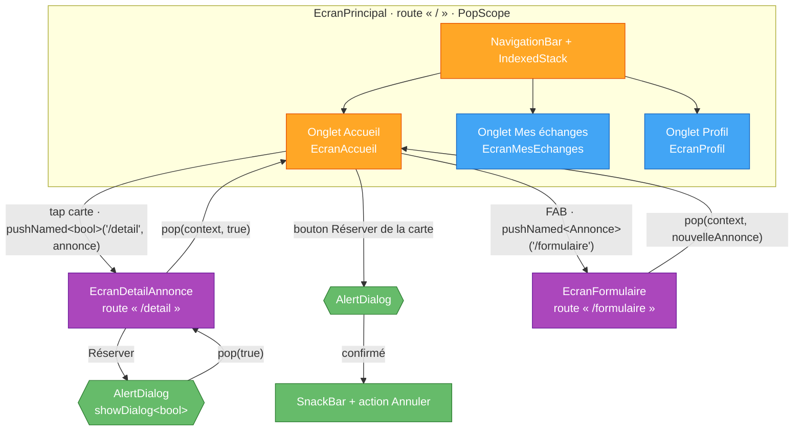

# TP5 — Navigation, dialogues, SnackBar et NavigationBar

> **Séance :** 3 h · **Environnement :** Flutter 3.x stable (≥ 3.27), Dart 3, VS Code / Android Studio, émulateur Android ou Chrome
> **Fil rouge :** LocalSwap — navigation principale à 3 onglets, écran Détail, confirmation de réservation, retour de données.

| Repère | Partie | Durée |
|---|---|---|
| 📘🗺️ | Rappel de cours + diagramme | 10 min |
| 🧪 | Partie A : exercices indépendants (5) | 70 min |
| 🏗️ | Partie B : navigation de LocalSwap | 45 min |
| 🤖 | Partie C : comprendre et maîtriser le code | 40 min |
| 📝 | Quiz de fin de TP | 10 min |
| 🎤 | Validation orale (5 min par binôme, **pendant** les parties B et C) | — |
| 🚀 | Partie D : défis bonus | hors temps |
| | **Total** | **175 min** |

Difficulté : 🟢 facile · 🟡 moyen · 🔴 difficile

---

## 🎯 Objectifs pédagogiques

À la fin de ce TP, vous serez capable de :

1. **Représenter** la pile de navigation après une suite de `push`, `pop` et `pushReplacement`.
2. **Passer** des données à un écran de façon typée (constructeur, `onGenerateRoute`) et **récupérer** un résultat avec `await`.
3. **Demander** une confirmation avec `showDialog<T>` et **proposer** une annulation avec `SnackBarAction`.
4. **Construire** une navigation principale à onglets (`NavigationBar` + `IndexedStack`) qui **conserve** l'état de chaque onglet.
5. **Sécuriser** l'utilisation de `BuildContext` après un `await` (`mounted`) et **contrôler** le bouton retour (`PopScope`).

## 📋 Prérequis

- **TP4** : `EcranAccueil` Stateful (liste/grille), `CarteAnnonce` Stateless avec `onTap`/`onReserver`, `EcranProfil`, `copyWith`, `mounted`.
- **TP2** : `Future`, `async`/`await`, expressions `switch` et patterns.

> [!IMPORTANT]
> **Règle sur l'IA.** Vous avez le droit d'utiliser une IA. Mais **60 % de la note** porte sur votre compréhension (Partie C, oral, quiz). Tenez le **📓 Journal IA** (C7) si vous l'utilisez.

---

## 📘 Rappel de cours

> [!NOTE]
> **La pile de navigation.** Le `Navigator` gère une **pile** d'écrans (*routes*) : seul celui du dessus est visible.
> - `Navigator.push(context, MaterialPageRoute(builder: (_) => EcranB()))` : **empile**.
> - `Navigator.pop(context)` : **dépile** (comme le bouton retour du téléphone).
> - `Navigator.pushReplacement(...)` : **remplace** l'écran du dessus (on ne peut plus y revenir).
> - `Navigator.popUntil(context, (route) => route.isFirst)` : revient à la base.
> Une boîte de dialogue est aussi une **route** : on la ferme avec `Navigator.pop`.

> [!NOTE]
> **Passer des données**
> - **Par le constructeur** (recommandé) : `EcranDetail(annonce: a)`. Typé, vérifié par le compilateur.
> - **Routes nommées** : `Navigator.pushNamed(context, '/detail', arguments: a)`. Dans `MaterialApp`, `onGenerateRoute` reçoit `settings.name` et `settings.arguments`, et construit l'écran **avec son constructeur typé**. Lire `ModalRoute.of(context)!.settings.arguments as X` dans l'écran est possible, mais fragile.

> [!NOTE]
> **Récupérer un résultat.** `push`, `pushNamed` et `showDialog` retournent un **`Future<T?>`** :
> `final bool? ok = await showDialog<bool>(...);`. L'écran appelé répond avec `Navigator.pop(context, valeur)`.
> Si l'utilisateur revient en arrière sans répondre, le résultat vaut **`null`**.
> Avec des routes nommées, la route construite doit avoir le **même type** : `MaterialPageRoute<bool>` pour un `pushNamed<bool>`.

> [!WARNING]
> **`BuildContext` après `await`.** Pendant un `await`, l'écran a pu être fermé. Avant d'utiliser `context` ou `setState` après un `await`, vérifiez **`if (!mounted) return;`** (dans un `State`) ou **`if (!context.mounted) return;`**. Le lint `use_build_context_synchronously` vous le rappelle.

> [!NOTE]
> **Retour système : `PopScope`** (remplace `WillPopScope`, déprécié). `canPop: false` bloque le retour ; `onPopInvokedWithResult: (didPop, result) { … }` est appelé à chaque tentative, pour par exemple demander une confirmation.

> [!NOTE]
> **Navigation principale Material 3 : `NavigationBar`** (recommandée à la place de `BottomNavigationBar`) avec des `NavigationDestination`. Les onglets **ne sont pas des routes** : on change simplement le contenu du `body`. Avec **`IndexedStack`**, tous les onglets restent dans l'arbre, et leur état est conservé.
> **`TabBar` + `TabBarView`** (dans un `DefaultTabController`) : sous-onglets **à l'intérieur** d'un écran. **`Drawer`** : menu latéral pour les sections secondaires.

## 🗺️ Diagramme — Navigation de LocalSwap



Légende : 🟠 écrans Stateful · 🔵 écrans Stateless · 🟣 routes empilées · 🟢 dialogues et messages.

---

## 🧪 Partie A — Exercices pédagogiques indépendants (sans LocalSwap) · 70 min

```bash
flutter create tp5_demos
cd tp5_demos
flutter run -t lib/ex1_news.dart
```

> [!TIP]
> **Tapez** le code, puis répondez aux questions **🔍** dans votre compte rendu.

---

### Exercice 5.1 — Lecteur d'actualités : la pile de navigation 🟢 · 12 min

**Notions nouvelles :** `Navigator.push`/`pop`, `pushReplacement`.

`lib/ex1_news.dart`

```dart
import 'package:flutter/material.dart';

void main() => runApp(const NewsApp());

class Article {
  const Article(this.title, this.body);

  final String title;
  final String body;
}

const List<Article> articles = [
  Article('Rentrée à l’ISET', 'Les cours reprennent lundi à 8 h.'),
  Article('Hackathon Flutter', 'Inscriptions ouvertes jusqu’au 15 novembre.'),
  Article('Bibliothèque', 'Nouveaux horaires : 8 h – 18 h.'),
];

class NewsApp extends StatelessWidget {
  const NewsApp({super.key});

  @override
  Widget build(BuildContext context) {
    return MaterialApp(
      debugShowCheckedModeBanner: false,
      theme: ThemeData(colorScheme: ColorScheme.fromSeed(seedColor: Colors.blue)),
      home: const NewsListPage(),
    );
  }
}

class NewsListPage extends StatelessWidget {
  const NewsListPage({super.key});

  @override
  Widget build(BuildContext context) {
    return Scaffold(
      appBar: AppBar(title: const Text('Actualités')),
      body: ListView.builder(
        itemCount: articles.length,
        itemBuilder: (context, index) {
          final Article article = articles[index];
          return ListTile(
            title: Text(article.title),
            trailing: const Icon(Icons.chevron_right),
            // EMPILE un écran ; la donnée passe par le CONSTRUCTEUR (typé).
            onTap: () => Navigator.push(
              context,
              MaterialPageRoute(builder: (context) => ArticlePage(article: article)),
            ),
          );
        },
      ),
    );
  }
}

class ArticlePage extends StatelessWidget {
  const ArticlePage({super.key, required this.article});

  final Article article;

  @override
  Widget build(BuildContext context) {
    final Article next = articles[(articles.indexOf(article) + 1) % articles.length];

    return Scaffold(
      // La flèche « retour » de l'AppBar est ajoutée automatiquement.
      appBar: AppBar(title: Text(article.title)),
      body: Padding(
        padding: const EdgeInsets.all(16),
        child: Column(
          crossAxisAlignment: CrossAxisAlignment.stretch,
          children: [
            Text(article.body, style: Theme.of(context).textTheme.bodyLarge),
            const SizedBox(height: 24),
            FilledButton.icon(
              onPressed: () => Navigator.pop(context), // DÉPILE
              icon: const Icon(Icons.arrow_back),
              label: const Text('Retour'),
            ),
            OutlinedButton(
              onPressed: () => Navigator.push(
                context,
                MaterialPageRoute(builder: (context) => ArticlePage(article: next)),
              ),
              child: const Text('Article suivant (empiler)'),
            ),
            OutlinedButton(
              onPressed: () => Navigator.pushReplacement(
                context,
                MaterialPageRoute(builder: (context) => ArticlePage(article: next)),
              ),
              child: const Text('Article suivant (remplacer)'),
            ),
            TextButton(
              onPressed: () => Navigator.popUntil(context, (route) => route.isFirst),
              child: const Text('Revenir à la liste'),
            ),
          ],
        ),
      ),
    );
  }
}
```

**🔍 Observer & répondre**

1. Ouvrez le 1ᵉʳ article, puis cliquez **deux fois** sur « empiler ». Combien d'appuis sur le bouton retour du téléphone faut-il pour revenir à la liste ? Dessinez la pile.
2. Même chose avec « remplacer ». Combien d'appuis maintenant ? Dessinez la pile.
3. Sur la liste (base de la pile), appuyez sur retour. Que se passe-t-il sur Android ?
4. Pourquoi passer l'article au **constructeur** de `ArticlePage` est-il plus sûr que d'utiliser une variable globale « article courant » ?

---

### Exercice 5.2 — Catalogue : routes nommées et `onGenerateRoute` 🟡 · 15 min

**Notions nouvelles :** routes nommées, `onGenerateRoute` (+ `onUnknownRoute`).

`lib/ex2_catalog.dart`

```dart
import 'package:flutter/material.dart';

void main() => runApp(const CatalogApp());

class Product {
  const Product(this.id, this.name, this.price);

  final String id;
  final String name;
  final double price;
}

const List<Product> products = [
  Product('p1', 'Clé USB 64 Go', 25),
  Product('p2', 'Souris sans fil', 39.9),
  Product('p3', 'Casque audio', 120),
];

/// Noms de routes centralisés : pas de chaîne tapée deux fois.
class AppRoutes {
  const AppRoutes._(); // non instanciable

  static const String product = '/product';
  static const String cart = '/cart';
}

class CatalogApp extends StatelessWidget {
  const CatalogApp({super.key});

  @override
  Widget build(BuildContext context) {
    return MaterialApp(
      debugShowCheckedModeBanner: false,
      theme: ThemeData(colorScheme: ColorScheme.fromSeed(seedColor: Colors.teal)),
      home: const CatalogPage(), // route « / »
      // 1) Table statique : routes SANS argument
      routes: {
        AppRoutes.cart: (context) => const CartPage(),
      },
      // 2) Routes AVEC argument : construites ici, avec un constructeur typé
      onGenerateRoute: (settings) => switch (settings) {
        RouteSettings(name: AppRoutes.product, arguments: final Product product) =>
          MaterialPageRoute<void>(
            settings: settings,
            builder: (context) => ProductPage(product: product),
          ),
        _ => null, // inconnu → onUnknownRoute
      },
      // 3) Filet de sécurité
      onUnknownRoute: (settings) => MaterialPageRoute<void>(
        builder: (context) => NotFoundPage(routeName: settings.name),
      ),
    );
  }
}

class CatalogPage extends StatelessWidget {
  const CatalogPage({super.key});

  @override
  Widget build(BuildContext context) {
    return Scaffold(
      appBar: AppBar(
        title: const Text('Catalogue'),
        actions: [
          IconButton(
            tooltip: 'Panier',
            onPressed: () => Navigator.pushNamed(context, AppRoutes.cart),
            icon: const Icon(Icons.shopping_cart_outlined),
          ),
        ],
      ),
      body: ListView(
        children: [
          for (final Product product in products)
            ListTile(
              title: Text(product.name),
              subtitle: Text('${product.price.toStringAsFixed(2)} DT'),
              onTap: () => Navigator.pushNamed(context, AppRoutes.product, arguments: product),
            ),
          const Divider(),
          ListTile(
            leading: const Icon(Icons.bug_report_outlined),
            title: const Text('Test : route inconnue'),
            onTap: () => Navigator.pushNamed(context, '/promo'),
          ),
          ListTile(
            leading: const Icon(Icons.bug_report_outlined),
            title: const Text('Test : mauvais argument'),
            onTap: () => Navigator.pushNamed(context, AppRoutes.product, arguments: 'p1'),
          ),
        ],
      ),
    );
  }
}

class ProductPage extends StatelessWidget {
  const ProductPage({super.key, required this.product});

  final Product product;

  @override
  Widget build(BuildContext context) {
    return Scaffold(
      appBar: AppBar(title: Text(product.name)),
      body: Center(
        child: Text(
          '${product.price.toStringAsFixed(2)} DT',
          style: Theme.of(context).textTheme.displaySmall,
        ),
      ),
    );
  }
}

class CartPage extends StatelessWidget {
  const CartPage({super.key});

  @override
  Widget build(BuildContext context) {
    return Scaffold(
      appBar: AppBar(title: const Text('Panier')),
      body: const Center(child: Text('Panier vide')),
    );
  }
}

class NotFoundPage extends StatelessWidget {
  const NotFoundPage({super.key, required this.routeName});

  final String? routeName;

  @override
  Widget build(BuildContext context) {
    return Scaffold(
      appBar: AppBar(title: const Text('Introuvable')),
      body: Center(child: Text('Aucune page pour « $routeName »')),
    );
  }
}
```

**🔍 Observer & répondre**

1. Testez « route inconnue » et « mauvais argument ». Quelle ligne de `onGenerateRoute` décide, dans chaque cas ?
2. Pourquoi `ProductPage` ne figure-t-elle pas dans la table `routes` ? Que faudrait-il écrire dans `ProductPage` pour l'y mettre, et quel risque cela introduirait-il ?
3. Ajoutez une route `/about` sans argument. Où l'ajoutez-vous, et pourquoi là ?

---

### Exercice 5.3 — Corbeille : dialogues et SnackBar 🟡 · 15 min

**Notions nouvelles :** `showDialog<T>` (résultat), `SnackBarAction`.

`lib/ex3_trash.dart`

```dart
import 'package:flutter/material.dart';

void main() => runApp(const TrashApp());

enum FileAction { rename, share, delete }

class TrashApp extends StatelessWidget {
  const TrashApp({super.key});

  @override
  Widget build(BuildContext context) {
    return MaterialApp(
      debugShowCheckedModeBanner: false,
      theme: ThemeData(colorScheme: ColorScheme.fromSeed(seedColor: Colors.red)),
      home: const FilesPage(),
    );
  }
}

class FilesPage extends StatefulWidget {
  const FilesPage({super.key});

  @override
  State<FilesPage> createState() => _FilesPageState();
}

class _FilesPageState extends State<FilesPage> {
  final List<String> _files = ['rapport.pdf', 'photo.png', 'notes.txt', 'budget.xlsx'];

  void _showMessage(String text, {SnackBarAction? action}) {
    ScaffoldMessenger.of(context)
      ..hideCurrentSnackBar()
      ..showSnackBar(SnackBar(content: Text(text), action: action));
  }

  Future<void> _delete(int index) async {
    final String name = _files[index];

    // showDialog retourne un Future : la valeur donnée à Navigator.pop(dialogContext, valeur).
    final bool? confirmed = await showDialog<bool>(
      context: context,
      builder: (dialogContext) => AlertDialog(
        icon: const Icon(Icons.delete_outline),
        title: Text('Supprimer « $name » ?'),
        content: const Text('Le fichier sera placé dans la corbeille.'),
        actions: [
          TextButton(
            onPressed: () => Navigator.pop(dialogContext, false),
            child: const Text('Annuler'),
          ),
          FilledButton(
            onPressed: () => Navigator.pop(dialogContext, true),
            child: const Text('Supprimer'),
          ),
        ],
      ),
    );

    // null = dialogue fermé en touchant à côté ; !mounted = page fermée entre-temps.
    if (confirmed != true || !mounted) return;

    setState(() => _files.removeAt(index));
    _showMessage(
      '« $name » supprimé',
      action: SnackBarAction(
        label: 'Annuler',
        onPressed: () => setState(() => _files.insert(index, name)),
      ),
    );
  }

  Future<void> _showActions(int index) async {
    final FileAction? action = await showDialog<FileAction>(
      context: context,
      builder: (dialogContext) => SimpleDialog(
        title: Text(_files[index]),
        children: [
          SimpleDialogOption(
            onPressed: () => Navigator.pop(dialogContext, FileAction.rename),
            child: const Text('Renommer'),
          ),
          SimpleDialogOption(
            onPressed: () => Navigator.pop(dialogContext, FileAction.share),
            child: const Text('Partager'),
          ),
          SimpleDialogOption(
            onPressed: () => Navigator.pop(dialogContext, FileAction.delete),
            child: const Text('Supprimer'),
          ),
        ],
      ),
    );
    if (!mounted) return;

    switch (action) {
      case FileAction.delete:
        await _delete(index);
      case FileAction.rename:
        _showMessage('Renommer : bientôt');
      case FileAction.share:
        _showMessage('Partager : bientôt');
      case null:
        break; // fermé sans choix
    }
  }

  @override
  Widget build(BuildContext context) {
    return Scaffold(
      appBar: AppBar(title: Text('Mes fichiers (${_files.length})')),
      body: _files.isEmpty
          ? const Center(child: Text('Aucun fichier'))
          : ListView.builder(
              itemCount: _files.length,
              itemBuilder: (context, index) => ListTile(
                leading: const Icon(Icons.insert_drive_file_outlined),
                title: Text(_files[index]),
                onTap: () => _showActions(index),
                trailing: IconButton(
                  tooltip: 'Supprimer',
                  onPressed: () => _delete(index),
                  icon: const Icon(Icons.delete_outline),
                ),
              ),
            ),
    );
  }
}
```

**🔍 Observer & répondre**

1. Ouvrez le dialogue de suppression, puis touchez **à côté**. Que vaut `confirmed` ? Que se passerait-il si l'on avait écrit `if (!confirmed!) return;` ?
2. Pourquoi utiliser `dialogContext` (et non `context`) dans le `builder` du dialogue ? (indice : à quelle route appartient chaque contexte ?)
3. Supprimez un fichier puis cliquez sur « Annuler » dans la `SnackBar`. Revient-il **à sa place** ? Quelle ligne le garantit ?
4. Quelle différence d'usage faites-vous entre `AlertDialog` et `SimpleDialog` ?

---

### Exercice 5.4 — Choisir sa ville : retour de données et PopScope 🔴 · 15 min

**Notions nouvelles :** `Navigator.pop(context, résultat)` + `await push<T>`, `PopScope`.

`lib/ex4_city_picker.dart`

```dart
import 'package:flutter/material.dart';

void main() => runApp(const CityApp());

class CityApp extends StatelessWidget {
  const CityApp({super.key});

  @override
  Widget build(BuildContext context) {
    return MaterialApp(
      debugShowCheckedModeBanner: false,
      theme: ThemeData(colorScheme: ColorScheme.fromSeed(seedColor: Colors.orange)),
      home: const ProfilePage(),
    );
  }
}

class ProfilePage extends StatefulWidget {
  const ProfilePage({super.key});

  @override
  State<ProfilePage> createState() => _ProfilePageState();
}

class _ProfilePageState extends State<ProfilePage> {
  String _city = 'non choisie';

  Future<void> _chooseCity() async {
    // push<String> → Future<String?> : null si l'utilisateur revient sans valider.
    final String? city = await Navigator.push<String>(
      context,
      MaterialPageRoute(builder: (context) => CityPickerPage(initial: _city)),
    );
    if (!mounted) return;
    if (city == null) {
      ScaffoldMessenger.of(context)
          .showSnackBar(const SnackBar(content: Text('Aucun changement')));
      return;
    }
    setState(() => _city = city);
  }

  @override
  Widget build(BuildContext context) {
    return Scaffold(
      appBar: AppBar(title: const Text('Mon profil')),
      body: Center(
        child: Column(
          mainAxisSize: MainAxisSize.min,
          children: [
            Text('Ville : $_city', style: Theme.of(context).textTheme.headlineSmall),
            const SizedBox(height: 16),
            FilledButton(onPressed: _chooseCity, child: const Text('Changer de ville')),
          ],
        ),
      ),
    );
  }
}

class CityPickerPage extends StatefulWidget {
  const CityPickerPage({super.key, required this.initial});

  final String initial;

  @override
  State<CityPickerPage> createState() => _CityPickerPageState();
}

class _CityPickerPageState extends State<CityPickerPage> {
  static const List<String> _cities = ['Tunis', 'Bizerte', 'Sousse', 'Sfax', 'Nabeul', 'Gabès'];
  String? _selected;

  bool get _hasUnsavedChoice => _selected != null && _selected != widget.initial;

  Future<bool> _confirmLeave() async {
    final bool? leave = await showDialog<bool>(
      context: context,
      builder: (dialogContext) => AlertDialog(
        title: const Text('Abandonner votre choix ?'),
        actions: [
          TextButton(
            onPressed: () => Navigator.pop(dialogContext, false),
            child: const Text('Rester'),
          ),
          FilledButton(
            onPressed: () => Navigator.pop(dialogContext, true),
            child: const Text('Quitter'),
          ),
        ],
      ),
    );
    return leave ?? false;
  }

  @override
  Widget build(BuildContext context) {
    return PopScope<String>(
      // Retour bloqué s'il y a un choix non validé
      canPop: !_hasUnsavedChoice,
      onPopInvokedWithResult: (bool didPop, String? result) async {
        if (didPop) return; // la page est déjà fermée
        final bool leave = await _confirmLeave();
        if (leave && context.mounted) Navigator.pop(context); // quitte SANS résultat
      },
      child: Scaffold(
        appBar: AppBar(title: const Text('Choisir une ville')),
        body: ListView(
          children: [
            for (final String city in _cities)
              ListTile(
                title: Text(city),
                selected: city == _selected,
                trailing: city == _selected ? const Icon(Icons.check) : null,
                onTap: () => setState(() => _selected = city),
              ),
          ],
        ),
        floatingActionButton: FloatingActionButton.extended(
          // Navigator.pop n'est PAS bloqué par PopScope : on renvoie le résultat
          onPressed: _selected == null ? null : () => Navigator.pop(context, _selected),
          icon: const Icon(Icons.check),
          label: const Text('Valider'),
        ),
      ),
    );
  }
}
```

**🔍 Observer & répondre**

1. Ouvrez le sélecteur, **ne choisissez rien**, appuyez sur retour. Que reçoit `ProfilePage` ? Quel message s'affiche ?
2. Choisissez « Sfax », puis appuyez sur retour. Que se passe-t-il ? Et si vous choisissez « Rester » ?
3. Choisissez « Sfax » puis « Valider ». Pourquoi `PopScope` ne bloque-t-il pas cette sortie ?
4. Retirez `if (!mounted) return;` dans `_chooseCity` : quel avertissement donne `flutter analyze` ? Dans quel scénario réel y aurait-il un plantage ?

---

### Exercice 5.5 — Application de cours : NavigationBar, IndexedStack et TabBar 🟡 · 13 min

**Notions nouvelles :** `NavigationBar` + `IndexedStack`, `TabBar`/`TabBarView`.

`lib/ex5_course_app.dart`

```dart
import 'package:flutter/material.dart';

void main() => runApp(const CourseApp());

class CourseApp extends StatelessWidget {
  const CourseApp({super.key});

  @override
  Widget build(BuildContext context) {
    return MaterialApp(
      debugShowCheckedModeBanner: false,
      theme: ThemeData(colorScheme: ColorScheme.fromSeed(seedColor: Colors.deepPurple)),
      home: const HomeShell(),
    );
  }
}

class HomeShell extends StatefulWidget {
  const HomeShell({super.key});

  @override
  State<HomeShell> createState() => _HomeShellState();
}

class _HomeShellState extends State<HomeShell> {
  int _index = 0;

  static const List<Widget> _pages = [
    CounterTab(label: 'Accueil'),
    ScheduleTab(),
    CounterTab(label: 'Profil'),
  ];

  @override
  Widget build(BuildContext context) {
    return Scaffold(
      // IndexedStack garde TOUS les onglets dans l'arbre : leur état est conservé.
      body: IndexedStack(index: _index, children: _pages),
      // body: _pages[_index], // ← variante à tester (question 1)
      bottomNavigationBar: NavigationBar(
        selectedIndex: _index,
        onDestinationSelected: (int i) => setState(() => _index = i),
        destinations: const [
          NavigationDestination(
            icon: Icon(Icons.home_outlined),
            selectedIcon: Icon(Icons.home),
            label: 'Accueil',
          ),
          NavigationDestination(
            icon: Icon(Icons.calendar_month_outlined),
            selectedIcon: Icon(Icons.calendar_month),
            label: 'Emploi du temps',
          ),
          NavigationDestination(
            icon: Icon(Icons.person_outline),
            selectedIcon: Icon(Icons.person),
            label: 'Profil',
          ),
        ],
      ),
    );
  }
}

class CounterTab extends StatefulWidget {
  const CounterTab({super.key, required this.label});

  final String label;

  @override
  State<CounterTab> createState() => _CounterTabState();
}

class _CounterTabState extends State<CounterTab> {
  int _visits = 0;

  @override
  void initState() {
    super.initState();
    debugPrint('initState de ${widget.label}');
  }

  @override
  Widget build(BuildContext context) {
    return Scaffold(
      appBar: AppBar(title: Text(widget.label)),
      body: Center(
        child: FilledButton(
          onPressed: () => setState(() => _visits++),
          child: Text('Clics : $_visits'),
        ),
      ),
    );
  }
}

class ScheduleTab extends StatelessWidget {
  const ScheduleTab({super.key});

  static const Map<String, List<String>> _days = {
    'Lundi': ['08:00 Flutter (TP)', '10:00 Réseaux', '14:00 Anglais'],
    'Mardi': ['08:00 Bases de données', '13:00 Projet tutoré'],
    'Mercredi': ['09:00 DevOps', '11:00 Gestion de projet'],
  };

  @override
  Widget build(BuildContext context) {
    return DefaultTabController(
      length: _days.length,
      child: Scaffold(
        appBar: AppBar(
          title: const Text('Emploi du temps'),
          bottom: TabBar(
            tabs: [for (final String day in _days.keys) Tab(text: day)],
          ),
        ),
        body: TabBarView(
          children: [
            for (final List<String> slots in _days.values)
              ListView(
                children: [
                  for (final String slot in slots)
                    ListTile(leading: const Icon(Icons.schedule), title: Text(slot)),
                ],
              ),
          ],
        ),
      ),
    );
  }
}
```

**🔍 Observer & répondre**

1. Cliquez 3 fois dans « Accueil », allez dans « Profil », puis revenez. Le compteur est-il conservé ? Combien de lignes `initState` voyez-vous au démarrage ? Recommencez avec `body: _pages[_index]` et comparez.
2. Quel inconvénient `IndexedStack` peut-il avoir si chaque onglet charge des données lourdes au démarrage ?
3. Dans quels cas choisir une `NavigationBar`, des `TabBar` ou un `Drawer` ? Donnez un exemple réel pour chacun.

---

## 🏗️ Partie B — Navigation de LocalSwap · 45 min

```text
lib/
├── main.dart                          ← onGenerateRoute
├── navigation/
│   └── routes.dart                    ← NOUVEAU : noms de routes + genererRoute()
├── screens/
│   ├── ecran_principal.dart           ← NOUVEAU : NavigationBar + IndexedStack + PopScope
│   ├── ecran_accueil.dart             ← modifié
│   ├── ecran_detail_annonce.dart      ← NOUVEAU
│   ├── ecran_formulaire.dart          ← NOUVEAU (provisoire, complété au TP6)
│   ├── ecran_mes_echanges.dart        ← NOUVEAU (provisoire)
│   └── ecran_profil.dart              ← TP4
└── widgets/
    └── dialogue_confirmation.dart     ← NOUVEAU
```

### B.1 — Routes 🟡

Dans `routes.dart` :
- une classe `Routes` non instanciable avec `static const String detail = '/detail';` et `formulaire = '/formulaire'` ;
- une fonction `Route<dynamic>? genererRoute(RouteSettings settings)` avec une expression `switch` et des patterns (comme l'ex. 5.2) :
  - `/detail` + argument `Annonce` → `MaterialPageRoute<bool>` vers `EcranDetailAnnonce(annonce: …)` ;
  - `/formulaire` → `MaterialPageRoute<Annonce>` vers `EcranFormulaire()` ;
  - sinon `null`.

Dans `main.dart` : `home: const EcranPrincipal()`, `onGenerateRoute: genererRoute`, et un `onUnknownRoute` simple.

> [!WARNING]
> Le **type** de la route doit correspondre à l'appel : `pushNamed<bool>` exige une `MaterialPageRoute<bool>`. Sinon, erreur à l'exécution : `type 'MaterialPageRoute<void>' is not a subtype of type 'Route<bool?>?'`.

### B.2 — `EcranPrincipal` 🟡

`StatefulWidget` avec `int _index` :
- `NavigationBar` à 3 destinations : *Accueil*, *Mes échanges*, *Profil* (icônes `outlined` + `selectedIcon`) ;
- `IndexedStack` avec `EcranAccueil`, `EcranMesEchanges` (texte « Vos échanges apparaîtront ici — TP7 ») et `EcranProfil` ;
- `PopScope` : sur les onglets 2 et 3, le bouton retour **revient à l'Accueil** au lieu de quitter l'application (`canPop: _index == 0`).

### B.3 — Dialogue de confirmation réutilisable 🟢

Dans `dialogue_confirmation.dart` : `Future<bool> confirmerReservation(BuildContext context, Annonce annonce)`, qui affiche un `AlertDialog` (« Réserver « titre » ? », boutons *Annuler* / *Réserver*) et retourne `true` **seulement** si l'utilisateur confirme (`?? false`).

### B.4 — `EcranDetailAnnonce` 🟡

Reçoit une `Annonce` par son constructeur et affiche : en-tête coloré avec l'icône de la catégorie, `BadgeStatut`, titre, libellé de catégorie, description (ou « Pas de description »), propriétaire. Bouton « Réserver » :
- désactivé si `!peutReserver(annonce)` ;
- sinon `confirmerReservation` puis, si c'est confirmé, **`Navigator.pop(context, true)`**.

### B.5 — `EcranAccueil` : brancher la navigation 🟡

1. `onTap` d'une carte → `_ouvrirDetail(annonce)` : `await Navigator.pushNamed<bool>(context, Routes.detail, arguments: annonce)` ; si le résultat est `true` (et si `mounted`), réserver l'annonce.
2. `onReserver` d'une carte → `confirmerReservation` **avant** de réserver.
3. Après une réservation : `SnackBar` « … réservée » avec une action **« Annuler »** qui remet le statut `disponible`.
4. FAB « Publier » → `await Navigator.pushNamed<Annonce>(context, Routes.formulaire)` ; si une annonce revient, l'insérer **en tête** de la liste.

### B.6 — Formulaire provisoire 🟢

`EcranFormulaire` affiche « Formulaire complet au TP6 » et un bouton « Créer une annonce de test » qui fait `Navigator.pop(context, Annonce(...))` (identifiant : `DateTime.now().millisecondsSinceEpoch.toString()`).

### B.7 — Drawer (facultatif) 🟢

Sur l'accueil : `Drawer` avec `NavigationDrawer` ou `ListView` de `ListTile` : « À propos » (`showAboutDialog`) et « Paramètres » (`SnackBar` « Bientôt »).

Terminez par `flutter analyze` (aucun problème, aucun `use_build_context_synchronously`) et un commit : `feat: navigation principale, détail et réservation`.

---

## 🤖 Partie C — Comprendre et maîtriser le code · 40 min

> [!CAUTION]
> Pour C1, C2 et C3, **répondez d'abord sur papier, sans exécuter et sans IA**. Vérifiez ensuite sur machine.

### C1 — Prédire avant d'exécuter 🟡 · 8 min

La pile contient `[Liste]`. Dessinez la pile **après chaque étape**, puis indiquez ce qu'affiche l'écran à la fin.

1. `push(A)`
2. `push(B)`
3. `pushReplacement(C)`
4. `push(D)`
5. `pop()`
6. `popUntil((route) => route.isFirst)`

Puis : dans l'exercice 5.4, `ProfilePage` exécute `final city = await Navigator.push<String>(...)`. Que vaut `city` dans chacun de ces cas ? (a) « Valider » après avoir choisi Gabès ; (b) bouton retour sans choix ; (c) choix de Sfax, retour, puis « Quitter ».

### C2 — Trouver les bugs 🟡 · 8 min

Ce code contient **4 erreurs**. Pour chacune : ligne, symptôme, cause, correction.

```dart
class RegionPage extends StatefulWidget {
  const RegionPage({super.key});

  @override
  State<RegionPage> createState() => _RegionPageState();
}

class _RegionPageState extends State<RegionPage> {
  late final String _region;
  String _chosen = 'aucune';

  @override
  void initState() {
    super.initState();
    _region = ModalRoute.of(context)!.settings.arguments as String;
  }

  Future<void> _pickCity() async {
    final city = Navigator.push<String>(
      context,
      MaterialPageRoute(builder: (_) => const CityPickerPage(initial: '')),
    );
    setState(() => _chosen = '$city');
  }

  Future<void> _openDetails() async {
    await Future<void>.delayed(const Duration(milliseconds: 300)); // petite animation
    Navigator.pushReplacement(
      context,
      MaterialPageRoute(builder: (_) => DetailsPage(city: _chosen)),
    );
  }

  @override
  Widget build(BuildContext context) {
    return Scaffold(
      appBar: AppBar(title: Text('Région : $_region')),
      body: Column(
        children: [
          Text('Ville choisie : $_chosen'),
          FilledButton(onPressed: _pickCity, child: const Text('Choisir')),
          FilledButton(onPressed: _openDetails, child: const Text('Voir les détails')),
        ],
      ),
    );
  }
}
```

### C3 — Critiquer du code généré par une IA 🔴 · 12 min

Prompt : *« Fais une navigation en bas à 3 onglets avec un écran de détail et une confirmation de réservation »*. Réponse de l'IA :

```dart
class MainPage extends StatefulWidget {
  @override
  _MainPageState createState() => _MainPageState();
}

class _MainPageState extends State<MainPage> {
  int currentIndex = 0;

  @override
  Widget build(BuildContext context) {
    final pages = [HomePage(), SearchPage(), ProfilePage()];
    return WillPopScope(
      onWillPop: () async {
        if (currentIndex != 0) {
          setState(() => currentIndex = 0);
          return false;
        }
        return true;
      },
      child: Scaffold(
        body: pages[currentIndex],
        bottomNavigationBar: BottomNavigationBar(
          currentIndex: currentIndex,
          selectedItemColor: Colors.blue,
          unselectedItemColor: Colors.grey,
          onTap: (i) => setState(() => currentIndex = i),
          items: [
            BottomNavigationBarItem(icon: Icon(Icons.home), label: 'Home'),
            BottomNavigationBarItem(icon: Icon(Icons.search), label: 'Search'),
            BottomNavigationBarItem(icon: Icon(Icons.person), label: 'Profile'),
          ],
        ),
      ),
    );
  }
}

// Dans HomePage, au tap sur un élément :
//   Navigator.pushNamed(context, '/detail', arguments: {'id': item.id, 'title': item.title});

class DetailPage extends StatelessWidget {
  @override
  Widget build(BuildContext context) {
    final args = ModalRoute.of(context)!.settings.arguments as Map;
    return Scaffold(
      appBar: AppBar(title: Text(args['titre'])),
      body: ElevatedButton(
        onPressed: () async {
          final ok = await showDialog(
            context: context,
            builder: (_) => AlertDialog(
              title: Text('Confirmer ?'),
              actions: [
                TextButton(onPressed: () => Navigator.pop(context, true), child: Text('Oui')),
              ],
            ),
          );
          if (ok) {
            Navigator.pop(context);
            ScaffoldMessenger.of(context).showSnackBar(SnackBar(content: Text('Réservé')));
          }
        },
        child: Text('Réserver'),
      ),
    );
  }
}
```

1. Trouvez **au moins 8 problèmes**, classés : 🔴 plantage ou bug, 🟠 API dépréciée / Material 2, 🟡 qualité.
2. Décrivez **deux scénarios précis** qui font planter `DetailPage`.
3. Comparez avec votre Partie B : quels choix de votre code évitent chacun de ces problèmes ?
4. Écrivez le prompt qui aurait évité ces problèmes.

### C4 — Modifier sous contrainte 🟡 · 5 min

1. Dans LocalSwap, en modifiant **une seule ligne**, faites démarrer l'application sur l'onglet *Profil*.
2. Dans l'exercice 5.3, en modifiant **au plus 2 lignes**, rendez le dialogue de suppression impossible à fermer en touchant à côté, et faites apparaître le bouton « Supprimer » en couleur `error`.

### C5 — Expliquer ligne par ligne 🟢 · 3 min

Recopiez votre `_ouvrirDetail` et commentez **chaque ligne**. Répondez : *« Pourquoi est-ce l'écran d'accueil qui réserve, et non l'écran Détail ? »*

### C6 — Exercice papier ✍️ 🟡 · 4 min

Dessinez la **pile de routes** de LocalSwap après chaque étape : (1) lancement ; (2) clic sur l'onglet *Profil* ; (3) retour à l'onglet *Accueil* ; (4) tap sur une carte ; (5) « Réserver » ; (6) « Confirmer » dans le dialogue. Expliquez pourquoi les étapes 2 et 3 ne changent **pas** la pile.

### C7 — Journal IA 📓

| # | Exercice | Prompt (copié tel quel) | Ce que j'ai gardé | Ce que j'ai rejeté ou corrigé, et pourquoi |
|---|---|---|---|---|
| 1 | | | | |

---

## 🚀 Partie D — Défis bonus

| Défi | Niveau | Énoncé |
|---|---|---|
| D1 — Hero | 🟢 | Animez l'icône de catégorie entre la carte et l'écran Détail avec un `Hero(tag: 'annonce-${annonce.id}', …)`. Que se passe-t-il si deux cartes ont le même `tag` ? |
| D2 — BottomSheet | 🟡 | Remplacez le dialogue de confirmation par `showModalBottomSheet<bool>`. Quand préférer l'un ou l'autre ? |
| D3 — Rail adaptatif | 🔴 | Au-delà de 600 dp de large (Chrome, tablette), remplacez la `NavigationBar` par un `NavigationRail` à gauche, avec le même `_index`. |
| D4 — go_router | 🔴 | Lisez la documentation de `go_router` (package officiel) et réécrivez seulement l'ex. 5.2 avec. Quels avantages pour le Web (URL, bouton précédent du navigateur) ? |

---

## 🎤 Validation orale (5 min par binôme)

1. Dessinez la pile quand l'écran Détail est ouvert. Que fait le bouton retour ?
2. Pourquoi `MaterialPageRoute<bool>` dans `genererRoute` ? **Mettez `<void>` en direct** : que se passe-t-il ?
3. Que reçoit l'accueil si l'utilisateur quitte le Détail avec la flèche retour ?
4. Montrez un `if (!mounted) return;`. Que se passerait-il sans ?
5. Pourquoi `IndexedStack` ? **Remplacez-le en direct** par `_pages[_index]` : que perd-on ?
6. Pourquoi la `NavigationBar` n'utilise-t-elle pas `Navigator.push` ?
7. **Modifiez en direct** le texte du bouton de confirmation.
8. Que fait `PopScope` dans `EcranPrincipal` ?

> [!IMPORTANT]
> La note d'oral est **individuelle**.

---

## ✅ Checklist de validation — le TP est réussi si…

- [ ] Les 5 exercices de la Partie A se lancent, et les questions 🔍 ont une réponse.
- [ ] LocalSwap a 3 onglets (`NavigationBar`) qui **conservent** leur état.
- [ ] Le retour système sur *Mes échanges* ou *Profil* ramène à l'Accueil.
- [ ] Tap sur une carte → Détail ; « Réserver » → dialogue → retour à l'accueil avec l'annonce réservée.
- [ ] Le bouton « Réserver » de la carte demande aussi une confirmation ; la `SnackBar` propose « Annuler ».
- [ ] Le FAB ouvre le formulaire provisoire, et l'annonce de test apparaît en tête de liste.
- [ ] `flutter analyze` : aucun problème (en particulier aucun `use_build_context_synchronously`).
- [ ] Les réponses aux exercices C1 à C6 sont rédigées, et le journal IA est tenu si une IA a été utilisée.

## ⚠️ Erreurs fréquentes et corrections

| Symptôme | Cause | Correction |
|---|---|---|
| `Don't use 'BuildContext's across async gaps` | `context` utilisé après `await` | `if (!mounted) return;` (ou `context.mounted`) |
| `is not a subtype of type 'Route<bool?>?'` | `pushNamed<bool>` vers une `MaterialPageRoute<void>` | Typer la route : `MaterialPageRoute<bool>` |
| `type 'Null' is not a subtype of type 'bool'` | `if (ok)` alors que le dialogue a été fermé à côté | `if (ok == true)` ou `?? false` |
| `dependOnInheritedWidgetOfExactType … before initState() completed` | `ModalRoute.of(context)` dans `initState` | Passer la donnée par le constructeur |
| Affiche `Instance of 'Future<String?>'` | `await` oublié devant `push` | `final x = await Navigator.push<String>(...)` |
| Le retour quitte l'application au lieu de revenir | `pushReplacement` au lieu de `push` | `push` |
| L'état d'un onglet est perdu | `body: pages[index]` | `IndexedStack` |
| `'WillPopScope' is deprecated` | Ancienne API | `PopScope` + `onPopInvokedWithResult` |
| Le dialogue ne se ferme pas, la page se ferme | `Navigator.pop` sur un mauvais contexte / navigateur | `Navigator.pop(dialogContext, …)` |

## 📝 Quiz de fin de TP · 10 min

**Q1.** `final r = await Navigator.push<String>(…)` ; l'utilisateur revient avec la flèche de l'`AppBar`. Que vaut `r` ?
- A. Une chaîne vide.
- B. `null`.
- C. Une exception est levée.
- D. La dernière valeur sélectionnée sur l'écran.

**Q2.** Pourquoi les onglets d'une `NavigationBar` ne sont-ils généralement pas gérés avec `Navigator.push` ?
- A. Parce que `Navigator.push` est déprécié.
- B. Parce que les onglets sont des sections de même niveau : on change le contenu du `body`, sans empiler d'écran à « dépiler ».
- C. Parce que `NavigationBar` ne fonctionne qu'avec des routes nommées.
- D. Parce que `push` ne fonctionne pas dans un `StatefulWidget`.

**Q3.** La pile est `[Liste, Détail]`. On exécute `Navigator.pushReplacement(context, …Panier…)`, puis on appuie sur retour. Quel écran s'affiche ?
- A. Liste
- B. Détail
- C. Panier
- D. L'application se ferme.

**Q4.** Pourquoi vérifier `mounted` après `await showDialog(...)` avant d'appeler `setState` ?
- A. Parce que `showDialog` désactive `setState`.
- B. Pour vérifier que l'utilisateur a bien cliqué sur un bouton.
- C. Parce que l'écran a pu être retiré de l'arbre pendant l'attente ; `setState` ou `context` provoqueraient alors une erreur.
- D. Pour que la `SnackBar` s'affiche plus vite.

**Q5.** Quel avantage principal apporte `onGenerateRoute` par rapport à `ModalRoute.of(context)!.settings.arguments as X` lu dans l'écran ?
- A. Les écrans reçoivent leurs données par un constructeur **typé**, et un argument invalide peut être redirigé vers une page d'erreur au lieu de planter.
- B. Les transitions sont plus rapides.
- C. Il n'est plus nécessaire de déclarer `MaterialApp`.
- D. Il remplace `Navigator.pop`.

## 📊 Barème indicatif (sur 20)

| Bloc | Détail | Points |
|---|---|---|
| **Code fonctionnel (40 %)** | Partie A : 5 exercices lancés + réponses 🔍 | 2 |
| | `NavigationBar` + `IndexedStack` + `PopScope` | 2 |
| | Routes typées + Détail + retour de données (réservation, formulaire) | 3 |
| | Dialogue de confirmation + `SnackBar` « Annuler », `analyze` propre | 1 |
| **Compréhension (60 %)** | C1 Prédire (pile + résultats) | 1 |
| | C2 Bugs | 1 |
| | C3 Critique du code IA | 1,5 |
| | C4 Modifier sous contrainte | 0,5 |
| | C5 + C6 Explication et papier | 1 |
| | Oral individuel | 5 |
| | Quiz (5 × 0,4) | 2 |
| | **Total** | **20** |

> [!CAUTION]
> Un code fonctionnel que vous ne savez pas expliquer à l'oral est noté au plus **la moitié** des points de son bloc. Du code utilisé sans être déclaré dans le journal IA vaut **0** pour l'exercice concerné.

## 🔜 Vers le TP6

Au TP6, `EcranFormulaire` deviendra un vrai **formulaire** (`Form`, validation, `TextEditingController`, `FocusNode`, sélecteur de date) qui renverra une `Annonce` complète par `Navigator.pop(context, annonce)` : le mécanisme de retour de données d'aujourd'hui ne changera pas.
