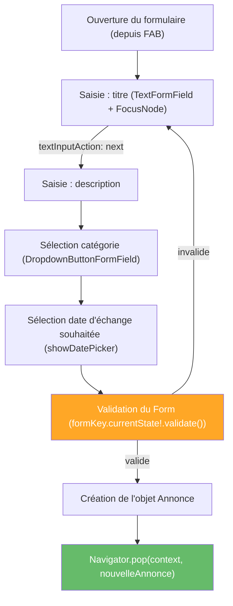

# TP6 — Formulaires avancés

## Objectifs
- Utiliser `TextField` et `TextEditingController`, `TextInputAction` et `FocusNode`.
- Mettre en place un formulaire complet avec validation, y compris asynchrone.
- Utiliser `showDatePicker` pour la sélection d'une date.
- Finaliser le formulaire de publication d'annonce de LocalSwap.

## Prérequis
- TP5 terminé (mécanisme de retour de données préparé).

---

## Rappel de cours — Notions et définitions

**`TextField` vs `TextFormField`** : `TextField` est un champ de saisie simple ; `TextFormField` s'intègre à un `Form` et supporte un `validator`.

**`TextEditingController`** : objet qui contrôle et lit le contenu d'un champ de texte de façon impérative (utile pour préremplir, effacer ou lire une valeur en dehors du cycle de validation du `Form`).

**`Form` et validation** : un `Form` regroupe des `TextFormField` et centralise leur validation via une `GlobalKey<FormState>` ; chaque `validator` retourne `null` (valide) ou un message d'erreur.

**`textInputAction` et `FocusNode`** : `textInputAction` définit le bouton affiché sur le clavier (ex. "Suivant", "Terminé") ; `FocusNode` permet de contrôler explicitement quel champ reçoit le focus, notamment pour enchaîner automatiquement la saisie d'un champ au suivant.

**Filtrage** : technique consistant à filtrer dynamiquement une liste affichée en fonction du texte saisi dans un champ de recherche (ici, filtrer les annonces par mot-clé ou catégorie).

**`showDatePicker`** : affiche un sélecteur de date natif Material, retourne une `DateTime?` sélectionnée par l'utilisateur.

**Validation asynchrone** : validation d'un champ nécessitant un traitement asynchrone (ex. vérifier l'unicité d'un titre d'annonce auprès d'une source de données), généralement gérée via un état de chargement local pendant la vérification.

## Diagramme — Cycle de vie du formulaire de publication



---

## Partie A — Guidée

### Exercice 6.1 — TextField et TextEditingController
**Objectif :** contrôler un champ de texte de façon impérative.

1. Créer un `TextField` simple, sans controller, et observer qu'on ne peut pas facilement lire sa valeur en dehors d'un `onChanged`.
2. Créer un `TextEditingController`, l'attacher au `TextField` (`controller: monController`), et ajouter un bouton "Afficher" qui affiche `monController.text` dans une `SnackBar`.
3. Ajouter un bouton "Effacer" qui vide le champ avec `monController.clear()`.
4. Ajouter un `TextEditingController` avec une valeur initiale (`TextEditingController(text: 'valeur par défaut')`) et vérifier qu'elle s'affiche bien au démarrage.
5. **Point d'attention à souligner :** ne pas oublier de disposer le controller dans `dispose()` de la classe `State` — expliquer pourquoi (fuite mémoire potentielle).

### Exercice 6.2 — Form et validation classique
**Objectif :** construire un formulaire complet avec validation centralisée.

1. Créer un `Form` avec une `GlobalKey<FormState> _formKey = GlobalKey<FormState>()`.
2. Ajouter un `TextFormField` "Nom" avec `validator: (valeur) => (valeur == null || valeur.isEmpty) ? 'Champ obligatoire' : null`.
3. Ajouter un `TextFormField` "Âge" avec un `validator` vérifiant que la saisie est bien un nombre (`int.tryParse`) et supérieure à 0.
4. Ajouter un bouton "Valider" qui appelle `_formKey.currentState!.validate()` et affiche une `SnackBar` de succès uniquement si le formulaire est valide.
5. Soumettre le formulaire vide et observer les messages d'erreur affichés sous chaque champ ; corriger progressivement les champs et vérifier leur disparition.

### Exercice 6.3 — textInputAction et FocusNode
**Objectif :** améliorer l'ergonomie de saisie en enchaînant les champs.

1. Ajouter `textInputAction: TextInputAction.next` au premier `TextFormField` du formulaire précédent.
2. Créer deux `FocusNode` (`_focusNom`, `_focusAge`), les attacher aux champs correspondants (`focusNode: ...`).
3. Dans `onFieldSubmitted` du champ "Nom", appeler `FieldFocus.requestFocus(_focusAge)` (ou `_focusAge.requestFocus()`) pour passer automatiquement au champ suivant au clavier.
4. Sur le dernier champ, utiliser `textInputAction: TextInputAction.done` et fermer le clavier (`_focusAge.unfocus()`) dans `onFieldSubmitted`.
5. **Point d'attention :** disposer les `FocusNode` dans `dispose()`, comme pour les controllers.

### Exercice 6.4 — Filtrage dynamique d'une liste
**Objectif :** appliquer la saisie d'un champ à une liste affichée, sans passer par un `Form`.

1. Créer une liste Dart de 8 chaînes (noms de villes par exemple) et un `TextField` de recherche au-dessus d'une `ListView`.
2. Dans `onChanged` du champ de recherche, filtrer la liste (`.where((v) => v.toLowerCase().contains(texte.toLowerCase()))`) et stocker le résultat dans une variable d'état mise à jour avec `setState`.
3. Afficher la liste filtrée avec `ListView.builder`.
4. Ajouter un message "Aucun résultat" affiché lorsque la liste filtrée est vide.

### Exercice 6.5 — showDatePicker
**Objectif :** intégrer un sélecteur de date natif dans un formulaire.

1. Ajouter un bouton "Choisir une date" qui appelle :
   ```dart
   final DateTime? date = await showDatePicker(
     context: context,
     initialDate: DateTime.now(),
     firstDate: DateTime(2020),
     lastDate: DateTime(2030),
   );
   ```
2. Si `date != null`, afficher la date choisie formatée (`'${date.day}/${date.month}/${date.year}'`) sous le bouton, via une variable d'état.
3. **Amélioration :** utiliser le package `intl` (`DateFormat('dd/MM/yyyy').format(date)`) pour un formatage plus robuste, et comparer avec le formatage manuel.

### Exercice 6.6 — Validation asynchrone
**Objectif :** gérer un cas de validation qui nécessite un traitement non instantané.

1. Simuler une liste de "titres déjà utilisés" (`['Vélo', 'Perceuse']`).
2. Créer une fonction `Future<bool> titreDisponible(String titre) async { await Future.delayed(Duration(seconds: 1)); return !titresExistants.contains(titre); }`.
3. Sur le bouton "Valider" du formulaire (plutôt que dans le `validator` synchrone classique), appeler cette fonction : afficher un indicateur de chargement (`CircularProgressIndicator` dans le bouton) pendant l'attente, puis un message d'erreur si le titre est déjà pris, ou la confirmation de soumission sinon.
4. **Question de synthèse :** pourquoi ce type de vérification ne peut-il pas être placé directement dans le `validator` synchrone d'un `TextFormField` ?

## Partie B — Application au projet LocalSwap

**Finaliser l'écran "Formulaire de publication"** (préparé au TP5) :
1. Champs : *titre* (`TextFormField` + `TextEditingController`, obligatoire, min. 3 caractères, `textInputAction: next`), *description* (facultative, `FocusNode` pour enchaîner depuis le titre).
2. *Catégorie* : sélection parmi `CategorieAnnonce` (`DropdownButtonFormField`).
3. *Date d'échange souhaitée* : bouton ouvrant `showDatePicker`, date affichée dans le formulaire une fois choisie.
4. *Validation asynchrone du titre* : simuler une vérification "ce titre n'est pas déjà utilisé" (délai de 1 seconde, message d'erreur si le titre correspond à un titre déjà présent dans les annonces chargées).
5. À la validation complète, créer l'objet `Annonce` (statut initial `disponible`) et le retourner à l'écran d'accueil via `Navigator.pop(context, nouvelleAnnonce)` (mécanisme préparé au TP5), qui l'ajoute à la liste affichée.
6. Réutiliser la technique de filtrage pour ajouter un champ de recherche par mot-clé sur l'écran d'accueil (TP4/TP5), filtrant la liste des annonces affichées.

## Livrables
- Formulaire de publication complet et fonctionnel (validation classique + asynchrone + DatePicker).
- Recherche par mot-clé fonctionnelle sur l'écran d'accueil.

## Grille d'évaluation

| Critère | Points |
|---|---|
| Formulaire avec validation classique correcte | 6 |
| Sélection de catégorie et de date fonctionnelles | 4 |
| Validation asynchrone du titre | 4 |
| Retour de données vers l'accueil (Navigator.pop) | 4 |
| Recherche/filtrage sur l'accueil | 2 |
| **Total** | **20** |
