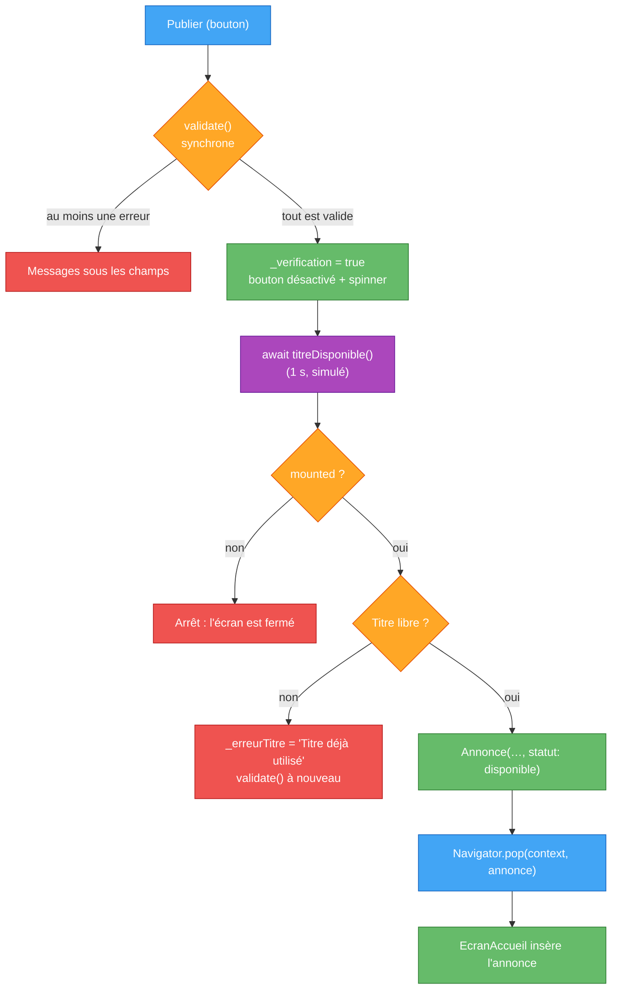

# TP6 — Formulaires, validation et saisie

> **Séance :** 3 h · **Environnement :** Flutter 3.x stable (≥ 3.27), Dart 3, VS Code / Android Studio, émulateur Android ou Chrome
> **Fil rouge :** LocalSwap — formulaire de publication complet (validation synchrone et asynchrone, catégorie, date) et recherche sur l'accueil.

| Repère | Partie | Durée |
|---|---|---|
| 📘🗺️ | Rappel de cours + diagramme | 10 min |
| 🧪 | Partie A : exercices indépendants (5) | 70 min |
| 🏗️ | Partie B : publication et recherche dans LocalSwap | 45 min |
| 🤖 | Partie C : comprendre et maîtriser le code | 40 min |
| 📝 | Quiz de fin de TP | 10 min |
| 🎤 | Validation orale (5 min par binôme, **pendant** les parties B et C) | — |
| 🚀 | Partie D : défis bonus | hors temps |
| | **Total** | **175 min** |

Difficulté : 🟢 facile · 🟡 moyen · 🔴 difficile

---

## 🎯 Objectifs pédagogiques

À la fin de ce TP, vous serez capable de :

1. **Gérer** le cycle de vie d'un `TextEditingController` et d'un `FocusNode` (création dans le `State`, `dispose`).
2. **Valider** un formulaire avec `Form`, `GlobalKey<FormState>` et des `validator` qui retournent `null` ou un message.
3. **Enchaîner** la saisie au clavier (`textInputAction`, `FocusNode`) et **choisir** le bon clavier (`keyboardType`).
4. **Filtrer** une liste à partir d'une saisie en gardant une **seule** source de vérité (état dérivé).
5. **Intégrer** une validation **asynchrone** et un `showDatePicker` sans bloquer l'interface ni utiliser un `BuildContext` périmé.

## 📋 Prérequis

- **TP4** : cycle de vie (`initState`/`dispose`), `mounted`.
- **TP5** : `await Navigator.pushNamed<Annonce>`, `Navigator.pop(context, annonce)`, `PopScope`, `routes.dart`.
- **TP2** : modèle `Annonce` (avec `copyWith` depuis le TP4).

> [!IMPORTANT]
> **Règle sur l'IA.** Vous avez le droit d'utiliser une IA. Mais **60 % de la note** porte sur votre compréhension (Partie C, oral, quiz). Tenez le **📓 Journal IA** (C7) si vous l'utilisez.

---

## 📘 Rappel de cours

> [!NOTE]
> **`TextField` vs `TextFormField`** : `TextField` est un champ simple ; `TextFormField` est un `TextField` qui s'intègre à un `Form` (paramètres `validator`, `onSaved`, `autovalidateMode`).
> **`TextEditingController`** : lit (`.text`), écrit (`.text = …`), efface (`.clear()`) et **écoute** (`addListener`) le contenu d'un champ.

> [!CAUTION]
> **Controllers et `FocusNode` : règle absolue**
> - Créés **une seule fois**, comme **champs du `State`** (jamais dans `build()`).
> - **Libérés** dans `dispose()` : `controller.dispose()`, `focusNode.dispose()`. Sinon : fuite mémoire et écouteurs encore actifs.

> [!NOTE]
> **`Form` et validation**
> - `final GlobalKey<FormState> _formKey = GlobalKey<FormState>();`, déclarée dans le `State`, puis `Form(key: _formKey, child: …)`.
> - `validator: (String? valeur) { … }` retourne **`null` si c'est valide**, sinon le **message** à afficher. Attention : `''` (chaîne vide) est une **erreur** !
> - `_formKey.currentState!.validate()` appelle **tous** les validators et retourne `true` si tous ont retourné `null`.
> - `autovalidateMode: AutovalidateMode.onUserInteraction` : valide pendant la saisie, après la première modification.

> [!NOTE]
> **Clavier et focus**
> - `keyboardType` : `TextInputType.emailAddress`, `.phone`, `.number`, `.numberWithOptions(decimal: true)`, `.multiline`.
> - `textInputAction` : bouton du clavier (`next`, `done`, `search`). Avec `next`, Flutter passe déjà au champ suivant.
> - `FocusNode` + `requestFocus()` : pour choisir **précisément** le champ suivant, donner le focus depuis un bouton, ou savoir si un champ est actif. `FocusScope.of(context).unfocus()` ferme le clavier.

> [!NOTE]
> **État dérivé.** Pour filtrer une liste, ne stockez **que** la requête (`_recherche`) et recalculez la liste filtrée dans `build()` (getter). Stocker aussi la liste filtrée crée **deux** sources de vérité, qui finissent par se contredire.

> [!NOTE]
> **Date et validation asynchrone**
> - `showDatePicker(context:, initialDate:, firstDate:, lastDate:)` retourne un `Future<DateTime?>` (`null` si annulé). `initialDate` doit respecter `firstDate`/`lastDate` (et `selectableDayPredicate`).
> - Un `validator` est **synchrone** : il ne peut pas attendre un serveur. Méthode : (1) `validate()` synchrone ; (2) `await` de la vérification, avec un indicateur de chargement ; (3) `mounted` ; (4) mémoriser l'erreur, que le `validator` retourne, puis `validate()` à nouveau.

## 🗺️ Diagramme — Soumission du formulaire de publication



Légende : 🔵 action utilisateur · 🟠 test · 🟣 attente asynchrone · 🟢 état/résultat · 🔴 erreur ou arrêt.

---

## 🧪 Partie A — Exercices pédagogiques indépendants (sans LocalSwap) · 70 min

```bash
flutter create tp6_demos
cd tp6_demos
flutter run -t lib/ex1_converter.dart
```

> [!TIP]
> **Tapez** le code, puis répondez aux questions **🔍** dans votre compte rendu.

---

### Exercice 6.1 — Convertisseur de devises : TextEditingController 🟢 · 12 min

**Notions nouvelles :** `TextEditingController` (lecture, écriture, écoute), `dispose`.

`lib/ex1_converter.dart`

```dart
import 'package:flutter/material.dart';

void main() => runApp(const ConverterApp());

class ConverterApp extends StatelessWidget {
  const ConverterApp({super.key});

  @override
  Widget build(BuildContext context) {
    return MaterialApp(
      debugShowCheckedModeBanner: false,
      theme: ThemeData(colorScheme: ColorScheme.fromSeed(seedColor: Colors.green)),
      home: const ConverterPage(),
    );
  }
}

class ConverterPage extends StatefulWidget {
  const ConverterPage({super.key});

  @override
  State<ConverterPage> createState() => _ConverterPageState();
}

class _ConverterPageState extends State<ConverterPage> {
  static const double _rate = 3.35; // 1 EUR = 3,35 TND (valeur fictive)

  // Créé UNE fois, avec le State. Valeur initiale : 10.
  final TextEditingController _euroController = TextEditingController(text: '10');

  @override
  void initState() {
    super.initState();
    _euroController.addListener(_onTextChanged); // appelé à chaque changement du texte
  }

  void _onTextChanged() {
    debugPrint('Texte : "${_euroController.text}"');
    setState(() {}); // le texte a changé : on redessine (le résultat est recalculé)
  }

  /// Résultat DÉRIVÉ du texte : jamais stocké.
  String get _result {
    final double? euros = double.tryParse(_euroController.text.replaceAll(',', '.'));
    return euros == null ? '—' : '${(euros * _rate).toStringAsFixed(3)} TND';
  }

  @override
  void dispose() {
    _euroController.removeListener(_onTextChanged);
    _euroController.dispose(); // libère le controller
    super.dispose();
  }

  @override
  Widget build(BuildContext context) {
    return Scaffold(
      appBar: AppBar(title: const Text('Convertisseur EUR → TND')),
      body: Padding(
        padding: const EdgeInsets.all(16),
        child: Column(
          crossAxisAlignment: CrossAxisAlignment.stretch,
          children: [
            TextField(
              controller: _euroController,
              keyboardType: const TextInputType.numberWithOptions(decimal: true),
              decoration: const InputDecoration(
                labelText: 'Montant en euros',
                prefixIcon: Icon(Icons.euro),
                border: OutlineInputBorder(),
              ),
            ),
            const SizedBox(height: 24),
            Text(
              _result,
              textAlign: TextAlign.center,
              style: Theme.of(context).textTheme.headlineMedium,
            ),
            const SizedBox(height: 24),
            Row(
              children: [
                Expanded(
                  child: OutlinedButton(
                    onPressed: () {
                      _euroController.text = '100'; // ÉCRIRE dans le champ
                    },
                    child: const Text('Mettre 100'),
                  ),
                ),
                const SizedBox(width: 8),
                Expanded(
                  child: OutlinedButton(
                    onPressed: _euroController.clear, // EFFACER
                    child: const Text('Effacer'),
                  ),
                ),
              ],
            ),
          ],
        ),
      ),
    );
  }
}
```

**🔍 Observer & répondre**

1. Cliquez sur « Mettre 100 » : le listener est-il appelé ? Qu'affiche la console ?
2. Mettez `setState(() {});` en commentaire dans `_onTextChanged`. Tapez un montant : le résultat se met-il à jour ? Et le texte du champ ? Expliquez la différence.
3. Pourquoi le résultat est-il un **getter** plutôt qu'une variable `String _result` mise à jour dans le listener ?
4. Retirez `_euroController.dispose()`. Voyez-vous une erreur ? Pourquoi est-ce quand même un problème ?

---

### Exercice 6.2 — Inscription au club : Form et validators 🟡 · 15 min

**Notions nouvelles :** `Form` + `GlobalKey<FormState>`, `validator`.

`lib/ex2_signup.dart`

```dart
import 'package:flutter/material.dart';

void main() => runApp(const SignUpApp());

class SignUpApp extends StatelessWidget {
  const SignUpApp({super.key});

  @override
  Widget build(BuildContext context) {
    return MaterialApp(
      debugShowCheckedModeBanner: false,
      theme: ThemeData(colorScheme: ColorScheme.fromSeed(seedColor: Colors.indigo)),
      home: const SignUpPage(),
    );
  }
}

class SignUpPage extends StatefulWidget {
  const SignUpPage({super.key});

  @override
  State<SignUpPage> createState() => _SignUpPageState();
}

class _SignUpPageState extends State<SignUpPage> {
  // La clé donne accès à l'état du Form (validate, save…). Déclarée dans le State.
  final GlobalKey<FormState> _formKey = GlobalKey<FormState>();
  final TextEditingController _nameController = TextEditingController();
  final TextEditingController _emailController = TextEditingController();
  final TextEditingController _ageController = TextEditingController();

  static final RegExp _emailRegExp = RegExp(r'^[^@\s]+@[^@\s]+\.[a-z]{2,}$', caseSensitive: false);

  @override
  void dispose() {
    _nameController.dispose();
    _emailController.dispose();
    _ageController.dispose();
    super.dispose();
  }

  // Un validator retourne null si c'est VALIDE, sinon le message d'erreur.
  String? _validateName(String? value) {
    final String name = value?.trim() ?? '';
    if (name.isEmpty) return 'Le nom est obligatoire';
    if (name.length < 3) return 'Au moins 3 caractères';
    return null;
  }

  String? _validateEmail(String? value) {
    final String email = value?.trim() ?? '';
    if (email.isEmpty) return "L'email est obligatoire";
    if (!_emailRegExp.hasMatch(email)) return 'Email invalide';
    return null;
  }

  String? _validateAge(String? value) {
    final int? age = int.tryParse(value?.trim() ?? '');
    if (age == null) return 'Entrez un nombre entier';
    if (age < 16 || age > 99) return 'Âge entre 16 et 99 ans';
    return null;
  }

  void _submit() {
    final bool valid = _formKey.currentState!.validate(); // appelle TOUS les validators
    if (!valid) return;
    ScaffoldMessenger.of(context).showSnackBar(
      SnackBar(content: Text('Bienvenue ${_nameController.text.trim()} !')),
    );
  }

  @override
  Widget build(BuildContext context) {
    return Scaffold(
      appBar: AppBar(title: const Text('Inscription au club')),
      body: Form(
        key: _formKey,
        child: ListView(
          padding: const EdgeInsets.all(16),
          children: [
            TextFormField(
              controller: _nameController,
              decoration: const InputDecoration(
                labelText: 'Nom complet',
                prefixIcon: Icon(Icons.person_outline),
                border: OutlineInputBorder(),
              ),
              validator: _validateName,
            ),
            const SizedBox(height: 16),
            TextFormField(
              controller: _emailController,
              keyboardType: TextInputType.emailAddress,
              decoration: const InputDecoration(
                labelText: 'Email',
                prefixIcon: Icon(Icons.alternate_email),
                border: OutlineInputBorder(),
              ),
              validator: _validateEmail,
            ),
            const SizedBox(height: 16),
            TextFormField(
              controller: _ageController,
              keyboardType: TextInputType.number,
              decoration: const InputDecoration(
                labelText: 'Âge',
                prefixIcon: Icon(Icons.cake_outlined),
                border: OutlineInputBorder(),
              ),
              validator: _validateAge,
            ),
            const SizedBox(height: 24),
            FilledButton(onPressed: _submit, child: const Text("S'inscrire")),
          ],
        ),
      ),
    );
  }
}
```

**🔍 Observer & répondre**

1. Soumettez le formulaire vide. Combien de messages apparaissent ? Corrigez un champ : son erreur disparaît-elle **avant** une nouvelle soumission ? Ajoutez `autovalidateMode: AutovalidateMode.onUserInteraction` au `Form` et comparez.
2. Testez ces emails : `amira@iset.tn`, `amira@iset`, `amira iset@tn.tn`, `AMIRA@ISET.TN`. Lesquels sont acceptés ? Pourquoi une regex d'email ne garantit-elle jamais qu'une adresse **existe** ?
3. Remplacez `int.tryParse` par `int.parse` et saisissez « dix-huit ». Que se passe-t-il ?
4. Que se passe-t-il si `_validateName` retourne `''` au lieu de `null` pour un nom correct ?

---

### Exercice 6.3 — Adresse de livraison : clavier et FocusNode 🟡 · 13 min

**Notions nouvelles :** `textInputAction` + `keyboardType`, `FocusNode`.

`lib/ex3_delivery.dart`

```dart
import 'package:flutter/material.dart';

void main() => runApp(const DeliveryApp());

class DeliveryApp extends StatelessWidget {
  const DeliveryApp({super.key});

  @override
  Widget build(BuildContext context) {
    return MaterialApp(
      debugShowCheckedModeBanner: false,
      theme: ThemeData(colorScheme: ColorScheme.fromSeed(seedColor: Colors.orange)),
      home: const DeliveryPage(),
    );
  }
}

class DeliveryPage extends StatefulWidget {
  const DeliveryPage({super.key});

  @override
  State<DeliveryPage> createState() => _DeliveryPageState();
}

class _DeliveryPageState extends State<DeliveryPage> {
  final GlobalKey<FormState> _formKey = GlobalKey<FormState>();
  final FocusNode _phoneFocus = FocusNode();
  final FocusNode _addressFocus = FocusNode();
  final FocusNode _zipFocus = FocusNode();

  @override
  void dispose() {
    _phoneFocus.dispose();
    _addressFocus.dispose();
    _zipFocus.dispose();
    super.dispose();
  }

  String? _required(String? value) =>
      (value == null || value.trim().isEmpty) ? 'Champ obligatoire' : null;

  void _submit() {
    if (!_formKey.currentState!.validate()) return;
    FocusScope.of(context).unfocus(); // ferme le clavier
    ScaffoldMessenger.of(context)
        .showSnackBar(const SnackBar(content: Text('Adresse enregistrée')));
  }

  @override
  Widget build(BuildContext context) {
    return Scaffold(
      appBar: AppBar(title: const Text('Livraison')),
      body: Form(
        key: _formKey,
        child: ListView(
          padding: const EdgeInsets.all(16),
          children: [
            TextFormField(
              autofocus: true, // le clavier s'ouvre sur ce champ
              textCapitalization: TextCapitalization.words,
              textInputAction: TextInputAction.next,
              onFieldSubmitted: (_) => _phoneFocus.requestFocus(),
              decoration: const InputDecoration(labelText: 'Nom', border: OutlineInputBorder()),
              validator: _required,
            ),
            const SizedBox(height: 16),
            TextFormField(
              focusNode: _phoneFocus,
              keyboardType: TextInputType.phone,
              textInputAction: TextInputAction.next,
              onFieldSubmitted: (_) => _addressFocus.requestFocus(),
              decoration: const InputDecoration(labelText: 'Téléphone', border: OutlineInputBorder()),
              validator: _required,
            ),
            const SizedBox(height: 16),
            TextFormField(
              focusNode: _addressFocus,
              maxLines: 2,
              textInputAction: TextInputAction.next,
              onFieldSubmitted: (_) => _zipFocus.requestFocus(),
              decoration: const InputDecoration(labelText: 'Adresse', border: OutlineInputBorder()),
              validator: _required,
            ),
            const SizedBox(height: 16),
            TextFormField(
              focusNode: _zipFocus,
              keyboardType: TextInputType.number,
              maxLength: 4, // codes postaux tunisiens : 4 chiffres
              textInputAction: TextInputAction.done,
              onFieldSubmitted: (_) => _submit(), // « Terminé » = valider
              decoration: const InputDecoration(labelText: 'Code postal', border: OutlineInputBorder()),
              validator: (value) =>
                  RegExp(r'^\d{4}$').hasMatch(value ?? '') ? null : '4 chiffres attendus',
            ),
            const SizedBox(height: 8),
            FilledButton(onPressed: _submit, child: const Text('Enregistrer')),
            TextButton(
              onPressed: () => _zipFocus.requestFocus(),
              child: const Text('Aller directement au code postal'),
            ),
          ],
        ),
      ),
    );
  }
}
```

**🔍 Observer & répondre**

1. Sur l'émulateur, quel bouton affiche le clavier pour chaque champ ? Quel clavier s'ouvre pour le téléphone et pour le code postal ?
2. Supprimez les 3 `onFieldSubmitted` des champs Nom, Téléphone et Adresse. Le focus passe-t-il quand même au champ suivant ? Alors, à quoi servent encore les `FocusNode` ici ?
3. Pourquoi les `FocusNode` sont-ils des champs du `State` et non des variables créées dans `build()` ?

---

### Exercice 6.4 — Recherche de villes : filtrage et état dérivé 🟢 · 12 min

**Notions nouvelles :** filtrage à la saisie, état dérivé (getter).

`lib/ex4_city_search.dart`

```dart
import 'package:flutter/material.dart';

void main() => runApp(const CitySearchApp());

class CitySearchApp extends StatelessWidget {
  const CitySearchApp({super.key});

  @override
  Widget build(BuildContext context) {
    return MaterialApp(
      debugShowCheckedModeBanner: false,
      theme: ThemeData(colorScheme: ColorScheme.fromSeed(seedColor: Colors.cyan)),
      home: const CitySearchPage(),
    );
  }
}

class CitySearchPage extends StatefulWidget {
  const CitySearchPage({super.key});

  @override
  State<CitySearchPage> createState() => _CitySearchPageState();
}

class _CitySearchPageState extends State<CitySearchPage> {
  static const List<String> _cities = [
    'Tunis', 'Ariana', 'Bizerte', 'Nabeul', 'Sousse', 'Monastir',
    'Mahdia', 'Sfax', 'Gabès', 'Kairouan', 'Kasserine', 'Tozeur',
  ];
  static const Set<String> _coastal = {
    'Tunis', 'Bizerte', 'Nabeul', 'Sousse', 'Monastir', 'Mahdia', 'Sfax', 'Gabès',
  };

  final TextEditingController _searchController = TextEditingController();
  String _query = ''; // SOURCE DE VÉRITÉ n° 1
  bool _coastalOnly = false; // SOURCE DE VÉRITÉ n° 2

  /// État DÉRIVÉ : recalculé à chaque build, jamais stocké.
  List<String> get _results {
    final String q = _query.trim().toLowerCase();
    return _cities
        .where((city) => city.toLowerCase().contains(q))
        .where((city) => !_coastalOnly || _coastal.contains(city))
        .toList();
  }

  @override
  void dispose() {
    _searchController.dispose();
    super.dispose();
  }

  @override
  Widget build(BuildContext context) {
    final List<String> results = _results; // calculé une seule fois par build

    return Scaffold(
      appBar: AppBar(title: const Text('Villes')),
      body: Column(
        children: [
          Padding(
            padding: const EdgeInsets.all(16),
            child: TextField(
              controller: _searchController,
              textInputAction: TextInputAction.search,
              onChanged: (value) => setState(() => _query = value),
              decoration: InputDecoration(
                hintText: 'Rechercher une ville',
                prefixIcon: const Icon(Icons.search),
                border: const OutlineInputBorder(),
                suffixIcon: _query.isEmpty
                    ? null
                    : IconButton(
                        tooltip: 'Effacer',
                        onPressed: () {
                          _searchController.clear(); // vide le CHAMP
                          setState(() => _query = ''); // vide l'ÉTAT
                        },
                        icon: const Icon(Icons.clear),
                      ),
              ),
            ),
          ),
          Padding(
            padding: const EdgeInsets.symmetric(horizontal: 16),
            child: Row(
              children: [
                FilterChip(
                  label: const Text('Littoral'),
                  selected: _coastalOnly,
                  onSelected: (value) => setState(() => _coastalOnly = value),
                ),
                const Spacer(),
                Text('${results.length} résultat(s)'),
              ],
            ),
          ),
          Expanded(
            child: results.isEmpty
                ? const Center(child: Text('Aucun résultat'))
                : ListView.builder(
                    itemCount: results.length,
                    itemBuilder: (context, index) => ListTile(
                      leading: const Icon(Icons.location_city),
                      title: Text(results[index]),
                    ),
                  ),
          ),
        ],
      ),
    );
  }
}
```

**🔍 Observer & répondre**

1. Cherchez « gabes » (sans accent). Trouvez-vous Gabès ? Pourquoi ? Proposez une solution.
2. Dans le bouton « Effacer », retirez `setState(() => _query = '')`. Que voit-on ? Et si l'on retire seulement `_searchController.clear()` ?
3. Un camarade stocke aussi `List<String> _filtered` qu'il met à jour dans `onChanged`. Décrivez un scénario (avec le `FilterChip`) où son affichage devient faux.

---

### Exercice 6.5 — Réservation de salle : date et validation asynchrone 🔴 · 18 min

**Notions nouvelles :** `showDatePicker`, validation asynchrone (erreur « serveur » mémorisée).

`lib/ex5_room_booking.dart`

```dart
import 'package:flutter/material.dart';

void main() => runApp(const RoomApp());

const Set<String> _bookedRooms = {'B12', 'A3'};

/// Simule un appel serveur : la salle est-elle libre ?
Future<bool> isRoomAvailable(String room) async {
  await Future<void>.delayed(const Duration(seconds: 1));
  return !_bookedRooms.contains(room.trim().toUpperCase());
}

String formatDate(DateTime d) =>
    '${d.day.toString().padLeft(2, '0')}/${d.month.toString().padLeft(2, '0')}/${d.year}';

class RoomApp extends StatelessWidget {
  const RoomApp({super.key});

  @override
  Widget build(BuildContext context) {
    return MaterialApp(
      debugShowCheckedModeBanner: false,
      theme: ThemeData(colorScheme: ColorScheme.fromSeed(seedColor: Colors.teal)),
      home: const RoomBookingPage(),
    );
  }
}

class RoomBookingPage extends StatefulWidget {
  const RoomBookingPage({super.key});

  @override
  State<RoomBookingPage> createState() => _RoomBookingPageState();
}

class _RoomBookingPageState extends State<RoomBookingPage> {
  final GlobalKey<FormState> _formKey = GlobalKey<FormState>();
  final TextEditingController _roomController = TextEditingController();
  DateTime? _date;
  String? _dateError;
  String? _roomServerError; // erreur ASYNCHRONE mémorisée
  bool _checking = false;

  @override
  void dispose() {
    _roomController.dispose();
    super.dispose();
  }

  /// Le dimanche est fermé : on ne propose jamais un dimanche comme date initiale.
  DateTime _nextOpenDay(DateTime day) =>
      day.weekday == DateTime.sunday ? day.add(const Duration(days: 1)) : day;

  Future<void> _pickDate() async {
    final DateTime today = DateUtils.dateOnly(DateTime.now());
    final DateTime? picked = await showDatePicker(
      context: context,
      initialDate: _date ?? _nextOpenDay(today),
      firstDate: today, // pas de date passée
      lastDate: today.add(const Duration(days: 60)),
      helpText: 'Date de réservation',
      selectableDayPredicate: (day) => day.weekday != DateTime.sunday,
    );
    if (picked == null) return; // annulé
    setState(() {
      _date = picked;
      _dateError = null;
    });
  }

  Future<void> _submit() async {
    // 1) Validation SYNCHRONE
    setState(() {
      _roomServerError = null;
      _dateError = _date == null ? 'Choisissez une date' : null;
    });
    final bool fieldsValid = _formKey.currentState!.validate();
    final DateTime? date = _date; // copie locale → promotion de type
    if (!fieldsValid || date == null) return;

    // 2) Vérification ASYNCHRONE
    setState(() => _checking = true);
    final bool available = await isRoomAvailable(_roomController.text);
    if (!mounted) return; // l'écran a pu être fermé pendant l'attente

    // 3) Résultat
    setState(() {
      _checking = false;
      _roomServerError = available ? null : 'Salle déjà réservée';
    });
    if (!available) {
      _formKey.currentState!.validate(); // affiche l'erreur serveur sous le champ
      return;
    }
    ScaffoldMessenger.of(context).showSnackBar(
      SnackBar(content: Text('Salle ${_roomController.text.trim().toUpperCase()} réservée le ${formatDate(date)}')),
    );
  }

  @override
  Widget build(BuildContext context) {
    final ColorScheme colors = Theme.of(context).colorScheme;
    final DateTime? date = _date;

    return Scaffold(
      appBar: AppBar(title: const Text('Réserver une salle')),
      body: Form(
        key: _formKey,
        child: ListView(
          padding: const EdgeInsets.all(16),
          children: [
            TextFormField(
              controller: _roomController,
              textCapitalization: TextCapitalization.characters,
              decoration: const InputDecoration(
                labelText: 'Salle (ex. B12)',
                prefixIcon: Icon(Icons.meeting_room_outlined),
                border: OutlineInputBorder(),
              ),
              validator: (value) {
                final String room = value?.trim() ?? '';
                if (room.isEmpty) return 'Salle obligatoire';
                if (!RegExp(r'^[A-Za-z]\d{1,2}$').hasMatch(room)) {
                  return 'Format : une lettre + un numéro (ex. B12)';
                }
                return _roomServerError; // null, sauf après un refus du « serveur »
              },
              onChanged: (_) {
                if (_roomServerError != null) setState(() => _roomServerError = null);
              },
            ),
            const SizedBox(height: 16),
            OutlinedButton.icon(
              onPressed: _pickDate,
              icon: const Icon(Icons.calendar_month),
              label: Text(date == null ? 'Choisir une date' : formatDate(date)),
            ),
            if (_dateError != null)
              Padding(
                padding: const EdgeInsets.only(top: 4, left: 12),
                child: Text(_dateError!, style: TextStyle(color: colors.error)),
              ),
            const SizedBox(height: 24),
            FilledButton(
              onPressed: _checking ? null : _submit, // désactivé pendant la vérification
              child: _checking
                  ? const SizedBox(
                      width: 20,
                      height: 20,
                      child: CircularProgressIndicator(strokeWidth: 2),
                    )
                  : const Text('Réserver'),
            ),
          ],
        ),
      ),
    );
  }
}
```

**🔍 Observer & répondre**

1. Réservez « b12 » à une date valide. Décrivez ce que vous voyez pendant 1 seconde, puis après. Modifiez le champ : que devient l'erreur ?
2. Pourquoi le bouton est-il désactivé pendant la vérification ? Que se passerait-il en cliquant 5 fois très vite s'il ne l'était pas ?
3. Remplacez `_nextOpenDay(today)` par `today` et imaginez qu'on est **dimanche**. Que se passe-t-il à l'ouverture du sélecteur ? Pourquoi ?
4. Pourquoi ne pas écrire `validator: (v) async => await isRoomAvailable(v!) ? null : 'Déjà réservée'` ?

---

## 🏗️ Partie B — Publication et recherche dans LocalSwap · 45 min

### B.1 — Faire évoluer le modèle 🟢

Ajoutez à `Annonce` un champ facultatif `final DateTime? dateSouhaitee;` (date d'échange souhaitée) :
- constructeur, `copyWith`, `toString` ;
- `toJson` : `'dateSouhaitee': dateSouhaitee!.toIso8601String()` **seulement** s'il n'est pas nul (collection `if`) ;
- `fromJson` : `DateTime.tryParse` si la clé est présente.

Vérifiez avec `dart run tool/verif_modeles.dart` (TP2) que tout fonctionne encore.

### B.2 — Service de vérification 🟢

Dans `lib/data/verification.dart` : `Future<bool> titreDisponible(String titre, List<String> titresExistants)` qui attend 1 s et retourne `false` si le titre existe déjà (**sans tenir compte de la casse ni des espaces autour**).

### B.3 — Passer les titres au formulaire 🟡

1. Dans `routes.dart`, la route `/formulaire` accepte maintenant un argument `List<String>` (titres existants) → `EcranFormulaire(titresExistants: …)`. Gardez un cas sans argument (liste vide).
2. Dans `EcranAccueil._publier()`, passez `arguments: _annonces.map((a) => a.titre).toList()`.

### B.4 — `EcranFormulaire` complet 🔴

`StatefulWidget` avec `Form` et `GlobalKey<FormState>` :

| Champ | Widget | Règles |
|---|---|---|
| Titre | `TextFormField` + controller + `FocusNode` | Obligatoire, 3 à 60 caractères ; `textInputAction: next` → description ; erreur asynchrone « Titre déjà utilisé » |
| Description | `TextFormField` + controller + `FocusNode` | Facultative, `maxLines: 4`, `maxLength: 200` |
| Catégorie | `SegmentedButton<CategorieAnnonce>` | Une seule sélection, `objet` par défaut, icône + libellé |
| Date souhaitée | `OutlinedButton` → `showDatePicker` | Facultative, entre aujourd'hui et +90 jours, bouton « Retirer la date » si choisie |
| Publier | `FilledButton` | Désactivé + spinner pendant la vérification |

À la validation complète : créer l'`Annonce` (`id` = horodatage, `statut: disponible`, `idProprietaire: 'moi'`, description `null` si vide) et `Navigator.pop(context, annonce)`.

> [!WARNING]
> Libérez **tous** les controllers et `FocusNode` dans `dispose()`. L'oral vous demandera de les montrer.

### B.5 — Protéger la saisie 🟡

Enveloppez le formulaire dans un `PopScope` (TP5) : si le titre ou la description contiennent du texte, le retour demande « Abandonner l'annonce ? ».

### B.6 — Recherche sur l'accueil 🟡

Dans `EcranAccueil`, sous l'en-tête :
- un `TextField` de recherche (icône, bouton « effacer ») qui filtre par **titre ou description** ;
- une rangée de `ChoiceChip` : *Toutes*, *Objet*, *Service*, *Covoiturage* (`CategorieAnnonce? _categorieFiltre`) ;
- la liste et la grille affichent `_annoncesFiltrees`, un **getter** (état dérivé) ;
- message « Aucune annonce ne correspond » si le résultat est vide.

> [!TIP]
> Grâce à vos callbacks basés sur `annonce.id` (TP4), réserver une annonce dans une liste filtrée modifie bien la **bonne** annonce. Vérifiez-le !

Terminez par `flutter analyze` (aucun problème) et un commit : `feat: formulaire de publication et recherche`.

---

## 🤖 Partie C — Comprendre et maîtriser le code · 40 min

> [!CAUTION]
> Pour C1, C2 et C3, **répondez d'abord sur papier, sans exécuter et sans IA**. Vérifiez ensuite sur machine.

### C1 — Prédire avant d'exécuter 🟡 · 8 min

1. Pour l'exercice 6.2, complétez le tableau : quel message s'affiche sous chaque champ après un clic sur « S'inscrire » ?

| Nom | Email | Âge | Nom → | Email → | Âge → | `validate()` retourne |
|---|---|---|---|---|---|---|
| `"  "` | `a@b.co` | `20` | | | | |
| `Ali` | `ali@iset` | `15` | | | | |
| `Ines` | `INES@ISET.TN` | ` 18 ` | | | | |
| `Mehdi B.` | `mehdi@x.tn` | `18.5` | | | | |

2. Dans l'exercice 6.1, on tape « 12 » au clavier, puis on clique sur « Effacer ». Combien de lignes `Texte : …` la console affiche-t-elle, et lesquelles ?

### C2 — Trouver les bugs 🟡 · 8 min

Ce formulaire « fonctionne presque ». Il contient **4 erreurs**. Pour chacune : ligne, symptôme, cause, correction.

```dart
class FeedbackPage extends StatefulWidget {
  const FeedbackPage({super.key});

  @override
  State<FeedbackPage> createState() => _FeedbackPageState();
}

class _FeedbackPageState extends State<FeedbackPage> {
  int _rating = 3;

  @override
  Widget build(BuildContext context) {
    final formKey = GlobalKey<FormState>();
    final commentController = TextEditingController();

    return Scaffold(
      appBar: AppBar(title: const Text('Votre avis')),
      body: Form(
        key: formKey,
        child: Column(
          children: [
            Slider(
              value: _rating.toDouble(),
              min: 1,
              max: 5,
              divisions: 4,
              label: '$_rating',
              onChanged: (v) => setState(() => _rating = v.round()),
            ),
            TextFormField(
              controller: commentController,
              decoration: const InputDecoration(labelText: 'Commentaire'),
              validator: (value) => (value ?? '').length < 10 ? 'Au moins 10 caractères' : '',
            ),
            FilledButton(
              onPressed: () {
                if (formKey.currentState!.validate()) {
                  debugPrint('Envoyé : $_rating — ${commentController.text}');
                }
              },
              child: const Text('Envoyer'),
            ),
          ],
        ),
      ),
    );
  }
}
```

> [!TIP]
> Indice : tapez un commentaire, **puis** bougez le curseur de note. Puis remplissez correctement le commentaire et envoyez.

### C3 — Critiquer du code généré par une IA 🔴 · 12 min

Prompt : *« Formulaire Flutter pour publier une annonce avec titre, prix, catégorie et date »*. Réponse de l'IA :

```dart
class AddItemPage extends StatefulWidget {
  @override
  _AddItemPageState createState() => _AddItemPageState();
}

class _AddItemPageState extends State<AddItemPage> {
  final titleController = TextEditingController();
  final priceController = TextEditingController();
  String category = 'Objets';
  DateTime? date;

  void submit() async {
    if (titleController.text == '') {
      ScaffoldMessenger.of(context).showSnackBar(SnackBar(content: Text('Titre vide')));
      return;
    }
    final price = int.parse(priceController.text);
    final exists = await checkTitle(titleController.text);
    if (exists) {
      ScaffoldMessenger.of(context).showSnackBar(SnackBar(content: Text('Existe déjà')));
      return;
    }
    Navigator.pop(context, {'title': titleController.text, 'price': price,
        'category': category, 'date': date.toString()});
  }

  @override
  Widget build(BuildContext context) {
    return Scaffold(
      appBar: AppBar(title: Text('Ajouter')),
      body: Column(
        children: [
          TextField(controller: titleController, decoration: InputDecoration(hintText: 'Titre')),
          TextField(controller: priceController, decoration: InputDecoration(hintText: 'Prix')),
          DropdownButton<String>(
            value: category,
            items: ['Objet', 'Service', 'Covoiturage']
                .map((c) => DropdownMenuItem(value: c, child: Text(c)))
                .toList(),
            onChanged: (v) => setState(() => category = v!),
          ),
          ElevatedButton(
            onPressed: () async {
              date = await showDatePicker(context: context, initialDate: DateTime(2020),
                  firstDate: DateTime.now(), lastDate: DateTime(2030));
            },
            child: Text(date == null ? 'Choisir une date' : date.toString()),
          ),
          ElevatedButton(onPressed: submit, child: Text('Publier')),
        ],
      ),
    );
  }
}
```

1. Trouvez **au moins 8 problèmes**, classés : 🔴 plantage ou bug, 🟠 mauvaise pratique Flutter/Dart 3, 🟡 ergonomie / Material 3.
2. Trois d'entre eux font **planter** l'application **dès la première utilisation**. Lesquels, et avec quel message ?
3. Comparez avec votre `EcranFormulaire` : pour chaque problème, quelle ligne de votre code l'évite ?
4. Écrivez le prompt qui aurait évité ces problèmes.

### C4 — Modifier sous contrainte 🟡 · 5 min

1. Exercice 6.2 : en ajoutant **2 lignes** (et un `import`) au champ Âge, empêchez **physiquement** la saisie de lettres, sans toucher au validator. (Indice : `FilteringTextInputFormatter`, dans `package:flutter/services.dart`.)
2. Exercice 6.4 : en modifiant **une seule ligne**, faites que la recherche ne trouve que les villes qui **commencent** par la saisie.

### C5 — Expliquer ligne par ligne 🟢 · 3 min

Recopiez la méthode de soumission de votre `EcranFormulaire` et commentez **chaque ligne**. Répondez : *« Pourquoi appelle-t-on `validate()` deux fois ? »*

### C6 — Exercice papier ✍️ 🟡 · 4 min

Pour l'exercice 6.5, complétez la chronologie (« b12 » saisi, date choisie, clic sur Réserver à t = 0) :

| Instant | `_checking` | Bouton | Message sous le champ Salle |
|---|---|---|---|
| t = 0 (juste après le clic) | | | |
| t = 0,5 s | | | |
| t = 1 s (réponse reçue) | | | |
| t = 2 s (l'utilisateur tape « 1 ») | | | |

Que se passe-t-il si l'utilisateur quitte l'écran à t = 0,5 s ? Quelle ligne l'a prévu ?

### C7 — Journal IA 📓

| # | Exercice | Prompt (copié tel quel) | Ce que j'ai gardé | Ce que j'ai rejeté ou corrigé, et pourquoi |
|---|---|---|---|---|
| 1 | | | | |

---

## 🚀 Partie D — Défis bonus

| Défi | Niveau | Énoncé |
|---|---|---|
| D1 — Recherche sans accents | 🟢 | Écrivez `String normaliser(String s)` (minuscules, sans accents ni espaces superflus) et utilisez-la dans la recherche de l'accueil : « gabes » doit trouver « Gabès ». |
| D2 — `ListenableBuilder` | 🟡 | Dans l'ex. 6.1, supprimez le listener et le `setState` : enveloppez seulement le `Text` du résultat dans un `ListenableBuilder(listenable: _euroController, …)`. Qu'est-ce qui est reconstruit maintenant ? |
| D3 — `FormField<DateTime>` | 🔴 | Transformez la date de l'ex. 6.5 en `FormField<DateTime>` pour qu'elle soit validée par `validate()` comme les autres champs. |
| D4 — Anti-rebond | 🔴 | Dans la recherche de l'accueil, ne filtrez qu'après 300 ms sans frappe (`Timer` du TP4, annulé dans `dispose`). Quel intérêt quand la recherche appellera un serveur (TP8) ? |

---

## 🎤 Validation orale (5 min par binôme)

1. **Montrez** où sont créés et libérés vos controllers et `FocusNode`. Pourquoi pas dans `build()` ?
2. Que retourne un validator quand le champ est correct ? **Faites-lui retourner `''` en direct** : que se passe-t-il ?
3. Pourquoi la vérification du titre n'est-elle pas dans le `validator` ?
4. Que se passe-t-il si l'utilisateur ferme le formulaire pendant la vérification ?
5. **Ajoutez en direct** une règle : le titre ne doit pas contenir « gratuit ».
6. Comment la nouvelle annonce arrive-t-elle sur l'accueil ? Citez les deux lignes clés.
7. Pourquoi `_annoncesFiltrees` est-il un getter ?
8. `SegmentedButton` plutôt qu'une liste déroulante pour la catégorie : pourquoi ?

> [!IMPORTANT]
> La note d'oral est **individuelle**.

---

## ✅ Checklist de validation — le TP est réussi si…

- [ ] Les 5 exercices de la Partie A se lancent, et les questions 🔍 ont une réponse.
- [ ] `Annonce` gère `dateSouhaitee` (JSON compris), et le script du TP2 passe encore.
- [ ] Le formulaire refuse un titre vide, trop court, ou déjà utilisé (après 1 s de vérification visible).
- [ ] Clavier : « Suivant » passe du titre à la description.
- [ ] Catégorie et date sont choisies ; la date peut être retirée.
- [ ] L'annonce publiée apparaît en tête de l'accueil ; le retour avec du texte saisi demande confirmation.
- [ ] La recherche et les filtres de catégorie fonctionnent, et la réservation dans une liste filtrée modifie la bonne annonce.
- [ ] Tous les controllers et `FocusNode` sont libérés ; `flutter analyze` affiche `No issues found!`.
- [ ] Les réponses aux exercices C1 à C6 sont rédigées, et le journal IA est tenu si une IA a été utilisée.

## ⚠️ Erreurs fréquentes et corrections

| Symptôme | Cause | Correction |
|---|---|---|
| Le texte saisi disparaît dès qu'on touche autre chose | Controller créé dans `build()` | Champ `final` du `State` |
| Le formulaire n'est jamais valide | Validator qui retourne `''` | Retourner `null` quand c'est valide |
| Les erreurs disparaissent ou `currentState` vaut `null` | `GlobalKey` créée dans `build()` | Champ du `State` |
| `FormatException: Invalid radix-10 number` | `int.parse` sur une saisie libre | `int.tryParse` + validator |
| `A TextEditingController was used after being disposed` | Controller libéré puis réutilisé, ou libéré deux fois | Un seul `dispose()`, dans le `State` propriétaire |
| `Provided initialDate must satisfy provided selectableDayPredicate` | Date initiale interdite (ex. dimanche) | Calculer une date initiale autorisée |
| `initialDate must be on or after firstDate` | Dates incohérentes | `initialDate` entre `firstDate` et `lastDate` |
| Double envoi | Bouton actif pendant l'`await` | `onPressed: _enCours ? null : _soumettre` |
| `Don't use 'BuildContext's across async gaps` | `context` après `await` | `if (!mounted) return;` |
| Le clavier cache le bouton | Contenu non défilable | `ListView` (ou `SingleChildScrollView`) dans le `Form` |

## 📝 Quiz de fin de TP · 10 min

**Q1.** Quel `validator` est correct pour un champ obligatoire ?
- A. `(v) => v!.isEmpty ? 'Obligatoire' : ''`
- B. `(v) => (v == null || v.trim().isEmpty) ? 'Obligatoire' : null`
- C. `(v) => v.isEmpty`
- D. `(v) async => v!.isEmpty ? 'Obligatoire' : null`

**Q2.** Où créer un `TextEditingController` dans un `StatefulWidget` ?
- A. Dans `build()`, pour qu'il soit toujours à jour.
- B. Dans le constructeur du widget (la classe `StatefulWidget`).
- C. Comme champ du `State` (ou dans `initState`), et le libérer dans `dispose()`.
- D. Comme variable globale, partagée par tous les écrans.

**Q3.** Pourquoi une vérification serveur (titre déjà pris) ne peut-elle pas se faire **directement** dans `validator` ?
- A. Parce que `validator` est synchrone : il doit retourner immédiatement `String?`, sans `await`.
- B. Parce que `validator` n'a pas accès au texte du champ.
- C. Parce que les validators ne fonctionnent qu'avec des nombres.
- D. Parce que `Form` interdit les appels réseau.

**Q4.** Un écran stocke `_recherche` **et** `_listeFiltree`. Quel est le risque principal ?
- A. Aucun, c'est plus rapide.
- B. `flutter analyze` refuse de compiler.
- C. Les deux états peuvent se désynchroniser (un autre filtre ou une liste modifiée sans recalcul).
- D. Le clavier ne s'ouvre plus.

**Q5.** `await showDatePicker(...)` retourne `null`. Que s'est-il passé ?
- A. L'utilisateur a annulé (ou fermé) le sélecteur.
- B. La date choisie est aujourd'hui.
- C. Le sélecteur n'a pas pu s'ouvrir.
- D. `firstDate` est après `lastDate`.

## 📊 Barème indicatif (sur 20)

| Bloc | Détail | Points |
|---|---|---|
| **Code fonctionnel (40 %)** | Partie A : 5 exercices lancés + réponses 🔍 | 2 |
| | Modèle (`dateSouhaitee`) + service de vérification + route avec argument | 1 |
| | `EcranFormulaire` : validation, focus, catégorie, date, asynchrone, `dispose`, `PopScope` | 3 |
| | Recherche + filtres sur l'accueil (état dérivé) | 2 |
| **Compréhension (60 %)** | C1 Prédire | 1 |
| | C2 Bugs | 1 |
| | C3 Critique du code IA | 1,5 |
| | C4 Modifier sous contrainte | 0,5 |
| | C5 + C6 Explication et papier | 1 |
| | Oral individuel | 5 |
| | Quiz (5 × 0,4) | 2 |
| | **Total** | **20** |

> [!CAUTION]
> Un code fonctionnel que vous ne savez pas expliquer à l'oral est noté au plus **la moitié** des points de son bloc. Du code utilisé sans être déclaré dans le journal IA vaut **0** pour l'exercice concerné.

## 🔜 Vers le TP7

Aujourd'hui, la liste des annonces vit dans `EcranAccueil`, et le formulaire doit lui **renvoyer** l'annonce. Au TP7, l'état passera dans un **`ChangeNotifier` partagé avec Provider** : l'accueil, le détail, « Mes échanges » et le formulaire liront et modifieront les mêmes données, sans se les passer de main en main.
