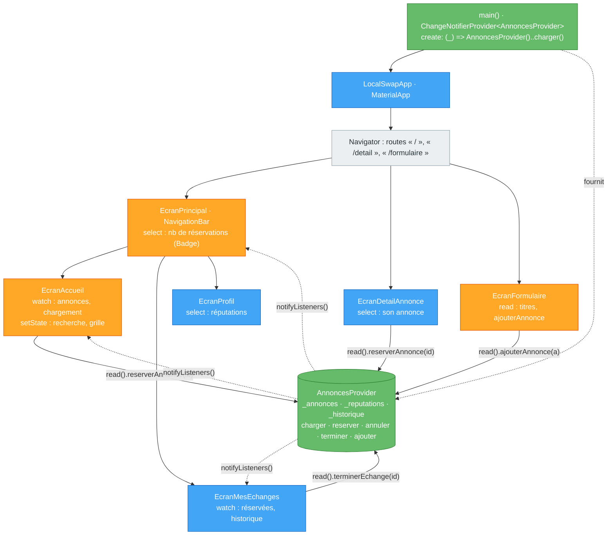

# TP7 — État partagé avec Provider (2 séances)

> **Séances :** 2 × 3 h · **Environnement :** Flutter 3.x stable (≥ 3.27), Dart 3, package `provider` 6.x, VS Code / Android Studio, émulateur Android ou Chrome
> **Fil rouge :** LocalSwap — toutes les annonces, les réservations, les échanges et la réputation passent dans un `AnnoncesProvider` partagé.

| Repère | Partie | Séance | Durée |
|---|---|---|---|
| 📘🗺️ | Rappel de cours + diagramme | 1 | 15 min |
| 🧪 | Partie A : exercices indépendants (5) | 1 | 120 min |
| 🤖 | Partie C (C1, C2) | 1 | 35 min |
| 🏗️ | Partie B : LocalSwap avec Provider | 2 | 110 min |
| 🤖 | Partie C (C3 à C6) | 2 | 45 min |
| 📝 | Quiz de fin de TP | 2 | 10 min |
| 🎤 | Validation orale (5 min par binôme, **pendant** la séance 2) | 2 | — |
| 🚀 | Partie D : défis bonus | — | hors temps |
| | **Total** | | **335 min** |

Difficulté : 🟢 facile · 🟡 moyen · 🔴 difficile

---

## 🎯 Objectifs pédagogiques

À la fin de ce TP, vous serez capable de :

1. **Justifier** le passage d'un état local (`setState`) à un état partagé, en distinguant **état d'interface** et **état métier**.
2. **Concevoir** un `ChangeNotifier` encapsulé (données privées, lecture seule, méthodes métier, `notifyListeners`).
3. **Choisir** entre `context.watch`, `context.read`, `context.select` et `Consumer`, et **prédire** quels widgets sont reconstruits.
4. **Placer** un provider au bon niveau de l'arbre pour qu'il soit accessible à toutes les routes qui en ont besoin.
5. **Gérer** un chargement asynchrone dans un `ChangeNotifier` (chargement, succès, erreur).

## 📋 Prérequis

- **TP4** : `StatefulWidget`, remonter l'état, callbacks, clés.
- **TP5** : `NavigationBar` + `IndexedStack`, routes, dialogues, `SnackBar`.
- **TP6** : formulaire de publication, recherche (état dérivé).
- **TP2** : classes `sealed`, `switch` avec patterns, `Future`.

> [!IMPORTANT]
> **Règle sur l'IA.** Vous avez le droit d'utiliser une IA. Mais **60 % de la note** porte sur votre compréhension (Partie C, oral, quiz). Tenez le **📓 Journal IA** (C7) si vous l'utilisez.

### Installation du package

```bash
flutter pub add provider
```

Cela ajoute dans `pubspec.yaml` une ligne du type `provider: ^6.1.2` (package officiellement recommandé dans la documentation Flutter pour débuter la gestion d'état).

---

## 📘 Rappel de cours

> [!NOTE]
> **Deux sortes d'état**
> - **État d'interface (éphémère)** : utile à **un seul** widget (onglet sélectionné, texte d'un champ, case « grille/liste »). → `setState` dans un `State`.
> - **État de l'application (partagé)** : utile à **plusieurs** écrans (annonces, panier, utilisateur connecté). → un objet partagé, ici un `ChangeNotifier` fourni par **Provider**.

> [!NOTE]
> **`BuildContext` et `InheritedWidget`** : chaque widget peut demander à son `context` une donnée fournie par un **ancêtre**. C'est le mécanisme `InheritedWidget` (comme `Theme.of(context)` ou `MediaQuery.of(context)`). Provider est construit dessus : un widget ne voit un provider **que s'il est placé en dessous** de celui-ci dans l'arbre.

> [!NOTE]
> **Les 3 pièces**
> 1. **`ChangeNotifier`** : votre classe d'état. Elle modifie ses données privées puis appelle **`notifyListeners()`**.
> 2. **`ChangeNotifierProvider(create: (_) => MonModele(), child: …)`** : crée l'objet **une fois**, le fournit au sous-arbre, et appelle son `dispose()` automatiquement.
> 3. **Lecture** dans les widgets :

| Méthode | Écoute ? | Où l'utiliser | Effet |
|---|---|---|---|
| `context.watch<T>()` | Oui, tout l'objet | Dans `build()` | Reconstruit le widget à **chaque** `notifyListeners()` |
| `context.select<T, R>((t) => t.x)` | Oui, seulement `x` | Dans `build()` | Reconstruit **seulement** si `x` change (`==`) |
| `Consumer<T>(builder: (ctx, t, child) => …, child: …)` | Oui | Autour d'une **petite** partie | Reconstruit seulement le `builder` ; `child` est réutilisé |
| `context.read<T>()` | **Non** | Dans un callback (`onPressed`…) | Accès ponctuel pour **appeler une méthode** |

> [!WARNING]
> `context.watch` dans un `onPressed` déclenche une **erreur** en mode debug (« Tried to use `context.watch` outside of the build method »). Dans un callback : **`read`**.

> [!TIP]
> **Encapsulation** : la liste est **privée** (`_annonces`) et exposée en **lecture seule** (`UnmodifiableListView`). Toute modification passe par une **méthode** du modèle, qui appelle `notifyListeners()`. Aucun widget ne peut « oublier » de notifier.

## 🗺️ Diagramme — Architecture Provider de LocalSwap



Légende : 🟢 état partagé / Provider · 🟠 écrans avec état d'interface local · 🔵 écrans sans état propre · ⚪ framework. Flèches pleines : **appels** (`read`) ; pointillés : **notifications**.

---

# ▶️ Séance 1

## 🧪 Partie A — Exercices pédagogiques indépendants (sans LocalSwap) · 120 min

```bash
flutter create tp7_demos
cd tp7_demos
flutter pub add provider
flutter run -t lib/ex1_shop_setstate.dart
```

> [!TIP]
> **Tapez** le code, puis répondez aux questions **🔍** dans votre compte rendu.

---

### Exercice 7.1 — Boutique sans Provider : ressentir le problème 🟢 · 20 min

**Notions :** remonter l'état (TP4) poussé à ses limites, « *prop drilling* ».

`lib/ex1_shop_setstate.dart`

```dart
import 'package:flutter/material.dart';

void main() => runApp(const ShopApp());

class ShopApp extends StatelessWidget {
  const ShopApp({super.key});

  @override
  Widget build(BuildContext context) {
    return MaterialApp(
      debugShowCheckedModeBanner: false,
      theme: ThemeData(colorScheme: ColorScheme.fromSeed(seedColor: Colors.pink)),
      home: const ShopShell(),
    );
  }
}

/// Le panier doit vivre dans le SEUL ancêtre commun des deux onglets.
class ShopShell extends StatefulWidget {
  const ShopShell({super.key});

  @override
  State<ShopShell> createState() => _ShopShellState();
}

class _ShopShellState extends State<ShopShell> {
  int _tab = 0;
  final List<String> _cart = []; // état partagé, remonté ici

  void _add(String item) => setState(() => _cart.add(item));
  void _remove(String item) => setState(() => _cart.remove(item));

  @override
  Widget build(BuildContext context) {
    return Scaffold(
      body: IndexedStack(
        index: _tab,
        children: [
          CatalogTab(cartCount: _cart.length, onAdd: _add), // ← tout passer…
          CartTab(items: _cart, onRemove: _remove), // ← …à chaque niveau
        ],
      ),
      bottomNavigationBar: NavigationBar(
        selectedIndex: _tab,
        onDestinationSelected: (int i) => setState(() => _tab = i),
        destinations: [
          const NavigationDestination(icon: Icon(Icons.store_outlined), label: 'Catalogue'),
          NavigationDestination(
            icon: Badge(
              isLabelVisible: _cart.isNotEmpty,
              label: Text('${_cart.length}'),
              child: const Icon(Icons.shopping_cart_outlined),
            ),
            label: 'Panier',
          ),
        ],
      ),
    );
  }
}

class CatalogTab extends StatelessWidget {
  const CatalogTab({super.key, required this.cartCount, required this.onAdd});

  final int cartCount;
  final ValueChanged<String> onAdd;

  static const List<String> _products = ['Stylo', 'Cahier', 'Clé USB', 'Calculatrice'];

  @override
  Widget build(BuildContext context) {
    return Scaffold(
      appBar: AppBar(title: Text('Catalogue ($cartCount au panier)')),
      body: ListView(
        children: [
          for (final String p in _products) ProductTile(name: p, onAdd: onAdd),
        ],
      ),
    );
  }
}

/// Ce widget n'utilise pas le panier… mais doit transmettre onAdd.
class ProductTile extends StatelessWidget {
  const ProductTile({super.key, required this.name, required this.onAdd});

  final String name;
  final ValueChanged<String> onAdd;

  @override
  Widget build(BuildContext context) {
    return ListTile(
      title: Text(name),
      trailing: IconButton(
        tooltip: 'Ajouter',
        onPressed: () => onAdd(name),
        icon: const Icon(Icons.add_shopping_cart),
      ),
    );
  }
}

class CartTab extends StatelessWidget {
  const CartTab({super.key, required this.items, required this.onRemove});

  final List<String> items;
  final ValueChanged<String> onRemove;

  @override
  Widget build(BuildContext context) {
    return Scaffold(
      appBar: AppBar(title: const Text('Panier')),
      body: items.isEmpty
          ? const Center(child: Text('Panier vide'))
          : ListView(
              children: [
                for (final String item in items)
                  ListTile(
                    title: Text(item),
                    trailing: IconButton(
                      tooltip: 'Retirer',
                      onPressed: () => onRemove(item),
                      icon: const Icon(Icons.remove_circle_outline),
                    ),
                  ),
              ],
            ),
    );
  }
}
```

**🔍 Observer & répondre**

1. Comptez les **paramètres de constructeur** qui ne servent qu'à **transmettre** le panier ou ses callbacks. Lesquels ?
2. On veut ajouter un bouton « Payer » dans `CartTab` qui ouvre une page `PaymentPage` (avec `Navigator.push`), affichant le total et un bouton « Vider le panier ». Listez **tout** ce qu'il faudrait modifier. Pourquoi est-ce pénible ?
3. Pourquoi ne pas simplement mettre le panier dans une **variable globale** `List<String> panier = [];` ? Que manquerait-il ?

---

### Exercice 7.2 — Même boutique avec Provider 🟢 · 25 min

**Notions nouvelles :** `ChangeNotifier`, `ChangeNotifierProvider` + `watch`/`read`.

`lib/ex2_shop_provider.dart`

```dart
import 'package:flutter/material.dart';
import 'package:provider/provider.dart';

/// 1) L'ÉTAT PARTAGÉ : données privées + méthodes qui notifient.
class CartModel extends ChangeNotifier {
  final List<String> _items = [];

  List<String> get items => List.unmodifiable(_items); // lecture seule
  int get count => _items.length;

  void add(String item) {
    _items.add(item);
    notifyListeners(); // « j'ai changé » → les widgets qui écoutent se reconstruisent
  }

  void remove(String item) {
    _items.remove(item);
    notifyListeners();
  }

  void clear() {
    _items.clear();
    notifyListeners();
  }
}

void main() {
  runApp(
    // 2) Fourni AU-DESSUS de MaterialApp : visible par TOUTES les routes.
    ChangeNotifierProvider(
      create: (context) => CartModel(), // créé une seule fois, libéré automatiquement
      child: const ShopApp(),
    ),
  );
}

class ShopApp extends StatelessWidget {
  const ShopApp({super.key});

  @override
  Widget build(BuildContext context) {
    return MaterialApp(
      debugShowCheckedModeBanner: false,
      theme: ThemeData(colorScheme: ColorScheme.fromSeed(seedColor: Colors.pink)),
      home: const ShopShell(),
    );
  }
}

class ShopShell extends StatefulWidget {
  const ShopShell({super.key});

  @override
  State<ShopShell> createState() => _ShopShellState();
}

class _ShopShellState extends State<ShopShell> {
  int _tab = 0; // état d'INTERFACE : reste un setState local

  @override
  Widget build(BuildContext context) {
    final int count = context.watch<CartModel>().count; // 3) ÉCOUTE

    return Scaffold(
      body: IndexedStack(
        index: _tab,
        children: const [CatalogTab(), CartTab()], // plus aucun paramètre !
      ),
      bottomNavigationBar: NavigationBar(
        selectedIndex: _tab,
        onDestinationSelected: (int i) => setState(() => _tab = i),
        destinations: [
          const NavigationDestination(icon: Icon(Icons.store_outlined), label: 'Catalogue'),
          NavigationDestination(
            icon: Badge(
              isLabelVisible: count > 0,
              label: Text('$count'),
              child: const Icon(Icons.shopping_cart_outlined),
            ),
            label: 'Panier',
          ),
        ],
      ),
    );
  }
}

class CatalogTab extends StatelessWidget {
  const CatalogTab({super.key});

  static const List<String> _products = ['Stylo', 'Cahier', 'Clé USB', 'Calculatrice'];

  @override
  Widget build(BuildContext context) {
    final int count = context.watch<CartModel>().count;
    return Scaffold(
      appBar: AppBar(title: Text('Catalogue ($count au panier)')),
      body: ListView(
        children: [for (final String p in _products) ProductTile(name: p)],
      ),
    );
  }
}

class ProductTile extends StatelessWidget {
  const ProductTile({super.key, required this.name});

  final String name;

  @override
  Widget build(BuildContext context) {
    return ListTile(
      title: Text(name),
      trailing: IconButton(
        tooltip: 'Ajouter',
        // 4) Dans un callback : READ (on agit, on n'écoute pas)
        onPressed: () => context.read<CartModel>().add(name),
        icon: const Icon(Icons.add_shopping_cart),
      ),
    );
  }
}

class CartTab extends StatelessWidget {
  const CartTab({super.key});

  @override
  Widget build(BuildContext context) {
    final CartModel cart = context.watch<CartModel>();
    return Scaffold(
      appBar: AppBar(title: const Text('Panier')),
      body: cart.items.isEmpty
          ? const Center(child: Text('Panier vide'))
          : ListView(
              children: [
                for (final String item in cart.items)
                  ListTile(
                    title: Text(item),
                    trailing: IconButton(
                      tooltip: 'Retirer',
                      onPressed: () => context.read<CartModel>().remove(item),
                      icon: const Icon(Icons.remove_circle_outline),
                    ),
                  ),
              ],
            ),
      floatingActionButton: cart.count == 0
          ? null
          : FloatingActionButton.extended(
              onPressed: () => Navigator.push(
                context,
                MaterialPageRoute(builder: (context) => const PaymentPage()),
              ),
              icon: const Icon(Icons.payment),
              label: const Text('Payer'),
            ),
    );
  }
}

/// Une NOUVELLE route : elle accède au panier sans qu'on lui passe quoi que ce soit.
class PaymentPage extends StatelessWidget {
  const PaymentPage({super.key});

  @override
  Widget build(BuildContext context) {
    final int count = context.watch<CartModel>().count;
    return Scaffold(
      appBar: AppBar(title: const Text('Paiement')),
      body: Center(
        child: FilledButton(
          onPressed: () {
            context.read<CartModel>().clear();
            Navigator.pop(context);
          },
          child: Text('Payer $count article(s) et vider le panier'),
        ),
      ),
    );
  }
}
```

**🔍 Observer & répondre**

1. Comparez avec 7.1 : combien de paramètres de transmission restent-ils ? Qu'est-ce qui reste en `setState`, et pourquoi ?
2. Dans `CartModel.add`, mettez `notifyListeners()` en commentaire. Ajoutez 3 articles, puis changez d'onglet. Que voit-on, et pourquoi le panier semble-t-il « se réparer » plus tard ?
3. Dans `ProductTile`, remplacez `context.read` par `context.watch` dans `onPressed`. Que se passe-t-il au clic ?
4. Déplacez `ChangeNotifierProvider` **dans** `ShopApp`, autour de `ShopShell` seulement (`home: ChangeNotifierProvider(…, child: ShopShell())`). Cliquez sur « Payer ». Quelle erreur obtenez-vous ? Expliquez-la avec la notion d'**ancêtre**.

---

### Exercice 7.3 — Station météo : qui se reconstruit ? 🟡 · 25 min

**Notions nouvelles :** `Consumer` (avec `child`), `context.select`.

`lib/ex3_rebuilds.dart`

```dart
import 'package:flutter/material.dart';
import 'package:provider/provider.dart';

class WeatherModel extends ChangeNotifier {
  double _temperature = 20;
  int _humidity = 50;

  double get temperature => _temperature;
  int get humidity => _humidity;

  void warmer() {
    _temperature += 0.5;
    notifyListeners();
  }

  void wetter() {
    _humidity = _humidity >= 100 ? 100 : _humidity + 5;
    notifyListeners();
  }
}

/// Compteur de builds par zone (outil pédagogique : on ne fait pas ça en production).
final Map<String, int> buildCounts = {};
int countBuild(String zone) => buildCounts.update(zone, (n) => n + 1, ifAbsent: () => 1);

void main() {
  runApp(
    ChangeNotifierProvider(
      create: (context) => WeatherModel(),
      child: const WeatherApp(),
    ),
  );
}

class WeatherApp extends StatelessWidget {
  const WeatherApp({super.key});

  @override
  Widget build(BuildContext context) {
    return MaterialApp(
      debugShowCheckedModeBanner: false,
      theme: ThemeData(colorScheme: ColorScheme.fromSeed(seedColor: Colors.lightBlue)),
      home: const WeatherPage(),
    );
  }
}

class WeatherPage extends StatelessWidget {
  const WeatherPage({super.key});

  @override
  Widget build(BuildContext context) {
    final int n = countBuild('Page'); // cette page n'ÉCOUTE rien
    return Scaffold(
      appBar: AppBar(title: Text('Station météo · page : $n build(s)')),
      body: ListView(
        padding: const EdgeInsets.all(16),
        children: [
          const TemperatureWatch(),
          const HumiditySelect(),
          // Consumer : seul le builder est reconstruit ; `child` est construit UNE fois
          Consumer<WeatherModel>(
            builder: (context, model, child) {
              final int c = countBuild('Consumer');
              return Card(
                child: Padding(
                  padding: const EdgeInsets.all(12),
                  child: Column(
                    children: [
                      Text('Consumer : ${model.temperature} °C ($c builds)'),
                      child!, // réutilisé tel quel
                    ],
                  ),
                ),
              );
            },
            child: const ExpensiveChart(),
          ),
          const SizedBox(height: 16),
          Row(
            children: [
              Expanded(
                child: FilledButton(
                  onPressed: () => context.read<WeatherModel>().warmer(),
                  child: const Text('+0,5 °C'),
                ),
              ),
              const SizedBox(width: 8),
              Expanded(
                child: FilledButton.tonal(
                  onPressed: () => context.read<WeatherModel>().wetter(),
                  child: const Text('+5 % humidité'),
                ),
              ),
            ],
          ),
        ],
      ),
    );
  }
}

/// watch : écoute TOUT le modèle.
class TemperatureWatch extends StatelessWidget {
  const TemperatureWatch({super.key});

  @override
  Widget build(BuildContext context) {
    final double t = context.watch<WeatherModel>().temperature;
    final int c = countBuild('TemperatureWatch');
    return ListTile(
      leading: const Icon(Icons.thermostat),
      title: Text('$t °C'),
      subtitle: Text('watch · $c build(s)'),
    );
  }
}

/// select : n'écoute QUE l'humidité.
class HumiditySelect extends StatelessWidget {
  const HumiditySelect({super.key});

  @override
  Widget build(BuildContext context) {
    final int h = context.select<WeatherModel, int>((m) => m.humidity);
    final int c = countBuild('HumiditySelect');
    return ListTile(
      leading: const Icon(Icons.water_drop_outlined),
      title: Text('$h %'),
      subtitle: Text('select · $c build(s)'),
    );
  }
}

class ExpensiveChart extends StatelessWidget {
  const ExpensiveChart({super.key});

  @override
  Widget build(BuildContext context) {
    final int c = countBuild('Graphique (child)');
    return Container(
      height: 80,
      margin: const EdgeInsets.only(top: 8),
      alignment: Alignment.center,
      color: Theme.of(context).colorScheme.surfaceContainerHighest,
      child: Text('Graphique coûteux · $c build(s)'),
    );
  }
}
```

**🔍 Observer & répondre** — remplissez **d'abord** la colonne « prédiction ».

| Action (depuis le démarrage) | Zone | Prédiction : builds | Observé |
|---|---|---|---|
| 3 clics sur « +0,5 °C » | Page / TemperatureWatch / HumiditySelect / Consumer / Graphique | | |
| puis 2 clics sur « +5 % humidité » | Page / TemperatureWatch / HumiditySelect / Consumer / Graphique | | |

1. Pourquoi `TemperatureWatch` se reconstruit-il quand seule l'humidité change ? Réécrivez-le avec `select`.
2. Pourquoi le compteur de la **Page** reste-t-il à 1 ?
3. Le graphique est `const` et passé en `child`. Que se passerait-il s'il était construit **dans** le `builder` ?

---

### Exercice 7.4 — Tâches et thème : encapsulation et MultiProvider 🟡 · 25 min

**Notions nouvelles :** encapsulation (`UnmodifiableListView`, getters calculés), `MultiProvider`.

`lib/ex4_todo.dart`

```dart
import 'dart:collection';

import 'package:flutter/material.dart';
import 'package:provider/provider.dart';

class Task {
  const Task({required this.id, required this.title, this.done = false});

  final String id;
  final String title;
  final bool done;

  Task toggled() => Task(id: id, title: title, done: !done);
}

/// Toute la LOGIQUE est ici ; l'interface ne fait qu'afficher et appeler.
class TodoModel extends ChangeNotifier {
  final List<Task> _tasks = [
    const Task(id: '1', title: 'Réviser Provider'),
    const Task(id: '2', title: 'Finir le TP6', done: true),
  ];

  UnmodifiableListView<Task> get tasks => UnmodifiableListView(_tasks);
  int get remaining => _tasks.where((t) => !t.done).length; // valeur CALCULÉE

  void add(String title) {
    final String clean = title.trim();
    if (clean.isEmpty) return; // règle métier dans le modèle
    _tasks.add(Task(id: DateTime.now().microsecondsSinceEpoch.toString(), title: clean));
    notifyListeners();
  }

  void toggle(String id) {
    final int i = _tasks.indexWhere((t) => t.id == id);
    if (i == -1) return;
    _tasks[i] = _tasks[i].toggled();
    notifyListeners();
  }

  void remove(String id) {
    _tasks.removeWhere((t) => t.id == id);
    notifyListeners();
  }
}

class ThemeModel extends ChangeNotifier {
  ThemeMode _mode = ThemeMode.light;

  ThemeMode get mode => _mode;

  void toggle() {
    _mode = _mode == ThemeMode.light ? ThemeMode.dark : ThemeMode.light;
    notifyListeners();
  }
}

void main() {
  runApp(
    MultiProvider(
      providers: [
        ChangeNotifierProvider(create: (context) => TodoModel()),
        ChangeNotifierProvider(create: (context) => ThemeModel()),
      ],
      child: const TodoApp(),
    ),
  );
}

class TodoApp extends StatelessWidget {
  const TodoApp({super.key});

  @override
  Widget build(BuildContext context) {
    final ThemeMode mode = context.watch<ThemeModel>().mode;
    const Color seed = Colors.deepPurple;
    return MaterialApp(
      debugShowCheckedModeBanner: false,
      theme: ThemeData(colorScheme: ColorScheme.fromSeed(seedColor: seed)),
      darkTheme: ThemeData(
        colorScheme: ColorScheme.fromSeed(seedColor: seed, brightness: Brightness.dark),
      ),
      themeMode: mode,
      home: const TodoPage(),
    );
  }
}

class TodoPage extends StatefulWidget {
  const TodoPage({super.key});

  @override
  State<TodoPage> createState() => _TodoPageState();
}

class _TodoPageState extends State<TodoPage> {
  // Le texte en cours de saisie est un état d'INTERFACE : il reste ici.
  final TextEditingController _controller = TextEditingController();

  @override
  void dispose() {
    _controller.dispose();
    super.dispose();
  }

  void _add() {
    context.read<TodoModel>().add(_controller.text);
    _controller.clear();
  }

  @override
  Widget build(BuildContext context) {
    final TodoModel todo = context.watch<TodoModel>();
    final bool dark = context.select<ThemeModel, bool>((t) => t.mode == ThemeMode.dark);

    return Scaffold(
      appBar: AppBar(
        title: Text('Tâches (${todo.remaining} restante(s))'),
        actions: [
          IconButton(
            tooltip: dark ? 'Thème clair' : 'Thème sombre',
            onPressed: () => context.read<ThemeModel>().toggle(),
            icon: Icon(dark ? Icons.light_mode : Icons.dark_mode),
          ),
        ],
      ),
      body: Column(
        children: [
          Padding(
            padding: const EdgeInsets.all(16),
            child: TextField(
              controller: _controller,
              textInputAction: TextInputAction.done,
              onSubmitted: (_) => _add(),
              decoration: InputDecoration(
                hintText: 'Nouvelle tâche',
                border: const OutlineInputBorder(),
                suffixIcon: IconButton(
                  tooltip: 'Ajouter',
                  onPressed: _add,
                  icon: const Icon(Icons.add),
                ),
              ),
            ),
          ),
          Expanded(
            child: ListView(
              children: [
                for (final Task task in todo.tasks)
                  CheckboxListTile(
                    key: ValueKey(task.id),
                    value: task.done,
                    onChanged: (_) => context.read<TodoModel>().toggle(task.id),
                    title: Text(
                      task.title,
                      style: TextStyle(
                        decoration: task.done ? TextDecoration.lineThrough : null,
                      ),
                    ),
                    secondary: IconButton(
                      tooltip: 'Supprimer',
                      onPressed: () => context.read<TodoModel>().remove(task.id),
                      icon: const Icon(Icons.delete_outline),
                    ),
                  ),
              ],
            ),
          ),
        ],
      ),
    );
  }
}
```

**🔍 Observer & répondre**

1. Dans `_add`, remplacez la première ligne par `context.read<TodoModel>().tasks.add(Task(id: 'x', title: _controller.text));`. Que se passe-t-il ? Pourquoi est-ce une **bonne** chose ?
2. Pourquoi `remaining` est-il un getter calculé et non un champ `int _remaining` mis à jour dans chaque méthode ?
3. Pourquoi `_controller` est-il dans le `State` de la page et non dans `TodoModel` ?
4. Au TP4 (défi D4), basculer le thème depuis un écran profond exigeait de faire passer un callback à travers plusieurs widgets. Combien de lignes cela coûte-t-il ici ?

---

### Exercice 7.5 — Citation du jour : chargement asynchrone dans un modèle 🔴 · 25 min

**Notions nouvelles :** méthode `async` dans un `ChangeNotifier`, états chargement/succès/erreur (classe `sealed`, TP2).

`lib/ex5_async_quote.dart`

```dart
import 'package:flutter/material.dart';
import 'package:provider/provider.dart';

/// Les 3 états possibles de l'écran (classe sealed → switch exhaustif).
sealed class QuoteState {
  const QuoteState();
}

class QuoteLoading extends QuoteState {
  const QuoteLoading();
}

class QuoteLoaded extends QuoteState {
  const QuoteLoaded(this.quote);
  final String quote;
}

class QuoteError extends QuoteState {
  const QuoteError(this.message);
  final String message;
}

class QuoteModel extends ChangeNotifier {
  static const List<String> _quotes = [
    'Le savoir est la seule richesse qui s’accroît quand on la partage.',
    'Un code lisible vaut mieux qu’un code astucieux.',
    'La patience est amère, mais son fruit est doux.',
  ];

  QuoteState _state = const QuoteLoading();
  int _calls = 0;
  bool _disposed = false;

  QuoteState get state => _state;
  bool get isLoading => _state is QuoteLoading;

  Future<void> load() async {
    _state = const QuoteLoading();
    notifyListeners();
    try {
      _state = QuoteLoaded(await _fakeApi());
    } catch (e) {
      _state = QuoteError('Impossible de charger la citation ($e)');
    }
    // Le modèle a pu être libéré pendant l'attente : on ne notifie plus.
    if (!_disposed) notifyListeners();
  }

  /// Simule un serveur : 1 s d'attente, 1 appel sur 3 échoue.
  Future<String> _fakeApi() async {
    await Future<void>.delayed(const Duration(seconds: 1));
    _calls++;
    if (_calls % 3 == 0) throw Exception('serveur indisponible');
    return _quotes[_calls % _quotes.length];
  }

  @override
  void dispose() {
    _disposed = true;
    super.dispose();
  }
}

void main() {
  runApp(
    ChangeNotifierProvider(
      create: (context) => QuoteModel()..load(), // chargement lancé à la création
      child: const QuoteApp(),
    ),
  );
}

class QuoteApp extends StatelessWidget {
  const QuoteApp({super.key});

  @override
  Widget build(BuildContext context) {
    return MaterialApp(
      debugShowCheckedModeBanner: false,
      theme: ThemeData(colorScheme: ColorScheme.fromSeed(seedColor: Colors.brown)),
      home: const QuotePage(),
    );
  }
}

class QuotePage extends StatelessWidget {
  const QuotePage({super.key});

  @override
  Widget build(BuildContext context) {
    final QuoteModel model = context.watch<QuoteModel>();
    final ColorScheme colors = Theme.of(context).colorScheme;

    return Scaffold(
      appBar: AppBar(title: const Text('Citation du jour')),
      body: Center(
        child: Padding(
          padding: const EdgeInsets.all(24),
          child: switch (model.state) {
            QuoteLoading() => const CircularProgressIndicator(),
            QuoteLoaded(:final quote) => Text(
                '« $quote »',
                textAlign: TextAlign.center,
                style: Theme.of(context).textTheme.headlineSmall,
              ),
            QuoteError(:final message) => Column(
                mainAxisSize: MainAxisSize.min,
                children: [
                  Icon(Icons.cloud_off, size: 48, color: colors.error),
                  const SizedBox(height: 8),
                  Text(message, textAlign: TextAlign.center),
                  const SizedBox(height: 16),
                  FilledButton(
                    onPressed: () => context.read<QuoteModel>().load(),
                    child: const Text('Réessayer'),
                  ),
                ],
              ),
          },
        ),
      ),
      floatingActionButton: FloatingActionButton(
        onPressed: model.isLoading ? null : () => context.read<QuoteModel>().load(),
        tooltip: 'Nouvelle citation',
        child: const Icon(Icons.refresh),
      ),
    );
  }
}
```

**🔍 Observer & répondre**

1. Cliquez plusieurs fois sur le bouton : notez la séquence des états. Après combien d'appels obtenez-vous une erreur ?
2. Ajoutez une 4ᵉ sous-classe `QuoteEmpty`. Quel fichier ne compile plus ? Quel avantage par rapport à 3 booléens `isLoading`, `hasError`, `hasData` ?
3. Pourquoi le `mounted` des TP4 à TP6 n'existe-t-il pas dans un `ChangeNotifier` ? Par quoi est-il remplacé ici ?
4. Le `FloatingActionButton` est-il désactivé pendant le chargement ? Pourquoi est-ce important pour un vrai serveur (TP8) ?

---

## 🤖 Partie C (séance 1) — C1 et C2 · 35 min

> [!CAUTION]
> **Répondez d'abord sur papier, sans exécuter et sans IA**. Vérifiez ensuite sur machine.

### C1 — Prédire les reconstructions 🟡 · 15 min

`CounterModel` a deux champs, `a` et `b`, et deux méthodes `incA()` et `incB()` qui notifient. Chaque widget affiche un `debugPrint('build X')`.

```dart
class Page extends StatelessWidget {          // build Page
  @override
  Widget build(BuildContext context) {
    debugPrint('build Page');
    return Column(children: [
      const W1(),     // final a = context.watch<CounterModel>().a;
      const W2(),     // final b = context.select<CounterModel, int>((m) => m.b);
      const W3(),     // aucun accès au modèle
      Consumer<CounterModel>(
        builder: (context, m, child) { debugPrint('build Consumer'); return Text('${m.a}'); },
      ),
      const W4(),     // onPressed: () => context.read<CounterModel>().incA()
    ]);
  }
}
```

Écrivez les lignes `build …` affichées : (a) au démarrage ; (b) après un appel à `incA()` ; (c) après un appel à `incB()` ; (d) après un `notifyListeners()` sans aucune modification.

### C2 — Trouver les bugs 🟡 · 20 min

Ce code contient **4 erreurs**. Pour chacune : ligne, symptôme (ou message), cause, correction.

```dart
class FavoritesModel extends ChangeNotifier {
  final Set<String> favorites = {};

  void toggle(String id) {
    if (!favorites.remove(id)) favorites.add(id);
  }
}

class ProductsPage extends StatelessWidget {
  const ProductsPage({super.key});

  @override
  Widget build(BuildContext context) {
    return ChangeNotifierProvider.value(
      value: FavoritesModel(),
      child: Scaffold(
        appBar: AppBar(
          actions: [
            IconButton(
              icon: const Icon(Icons.favorite),
              onPressed: () => Navigator.push(
                context,
                MaterialPageRoute(builder: (_) => const FavoritesPage()), // lit FavoritesModel
              ),
            ),
          ],
        ),
        body: ListView(
          children: [
            for (final id in ['p1', 'p2', 'p3'])
              Builder(
                builder: (context) => ListTile(
                  title: Text(id),
                  trailing: IconButton(
                    icon: const Icon(Icons.star_border),
                    onPressed: () => context.watch<FavoritesModel>().toggle(id),
                  ),
                ),
              ),
          ],
        ),
      ),
    );
  }
}
```

---

# ▶️ Séance 2

## 🏗️ Partie B — LocalSwap avec Provider · 110 min

```text
lib/
├── main.dart                          ← ChangeNotifierProvider
├── state/
│   └── annonces_provider.dart         ← NOUVEAU
└── screens/                           ← accueil, détail, formulaire, mes échanges, profil, principal : MODIFIÉS
```

> [!IMPORTANT]
> **Règle de répartition** : ce qui concerne **plusieurs écrans** (annonces, statuts, réputations, historique) va dans `AnnoncesProvider`. Ce qui ne concerne **qu'un écran** (texte de recherche, filtre de catégorie, mode grille, onglet sélectionné, controllers) reste en `setState`.

### B.1 — `AnnoncesProvider` 🔴 · 35 min

Dans `lib/state/annonces_provider.dart`, une classe `AnnoncesProvider extends ChangeNotifier` :

| Membre | Rôle |
|---|---|
| `_annonces`, `_chargement`, `_erreur`, `_reputations` (`Map<String, int>`), `_historique` (`List<Echange>`) | Données **privées** |
| `annonces` (`UnmodifiableListView`), `chargement`, `erreur`, `historique` | Lecture seule |
| `reservees` | Annonces au statut `reservee` (getter calculé) |
| `titres` | Liste des titres (pour la vérification du TP6) |
| `Annonce? annonceParId(String id)` | Recherche (ou `null`) |
| `int reputationDe(String idUtilisateur)` | 0 si inconnu |
| `Future<void> charger()` | Utilise `chargerAnnonces()` (TP2) ; gère chargement et erreur ; initialise les réputations depuis `utilisateursTest` (TP4) |
| `void reserverAnnonce(String id)` | `disponible` → `reservee`, **uniquement** si `peutReserver` |
| `void annulerReservation(String id)` | `reservee` → `disponible` (action « Annuler » de la `SnackBar`) |
| `void terminerEchange(String id)` | `reservee` → `terminee`, réputation du propriétaire +1 (**plafonnée à 5**), ajout d'un `Echange` (`idDemandeur: 'moi'`, date du jour) à l'historique |
| `void ajouterAnnonce(Annonce a)` | Insertion **en tête** |

Chaque méthode qui modifie l'état appelle `notifyListeners()` **une seule fois**, à la fin.

### B.2 — Fournir le provider 🟢 · 5 min

Dans `main.dart`, enveloppez `LocalSwapApp` (donc **au-dessus** de `MaterialApp`) :
`ChangeNotifierProvider(create: (_) => AnnoncesProvider()..charger(), child: const LocalSwapApp())`.

### B.3 — Accueil 🟡 · 20 min

- Supprimez `_annonces`, `_chargement`, `initState`/`_charger` : tout vient de `context.watch<AnnoncesProvider>()`.
- Gardez en `setState` : recherche, filtre de catégorie, grille/liste.
- Affichez un message d'erreur avec un bouton « Réessayer » si `erreur != null`.
- `onReserver` : confirmation (TP5), puis `context.read<AnnoncesProvider>().reserverAnnonce(id)`, puis `SnackBar` avec « Annuler » → `annulerReservation(id)`.
- `onTap` : `Navigator.pushNamed(context, Routes.detail, arguments: annonce)` (**plus besoin** d'attendre un résultat).
- FAB : `Navigator.pushNamed(context, Routes.formulaire)` (**plus d'insertion** ici).

### B.4 — Détail 🟡 · 15 min

- L'écran reçoit toujours l'`Annonce` par la route, mais affiche la **version à jour** : `context.select<AnnoncesProvider, Annonce?>((p) => p.annonceParId(annonce.id)) ?? annonce`.
- « Réserver » : confirmation → `read().reserverAnnonce(id)`. L'écran **reste ouvert** et son badge passe à « Réservée » tout seul.

### B.5 — Formulaire 🟢 · 10 min

- Les titres existants viennent de `context.read<AnnoncesProvider>().titres` (supprimez l'argument de route du TP6).
- À la validation : `context.read<AnnoncesProvider>().ajouterAnnonce(annonce)` puis `Navigator.pop(context)`.

### B.6 — Mes échanges, Profil, Badge 🟡 · 20 min

- **Mes échanges** : section « En cours » (`reservees`, `CarteAnnonce` ou `ListTile`) avec un bouton « Terminer l'échange » (confirmation) → `terminerEchange(id)`, puis section « Historique » (`historique`, date formatée).
- **Profil** : la réputation affichée vient de `reputationDe(u.id)` → elle augmente quand un échange est terminé.
- **`NavigationBar`** : `Badge` sur « Mes échanges » avec le **nombre de réservations**, lu avec **`context.select`** (seul ce nombre déclenche la reconstruction).

### B.7 — Démonstration finale ✅ · 5 min

Scénario à montrer à l'oral, **sans redémarrer** : réserver une annonce depuis le Détail → son badge change dans le Détail **et** dans l'accueil → le compteur de « Mes échanges » passe à 1 → terminer l'échange → l'annonce passe « Terminée », la réputation du propriétaire augmente dans *Profil*, l'échange apparaît dans l'historique.

Terminez par `flutter analyze` (aucun problème) et un commit : `feat: état partagé avec Provider`.

---

## 🤖 Partie C (séance 2) — C3 à C7 · 45 min

### C3 — Critiquer du code généré par une IA 🔴 · 15 min

Prompt : *« Fais un Provider Flutter pour gérer les annonces avec chargement depuis une API et affichage d'un message de succès »*. Réponse de l'IA :

```dart
class AnnoncesProvider with ChangeNotifier {
  static final AnnoncesProvider instance = AnnoncesProvider();

  List<Annonce> annonces = [];
  bool loading = false;
  BuildContext? context;

  AnnoncesProvider() {
    fetch();
  }

  void fetch() async {
    loading = true;
    final data = await chargerAnnonces();
    annonces = data;
    loading = false;
    notifyListeners();
  }

  void reserver(Annonce a) {
    final index = annonces.indexOf(a);
    annonces[index] = a.copyWith(statut: StatutAnnonce.reservee);
    notifyListeners();
    ScaffoldMessenger.of(context!).showSnackBar(SnackBar(content: Text('Réservé !')));
  }
}

// main.dart
void main() => runApp(
      ChangeNotifierProvider(
        create: (_) => AnnoncesProvider.instance,
        child: MyApp(),
      ),
    );

// Dans un écran :
@override
Widget build(BuildContext context) {
  final provider = Provider.of<AnnoncesProvider>(context);
  provider.context = context;
  return Consumer<AnnoncesProvider>(
    builder: (context, p, _) => MaterialApp(
      home: ListView(
        children: p.annonces.map((a) => ListTile(
          title: Text(a.titre),
          onTap: () => Provider.of<AnnoncesProvider>(context).reserver(a),
        )).toList(),
      ),
    ),
  );
}
```

1. Trouvez **au moins 8 problèmes**, classés : 🔴 plantage ou bug, 🟠 mauvaise architecture Provider, 🟡 qualité.
2. Expliquez pourquoi stocker un `BuildContext` dans un provider est dangereux.
3. Pour chaque problème, montrez la ligne de **votre** `AnnoncesProvider` ou de vos écrans qui l'évite.
4. Écrivez le prompt qui aurait évité ces problèmes.

### C4 — Modifier sous contrainte 🟡 · 8 min

1. **Exercice 7.4** : ajoutez un bouton « Supprimer les tâches terminées ». Contrainte : **aucune boucle ni aucun `where`** dans le code de l'interface.
2. **LocalSwap** : affichez « N disponibles » dans le titre de l'`AppBar` de l'accueil. Contrainte : ce titre doit être reconstruit **seulement** quand ce nombre change (pas à chaque `notifyListeners`). Quel outil utilisez-vous, et pourquoi pas `watch` ?

### C5 — Expliquer ligne par ligne 🟢 · 7 min

Recopiez votre `terminerEchange` et commentez **chaque ligne**. Répondez : *« Que se passerait-il si on appelait `notifyListeners()` après chaque petite modification (statut, réputation, historique) au lieu d'une seule fois ? »*

### C6 — Exercice papier ✍️ 🟡 · 10 min

Dessinez l'arbre de widgets de LocalSwap (de `main` à `CarteAnnonce`, plus la route Détail ouverte), placez `ChangeNotifierProvider`, et **entourez en rouge** tous les widgets reconstruits après `reserverAnnonce(id)` appelé depuis le Détail. Justifiez chaque widget entouré (`watch`, `select` ou `Consumer`).

### C7 — Journal IA 📓

| # | Exercice | Prompt (copié tel quel) | Ce que j'ai gardé | Ce que j'ai rejeté ou corrigé, et pourquoi |
|---|---|---|---|---|
| 1 | | | | |

---

## 🚀 Partie D — Défis bonus

| Défi | Niveau | Énoncé |
|---|---|---|
| D1 — Favoris persistants en mémoire | 🟡 | Ajoutez un `FavorisProvider` (`Set<String>`) avec `MultiProvider`. La carte affiche un cœur lu avec `select` ; une page « Favoris » liste les annonces favorites. Le favori survit au défilement et au changement d'onglet (comparez avec le défi D1 du TP4). |
| D2 — `ProxyProvider` | 🔴 | Créez un `StatistiquesProvider` qui dépend d'`AnnoncesProvider` (`ChangeNotifierProxyProvider`) et calcule le nombre d'annonces par catégorie. |
| D3 — Thème global | 🟢 | Ajoutez un `ThemeProvider` (comme dans l'ex. 7.4) et un interrupteur clair/sombre dans le Drawer de LocalSwap. |
| D4 — Comparer | 🔴 | Lisez la page « Approaches to state management » de la documentation Flutter. En 10 lignes : dans quel cas passeriez-vous à Riverpod ou Bloc ? |

---

## 🎤 Validation orale (5 min par binôme, séance 2)

1. Montrez où est créé `AnnoncesProvider`. **Déplacez-le en direct** sous `MaterialApp` (dans `home`) : que se passe-t-il à l'ouverture du Détail ?
2. Pourquoi `_annonces` est-il privé ? **Essayez en direct** `provider.annonces.add(...)` depuis l'accueil.
3. Pourquoi la recherche et le mode grille ne sont-ils **pas** dans le provider ?
4. `read` ou `watch` dans ce `onPressed` ? Pourquoi ?
5. Comment le Détail affiche-t-il le nouveau statut **sans** qu'on lui renvoie l'annonce ?
6. Le `Badge` de la `NavigationBar` utilise `select` : qu'est-ce que cela change ?
7. Que se passe-t-il si `chargerAnnonces()` lève une exception ?
8. **Modifiez en direct** : la réputation ne doit pas augmenter si le propriétaire est `'moi'`.

> [!IMPORTANT]
> La note d'oral est **individuelle**.

---

## ✅ Checklist de validation — le TP est réussi si…

- [ ] Les 5 exercices de la Partie A se lancent, et les questions 🔍 (dont le tableau de l'ex. 7.3) ont une réponse.
- [ ] `AnnoncesProvider` est encapsulé (champs privés, lecture seule, une seule notification par méthode).
- [ ] Le provider est au-dessus de `MaterialApp` ; Détail et Formulaire y accèdent.
- [ ] Le scénario B.7 fonctionne **sans redémarrer**.
- [ ] Recherche, filtres et grille restent en `setState` local.
- [ ] Le `Badge` de « Mes échanges » utilise `select`.
- [ ] Les erreurs de chargement s'affichent avec « Réessayer ».
- [ ] `flutter analyze` : aucun problème.
- [ ] Les réponses aux exercices C1 à C6 sont rédigées, et le journal IA est tenu si une IA a été utilisée.

## ⚠️ Erreurs fréquentes et corrections

| Symptôme | Cause | Correction |
|---|---|---|
| `ProviderNotFoundException` | Provider placé **sous** l'endroit qui le lit, ou dans un écran alors qu'une **autre route** le lit | Le placer au-dessus de `MaterialApp` |
| `Tried to use context.watch outside of the build method` | `watch` dans un callback | `read` |
| L'interface ne se met pas à jour | `notifyListeners()` oublié | L'appeler à la fin de chaque méthode qui modifie l'état |
| `Unsupported operation: Cannot add to an unmodifiable list` | Tentative de modifier la liste exposée | Passer par une méthode du provider |
| L'état est perdu ou dupliqué | `ChangeNotifierProvider.value(value: Modele())` dans `build` | `create:` (créé une fois) ; `.value` seulement pour un objet existant |
| `A ChangeNotifier was used after being disposed` | `notifyListeners` après `dispose` (fin d'un `await`) | Garde `_disposed` |
| Tout l'écran se reconstruit à chaque changement | `watch` en haut d'un gros écran | `select` ou `Consumer` sur la petite partie concernée |
| `setState() or markNeedsBuild() called during build` | `notifyListeners()` déclenché pendant un `build` | Appeler les méthodes dans des callbacks, ou au `create` avant toute écoute |
| L'annonce apparaît deux fois | Ajout dans le provider **et** insertion par l'accueil | Une seule source : le provider |

## 📝 Quiz de fin de TP · 10 min

**Q1.** Dans `onPressed`, pour appeler `panier.ajouter(x)`, on utilise :
- A. `context.watch<Panier>().ajouter(x)`
- B. `context.read<Panier>().ajouter(x)`
- C. `context.select<Panier, void>((p) => p.ajouter(x))`
- D. `Panier().ajouter(x)`

**Q2.** Une méthode du modèle modifie la liste mais oublie `notifyListeners()`. Que se passe-t-il ?
- A. Erreur de compilation.
- B. Exception à l'exécution.
- C. La donnée change, mais les widgets qui écoutent ne sont pas reconstruits (jusqu'à une autre reconstruction).
- D. Flutter appelle `notifyListeners()` automatiquement.

**Q3.** `ChangeNotifierProvider` est placé dans le `home` de `MaterialApp`. Un écran ouvert avec `Navigator.push` le lit. Résultat ?
- A. `ProviderNotFoundException` : la nouvelle route n'est pas une descendante de `home`.
- B. Cela fonctionne : toutes les routes partagent le même `context`.
- C. Un second provider est créé automatiquement.
- D. Cela fonctionne seulement en mode release.

**Q4.** Quel est l'intérêt de `context.select<AnnoncesProvider, int>((p) => p.reservees.length)` par rapport à `context.watch` ?
- A. Il est obligatoire pour les entiers.
- B. Le widget n'est reconstruit que si ce nombre change, et non à chaque notification.
- C. Il évite d'appeler `notifyListeners()`.
- D. Il rend la liste modifiable.

**Q5.** Pourquoi exposer `UnmodifiableListView<Annonce> get annonces` plutôt que `List<Annonce> annonces` publique ?
- A. Pour que toute modification passe par une méthode qui notifie et applique les règles métier.
- B. Parce que `List` est dépréciée.
- C. Pour accélérer l'affichage.
- D. Parce que Provider n'accepte pas les `List`.

## 📊 Barème indicatif (sur 20)

| Bloc | Détail | Points |
|---|---|---|
| **Code fonctionnel (40 %)** | Partie A : 5 exercices lancés + réponses 🔍 | 2 |
| | `AnnoncesProvider` encapsulé et complet | 2,5 |
| | Écrans branchés (accueil, détail, formulaire), états locaux conservés | 2 |
| | Mes échanges + profil + `Badge` avec `select`, scénario B.7 | 1,5 |
| **Compréhension (60 %)** | C1 Prédire les reconstructions | 1 |
| | C2 Bugs | 1 |
| | C3 Critique du code IA | 1,5 |
| | C4 Modifier sous contrainte | 0,5 |
| | C5 + C6 Explication et papier | 1 |
| | Oral individuel | 5 |
| | Quiz (5 × 0,4) | 2 |
| | **Total** | **20** |

> [!CAUTION]
> Un code fonctionnel que vous ne savez pas expliquer à l'oral est noté au plus **la moitié** des points de son bloc. Du code utilisé sans être déclaré dans le journal IA vaut **0** pour l'exercice concerné.

## 🔜 Vers le TP8

`AnnoncesProvider.charger()` appelle aujourd'hui une fonction **simulée**. Au TP8, vous la remplacerez par de vrais appels **HTTP** (GET, POST) vers une API JSON, avec gestion du chargement, des erreurs réseau et des délais : la structure de l'état (chargement / erreur / données) ne changera pas.
