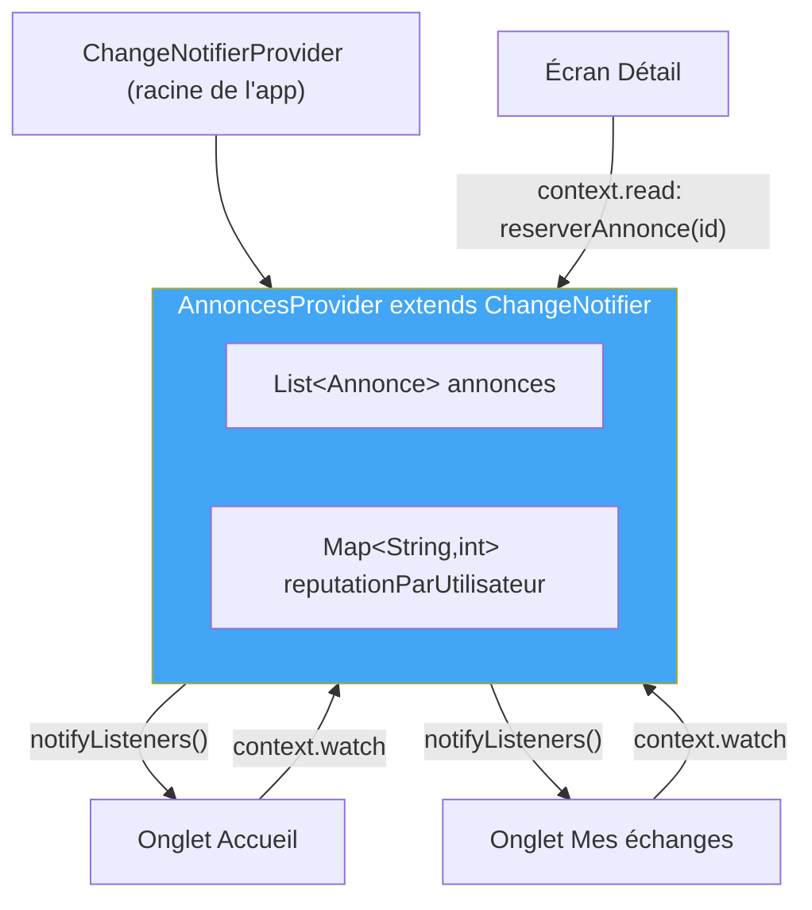

# TP7 — Provider et gestion d'état (2 séances)

## Objectifs
- Comprendre `Context`, `InheritedWidget` et leur lien avec Provider.
- Mettre en place `ChangeNotifier`, `ChangeNotifierProvider`, `Consumer` et `notifyListeners()`.
- Migrer l'ensemble des écrans de LocalSwap vers un état partagé global.
- Optimiser les performances (propriété `listen`, `Consumer` ciblé).

## Prérequis
- TP6 terminé (formulaire de publication fonctionnel).

---

## Rappel de cours — Notions et définitions

**`Context` et `InheritedWidget`** : le `BuildContext` donne accès à la position d'un widget dans l'arbre et à tout ce que ses ancêtres exposent. `InheritedWidget` est le mécanisme bas niveau permettant à un widget de rendre une donnée accessible à tous ses descendants sans passer de paramètres à chaque niveau — c'est exactement sur ce mécanisme que repose **Provider**.

**Pourquoi le `setState` local ne suffit plus** : dès qu'une donnée doit être visible et modifiable depuis plusieurs écrans distincts (ex. le statut d'une annonce, visible dans le fil *et* dans l'écran détail *et* dans "Mes échanges"), le `setState` local oblige à des allers-retours de callbacks difficiles à maintenir.

**`ChangeNotifier`** : classe Dart qui peut notifier ses "auditeurs" (*listeners*) d'un changement via `notifyListeners()`.

**`ChangeNotifierProvider`** : widget qui instancie et expose un `ChangeNotifier` à un sous-arbre de widgets.

**Lire/écouter l'état** :
- `context.watch<T>()` (ou `Consumer<T>`) : écoute les changements et reconstruit le widget à chaque `notifyListeners()`.
- `context.read<T>()` : lit l'état une seule fois, sans écouter les changements (utilisé typiquement dans un `onPressed`, pour éviter des rebuilds inutiles).

**Optimisation avec `Consumer` ciblé et propriété `listen`** : plutôt que d'appeler `context.watch<T>()` sur tout un écran (ce qui reconstruit l'écran entier à chaque changement), on encapsule uniquement la portion d'UI concernée dans un `Consumer<T>`, limitant les reconstructions à ce qui en a réellement besoin.

## Diagramme — Architecture Provider de LocalSwap

---

## Partie A — Guidée (séance 1)

### Exercice 7.1 — Constater les limites du `setState` local
**Objectif :** ressentir concrètement le problème avant d'y apporter la solution Provider.

1. Créer deux écrans `EcranA` et `EcranB` accessibles via une `BottomNavigationBar`, partageant *visuellement* un même compteur (chacun affiche sa propre variable locale `int compteur = 0`).
2. Incrémenter le compteur depuis `EcranA` (bouton + `setState`) puis basculer vers `EcranB` : constater que son compteur, lui, n'a pas changé.
3. **Question :** quelles solutions "manuelles" existeraient pour synchroniser les deux (callback remontant jusqu'à un ancêtre commun, singleton global...) ? Lister leurs limites avant d'introduire Provider comme réponse structurée à ce problème.

### Exercice 7.2 — Premier ChangeNotifier
**Objectif :** créer et exposer un état partagé minimal.

1. Créer une classe `CompteurProvider extends ChangeNotifier` avec un attribut privé `int _valeur = 0;`, un getter `int get valeur => _valeur;`, et une méthode `void incrementer() { _valeur++; notifyListeners(); }`.
2. Injecter ce provider au sommet de l'application : `ChangeNotifierProvider(create: (_) => CompteurProvider(), child: MaterialApp(...))`.
3. Dans `EcranA`, afficher `context.watch<CompteurProvider>().valeur` et ajouter un bouton appelant `context.read<CompteurProvider>().incrementer()`.
4. Dans `EcranB` (différent, mais dans le même arbre de widgets), afficher également `context.watch<CompteurProvider>().valeur` **sans aucun bouton**.
5. **Vérification clé :** incrémenter depuis `EcranA`, basculer vers `EcranB` : le compteur doit apparaître déjà à jour, sans aucun code de synchronisation manuel.

### Exercice 7.3 — context.watch vs context.read
**Objectif :** comprendre pourquoi le choix entre les deux n'est pas anodin.

1. Dans le bouton d'incrémentation de l'exercice 7.2, remplacer `context.read<CompteurProvider>()` par `context.watch<CompteurProvider>()` : l'application compile-t-elle et fonctionne-t-elle toujours (dans un `onPressed`) ? Rechercher pourquoi Flutter déconseille cet usage bien qu'il puisse fonctionner dans certains cas.
2. Ajouter un `print('build EcranA')` dans la méthode `build` d'`EcranA` : cliquer plusieurs fois sur le bouton et observer dans la console combien de fois l'écran est reconstruit avec `context.watch` comparé à une version qui utiliserait uniquement `context.read` pour la lecture d'affichage (dans ce cas précis, il faut bien `watch` pour l'affichage — l'exercice sert à observer *quand* un rebuild a lieu).

### Exercice 7.4 — Consumer ciblé et optimisation
**Objectif :** limiter les reconstructions inutiles.

1. Construire un écran contenant, en plus de l'affichage du compteur, une zone "décorative" complexe (ex. une liste de 20 `Card` statiques) qui ne dépend pas du compteur.
2. Ajouter un `print('build zone décorative')` dans cette zone, et un `print('build zone compteur')` autour de l'affichage du compteur.
3. **Version 1 :** utiliser `context.watch<CompteurProvider>()` au niveau de la méthode `build` de tout l'écran. Cliquer sur le bouton d'incrémentation et observer dans la console que **les deux zones** se reconstruisent, y compris la zone décorative qui n'a pourtant pas changé.
4. **Version 2 :** englober uniquement l'affichage du compteur dans un `Consumer<CompteurProvider>(builder: (context, provider, child) => Text('${provider.valeur}'))`, en laissant le reste de l'écran hors de tout `watch`. Recliquer sur le bouton et observer que seule la zone du compteur se reconstruit désormais.
5. **Synthèse écrite (2-3 lignes) :** dans quel cas la propriété `listen: false` d'un `Provider.of<T>(context, listen: false)` est-elle équivalente à `context.read<T>()` ?

## Partie B — Application au projet LocalSwap (séance 2)

**Créer `AnnoncesProvider extends ChangeNotifier`** contenant :
- `List<Annonce> annonces` (remplace la liste en mémoire des TP précédents).
- `Map<String, int> reputationParUtilisateur`.
- `reserverAnnonce(String idAnnonce)` : passe le statut de `disponible` à `reservee`, puis `notifyListeners()`.
- `terminerEchange(String idAnnonce)` : passe le statut à `terminee`, incrémente la réputation du propriétaire, ajoute un `Echange` à un historique.
- `ajouterAnnonce(Annonce nouvelleAnnonce)` : ajoute l'annonce créée par le formulaire (TP6).

**Intégration complète dans les 3 onglets de la `BottomNavigationBar` (TP5) :**
- Injecter `AnnoncesProvider` au sommet de l'application.
- **Accueil** : `context.watch<AnnoncesProvider>().annonces` alimente `ListView.builder`/`GridView` (TP4).
- **Détail** : le bouton "Réserver" appelle `context.read<AnnoncesProvider>().reserverAnnonce(id)`, suivi du `AlertDialog`/`SnackBar` (TP5).
- **Mes échanges** : nouvel onglet affichant les annonces réservées/terminées par l'utilisateur courant, alimenté par `AnnoncesProvider`, avec un bouton "Terminer l'échange" appelant `terminerEchange()`.
- **Formulaire** : la validation (TP6) appelle `context.read<AnnoncesProvider>().ajouterAnnonce(...)` en complément du `Navigator.pop`.
- Utiliser des `Consumer<AnnoncesProvider>` ciblés (plutôt que `context.watch` sur l'écran entier) pour n'reconstruire que la carte concernée lors d'un changement de statut.

## Livrables
- `AnnoncesProvider` complet et injecté.
- Les 3 onglets et l'écran détail connectés à cet état partagé, avec démonstration : réserver une annonce dans l'écran détail met à jour instantanément son badge dans le fil et fait apparaître l'annonce dans "Mes échanges".

## Grille d'évaluation

| Critère | Points |
|---|---|
| Implémentation correcte du `AnnoncesProvider` | 6 |
| Intégration dans les 3 onglets + écran détail | 8 |
| Onglet "Mes échanges" fonctionnel | 4 |
| Optimisation avec `Consumer` ciblé | 2 |
| **Total** | **20** |
