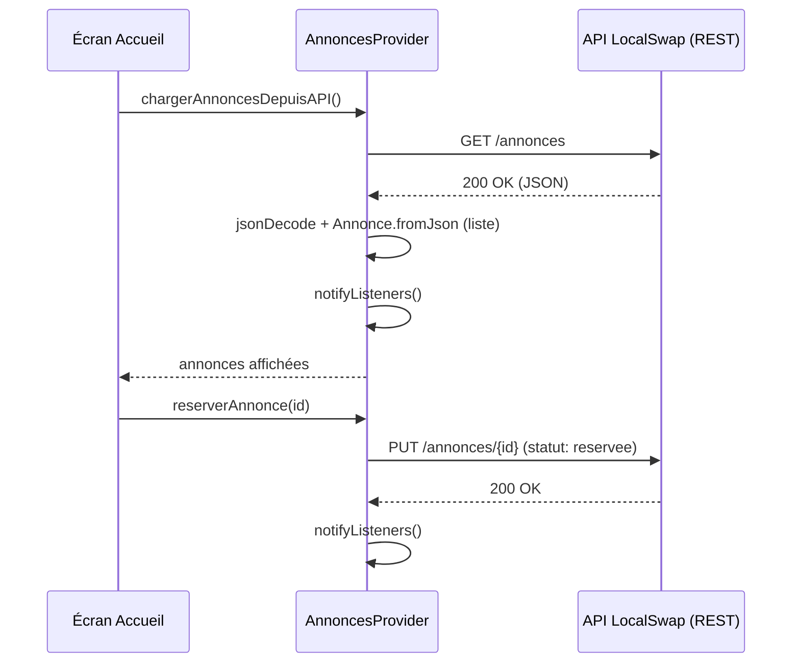

# TP8 — Utilisation du protocole HTTP (2 séances)

## Objectifs
- Utiliser le module `http` de Dart pour communiquer avec une API REST.
- Convertir des réponses JSON en objets Dart et inversement.
- Gérer les états de chargement (`loading`/`error`/`success`).
- Utiliser `FutureBuilder` pour l'affichage asynchrone.
- Connecter LocalSwap à une API simulée (persistance distante).

## Prérequis
- TP7 terminé (`AnnoncesProvider` opérationnel).
- Une API REST simulée est nécessaire pour ce TP (ex. `json-server` lancé localement sur les postes, ou tout backend simple mis à disposition par l'enseignant).

---

## Rappel de cours — Notions et définitions

**Le package `http`** : bibliothèque Dart officielle pour effectuer des requêtes HTTP (`get`, `post`, `put`, `delete`) vers une API.

**Conversion JSON ↔ objets Dart** : une réponse HTTP retourne un corps texte au format JSON ; `jsonDecode()` le convertit en `Map`/`List` Dart, que l'on transforme ensuite en objets via les constructeurs `.fromJson()` (TP2) ; `jsonEncode()` fait l'inverse pour envoyer des données.

**Gestion des états de chargement** : toute requête réseau prend du temps et peut échouer ; une interface bien conçue distingue au minimum 3 états : *chargement en cours*, *erreur*, *données chargées avec succès*.

**Sauvegarde et mise à jour distantes** : au-delà de la simple lecture (`GET`), une application doit gérer la création (`POST`) et la mise à jour (`PUT`/`PATCH`) de données côté serveur, avec les mêmes principes de gestion de chargement.

**`FutureBuilder`** : widget qui construit son contenu en fonction de l'état d'un `Future` (`ConnectionState.waiting`, présence de données, présence d'une erreur), évitant de gérer manuellement des booléens de chargement dans un `StatefulWidget`.

## Diagramme — Flux d'une requête HTTP dans LocalSwap



---

## Partie A — Guidée (séance 1)

### Exercice 8.1 — Mise en place de l'environnement HTTP
**Objectif :** disposer d'une API de test fonctionnelle avant d'écrire le moindre code Dart réseau.

1. Ajouter la dépendance dans `pubspec.yaml` :
   ```yaml
   dependencies:
     http: ^1.0.0
   ```
   puis `flutter pub get`.
2. Installer et lancer `json-server` (ou l'équivalent fourni par l'enseignant) avec un fichier `db.json` minimal contenant une clé `"annonces": [...]` (3-4 objets de test avec les mêmes champs que la classe `Annonce` du TP2).
3. Vérifier depuis un navigateur ou `curl` que l'URL `http://localhost:3000/annonces` (ou l'adresse IP de la machine si test depuis l'émulateur) renvoie bien le JSON attendu.
4. **Point d'attention réseau local :** sur un émulateur Android, `localhost` doit généralement être remplacé par `10.0.2.2` pour atteindre la machine hôte — vérifier ce point avant de continuer.

### Exercice 8.2 — Première requête GET
**Objectif :** effectuer un appel HTTP minimal et observer la réponse brute.

1. Écrire une fonction asynchrone :
   ```dart
   Future<void> testerGet() async {
     final reponse = await http.get(Uri.parse('http://10.0.2.2:3000/annonces'));
     print('Code : ${reponse.statusCode}');
     print('Corps : ${reponse.body}');
   }
   ```
2. Appeler cette fonction depuis un bouton de test et observer dans la console le code de statut (`200`) et le corps brut (chaîne JSON).
3. **Erreur volontaire :** modifier temporairement l'URL pour qu'elle soit invalide (mauvais port) et observer l'exception levée ; l'entourer d'un `try/catch` et afficher un message d'erreur clair.

### Exercice 8.3 — Conversion JSON → objets Dart
**Objectif :** transformer une réponse brute en collection typée exploitable.

1. Utiliser `jsonDecode(reponse.body)` sur le corps de la réponse précédente et observer le type retourné (`List<dynamic>`).
2. Convertir chaque élément de cette liste en objet `Annonce` avec `.fromJson()` (classe du TP2) : `final annonces = (jsonDecode(reponse.body) as List).map((e) => Annonce.fromJson(e)).toList();`.
3. Afficher `annonces.length` et le titre de la première annonce pour vérifier la conversion.
4. **Exercice inverse :** prendre un objet `Annonce` existant, appeler `.toJson()`, puis `jsonEncode(...)` sur le résultat, et afficher la chaîne JSON obtenue — vérifier qu'elle correspond au format attendu par l'API.

### Exercice 8.4 — Gestion manuelle des états de chargement
**Objectif :** comprendre "à la main" ce que `FutureBuilder` automatisera en Partie B.

1. Dans un `StatefulWidget`, déclarer trois variables d'état : `bool _chargement = true; String? _erreur; List<Annonce> _annonces = [];`.
2. Dans `initState()`, appeler une méthode asynchrone qui effectue la requête `GET`, puis :
   - en cas de succès : `setState(() { _annonces = ...; _chargement = false; });`
   - en cas d'erreur (`catch`) : `setState(() { _erreur = 'Erreur de chargement'; _chargement = false; });`
3. Dans la méthode `build`, afficher conditionnellement : un `CircularProgressIndicator` si `_chargement`, un message d'erreur avec bouton "Réessayer" si `_erreur != null`, ou la liste des annonces sinon.
4. **Test de robustesse :** couper le serveur `json-server` avant de lancer l'application et vérifier que le message d'erreur s'affiche correctement plutôt qu'un crash ou un écran blanc.

## Partie B — Application au projet LocalSwap (séance 2)

1. **Remplacer** la fonction `chargerAnnonces()` (données statiques, TP2) par une vraie requête `GET /annonces` vers l'API, convertissant la réponse JSON en `List<Annonce>` via `.fromJson()`.
2. **Sauvegarde d'une annonce** : la méthode `ajouterAnnonce()` de `AnnoncesProvider` (TP7) doit désormais envoyer une requête `POST /annonces` avec le JSON de la nouvelle annonce (`.toJson()`), avant de mettre à jour la liste locale.
3. **Mise à jour d'une annonce sauvegardée** : `reserverAnnonce()` et `terminerEchange()` doivent envoyer une requête `PUT`/`PATCH /annonces/{id}` pour synchroniser le changement de statut côté serveur.
4. **Gestion avancée du chargement** : utiliser `FutureBuilder` pour l'écran "Accueil" au premier chargement de l'application (affichage d'un indicateur de progression pendant le chargement initial, message d'erreur avec bouton "Réessayer" en cas d'échec réseau), tout en conservant `AnnoncesProvider`/`Consumer` (TP7) pour les mises à jour ultérieures en temps réel.
5. **Récupération des annonces sauvegardées** : vérifier qu'au redémarrage de l'application, les annonces créées lors d'une session précédente sont bien rechargées depuis l'API.

## Livrables
- `AnnoncesProvider` connecté à l'API pour le chargement, la création et la mise à jour des annonces.
- Écran "Accueil" utilisant `FutureBuilder` pour le chargement initial, avec gestion d'erreur et de nouvel essai.
- Démonstration : créer une annonce, réserver une annonce, redémarrer l'application, vérifier que tout est bien conservé côté serveur.

## Grille d'évaluation

| Critère | Points |
|---|---|
| Requêtes GET/POST/PUT fonctionnelles | 8 |
| Conversion JSON ↔ objets Dart correcte | 4 |
| Gestion des états de chargement (FutureBuilder + erreurs) | 6 |
| Persistance distante vérifiée après redémarrage | 2 |
| **Total** | **20** |
