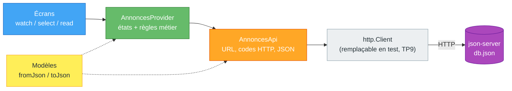
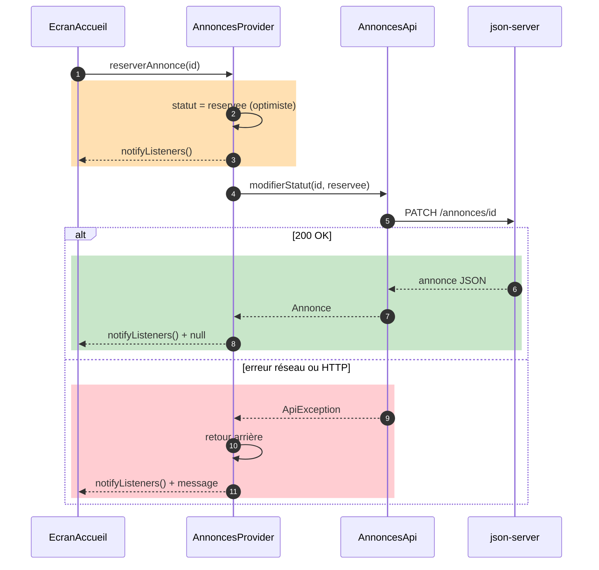

# TP8 — HTTP, JSON et API REST (2 séances)

> **Séances :** 2 × 3 h · **Environnement :** Flutter 3.x stable (≥ 3.27), Dart 3, packages `http` 1.x et `provider` 6.x, Node.js (pour `json-server`), émulateur Android ou Chrome
> **Fil rouge :** LocalSwap — les annonces, réservations, échanges et réputations sont lus et enregistrés sur une API REST.

| Repère | Partie | Séance | Durée |
|---|---|---|---|
| 📘🗺️ | Rappel de cours + diagrammes | 1 | 15 min |
| 🧪 | Partie A : exercices 8.1 à 8.4 | 1 | 130 min |
| 🤖 | Partie C (C1, C2) | 1 | 30 min |
| 🧪 | Partie A : exercice 8.5 | 2 | 35 min |
| 🏗️ | Partie B : LocalSwap connecté | 2 | 90 min |
| 🤖 | Partie C (C3 à C6) | 2 | 40 min |
| 📝 | Quiz de fin de TP | 2 | 10 min |
| 🎤 | Validation orale (5 min par binôme, **pendant** la séance 2) | 2 | — |
| 🚀 | Partie D : défis bonus | — | hors temps |
| | **Total** | | **350 min** |

Difficulté : 🟢 facile · 🟡 moyen · 🔴 difficile

---

## 🎯 Objectifs pédagogiques

À la fin de ce TP, vous serez capable de :

1. **Configurer** l'accès à une API locale selon la cible (émulateur Android, Chrome, téléphone) sans modifier le code.
2. **Envoyer** des requêtes `GET`, `POST`, `PATCH` et `DELETE` avec `http`, et **interpréter** les codes de statut.
3. **Convertir** une réponse JSON en objets Dart typés, en **rejetant** les données invalides.
4. **Distinguer** et **afficher** les états chargement / erreur / données (`FutureBuilder` ou `ChangeNotifier`).
5. **Mettre en œuvre** une mise à jour optimiste avec retour arrière en cas d'échec réseau.

## 📋 Prérequis

- **TP2** : `fromJson`/`toJson` avec map pattern, `FormatException`, `async`/`await`, `try/catch`.
- **TP7** : `AnnoncesProvider` (chargement, erreur, méthodes métier), `read`/`watch`/`select`.
- **TP6** : formulaire de publication.
- **Node.js** installé (pour lancer `json-server` avec `npx`).

> [!IMPORTANT]
> **Règle sur l'IA.** Vous avez le droit d'utiliser une IA. Mais **60 % de la note** porte sur votre compréhension (Partie C, oral, quiz). Tenez le **📓 Journal IA** (C7) si vous l'utilisez.

---

## 📘 Rappel de cours

> [!NOTE]
> **API REST** : des **ressources** identifiées par des URL, manipulées avec des **méthodes** HTTP.

| Méthode | Exemple | Rôle | Code de succès habituel |
|---|---|---|---|
| `GET` | `/annonces`, `/annonces/a1` | Lire | `200 OK` |
| `POST` | `/annonces` (+ corps JSON) | Créer | `201 Created` |
| `PATCH` | `/annonces/a1` (+ champs modifiés) | Modifier **en partie** | `200 OK` |
| `PUT` | `/annonces/a1` (+ objet complet) | Remplacer | `200 OK` |
| `DELETE` | `/annonces/a1` | Supprimer | `200 OK` / `204 No Content` |

> Erreurs courantes : `400` (requête invalide), `404` (ressource introuvable), `500` (erreur serveur).

> [!WARNING]
> **Le package `http` ne lève PAS d'exception pour un 404 ou un 500** : il retourne une réponse avec `statusCode`. C'est **à vous** de vérifier le code. Les exceptions ne concernent que les problèmes de **connexion** (`http.ClientException`) et les délais dépassés (`TimeoutException`, si vous ajoutez `.timeout(...)`).

> [!NOTE]
> **JSON ↔ Dart**
> - `jsonDecode(texte)` → `Map<String, dynamic>` / `List<dynamic>` / `String` / `int` / `double` / `bool` / `null`.
> - Un nombre JSON sans virgule (`10`) devient un **`int`** : `json['prix'] as double` **plante**. Écrivez `(json['prix'] as num).toDouble()`.
> - `jsonEncode(objet.toJson())` produit le corps d'un `POST`/`PATCH`, avec l'en-tête `Content-Type: application/json`.
> - Accents : décodez `utf8.decode(response.bodyBytes)` plutôt que `response.body` si le serveur n'indique pas son encodage.

> [!NOTE]
> **Adresse du serveur selon la cible**
> - **Chrome** : `http://localhost:3000`
> - **Émulateur Android** : `http://10.0.2.2:3000` (adresse spéciale de la machine hôte ; `localhost` y désigne l'émulateur lui-même)
> - **Téléphone réel** : l'adresse IP de votre PC sur le Wi-Fi (ex. `http://192.168.1.20:3000`), serveur lancé avec `--host 0.0.0.0`
> - Android interdit par défaut le **HTTP non chiffré** (*cleartext*) : à autoriser **en debug seulement** (voir ex. 8.1).

> [!NOTE]
> **`FutureBuilder`** affiche l'état d'un `Future` (`snapshot.connectionState`, `hasError`, `data`). Le `Future` doit être créé **une seule fois** (dans `initState`), jamais dans `build()`, sinon une nouvelle requête part à chaque reconstruction.
> **Mise à jour optimiste** : on modifie l'interface **tout de suite**, on envoie la requête, puis on **annule** la modification si le serveur refuse. L'application paraît instantanée, mais il faut gérer le retour arrière.

## 🗺️ Diagrammes

**Architecture en couches (Partie B)** : chaque couche ne connaît que la suivante.



**Réservation optimiste avec retour arrière** :



---

# ▶️ Séance 1

## 🧪 Partie A — Exercices pédagogiques indépendants (sans LocalSwap)

### Exercice 8.1 — Serveur de test et configuration 🟢 · 25 min

**Notions nouvelles :** API REST locale (`json-server`), adresse selon la cible (`--dart-define`).

1. Dans un dossier `api/` (hors projet Flutter), créez `db.json` :

```json
{
  "books": [
    { "id": "b1", "title": "Le Petit Prince", "author": "A. de Saint-Exupéry", "available": true },
    { "id": "b2", "title": "Flutter en action", "author": "E. Windmill", "available": false },
    { "id": "b3", "title": "Clean Code", "author": "R. C. Martin", "available": true }
  ],
  "annonces": [
    { "id": "a1", "titre": "Perceuse Bosch", "description": "Prêt pour le week-end", "categorie": "objet", "statut": "disponible", "idProprietaire": "u1" },
    { "id": "a2", "titre": "Cours de maths (bac)", "categorie": "service", "statut": "disponible", "idProprietaire": "u2" },
    { "id": "a3", "titre": "Bizerte → Tunis lundi 7h", "description": "2 places", "categorie": "covoiturage", "statut": "reservee", "idProprietaire": "u3" },
    { "id": "a4", "titre": "Vélo enfant", "description": "Taille 16 pouces", "categorie": "objet", "statut": "terminee", "idProprietaire": "u1" },
    { "id": "a5", "titre": "Aide au déménagement", "categorie": "service", "statut": "disponible", "idProprietaire": "u4" },
    { "id": "a6", "titre": "Tunis → Sousse samedi", "categorie": "covoiturage", "statut": "disponible", "idProprietaire": "u5" }
  ],
  "utilisateurs": [
    { "id": "u1", "nom": "Amira Ben Salah", "reputation": 5 },
    { "id": "u2", "nom": "Youssef Trabelsi", "reputation": 4 },
    { "id": "u3", "nom": "Sarra Jlassi", "reputation": 3 },
    { "id": "u4", "nom": "Mehdi Gharbi", "reputation": 4 },
    { "id": "u5", "nom": "Ines Mansour", "reputation": 2 },
    { "id": "u6", "nom": "Karim Ayari", "reputation": 5 }
  ],
  "echanges": []
}
```

2. Lancez le serveur (version 0.17 stable) :

```bash
cd api
npx json-server@0.17.4 --watch db.json --port 3000 --host 0.0.0.0
```

3. Dans le navigateur, testez `http://localhost:3000/books`, `/books/b1`, `/books/b99`, `/annonces?statut=disponible`. Notez le code HTTP de chaque réponse (onglet *Réseau* des outils de développement).

4. Créez le projet de démonstration et ajoutez `http` :

```bash
flutter create tp8_demos
cd tp8_demos
flutter pub add http provider
```

5. **Android uniquement** : autorisez le HTTP non chiffré **en debug**. Dans `android/app/src/debug/AndroidManifest.xml`, ajoutez dans la balise `<manifest>` :

```xml
<application android:usesCleartextTraffic="true" />
```

6. `lib/api_config.dart` :

```dart
import 'package:flutter/foundation.dart';

/// Surchargeable au lancement : flutter run --dart-define=API_URL=http://192.168.1.20:3000
const String _apiUrlFromEnv = String.fromEnvironment('API_URL');

String get apiBaseUrl {
  if (_apiUrlFromEnv.isNotEmpty) return _apiUrlFromEnv;
  if (kIsWeb) return 'http://localhost:3000';
  if (defaultTargetPlatform == TargetPlatform.android) {
    return 'http://10.0.2.2:3000'; // émulateur Android → machine hôte
  }
  return 'http://localhost:3000';
}
```

**🔍 Observer & répondre**

1. Pourquoi `localhost` ne fonctionne-t-il pas depuis l'émulateur Android ?
2. Que fait `--host 0.0.0.0` ? Dans quel cas est-il indispensable ?
3. Pourquoi autoriser le *cleartext* seulement dans le manifeste **debug** ?
4. Après un `POST` (exercice 8.4), ouvrez `db.json` : que constatez-vous ?

---

### Exercice 8.2 — Console HTTP : GET, codes et erreurs 🟡 · 35 min

**Notions nouvelles :** `http.get` + vérification du code, décodage JSON robuste et exceptions métier.

`lib/book.dart`

```dart
class Book {
  const Book({
    required this.id,
    required this.title,
    required this.author,
    required this.available,
  });

  final String id;
  final String title;
  final String author;
  final bool available;

  factory Book.fromJson(Map<String, dynamic> json) => switch (json) {
        {
          'id': final Object id, // String ou int selon le serveur
          'title': final String title,
          'author': final String author,
          'available': final bool available,
        } =>
          Book(id: id.toString(), title: title, author: author, available: available),
        _ => throw FormatException('Livre JSON invalide : $json'),
      };

  /// Sans id : c'est le serveur qui l'attribue lors d'un POST.
  Map<String, dynamic> toJson() => {'title': title, 'author': author, 'available': available};

  Book copyWith({bool? available}) =>
      Book(id: id, title: title, author: author, available: available ?? this.available);
}
```

`lib/books_api.dart` (réutilisé jusqu'à l'exercice 8.5)

```dart
import 'dart:async';
import 'dart:convert';

import 'package:http/http.dart' as http;

import 'api_config.dart';
import 'book.dart';

/// Erreur « métier » lisible par l'interface.
class ApiException implements Exception {
  const ApiException(this.message, {this.statusCode});

  final String message;
  final int? statusCode;

  @override
  String toString() => statusCode == null ? message : '$message (HTTP $statusCode)';
}

class BooksApi {
  BooksApi({http.Client? client, String? baseUrl})
      : _client = client ?? http.Client(),
        _baseUrl = baseUrl ?? apiBaseUrl;

  final http.Client _client; // injectable : on le remplacera par un faux client au TP9
  final String _baseUrl;

  static const Duration _timeout = Duration(seconds: 8);
  static const Map<String, String> _jsonHeaders = {
    'Content-Type': 'application/json; charset=utf-8',
  };

  Uri _uri(String path) => Uri.parse('$_baseUrl$path');

  /// Envoie une requête et transforme les erreurs techniques en ApiException.
  Future<http.Response> _send(Future<http.Response> Function() request) async {
    try {
      return await request().timeout(_timeout);
    } on TimeoutException {
      throw const ApiException('Le serveur ne répond pas');
    } on http.ClientException catch (e) {
      throw ApiException('Connexion impossible : ${e.message}');
    }
  }

  /// http ne lève rien pour un 404 : on vérifie nous-mêmes.
  void _expect(http.Response response, int expected) {
    if (response.statusCode == 404) {
      throw ApiException('Ressource introuvable', statusCode: 404);
    }
    if (response.statusCode != expected) {
      throw ApiException('Réponse inattendue', statusCode: response.statusCode);
    }
  }

  Object? _decode(http.Response response) => jsonDecode(utf8.decode(response.bodyBytes));

  Future<List<Book>> fetchBooks() async {
    final http.Response response = await _send(() => _client.get(_uri('/books')));
    _expect(response, 200);
    final Object? data = _decode(response);
    if (data is! List) throw const ApiException('Une liste était attendue');
    return data.map((e) => Book.fromJson(e as Map<String, dynamic>)).toList();
  }

  Future<Book> fetchBook(String id) async {
    final http.Response response = await _send(() => _client.get(_uri('/books/$id')));
    _expect(response, 200);
    return Book.fromJson(_decode(response) as Map<String, dynamic>);
  }

  // --- Écriture (exercice 8.4) ---

  Future<Book> addBook(Book book) async {
    final http.Response response = await _send(
      () => _client.post(_uri('/books'), headers: _jsonHeaders, body: jsonEncode(book.toJson())),
    );
    _expect(response, 201);
    return Book.fromJson(_decode(response) as Map<String, dynamic>);
  }

  Future<Book> setAvailable(String id, bool available) async {
    final http.Response response = await _send(
      () => _client.patch(
        _uri('/books/$id'),
        headers: _jsonHeaders,
        body: jsonEncode({'available': available}),
      ),
    );
    _expect(response, 200);
    return Book.fromJson(_decode(response) as Map<String, dynamic>);
  }

  Future<void> deleteBook(String id) async {
    final http.Response response = await _send(() => _client.delete(_uri('/books/$id')));
    _expect(response, 200);
  }

  void close() => _client.close();
}
```

`lib/ex2_http_console.dart`

```dart
import 'package:flutter/material.dart';

import 'books_api.dart';

void main() => runApp(const ConsoleApp());

class ConsoleApp extends StatelessWidget {
  const ConsoleApp({super.key});

  @override
  Widget build(BuildContext context) {
    return MaterialApp(
      debugShowCheckedModeBanner: false,
      theme: ThemeData(colorScheme: ColorScheme.fromSeed(seedColor: Colors.blueGrey)),
      home: const ConsolePage(),
    );
  }
}

class ConsolePage extends StatefulWidget {
  const ConsolePage({super.key});

  @override
  State<ConsolePage> createState() => _ConsolePageState();
}

class _ConsolePageState extends State<ConsolePage> {
  final BooksApi _api = BooksApi();
  final BooksApi _wrongPortApi = BooksApi(baseUrl: 'http://10.0.2.2:3999');
  final List<String> _log = [];

  @override
  void dispose() {
    _api.close();
    _wrongPortApi.close();
    super.dispose();
  }

  Future<void> _run(String label, Future<String> Function() action) async {
    String line;
    try {
      line = '✅ $label → ${await action()}';
    } on ApiException catch (e) {
      line = '❌ $label → $e';
    } on FormatException catch (e) {
      line = '⚠️ $label → JSON invalide : ${e.message}';
    }
    if (!mounted) return;
    setState(() => _log.insert(0, line));
  }

  @override
  Widget build(BuildContext context) {
    return Scaffold(
      appBar: AppBar(title: const Text('Console HTTP')),
      body: Column(
        children: [
          Wrap(
            spacing: 8,
            runSpacing: 8,
            children: [
              FilledButton(
                onPressed: () => _run('GET /books', () async {
                  final books = await _api.fetchBooks();
                  return '${books.length} livres, 1er : ${books.first.title}';
                }),
                child: const Text('GET /books'),
              ),
              FilledButton.tonal(
                onPressed: () => _run('GET /books/b1', () async => (await _api.fetchBook('b1')).title),
                child: const Text('GET /books/b1'),
              ),
              FilledButton.tonal(
                onPressed: () => _run('GET /books/b99', () async => (await _api.fetchBook('b99')).title),
                child: const Text('GET /books/b99'),
              ),
              OutlinedButton(
                onPressed: () => _run('Mauvais port', () async => '${(await _wrongPortApi.fetchBooks()).length}'),
                child: const Text('Mauvais port'),
              ),
            ],
          ),
          const Divider(),
          Expanded(
            child: ListView(
              children: [for (final String line in _log) ListTile(dense: true, title: Text(line))],
            ),
          ),
        ],
      ),
    );
  }
}
```

**🔍 Observer & répondre**

1. Testez les 4 boutons. Pour chacun, indiquez **quelle ligne** de `BooksApi` a produit le message.
2. Supprimez l'appel à `_expect` dans `fetchBook`, puis testez `b99`. Quel message obtenez-vous maintenant, et pourquoi est-il trompeur ?
3. Arrêtez `json-server` (Ctrl+C) puis cliquez sur « GET /books ». Combien de temps avant le message ? Quelle exception d'origine a été convertie ?
4. Pourquoi convertir toutes les erreurs techniques en `ApiException` plutôt que de laisser remonter `ClientException`, `TimeoutException`… jusqu'à l'interface ?

---

### Exercice 8.3 — Liste de livres avec FutureBuilder 🟡 · 30 min

**Notions nouvelles :** `FutureBuilder` + `AsyncSnapshot`, `Future` créé une seule fois.

`lib/ex3_future_builder.dart`

```dart
import 'package:flutter/material.dart';

import 'book.dart';
import 'books_api.dart';

void main() => runApp(const LibraryApp());

class LibraryApp extends StatelessWidget {
  const LibraryApp({super.key});

  @override
  Widget build(BuildContext context) {
    return MaterialApp(
      debugShowCheckedModeBanner: false,
      theme: ThemeData(colorScheme: ColorScheme.fromSeed(seedColor: Colors.teal)),
      home: const BookListPage(),
    );
  }
}

class BookListPage extends StatefulWidget {
  const BookListPage({super.key});

  @override
  State<BookListPage> createState() => _BookListPageState();
}

class _BookListPageState extends State<BookListPage> {
  final BooksApi _api = BooksApi();
  late Future<List<Book>> _future; // créé UNE fois, pas dans build()

  @override
  void initState() {
    super.initState();
    _future = _api.fetchBooks();
  }

  @override
  void dispose() {
    _api.close();
    super.dispose();
  }

  /// Relancer = remplacer le Future, puis reconstruire.
  Future<void> _reload() async {
    final Future<List<Book>> next = _api.fetchBooks();
    setState(() => _future = next);
    try {
      await next;
    } catch (_) {
      // l'erreur est affichée par le FutureBuilder
    }
  }

  @override
  Widget build(BuildContext context) {
    return Scaffold(
      appBar: AppBar(title: const Text('Bibliothèque')),
      body: FutureBuilder<List<Book>>(
        future: _future,
        builder: (context, snapshot) {
          debugPrint('FutureBuilder : ${snapshot.connectionState}');

          if (snapshot.connectionState != ConnectionState.done) {
            return const Center(child: CircularProgressIndicator());
          }
          if (snapshot.hasError) {
            return ErrorView(message: '${snapshot.error}', onRetry: _reload);
          }
          final List<Book> books = snapshot.data ?? const [];
          if (books.isEmpty) return const Center(child: Text('Aucun livre'));

          return RefreshIndicator(
            onRefresh: _reload, // tirer vers le bas pour recharger
            child: ListView.builder(
              itemCount: books.length,
              itemBuilder: (context, index) {
                final Book book = books[index];
                return ListTile(
                  leading: Icon(book.available ? Icons.book_outlined : Icons.lock_clock),
                  title: Text(book.title),
                  subtitle: Text(book.author),
                  trailing: Text(book.available ? 'Disponible' : 'Emprunté'),
                );
              },
            ),
          );
        },
      ),
    );
  }
}

class ErrorView extends StatelessWidget {
  const ErrorView({super.key, required this.message, required this.onRetry});

  final String message;
  final VoidCallback onRetry;

  @override
  Widget build(BuildContext context) {
    final ColorScheme colors = Theme.of(context).colorScheme;
    return Center(
      child: Padding(
        padding: const EdgeInsets.all(24),
        child: Column(
          mainAxisSize: MainAxisSize.min,
          children: [
            Icon(Icons.cloud_off, size: 56, color: colors.error),
            const SizedBox(height: 12),
            Text(message, textAlign: TextAlign.center),
            const SizedBox(height: 16),
            FilledButton.icon(
              onPressed: onRetry,
              icon: const Icon(Icons.refresh),
              label: const Text('Réessayer'),
            ),
          ],
        ),
      ),
    );
  }
}
```

**🔍 Observer & répondre**

1. Notez la suite des `connectionState` affichés dans la console au démarrage.
2. Arrêtez le serveur, tirez la liste vers le bas, puis relancez le serveur et cliquez sur « Réessayer ». Décrivez chaque écran.
3. Déplacez `_api.fetchBooks()` **directement** dans `future:` (dans `build`). Ajoutez un bouton qui fait `setState(() {})`. Combien de requêtes partent quand on clique 5 fois ? Regardez la console de `json-server`.

---

### Exercice 8.4 — Ajouter, emprunter, supprimer 🟡 · 40 min

**Notions nouvelles :** `POST`/`PATCH`/`DELETE` avec un corps JSON et l'en-tête `Content-Type`, codes 201/200/404.

`lib/ex4_write.dart`

```dart
import 'package:flutter/material.dart';

import 'book.dart';
import 'books_api.dart';
import 'ex3_future_builder.dart' show ErrorView;

void main() => runApp(const WriteApp());

class WriteApp extends StatelessWidget {
  const WriteApp({super.key});

  @override
  Widget build(BuildContext context) {
    return MaterialApp(
      debugShowCheckedModeBanner: false,
      theme: ThemeData(colorScheme: ColorScheme.fromSeed(seedColor: Colors.deepOrange)),
      home: const ManageBooksPage(),
    );
  }
}

class ManageBooksPage extends StatefulWidget {
  const ManageBooksPage({super.key});

  @override
  State<ManageBooksPage> createState() => _ManageBooksPageState();
}

class _ManageBooksPageState extends State<ManageBooksPage> {
  final BooksApi _api = BooksApi();
  final TextEditingController _titleCtrl = TextEditingController();
  final TextEditingController _authorCtrl = TextEditingController();
  late Future<List<Book>> _future;
  bool _busy = false; // une écriture est en cours

  @override
  void initState() {
    super.initState();
    _future = _api.fetchBooks();
  }

  @override
  void dispose() {
    _titleCtrl.dispose();
    _authorCtrl.dispose();
    _api.close();
    super.dispose();
  }

  void _reload() => setState(() => _future = _api.fetchBooks());

  /// Exécute une écriture, affiche le résultat, puis recharge la liste (stratégie PESSIMISTE).
  Future<void> _write(String success, Future<void> Function() action) async {
    setState(() => _busy = true);
    String message = success;
    try {
      await action();
    } on ApiException catch (e) {
      message = 'Échec : $e';
    }
    if (!mounted) return;
    setState(() => _busy = false);
    ScaffoldMessenger.of(context)
      ..hideCurrentSnackBar()
      ..showSnackBar(SnackBar(content: Text(message)));
    _reload();
  }

  void _add() {
    final String title = _titleCtrl.text.trim();
    final String author = _authorCtrl.text.trim();
    if (title.isEmpty || author.isEmpty) return;
    _write('« $title » ajouté', () async {
      await _api.addBook(Book(id: '', title: title, author: author, available: true));
      _titleCtrl.clear();
      _authorCtrl.clear();
    });
  }

  @override
  Widget build(BuildContext context) {
    return Scaffold(
      appBar: AppBar(
        title: const Text('Gérer les livres'),
        bottom: _busy
            ? const PreferredSize(
                preferredSize: Size.fromHeight(4),
                child: LinearProgressIndicator(),
              )
            : null,
      ),
      body: Column(
        children: [
          Padding(
            padding: const EdgeInsets.all(12),
            child: Row(
              children: [
                Expanded(
                  child: TextField(
                    controller: _titleCtrl,
                    decoration: const InputDecoration(labelText: 'Titre'),
                  ),
                ),
                const SizedBox(width: 8),
                Expanded(
                  child: TextField(
                    controller: _authorCtrl,
                    decoration: const InputDecoration(labelText: 'Auteur'),
                  ),
                ),
                IconButton.filled(
                  tooltip: 'Ajouter (POST)',
                  onPressed: _busy ? null : _add,
                  icon: const Icon(Icons.add),
                ),
              ],
            ),
          ),
          Expanded(
            child: FutureBuilder<List<Book>>(
              future: _future,
              builder: (context, snapshot) {
                if (snapshot.connectionState != ConnectionState.done) {
                  return const Center(child: CircularProgressIndicator());
                }
                if (snapshot.hasError) {
                  return ErrorView(message: '${snapshot.error}', onRetry: _reload);
                }
                final List<Book> books = snapshot.data ?? const [];
                return ListView.builder(
                  itemCount: books.length,
                  itemBuilder: (context, index) {
                    final Book book = books[index];
                    return ListTile(
                      key: ValueKey(book.id),
                      title: Text(book.title),
                      subtitle: Text('${book.author} · id ${book.id}'),
                      leading: Switch(
                        value: book.available,
                        onChanged: _busy
                            ? null
                            : (value) => _write(
                                  value ? 'Rendu' : 'Emprunté',
                                  () => _api.setAvailable(book.id, value),
                                ),
                      ),
                      trailing: IconButton(
                        tooltip: 'Supprimer (DELETE)',
                        onPressed: _busy
                            ? null
                            : () => _write('Supprimé', () => _api.deleteBook(book.id)),
                        icon: const Icon(Icons.delete_outline),
                      ),
                    );
                  },
                );
              },
            ),
          ),
        ],
      ),
    );
  }
}
```

**🔍 Observer & répondre**

1. Ajoutez un livre. Quel `id` le serveur lui a-t-il donné ? Retrouvez la ligne dans `db.json`.
2. Dans `addBook`, retirez `headers: _jsonHeaders`. Ajoutez un livre, puis regardez `db.json` : qu'a enregistré le serveur ? Pourquoi ?
3. Supprimez un livre dans un onglet du navigateur (`DELETE` avec un outil comme l'extension REST du navigateur, ou supprimez-le de `db.json`), puis basculez son interrupteur dans l'application. Quel message ? Quel code HTTP ?
4. Avec cette stratégie « pessimiste », combien de requêtes un simple clic sur l'interrupteur déclenche-t-il ? Quel délai l'utilisateur ressent-il ?

---

## 🤖 Partie C (séance 1) — C1 et C2 · 30 min

> [!CAUTION]
> **Répondez d'abord sur papier, sans exécuter et sans IA**. Vérifiez ensuite sur machine.

### C1 — Prédire avant d'exécuter 🟡 · 12 min

```dart
// C1.a — types après décodage
final List<dynamic> v = jsonDecode('[1, 2.5, "x", true, null, {"a": 1}, [3]]') as List<dynamic>;
for (final e in v) {
  debugPrint('${e.runtimeType}');
}
```

```dart
// C1.b — que se passe-t-il pour chaque ligne ?
final Map<String, dynamic> j = jsonDecode('{"prix": 10, "remise": 2.5, "stock": "4"}') as Map<String, dynamic>;
final double a = j['remise'] as double;            // (1)
final double b = j['prix'] as double;              // (2)
final double c = (j['prix'] as num).toDouble();    // (3)
final int d = j['stock'] as int;                   // (4)
final int e = int.parse(j['stock'] as String);     // (5)
```

```dart
// C1.c — code de statut
final http.Response r = await http.get(Uri.parse('$apiBaseUrl/books/b99'));
debugPrint('A');
final Map<String, dynamic> m = jsonDecode(r.body) as Map<String, dynamic>;
debugPrint('B ${m.length}');
final Book book = Book.fromJson(m);
debugPrint('C ${book.title}');
```
Pour C1.c : quelles lettres s'affichent ? Quelle exception, à quelle ligne ? (indice : json-server répond `404` avec le corps `{}`)

### C2 — Trouver les bugs 🟡 · 18 min

Ce code contient **4 erreurs**. Pour chacune : ligne, symptôme, cause, correction.

```dart
class ProductsPage extends StatefulWidget {
  const ProductsPage({super.key});

  @override
  State<ProductsPage> createState() => _ProductsPageState();
}

class _ProductsPageState extends State<ProductsPage> {
  String _search = '';

  Future<List<Product>> _load() async {
    final response = await http.get(Uri.parse('http://localhost:3000/products'));
    final List<dynamic> data = jsonDecode(response.body) as List<dynamic>;
    return data
        .map((e) => Product(e['name'] as String, e['price'] as double))
        .toList();
  }

  @override
  Widget build(BuildContext context) {
    return Scaffold(
      appBar: AppBar(
        title: TextField(onChanged: (v) => setState(() => _search = v)),
      ),
      body: FutureBuilder<List<Product>>(
        future: _load(),
        builder: (context, snapshot) {
          if (!snapshot.hasData) return const Center(child: CircularProgressIndicator());
          final items = snapshot.data!.where((p) => p.name.contains(_search)).toList();
          return ListView(children: [for (final p in items) ListTile(title: Text(p.name))]);
        },
      ),
    );
  }
}
```

> [!TIP]
> Testez sur **l'émulateur Android**, avec des prix entiers dans `db.json`, et en tapant dans la barre de recherche. Arrêtez aussi le serveur : que voit l'utilisateur ?

---

# ▶️ Séance 2

### Exercice 8.5 — Emprunts instantanés : Provider + mise à jour optimiste 🔴 · 35 min

**Notions nouvelles :** injection de dépendance (`BooksApi` passée au provider), mise à jour optimiste avec retour arrière.

`lib/ex5_optimistic.dart`

```dart
import 'package:flutter/material.dart';
import 'package:provider/provider.dart';

import 'book.dart';
import 'books_api.dart';

class BooksProvider extends ChangeNotifier {
  BooksProvider(this._api); // l'API est INJECTÉE (remplaçable par un faux en test)

  final BooksApi _api;
  List<Book> _books = [];
  bool _loading = false;
  String? _error;
  final Set<String> _pending = {}; // ids en cours d'envoi
  bool _disposed = false;

  List<Book> get books => List.unmodifiable(_books);
  bool get loading => _loading;
  String? get error => _error;
  bool isPending(String id) => _pending.contains(id);

  void _notify() {
    if (!_disposed) notifyListeners();
  }

  Future<void> load() async {
    _loading = true;
    _error = null;
    _notify();
    try {
      _books = await _api.fetchBooks();
    } on ApiException catch (e) {
      _error = e.toString();
    } finally {
      _loading = false;
      _notify();
    }
  }

  void _replace(String id, Book book) {
    final int i = _books.indexWhere((b) => b.id == id);
    if (i != -1) _books[i] = book;
  }

  /// Retourne null si tout va bien, sinon un message d'erreur.
  Future<String?> toggleAvailable(String id) async {
    final int i = _books.indexWhere((b) => b.id == id);
    if (i == -1 || _pending.contains(id)) return null;
    final Book before = _books[i];

    // 1) OPTIMISTE : l'interface change tout de suite
    _replace(id, before.copyWith(available: !before.available));
    _pending.add(id);
    _notify();

    try {
      // 2) Le serveur confirme : on garde SA version
      _replace(id, await _api.setAvailable(id, !before.available));
      return null;
    } on ApiException catch (e) {
      // 3) Échec : RETOUR ARRIÈRE
      _replace(id, before);
      return 'Modification annulée : $e';
    } finally {
      _pending.remove(id);
      _notify();
    }
  }

  @override
  void dispose() {
    _disposed = true;
    _api.close();
    super.dispose();
  }
}

void main() {
  runApp(
    ChangeNotifierProvider(
      create: (context) => BooksProvider(BooksApi())..load(),
      child: const OptimisticApp(),
    ),
  );
}

class OptimisticApp extends StatelessWidget {
  const OptimisticApp({super.key});

  @override
  Widget build(BuildContext context) {
    return MaterialApp(
      debugShowCheckedModeBanner: false,
      theme: ThemeData(colorScheme: ColorScheme.fromSeed(seedColor: Colors.indigo)),
      home: const LoansPage(),
    );
  }
}

class LoansPage extends StatelessWidget {
  const LoansPage({super.key});

  Future<void> _toggle(BuildContext context, String id) async {
    final String? error = await context.read<BooksProvider>().toggleAvailable(id);
    if (error == null || !context.mounted) return;
    ScaffoldMessenger.of(context).showSnackBar(SnackBar(content: Text(error)));
  }

  @override
  Widget build(BuildContext context) {
    final BooksProvider provider = context.watch<BooksProvider>();
    final String? error = provider.error;

    return Scaffold(
      appBar: AppBar(title: const Text('Emprunts')),
      body: switch ((provider.loading, error)) {
        (true, _) => const Center(child: CircularProgressIndicator()),
        (false, final String message?) => Center(
            child: TextButton(
              onPressed: () => context.read<BooksProvider>().load(),
              child: Text('$message\nToucher pour réessayer', textAlign: TextAlign.center),
            ),
          ),
        _ => ListView(
            children: [
              for (final Book book in provider.books)
                SwitchListTile(
                  key: ValueKey(book.id),
                  title: Text(book.title),
                  subtitle: Text(provider.isPending(book.id) ? 'Envoi…' : book.author),
                  value: book.available,
                  onChanged: provider.isPending(book.id) ? null : (_) => _toggle(context, book.id),
                ),
            ],
          ),
      },
    );
  }
}
```

**🔍 Observer & répondre**

1. Basculez un livre : l'interrupteur change-t-il **avant** la réponse du serveur ? Comparez avec l'exercice 8.4.
2. Arrêtez `json-server`, puis basculez un livre. Décrivez précisément ce qui se passe à l'écran, et dans quel ordre.
3. Pourquoi garder la version **renvoyée par le serveur** (`_replace(id, await …)`) plutôt que notre version optimiste ?
4. Pourquoi l'interrupteur est-il désactivé pendant l'envoi ? Que se passerait-il avec deux clics rapides sinon ?

---

## 🏗️ Partie B — LocalSwap connecté à l'API · 90 min

> [!IMPORTANT]
> Utilisez le **même** `json-server` et le même `db.json` que l'exercice 8.1 (collections `annonces`, `utilisateurs`, `echanges`). Gardez une **copie** du `db.json` initial pour pouvoir le réinitialiser.

```text
lib/
├── data/
│   ├── api_config.dart        ← NOUVEAU (copie de l'ex. 8.1)
│   ├── api_exception.dart     ← NOUVEAU
│   ├── annonces_api.dart      ← NOUVEAU
│   └── annonces_test.dart     ← n'est plus utilisé par l'application (gardé pour le TP9)
└── state/
    └── annonces_provider.dart ← MODIFIÉ : reçoit AnnoncesApi
```

### B.1 — Préparation 🟢 · 10 min

`flutter pub add http` ; *cleartext* en debug (ex. 8.1) ; `api_config.dart`. Vérifiez que `Annonce.fromJson` accepte les annonces de `db.json`.

### B.2 — `AnnoncesApi` 🟡 · 25 min

Sur le modèle de `BooksApi` (client injectable, `_send`, `_expect`, `utf8.decode`, timeout de 8 s, `ApiException`) :

| Méthode | Requête | Code attendu |
|---|---|---|
| `Future<List<Annonce>> listerAnnonces()` | `GET /annonces` | 200 |
| `Future<List<Utilisateur>> listerUtilisateurs()` | `GET /utilisateurs` | 200 |
| `Future<List<Echange>> listerEchanges()` | `GET /echanges` | 200 |
| `Future<Annonce> creerAnnonce(Annonce a)` | `POST /annonces` (corps : `a.toJson()`, avec son `id`) | 201 |
| `Future<Annonce> modifierStatut(String id, StatutAnnonce s)` | `PATCH /annonces/{id}` `{"statut": …}` | 200 |
| `Future<Echange> creerEchange(Echange e)` | `POST /echanges` | 201 |
| `Future<Utilisateur> modifierReputation(String id, int r)` | `PATCH /utilisateurs/{id}` `{"reputation": …}` | 200 |
| `void fermer()` | `close()` du client | — |

### B.3 — `AnnoncesProvider` connecté 🔴 · 40 min

1. Le constructeur reçoit un `AnnoncesApi` ; `main.dart` : `AnnoncesProvider(AnnoncesApi())..charger()` ; `dispose` ferme l'API.
2. `charger()` : les 3 listes **en parallèle** (`Future.wait`, TP2) ; les réputations viennent des `utilisateurs` du serveur (plus de `utilisateursTest`). Ajoutez un getter `utilisateurs` pour l'écran Profil.
3. `reserverAnnonce` et `annulerReservation` → `Future<String?>`, **optimistes** avec retour arrière (comme l'ex. 8.5) et un `Set<String>` d'ids en cours.
4. `ajouterAnnonce` → `Future<String?>`, **pessimiste** : on attend le `201` avant d'insérer l'annonce **renvoyée par le serveur**.
5. `terminerEchange` → `Future<String?>`, pessimiste, 3 requêtes : `PATCH` statut, `POST` échange, `PATCH` réputation. En cas d'échec au milieu, appelez `charger()` pour resynchroniser, puis retournez le message.

### B.4 — Écrans 🟡 · 15 min

- Accueil, Détail, Mes échanges : `await` des méthodes ; si un message revient → `SnackBar` (après `context.mounted`). Pendant l'envoi, le bouton concerné est désactivé (`isPending(id)`).
- Formulaire : le bouton « Publier » attend `ajouterAnnonce` ; en cas d'erreur, le formulaire **reste ouvert** avec le message ; sinon `Navigator.pop`.
- Profil : liste et réputations depuis le provider.
- Accueil : l'erreur de chargement (serveur arrêté) affiche « Réessayer » (déjà fait au TP7 : vérifiez !).

> [!NOTE]
> **Pourquoi pas de `FutureBuilder` dans l'accueil ?** L'état (chargement / erreur / données) est **déjà** dans `AnnoncesProvider` (TP7). Un `FutureBuilder` en plus créerait une **seconde** source de vérité pour le même chargement. `FutureBuilder` convient à un écran **isolé** qui charge ses propres données (ex. 8.3).

### B.5 — Démonstration ✅

Sans redémarrer `json-server` : publier une annonce, réserver une annonce, terminer un échange → **redémarrer l'application** → tout est conservé (vérifiez aussi `db.json`). Puis arrêter le serveur et réserver : le badge revient à « Disponible » avec un message.

Terminez par `flutter analyze` (aucun problème) et un commit : `feat: connexion à l'API REST`.

---

## 🤖 Partie C (séance 2) — C3 à C7 · 40 min

### C3 — Critiquer du code généré par une IA 🔴 · 15 min

Prompt : *« Écris un service Flutter qui récupère et crée des annonces sur mon API REST »*. Réponse de l'IA :

```dart
class ApiService {
  static const baseUrl = 'http://localhost:3000';

  static Future<List<dynamic>> getAnnonces() async {
    try {
      final res = await http.get(Uri.parse('$baseUrl/annonces'));
      return json.decode(res.body);
    } catch (e) {
      print(e);
      return [];
    }
  }

  static Future<void> addAnnonce(Map data) async {
    await http.post(Uri.parse('$baseUrl/annonces'), body: data);
  }
}

// Dans l'écran :
@override
Widget build(BuildContext context) {
  return FutureBuilder(
    future: ApiService.getAnnonces(),
    builder: (context, snapshot) {
      if (snapshot.connectionState == ConnectionState.waiting) {
        return CircularProgressIndicator();
      }
      final list = snapshot.data as List;
      if (list.isEmpty) return Text('Aucune annonce pour le moment');
      return ListView(
        children: list.map((a) => ListTile(title: Text(a['titre']))).toList(),
      );
    },
  );
}
```

1. Trouvez **au moins 9 problèmes**, classés : 🔴 bug, 🟠 architecture/testabilité, 🟡 qualité.
2. Le serveur est arrêté : que voit l'utilisateur ? Pourquoi est-ce **pire** qu'un plantage ?
3. Que contient réellement le corps envoyé par `addAnnonce` ? Que stocke `json-server` ?
4. Pour chaque problème, montrez la ligne de **votre** `AnnoncesApi` qui l'évite, puis écrivez le prompt idéal.

### C4 — Modifier sous contrainte 🟡 · 7 min

1. Lancez LocalSwap sur un **téléphone réel**, **sans modifier aucun fichier `.dart`**. Donnez la commande exacte.
2. Rendez `reserverAnnonce` **pessimiste** (on attend le serveur avant de changer l'interface). Combien de lignes déplacez-vous ? Qu'est-ce que l'utilisateur perçoit de différent ?

### C5 — Expliquer ligne par ligne 🟢 · 6 min

Recopiez votre `reserverAnnonce` et commentez **chaque ligne**. Répondez : *« Pourquoi le `notifyListeners()` final est-il dans un `finally` ? »*

### C6 — Exercice papier ✍️ 🔴 · 12 min

`terminerEchange` envoie 3 requêtes. La **2ᵉ** (`POST /echanges`) échoue (serveur arrêté juste à ce moment).
1. Complétez : état de l'annonce, de l'échange et de la réputation **sur le serveur** ; **dans l'application** avant et après votre `charger()`.
2. Pourquoi est-ce un problème de **cohérence** ? Proposez deux solutions (une côté application, une côté serveur).

### C7 — Journal IA 📓

| # | Exercice | Prompt (copié tel quel) | Ce que j'ai gardé | Ce que j'ai rejeté ou corrigé, et pourquoi |
|---|---|---|---|---|
| 1 | | | | |

---

## 🚀 Partie D — Défis bonus

| Défi | Niveau | Énoncé |
|---|---|---|
| D1 — Vérification serveur du titre | 🟡 | Remplacez la vérification locale du TP6 par `GET /annonces?titre=…` (filtre de `json-server`). Combinez avec l'anti-rebond (TP6, D4). |
| D2 — Pagination | 🔴 | Chargez les annonces par pages de 3 (`?_page=1&_limit=3`) avec un bouton « Charger plus », puis au défilement (`ScrollController`). |
| D3 — Cache hors ligne | 🔴 | Gardez la dernière liste reçue ; si le serveur est arrêté, affichez-la avec un bandeau « Hors ligne — données du HH:MM ». |
| D4 — Nouvel essai automatique | 🟡 | En cas d'erreur de connexion, réessayez 3 fois avec un délai croissant (1 s, 2 s, 4 s) avant d'abandonner. |

---

## 🎤 Validation orale (5 min par binôme, séance 2)

1. **Arrêtez le serveur en direct** et réservez une annonce : expliquez chaque étape visible.
2. Pourquoi `10.0.2.2` ? Et sur Chrome ? Et sur votre téléphone ?
3. Montrez où le code **vérifie le statut HTTP**. Que se passerait-il sans ?
4. Pourquoi `AnnoncesApi` reçoit-elle un `http.Client` en paramètre ?
5. Optimiste ou pessimiste : quelle stratégie pour la réservation ? pour la publication ? Pourquoi ?
6. **Modifiez en direct** le délai d'attente à 3 s : où et comment ?
7. Pourquoi pas de `FutureBuilder` dans l'accueil ?
8. Que se passe-t-il si `db.json` contient `"prix": 10` et que le code fait `as double` ?

> [!IMPORTANT]
> La note d'oral est **individuelle**.

---

## ✅ Checklist de validation — le TP est réussi si…

- [ ] `json-server` fonctionne et l'application l'atteint depuis l'émulateur **et** depuis Chrome.
- [ ] Les 5 exercices de la Partie A fonctionnent, et les questions 🔍 ont une réponse.
- [ ] `AnnoncesApi` vérifie les codes HTTP, utilise un délai d'attente et lève des `ApiException`.
- [ ] Chargement parallèle ; erreur de chargement affichée avec « Réessayer ».
- [ ] Réservation optimiste avec retour arrière visible quand le serveur est arrêté.
- [ ] Publication et fin d'échange persistées : elles survivent au redémarrage de l'application.
- [ ] `flutter analyze` : aucun problème ; le client HTTP est fermé dans `dispose`.
- [ ] Les réponses aux exercices C1 à C6 sont rédigées, et le journal IA est tenu si une IA a été utilisée.

## ⚠️ Erreurs fréquentes et corrections

| Symptôme | Cause | Correction |
|---|---|---|
| `Connection refused` sur l'émulateur | `localhost` au lieu de `10.0.2.2` | `apiBaseUrl` selon la plateforme |
| `Cleartext HTTP traffic to 10.0.2.2 not permitted` | Android bloque le HTTP non chiffré | `usesCleartextTraffic` dans le manifeste **debug** |
| Téléphone réel : délai dépassé | Serveur sur `localhost` uniquement, ou pare-feu | `--host 0.0.0.0`, IP du PC, `--dart-define=API_URL=…` |
| `type 'int' is not a subtype of type 'double'` | `as double` sur un nombre entier JSON | `(x as num).toDouble()` |
| `FormatException` ou objet vide après un 404 | Code HTTP non vérifié | `_expect(response, 200)` |
| L'annonce créée est vide sur le serveur | `POST` sans `Content-Type: application/json` ou corps non encodé | `headers` + `jsonEncode(...)` |
| Requêtes en boucle | `Future` créé dans `build()` | Le créer dans `initState` |
| Accents illisibles (`é`) | Mauvais décodage du corps | `utf8.decode(response.bodyBytes)` |
| `XMLHttpRequest error` sur Chrome | CORS ou serveur arrêté | `json-server` (CORS autorisé) ; vérifier l'URL |
| « Aucune annonce » alors que le serveur est arrêté | `catch` qui retourne `[]` | Propager une erreur et l'afficher |

## 📝 Quiz de fin de TP · 10 min

**Q1.** Votre application tourne sur l'**émulateur Android** ; `json-server` tourne sur votre PC (port 3000). Quelle URL utiliser ?
- A. `http://localhost:3000`
- B. `http://127.0.0.1:3000`
- C. `http://10.0.2.2:3000`
- D. `https://localhost:3000`

**Q2.** `http.get(...)` reçoit une réponse **404**. Que se passe-t-il ?
- A. Une `ClientException` est levée.
- B. Une `HttpException` est levée.
- C. Rien de particulier : la réponse est retournée avec `statusCode == 404`, c'est au code de le vérifier.
- D. Le package réessaie automatiquement.

**Q3.** Pourquoi ne pas écrire `FutureBuilder(future: api.charger(), …)` directement dans `build()` ?
- A. Parce que `FutureBuilder` n'accepte pas d'appel de méthode.
- B. Parce que chaque reconstruction lancerait une **nouvelle** requête.
- C. Parce que le résultat serait toujours `null`.
- D. Parce que cela ne fonctionne pas sur Android.

**Q4.** Dans une mise à jour **optimiste**, que fait-on si le serveur répond par une erreur ?
- A. On ignore l'erreur : l'interface est déjà à jour.
- B. On redémarre l'application.
- C. On remet l'interface dans l'état d'avant et on informe l'utilisateur.
- D. On renvoie la requête indéfiniment.

**Q5.** `jsonDecode('{"prix": 10}')['prix'] as double` :
- A. Retourne `10.0`.
- B. Lève une erreur de type à l'exécution, car `10` est décodé en `int`.
- C. Ne compile pas.
- D. Retourne `null`.

## 📊 Barème indicatif (sur 20)

| Bloc | Détail | Points |
|---|---|---|
| **Code fonctionnel (40 %)** | Partie A : 5 exercices fonctionnels + réponses 🔍 | 2 |
| | `AnnoncesApi` (codes, délai, JSON, `ApiException`, client injectable) | 2 |
| | Provider connecté (chargement parallèle, optimiste + retour arrière, pessimiste) | 2,5 |
| | Écrans branchés + persistance démontrée | 1,5 |
| **Compréhension (60 %)** | C1 Prédire | 1 |
| | C2 Bugs | 1 |
| | C3 Critique du code IA | 1,5 |
| | C4 Modifier sous contrainte | 0,5 |
| | C5 + C6 Explication et papier | 1 |
| | Oral individuel | 5 |
| | Quiz (5 × 0,4) | 2 |
| | **Total** | **20** |

> [!CAUTION]
> Un code fonctionnel que vous ne savez pas expliquer à l'oral est noté au plus **la moitié** des points de son bloc. Du code utilisé sans être déclaré dans le journal IA vaut **0** pour l'exercice concerné.

## 🔜 Vers le TP9

`BooksApi` et `AnnoncesApi` reçoivent un `http.Client` : au TP9, vous les testerez **sans serveur**, avec un faux client (`MockClient` du package `http`) qui renvoie exactement les réponses voulues (200, 404, JSON invalide, délai…). Vous testerez aussi `AnnoncesProvider`, les validators du TP6 et les widgets de LocalSwap.
