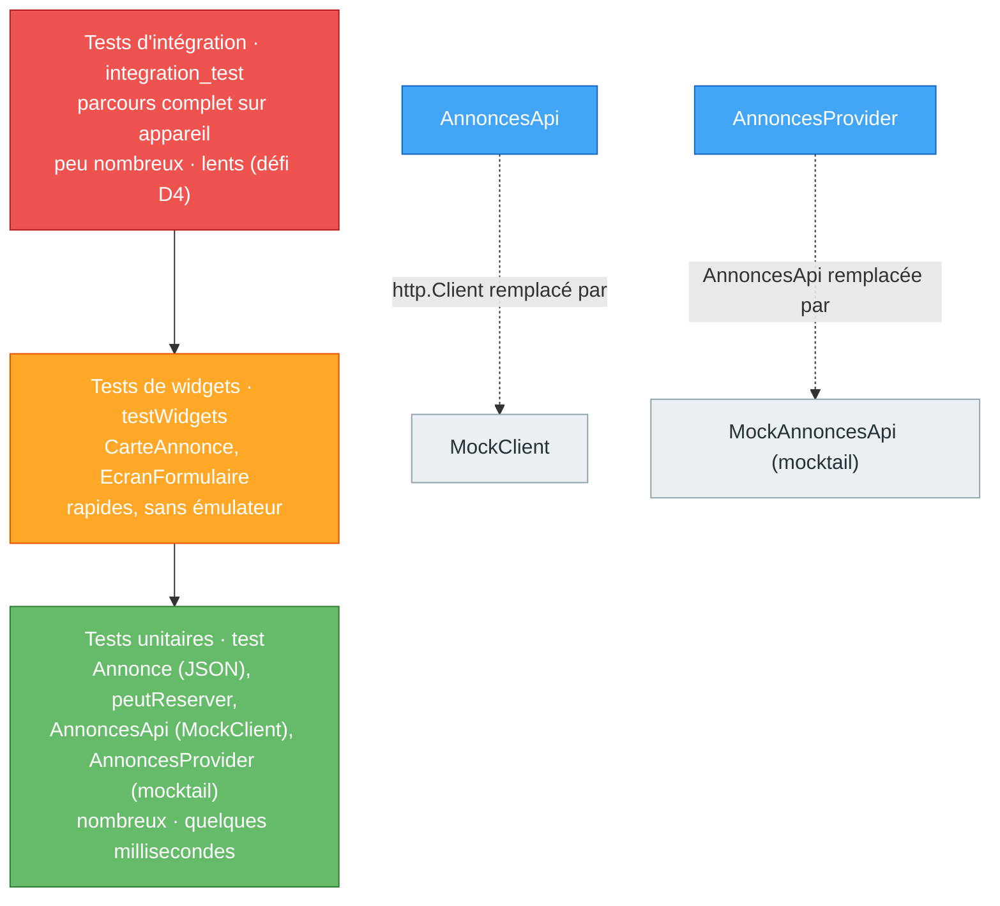

# TP9 — Tests unitaires, tests de widgets et isolation réseau

> **Séance :** 3 h · **Environnement :** Flutter 3.x stable (≥ 3.27), Dart 3, `flutter_test`, packages `http` 1.x (avec `http/testing.dart`) et `mocktail` 1.x, VS Code / Android Studio (**aucun émulateur nécessaire**)
> **Fil rouge :** LocalSwap — une suite de tests automatisés pour les modèles, l'API, le provider et les widgets.

| Repère | Partie | Durée |
|---|---|---|
| 📘🗺️ | Rappel de cours + diagramme | 10 min |
| 🧪 | Partie A : exercices indépendants (5) | 70 min |
| 🏗️ | Partie B : tests de LocalSwap | 50 min |
| 🤖 | Partie C : comprendre et maîtriser le code | 35 min |
| 📝 | Quiz de fin de TP | 10 min |
| 🎤 | Validation orale (5 min par binôme, **pendant** les parties B et C) | — |
| 🚀 | Partie D : défis bonus | hors temps |
| | **Total** | **175 min** |

Difficulté : 🟢 facile · 🟡 moyen · 🔴 difficile

---

## 🎯 Objectifs pédagogiques

À la fin de ce TP, vous serez capable de :

1. **Concevoir** des cas de test pertinents (cas normal, limites, erreurs) **avant** d'écrire le test.
2. **Écrire** des tests unitaires avec `test`, `group`, `setUp`, `expect` et les *matchers* adaptés (`closeTo`, `throwsA`, `isA`…).
3. **Tester** un widget sans émulateur (`pumpWidget`, `find`, `tap`, `enterText`, `pump`).
4. **Isoler** une dépendance réseau avec `MockClient` et une dépendance de classe avec `mocktail`.
5. **Repérer** un test inutile ou trompeur (test qui passe toujours, dépendant du réseau ou de l'ordre).

## 📋 Prérequis

- **TP8** : `AnnoncesApi` et `AnnoncesProvider` avec dépendances **injectées** (`http.Client`, `AnnoncesApi`).
- **TP2** : `fromJson`/`toJson`, `peutReserver`. **TP4** : `CarteAnnonce`. **TP6** : formulaire et validators.

> [!IMPORTANT]
> **Règle sur l'IA.** Une IA écrit très vite des tests… qui passent sans rien vérifier. **60 % de la note** porte sur votre compréhension (Partie C, oral, quiz). Tenez le **📓 Journal IA** (C7) si vous l'utilisez.

### Installation

```bash
flutter pub add http
flutter pub add dev:mocktail
flutter test            # lance tous les fichiers test/**_test.dart
```

---

## 📘 Rappel de cours

> [!NOTE]
> **Anatomie d'un test : Arrange · Act · Assert**
> ```dart
> test('réserver une annonce disponible change son statut', () {
>   final annonce = Annonce(/* … disponible … */);          // Arrange : préparer
>   final resultat = peutReserver(annonce);                  // Act : agir
>   expect(resultat, isTrue);                                // Assert : vérifier
> });
> ```
> - `group('nom', () { … })` regroupe ; `setUp(() { … })` s'exécute **avant chaque** test (chaque test repart de zéro).
> - Le nom du test décrit le **comportement attendu**, en français.

> [!NOTE]
> **Matchers utiles** : `equals` (par défaut), `isTrue`/`isFalse`, `isNull`, `hasLength(3)`, `contains('x')`, `closeTo(0.3, 1e-9)` (nombres décimaux), `isA<Type>()`, `throwsA(isA<FormatException>())`, `throwsArgumentError`, `throwsStateError`.
> **Asynchrone** : `test('…', () async { expect(await f(), 3); })` et, pour une erreur asynchrone, **`await expectLater(f(), throwsA(...))`**.

> [!NOTE]
> **Tests de widgets** (`testWidgets`, sans émulateur)
> - `await tester.pumpWidget(MaterialApp(home: …))` : construit le widget (il faut un `MaterialApp` pour le thème, la direction du texte, la navigation…).
> - **Finders** : `find.text('…')`, `find.byKey(const Key('…'))`, `find.byType(FilledButton)`, `find.widgetWithText(FilledButton, 'Réserver')`.
> - **Interactions** : `await tester.tap(finder)`, `await tester.enterText(finder, 'texte')`.
> - **`await tester.pump()`** : construit l'image suivante. **Après chaque interaction**, sinon le test ne voit pas le `setState`. `pump(const Duration(seconds: 1))` fait avancer le temps (simulé) ; `pumpAndSettle()` attend la fin des animations.
> - `expect(finder, findsOneWidget / findsNothing / findsNWidgets(2))`.

> [!NOTE]
> **Isoler les dépendances**
> - **`MockClient`** (`package:http/testing.dart`) : un faux `http.Client` ; vous écrivez la réponse (code, corps) **et** vous pouvez inspecter la requête reçue.
> - **`mocktail`** : un faux objet de n'importe quelle classe : `class MockApi extends Mock implements AnnoncesApi {}`, puis `when(() => api.x()).thenAnswer((_) async => …)` et `verify(() => api.x()).called(1)`.
> - C'est possible **parce que** les dépendances sont **injectées** par le constructeur (TP8).

## 🗺️ Diagramme — Pyramide de tests de LocalSwap



Légende : plus on descend, plus les tests sont **nombreux, rapides et précis** ; en gris, les **doublures** qui remplacent le réseau.

---

## 🧪 Partie A — Exercices pédagogiques indépendants (sans LocalSwap) · 70 min

```bash
flutter create tp9_demos
cd tp9_demos
flutter pub add http
flutter pub add dev:mocktail
```

Le code testé va dans `lib/`, les tests dans `test/` (nom terminé par `_test.dart`).

> [!TIP]
> Pour chaque exercice : **lisez** le code de `lib/`, **listez sur papier** les cas à tester, **puis** tapez les tests. Faites échouer chaque test au moins une fois (changez une valeur attendue) pour vérifier qu'il teste vraiment quelque chose.

---

### Exercice 9.1 — Mentions et moyennes : premiers tests unitaires 🟢 · 12 min

**Notions nouvelles :** `test`/`group`/`expect`, matchers de limites et d'erreurs.

`lib/grading.dart`

```dart
/// Mention selon une note sur 20. Lève une ArgumentError hors de [0, 20].
String mention(double note) {
  if (note < 0 || note > 20) {
    throw ArgumentError.value(note, 'note', 'doit être comprise entre 0 et 20');
  }
  if (note >= 16) return 'Très bien';
  if (note >= 14) return 'Bien';
  if (note >= 12) return 'Assez bien';
  if (note >= 10) return 'Passable';
  return 'Ajourné';
}

/// Moyenne d'une liste de notes. Lève une StateError si la liste est vide.
double moyenne(List<double> notes) {
  if (notes.isEmpty) throw StateError('Aucune note');
  return notes.reduce((a, b) => a + b) / notes.length;
}
```

`test/grading_test.dart`

```dart
import 'package:flutter_test/flutter_test.dart';
import 'package:tp9_demos/grading.dart';

void main() {
  group('mention', () {
    test('16 et plus donne « Très bien »', () {
      expect(mention(16), 'Très bien');
      expect(mention(20), 'Très bien');
    });

    test('les limites exactes entre deux mentions', () {
      expect(mention(14), 'Bien');
      expect(mention(13.99), 'Assez bien');
      expect(mention(10), 'Passable');
      expect(mention(9.99), 'Ajourné');
    });

    test('une note hors de [0, 20] lève une ArgumentError', () {
      expect(() => mention(-1), throwsArgumentError);
      expect(() => mention(20.5), throwsA(isA<ArgumentError>()));
    });
  });

  group('moyenne', () {
    test('calcule la moyenne de plusieurs notes', () {
      expect(moyenne([10, 12, 14]), 12);
    });

    test('compare les décimaux avec une tolérance', () {
      expect(moyenne([0.1, 0.2]), closeTo(0.15, 1e-9));
    });

    test('une liste vide lève une StateError', () {
      expect(() => moyenne([]), throwsStateError);
    });
  });
}
```

```bash
flutter test test/grading_test.dart
```

**🔍 Observer & répondre**

1. Remplacez `if (note >= 14)` par `if (note > 14)` dans `lib/`. Quel test échoue ? Recopiez le message (*Expected* / *Actual*).
2. Pourquoi écrit-on `expect(() => mention(-1), …)` avec `() =>` et pas `expect(mention(-1), …)` ?
3. Remplacez `closeTo(0.15, 1e-9)` par `0.15`. Le test passe-t-il ? Pourquoi ?
4. Quel cas de test **manque** encore pour `mention` ? Ajoutez-le.

---

### Exercice 9.2 — Panier : tester un ChangeNotifier 🟡 · 13 min

**Notions nouvelles :** `setUp`, vérifier les **notifications** d'un `ChangeNotifier`.

`lib/cart_model.dart`

```dart
import 'package:flutter/foundation.dart';

class CartModel extends ChangeNotifier {
  static const int maxPerItem = 5;

  final Map<String, int> _quantities = {};

  int get totalItems => _quantities.values.fold(0, (sum, q) => sum + q);
  int quantityOf(String item) => _quantities[item] ?? 0;

  /// Retourne false si la limite est atteinte (rien ne change, aucune notification).
  bool add(String item) {
    final int current = quantityOf(item);
    if (current >= maxPerItem) return false;
    _quantities[item] = current + 1;
    notifyListeners();
    return true;
  }

  void remove(String item) {
    final int current = quantityOf(item);
    if (current == 0) return;
    if (current == 1) {
      _quantities.remove(item);
    } else {
      _quantities[item] = current - 1;
    }
    notifyListeners();
  }
}
```

`test/cart_model_test.dart`

```dart
import 'package:flutter_test/flutter_test.dart';
import 'package:tp9_demos/cart_model.dart';

void main() {
  late CartModel cart;
  late int notifications;

  // Exécuté AVANT CHAQUE test : chaque test repart d'un panier neuf.
  setUp(() {
    cart = CartModel();
    notifications = 0;
    cart.addListener(() => notifications++);
  });

  test('un panier neuf est vide', () {
    expect(cart.totalItems, 0);
    expect(notifications, 0);
  });

  test('add augmente la quantité et notifie une seule fois', () {
    final bool ok = cart.add('stylo');

    expect(ok, isTrue);
    expect(cart.quantityOf('stylo'), 1);
    expect(notifications, 1);
  });

  test('au-delà de 5 exemplaires, add refuse sans notifier', () {
    for (var i = 0; i < CartModel.maxPerItem; i++) {
      cart.add('cahier');
    }
    notifications = 0;

    expect(cart.add('cahier'), isFalse);
    expect(cart.quantityOf('cahier'), CartModel.maxPerItem);
    expect(notifications, 0);
  });

  test('remove sur un article absent ne notifie pas', () {
    cart.remove('gomme');
    expect(notifications, 0);
  });

  test('remove décrémente, puis retire l’article', () {
    cart
      ..add('règle')
      ..add('règle');

    cart.remove('règle');
    expect(cart.quantityOf('règle'), 1);

    cart.remove('règle');
    expect(cart.quantityOf('règle'), 0);
    expect(cart.totalItems, 0);
  });
}
```

**🔍 Observer & répondre**

1. Pourquoi tester le **nombre de notifications** ? Quel bug d'interface (TP7) ce test empêche-t-il ?
2. Supprimez `setUp` et créez **un seul** panier en haut de `main()`. Quels tests échouent ? Changent-ils selon l'ordre ? Pourquoi est-ce grave ?
3. Retirez le `return` de la ligne `if (current == 0) return;`. Quel test le détecte ?

---

### Exercice 9.3 — Compteur de salle : premiers tests de widgets 🟡 · 15 min

**Notions nouvelles :** `testWidgets` + `pumpWidget`, finders et `pump` après une interaction.

`lib/room_counter.dart`

```dart
import 'package:flutter/material.dart';

class RoomCounterPage extends StatefulWidget {
  const RoomCounterPage({super.key, required this.capacity});

  final int capacity;

  @override
  State<RoomCounterPage> createState() => _RoomCounterPageState();
}

class _RoomCounterPageState extends State<RoomCounterPage> {
  int _count = 0;

  @override
  Widget build(BuildContext context) {
    final bool isFull = _count >= widget.capacity;
    return Scaffold(
      appBar: AppBar(title: const Text('Salle B12')),
      body: Center(
        child: Column(
          mainAxisSize: MainAxisSize.min,
          children: [
            Text('$_count / ${widget.capacity}', key: const Key('count')),
            if (isFull) const Text('Salle pleine'),
            FilledButton.icon(
              key: const Key('enter'),
              onPressed: isFull ? null : () => setState(() => _count++),
              icon: const Icon(Icons.person_add),
              label: const Text('Entrée'),
            ),
            OutlinedButton(
              onPressed: () => setState(() => _count = 0),
              child: const Text('Réinitialiser'),
            ),
          ],
        ),
      ),
    );
  }
}
```

`test/room_counter_test.dart`

```dart
import 'package:flutter/material.dart';
import 'package:flutter_test/flutter_test.dart';
import 'package:tp9_demos/room_counter.dart';

/// Un widget testé a besoin d'un MaterialApp (thème, direction du texte…).
Widget wrap(Widget child) => MaterialApp(home: child);

void main() {
  testWidgets('affiche 0 / 3 au démarrage', (WidgetTester tester) async {
    await tester.pumpWidget(wrap(const RoomCounterPage(capacity: 3)));

    expect(find.text('0 / 3'), findsOneWidget);
    expect(find.text('Salle pleine'), findsNothing);
  });

  testWidgets('un tap sur « Entrée » incrémente le compteur', (tester) async {
    await tester.pumpWidget(wrap(const RoomCounterPage(capacity: 3)));

    await tester.tap(find.byKey(const Key('enter')));
    await tester.pump(); // reconstruit l'écran après le setState

    expect(find.text('1 / 3'), findsOneWidget);
    expect(find.text('0 / 3'), findsNothing);
  });

  testWidgets('salle pleine : message affiché et bouton désactivé', (tester) async {
    await tester.pumpWidget(wrap(const RoomCounterPage(capacity: 2)));

    for (var i = 0; i < 2; i++) {
      await tester.tap(find.byKey(const Key('enter')));
      await tester.pump();
    }

    expect(find.text('Salle pleine'), findsOneWidget);
    final FilledButton button = tester.widget<FilledButton>(find.byKey(const Key('enter')));
    expect(button.onPressed, isNull);
  });

  testWidgets('« Réinitialiser » remet le compteur à zéro', (tester) async {
    await tester.pumpWidget(wrap(const RoomCounterPage(capacity: 3)));
    await tester.tap(find.byKey(const Key('enter')));
    await tester.pump();

    await tester.tap(find.widgetWithText(OutlinedButton, 'Réinitialiser'));
    await tester.pump();

    expect(find.text('0 / 3'), findsOneWidget);
  });
}
```

**🔍 Observer & répondre**

1. Retirez le premier `await tester.pump();` du 2ᵉ test. Que se passe-t-il ? Pourquoi ?
2. Retirez `wrap(...)` (passez directement `RoomCounterPage`). Quel message obtenez-vous ?
3. Pourquoi tester `button.onPressed` plutôt que de taper 3 fois et vérifier que le compteur reste à 2 ? Les deux approches sont-elles équivalentes ?
4. Ces tests ont-ils besoin d'un émulateur ? Combien de temps durent-ils ?

---

### Exercice 9.4 — Formulaire d'inscription : saisie et validation 🟡 · 15 min

**Notions nouvelles :** `enterText`, tester un widget par ses **effets** (callback, messages affichés).

`lib/signup_form.dart`

```dart
import 'package:flutter/material.dart';

class SignUpForm extends StatefulWidget {
  const SignUpForm({super.key, required this.onSubmitted});

  /// Appelé avec le nom nettoyé quand le formulaire est valide.
  final ValueChanged<String> onSubmitted;

  @override
  State<SignUpForm> createState() => _SignUpFormState();
}

class _SignUpFormState extends State<SignUpForm> {
  final GlobalKey<FormState> _formKey = GlobalKey<FormState>();
  final TextEditingController _nameCtrl = TextEditingController();
  final TextEditingController _emailCtrl = TextEditingController();

  static final RegExp _email = RegExp(r'^[^@\s]+@[^@\s]+\.[a-z]{2,}$', caseSensitive: false);

  @override
  void dispose() {
    _nameCtrl.dispose();
    _emailCtrl.dispose();
    super.dispose();
  }

  void _submit() {
    if (!_formKey.currentState!.validate()) return;
    widget.onSubmitted(_nameCtrl.text.trim());
  }

  @override
  Widget build(BuildContext context) {
    return Form(
      key: _formKey,
      child: ListView(
        padding: const EdgeInsets.all(16),
        children: [
          TextFormField(
            key: const Key('name'),
            controller: _nameCtrl,
            decoration: const InputDecoration(labelText: 'Nom'),
            validator: (v) => (v == null || v.trim().isEmpty) ? 'Le nom est obligatoire' : null,
          ),
          TextFormField(
            key: const Key('email'),
            controller: _emailCtrl,
            decoration: const InputDecoration(labelText: 'Email'),
            validator: (v) {
              final String email = v?.trim() ?? '';
              if (email.isEmpty) return "L'email est obligatoire";
              if (!_email.hasMatch(email)) return 'Email invalide';
              return null;
            },
          ),
          const SizedBox(height: 16),
          FilledButton(
            key: const Key('submit'),
            onPressed: _submit,
            child: const Text("S'inscrire"),
          ),
        ],
      ),
    );
  }
}
```

`test/signup_form_test.dart`

```dart
import 'package:flutter/material.dart';
import 'package:flutter_test/flutter_test.dart';
import 'package:tp9_demos/signup_form.dart';

void main() {
  late String? submitted;

  Future<void> pumpForm(WidgetTester tester) async {
    submitted = null;
    await tester.pumpWidget(
      MaterialApp(home: Scaffold(body: SignUpForm(onSubmitted: (name) => submitted = name))),
    );
  }

  testWidgets('formulaire vide : deux erreurs, aucun envoi', (tester) async {
    await pumpForm(tester);

    await tester.tap(find.byKey(const Key('submit')));
    await tester.pump();

    expect(find.text('Le nom est obligatoire'), findsOneWidget);
    expect(find.text("L'email est obligatoire"), findsOneWidget);
    expect(submitted, isNull);
  });

  testWidgets('email invalide : message dédié', (tester) async {
    await pumpForm(tester);

    await tester.enterText(find.byKey(const Key('name')), 'Amira');
    await tester.enterText(find.byKey(const Key('email')), 'amira@iset');
    await tester.tap(find.byKey(const Key('submit')));
    await tester.pump();

    expect(find.text('Email invalide'), findsOneWidget);
    expect(submitted, isNull);
  });

  testWidgets('saisie valide : envoi du nom sans espaces autour', (tester) async {
    await pumpForm(tester);

    await tester.enterText(find.byKey(const Key('name')), '  Amira  ');
    await tester.enterText(find.byKey(const Key('email')), 'amira@iset.tn');
    await tester.tap(find.byKey(const Key('submit')));
    await tester.pump();

    expect(submitted, 'Amira');
    expect(find.text('Le nom est obligatoire'), findsNothing);
  });
}
```

**🔍 Observer & répondre**

1. Pourquoi le formulaire expose-t-il un callback `onSubmitted` au lieu d'afficher lui-même une `SnackBar` ? En quoi cela facilite-t-il le test ?
2. Remplacez `find.byKey(const Key('submit'))` par `find.text("S'inscrire")`. Le test passe-t-il ? Quel finder est le plus robuste si le texte du bouton est traduit un jour ?
3. Ajoutez un test : un email avec des majuscules (`AMIRA@ISET.TN`) doit être accepté.

---

### Exercice 9.5 — Météo : MockClient et mocktail 🔴 · 15 min

**Notions nouvelles :** `MockClient` (faux réseau), `mocktail` (fausse classe) + `verify`.

`lib/weather_api.dart`

```dart
import 'dart:async';
import 'dart:convert';

import 'package:http/http.dart' as http;

class WeatherException implements Exception {
  const WeatherException(this.message);
  final String message;

  @override
  String toString() => message;
}

class CityNotFoundException extends WeatherException {
  const CityNotFoundException(String city) : super('Ville inconnue : $city');
}

class WeatherApi {
  WeatherApi({http.Client? client, this.baseUrl = 'http://localhost:3000'})
      : _client = client ?? http.Client();

  final http.Client _client;
  final String baseUrl;

  Future<double> fetchTemperature(String city) async {
    final Uri uri = Uri.parse('$baseUrl/weather').replace(queryParameters: {'city': city});
    final http.Response response;
    try {
      response = await _client.get(uri).timeout(const Duration(seconds: 5));
    } on TimeoutException {
      throw const WeatherException('Délai dépassé');
    } on http.ClientException {
      throw const WeatherException('Connexion impossible');
    }
    if (response.statusCode == 404) throw CityNotFoundException(city);
    if (response.statusCode != 200) {
      throw WeatherException('Erreur serveur (${response.statusCode})');
    }
    final Object? json = jsonDecode(utf8.decode(response.bodyBytes));
    return switch (json) {
      {'temperature': final num t} => t.toDouble(),
      _ => throw const WeatherException('Réponse invalide'),
    };
  }
}
```

`lib/weather_model.dart`

```dart
import 'package:flutter/foundation.dart';

import 'weather_api.dart';

class WeatherModel extends ChangeNotifier {
  WeatherModel(this._api); // dépendance INJECTÉE

  final WeatherApi _api;
  double? _temperature;
  String? _error;
  bool _loading = false;

  double? get temperature => _temperature;
  String? get error => _error;
  bool get loading => _loading;

  Future<void> load(String city) async {
    _loading = true;
    _error = null;
    notifyListeners();
    try {
      _temperature = await _api.fetchTemperature(city);
    } on WeatherException catch (e) {
      _error = e.message;
    } finally {
      _loading = false;
      notifyListeners();
    }
  }
}
```

`test/weather_api_test.dart` — **faux réseau** avec `MockClient`

```dart
import 'package:flutter_test/flutter_test.dart';
import 'package:http/http.dart' as http;
import 'package:http/testing.dart';
import 'package:tp9_demos/weather_api.dart';

const Map<String, String> jsonUtf8 = {'content-type': 'application/json; charset=utf-8'};

void main() {
  test('200 : retourne la température et envoie la bonne requête', () async {
    final client = MockClient((http.Request request) async {
      // On peut AUSSI vérifier ce que l'application envoie.
      expect(request.method, 'GET');
      expect(request.url.path, '/weather');
      expect(request.url.queryParameters['city'], 'Gabès');
      return http.Response('{"city": "Gabès", "temperature": 24}', 200, headers: jsonUtf8);
    });
    final api = WeatherApi(client: client, baseUrl: 'http://test');

    expect(await api.fetchTemperature('Gabès'), 24.0);
  });

  test('404 : lève CityNotFoundException', () async {
    final api = WeatherApi(
      client: MockClient((_) async => http.Response('{}', 404)),
      baseUrl: 'http://test',
    );

    await expectLater(api.fetchTemperature('Atlantis'), throwsA(isA<CityNotFoundException>()));
  });

  test('erreur de connexion : WeatherException lisible', () async {
    final api = WeatherApi(
      client: MockClient((_) async => throw http.ClientException('refusé')),
      baseUrl: 'http://test',
    );

    await expectLater(
      api.fetchTemperature('Tunis'),
      throwsA(isA<WeatherException>().having((e) => e.message, 'message', 'Connexion impossible')),
    );
  });

  test('JSON sans température : « Réponse invalide »', () async {
    final api = WeatherApi(
      client: MockClient((_) async => http.Response('{"city": "Tunis"}', 200)),
      baseUrl: 'http://test',
    );

    await expectLater(api.fetchTemperature('Tunis'), throwsA(isA<WeatherException>()));
  });
}
```

`test/weather_model_test.dart` — **fausse classe** avec `mocktail`

```dart
import 'package:flutter_test/flutter_test.dart';
import 'package:mocktail/mocktail.dart';
import 'package:tp9_demos/weather_api.dart';
import 'package:tp9_demos/weather_model.dart';

class MockWeatherApi extends Mock implements WeatherApi {}

void main() {
  late MockWeatherApi api;
  late WeatherModel model;

  setUp(() {
    api = MockWeatherApi();
    model = WeatherModel(api);
  });

  test('load : succès → température, pas d’erreur, un seul appel', () async {
    when(() => api.fetchTemperature('Tunis')).thenAnswer((_) async => 24);

    await model.load('Tunis');

    expect(model.temperature, 24);
    expect(model.error, isNull);
    expect(model.loading, isFalse);
    verify(() => api.fetchTemperature('Tunis')).called(1);
  });

  test('load : échec → message d’erreur, chargement terminé', () async {
    when(() => api.fetchTemperature(any()))
        .thenAnswer((_) => Future.error(const WeatherException('Connexion impossible')));

    await model.load('Sfax');

    expect(model.temperature, isNull);
    expect(model.error, 'Connexion impossible');
    expect(model.loading, isFalse);
  });
}
```

**🔍 Observer & répondre**

1. Dans le 1ᵉʳ test de `weather_api_test.dart`, retirez `headers: jsonUtf8`. Le test échoue : pourquoi ? (indice : encodage par défaut de `http.Response(String …)`).
2. Dans le test 404, retirez `await` devant `expectLater`. Puis cassez volontairement le code (retournez `0` au lieu de lever l'exception). Le test échoue-t-il toujours au bon endroit ? Pourquoi `await` est-il indispensable ?
3. Quelle différence faites-vous entre `MockClient` et `MockWeatherApi` ? Quelle couche chacun permet-il de tester ?
4. Pourquoi ces tests seraient-ils **impossibles** si `WeatherApi` créait son `http.Client` à l'intérieur de chaque méthode ?

---

## 🏗️ Partie B — Tests de LocalSwap · 50 min

```text
test/
├── helpers.dart                       ← fabriques de données de test
├── models/annonce_test.dart
├── data/annonces_api_test.dart
├── state/annonces_provider_test.dart
└── widgets/
    ├── carte_annonce_test.dart
    └── ecran_formulaire_test.dart
```

> [!TIP]
> Dans `test/helpers.dart`, écrivez une fabrique `Annonce annonceTest({String id = 'a1', StatutAnnonce statut = StatutAnnonce.disponible, String idProprietaire = 'u1'})` : vos tests restent courts et lisibles.

### B.1 — Modèle (`annonce_test.dart`) 🟢 · au moins 5 tests

- `peutReserver` : `true` pour `disponible`, `false` pour `reservee` **et** `terminee`.
- Aller-retour `toJson` → `fromJson` : tous les champs sont identiques (y compris `dateSouhaitee`).
- `fromJson` sans `titre` → `FormatException` ; avec `"statut": "inconnu"` → `FormatException`.
- `toJson` n'écrit **pas** la clé `description` quand elle est nulle.

### B.2 — API (`annonces_api_test.dart`) avec `MockClient` 🟡 · au moins 4 tests

- `listerAnnonces` : un `200` avec 2 annonces → 2 objets `Annonce`.
- `404` → `ApiException` avec `statusCode == 404`.
- `http.ClientException` → `ApiException` (message lisible).
- `creerAnnonce` : vérifiez **dans le `MockClient`** que la méthode est `POST`, que l'en-tête `content-type` contient `application/json` et que le corps décodé contient le bon `titre`. Répondez `201`.

### B.3 — Provider (`annonces_provider_test.dart`) avec `mocktail` 🔴 · au moins 5 tests

```dart
class MockAnnoncesApi extends Mock implements AnnoncesApi {}

setUpAll(() {
  // nécessaire pour utiliser any() avec ces types
  registerFallbackValue(StatutAnnonce.disponible);
  registerFallbackValue(annonceTest());
});
```

- `charger` réussi : listes remplies, `chargement == false`, `erreur == null`.
- `charger` en échec (`ApiException`) : `erreur` renseignée.
- `reserverAnnonce` réussi : statut `reservee`, **les autres annonces inchangées**, `modifierStatut` appelé **une fois**.
- `reserverAnnonce` en échec : **retour arrière** (statut `disponible`) et message retourné.
- `reserverAnnonce` sur une annonce `terminee` : **aucun** appel réseau (`verifyNever`).
- `terminerEchange` : réputation du propriétaire **+1**, et **plafonnée à 5**.

### B.4 — Widgets 🟡 · au moins 3 tests

- `CarteAnnonce` disponible : texte « Disponible », bouton « Réserver » actif ; un tap appelle `onReserver` (compteur dans le test).
- `CarteAnnonce` avec `onReserver: null` : bouton désactivé.
- `EcranFormulaire` (dans un `ChangeNotifierProvider` créé avec un `MockAnnoncesApi`) : « Publier » avec un titre vide → « Le titre est obligatoire ».

### B.5 — Couverture 🟢

```bash
flutter test --coverage      # produit coverage/lcov.info
```

Ouvrez `lcov.info` (ou l'extension VS Code *Coverage Gutters*) et complétez un tableau : fichier / lignes couvertes / **une ligne importante non couverte et pourquoi**.

Terminez par `flutter test` (tout est vert), `flutter analyze` (aucun problème) et un commit : `test: suite de tests LocalSwap`.

---

## 🤖 Partie C — Comprendre et maîtriser le code · 35 min

> [!CAUTION]
> Pour C1, C2 et C3, **répondez d'abord sur papier, sans exécuter et sans IA**. Vérifiez ensuite sur machine.

### C1 — Prédire : le test passe-t-il ? 🟡 · 8 min

Pour chaque ligne : ✅ passe, ❌ échoue (avec le message attendu), ou 💥 erreur.

```dart
expect(0.1 + 0.2, 0.3);                                         // (1)
expect(0.1 + 0.2, closeTo(0.3, 1e-9));                          // (2)
expect([1, 2, 3], [1, 2, 3]);                                   // (3)
expect(const Duration(seconds: 60), const Duration(minutes: 1)); // (4)
expect(Annonce.fromJson(j), Annonce.fromJson(j));               // (5) Annonce sans == redéfini
expect('Bizerte', contains('zer'));                             // (6)
expect(() => int.parse('abc'), throwsFormatException);          // (7)
expect(int.parse('abc'), throwsFormatException);                // (8)
```

Puis : dans un écran qui contient **deux** boutons « Ajouter », que donne `expect(find.text('Ajouter'), findsOneWidget)` ?

### C2 — Trouver les tests défectueux 🟡 · 8 min

Ces 4 tests ont un défaut : ils **passent alors que le code est faux**, échouent **au hasard**, ou **plantent** pour une mauvaise raison. Pour chacun : le défaut, sa conséquence, la correction.

```dart
// T1
test('fetchTemperature retourne 24', () {
  final api = WeatherApi(client: MockClient((_) async => http.Response('{"temperature": 24}', 200)));
  api.fetchTemperature('Tunis').then((t) => expect(t, 99));
});

// T2
test('charger récupère les annonces du serveur', () async {
  final provider = AnnoncesProvider(AnnoncesApi()); // vraie API
  await provider.charger();
  expect(provider.annonces, hasLength(6));
});

// T3
final cart = CartModel(); // partagé par tous les tests
test('ajout d’un stylo', () {
  cart.add('stylo');
  expect(cart.totalItems, 1);
});
test('ajout d’un cahier', () {
  cart.add('cahier');
  expect(cart.totalItems, 1);
});

// T4
testWidgets('la carte affiche le titre', (tester) async {
  await tester.pumpWidget(CarteAnnonce(annonce: annonceTest()));
  expect(find.text('Perceuse'), findsOneWidget);
});
```

### C3 — Critiquer des tests générés par une IA 🔴 · 10 min

Prompt : *« Écris des tests pour mon AnnoncesProvider »*. Réponse de l'IA :

```dart
class MockAnnoncesProvider extends Mock implements AnnoncesProvider {}

void main() {
  test('test provider', () async {
    final provider = MockAnnoncesProvider();
    when(() => provider.reserverAnnonce('a1')).thenAnswer((_) async => null);
    when(() => provider.annonces).thenReturn(UnmodifiableListView([]));

    final result = await provider.reserverAnnonce('a1');
    expect(result, null);
    expect(provider.annonces.length, 0);
    expect(true, true);
  });

  test('chargement', () async {
    final provider = AnnoncesProvider(AnnoncesApi());
    provider.charger();
    await Future.delayed(const Duration(seconds: 3));
    expect(provider.chargement, false);
  });
}
```

1. Trouvez **au moins 6 problèmes**. Lequel rend le 1ᵉʳ test **totalement inutile** ? Expliquez-le en une phrase.
2. Combien de lignes du **vrai** `AnnoncesProvider` le 1ᵉʳ test exécute-t-il ?
3. Réécrivez ces deux tests correctement (vrai provider, fausse API, Arrange/Act/Assert, noms explicites).
4. Écrivez le prompt qui aurait produit de bons tests.

### C4 — Modifier sous contrainte : « tests mutants » 🟡 · 5 min

1. Dans LocalSwap, remplacez dans `peutReserver` `== StatutAnnonce.disponible` par `!= StatutAnnonce.terminee`. **Vos** tests le détectent-ils ? Sinon, ajoutez le test manquant.
2. Retirez la limite de 5 dans `terminerEchange`. Quel test échoue ? (Si aucun : écrivez-le **d'abord**, constatez qu'il échoue, puis remettez la limite.)

### C5 — Expliquer ligne par ligne 🟢 · 2 min

Recopiez votre test « `reserverAnnonce` en échec : retour arrière » et étiquetez chaque ligne : **Arrange**, **Act** ou **Assert**, avec une phrase.

### C6 — Exercice papier : concevoir les cas de test ✍️ 🟡 · 2 min (puis à la maison)

Spécification : `double fraisLivraison(double distanceKm, {required bool membre})` : 0 DT jusqu'à 2 km ; 3 DT de 2 à 10 km ; 3 DT + 0,5 DT par km au-delà de 10 km ; −50 % pour les membres ; distance négative → `ArgumentError`.
**Sans écrire de code**, listez dans un tableau les cas de test (valeurs d'entrée → résultat attendu), en couvrant chaque **classe** et chaque **limite** (2, 10…). Combien en faut-il au minimum ?

### C7 — Journal IA 📓

| # | Exercice | Prompt (copié tel quel) | Ce que j'ai gardé | Ce que j'ai rejeté ou corrigé, et pourquoi |
|---|---|---|---|---|
| 1 | | | | |

---

## 🚀 Partie D — Défis bonus

| Défi | Niveau | Énoncé |
|---|---|---|
| D1 — TDD | 🟡 | Implémentez `fraisLivraison` (C6) en **TDD** : un test rouge, le minimum de code pour le rendre vert, puis on améliore. Notez chaque cycle. |
| D2 — Golden test | 🟡 | `await expectLater(find.byType(CarteAnnonce), matchesGoldenFile('goldens/carte.png'));` (générer avec `flutter test --update-goldens`). Que détecte ce test qu'un `find.text` ne voit pas ? |
| D3 — Temps simulé | 🔴 | Testez le délai de 8 s d'`AnnoncesApi` **sans attendre 8 s** (package `fake_async`, ou `testWidgets` + `pump(const Duration(seconds: 9))`). |
| D4 — Intégration | 🔴 | Avec `integration_test` (fourni par le SDK), écrivez un parcours complet sur émulateur : ouvrir l'application, réserver, vérifier le badge. |

---

## 🎤 Validation orale (5 min par binôme)

1. **Lancez `flutter test`** devant l'enseignant. Combien de tests, combien de temps ?
2. **Cassez `peutReserver` en direct** : quel test échoue ? Lisez le message.
3. Pourquoi `MockAnnoncesApi` et pas `MockAnnoncesProvider` dans les tests du provider ?
4. À quoi sert `pump()` ? Que se passe-t-il sans ?
5. Pourquoi `await expectLater(...)` pour une exception asynchrone ?
6. Montrez une ligne **non couverte** importante. Écrivez le test en direct.
7. Votre test réseau passerait-il dans le train, sans Internet ? Pourquoi ?
8. Qu'est-ce qu'un test qui « passe toujours » ? Donnez un exemple.

> [!IMPORTANT]
> La note d'oral est **individuelle**.

---

## ✅ Checklist de validation — le TP est réussi si…

- [ ] Les 5 exercices de la Partie A passent, et vous avez fait échouer chaque test au moins une fois.
- [ ] Les réponses 🔍 sont rédigées.
- [ ] LocalSwap : au moins 5 tests de modèle, 4 tests d'API (`MockClient`), 5 tests de provider (`mocktail`), 3 tests de widgets.
- [ ] Aucun test n'utilise le vrai réseau ni `Future.delayed` pour attendre.
- [ ] `flutter test` : tout est vert ; `flutter analyze` : aucun problème.
- [ ] Le tableau de couverture est rempli.
- [ ] Les réponses aux exercices C1 à C6 sont rédigées, et le journal IA est tenu si une IA a été utilisée.

## ⚠️ Erreurs fréquentes et corrections

| Symptôme | Cause | Correction |
|---|---|---|
| `No MaterialLocalizations found` / `No Directionality widget found` | Widget testé sans `MaterialApp` | `pumpWidget(MaterialApp(home: …))` |
| Le test ne voit pas le nouvel état | `pump()` oublié après `tap`/`enterText` | `await tester.pump();` |
| `Expected: exactly one matching candidate, Actual: … Found 2 widgets` | Finder ambigu | `find.byKey`, `find.widgetWithText` |
| Un test asynchrone passe toujours | `expect` dans un `.then` sans `await` | `async`/`await`, `await expectLater` |
| `Bad state: A test tried to use 'any' or 'captureAny' on a parameter of type 'X'` | Type sans valeur de repli | `registerFallbackValue(...)` dans `setUpAll` |
| `type 'Null' is not a subtype of type 'Future<…>'` | Méthode du mock non configurée | `when(...).thenAnswer(...)` |
| Tests qui échouent selon l'ordre | État partagé entre tests | Tout recréer dans `setUp` |
| Tests lents ou qui échouent sans Internet | Vrai `http.Client` | `MockClient` / API injectée |
| `FormatException: Unexpected extension byte` (ou `Invalid argument … Contains invalid characters`) avec un faux `http.Response` accentué | Corps encodé en Latin-1 par défaut | `headers: {'content-type': 'application/json; charset=utf-8'}` |
| `A Timer is still pending even after the widget tree was disposed` | `Future.delayed` du code (TP6) non écoulé | `await tester.pump(const Duration(seconds: 1))` |

## 📝 Quiz de fin de TP · 10 min

**Q1.** Dans un test de widget, après `await tester.tap(bouton)`, pourquoi appeler `await tester.pump()` ?
- A. Pour fermer le clavier.
- B. Pour construire l'image suivante, qui tient compte du `setState` déclenché par le tap.
- C. Pour lancer l'émulateur.
- D. Pour réinitialiser le widget.

**Q2.** Quel est l'intérêt principal de `MockClient` ?
- A. Accélérer le vrai serveur.
- B. Tester le code qui fait des requêtes HTTP **sans réseau**, avec des réponses contrôlées (200, 404, erreur…).
- C. Remplacer `json-server` en production.
- D. Générer automatiquement des tests.

**Q3.** Ce test passe. Pourquoi est-ce inquiétant ?
```dart
test('x', () { api.charger().then((v) => expect(v, 42)); });
```
- A. Il n'est pas inquiétant.
- B. Le test se termine avant la fin du `Future` : l'`expect` n'est jamais vérifié à temps, le test passe même si la valeur est fausse.
- C. `then` est déprécié.
- D. Il manque un `group`.

**Q4.** `expect(0.1 + 0.2, 0.3)` échoue. Que faut-il écrire ?
- A. `expect(0.1 + 0.2, 0.30000000000000004)`
- B. `expect((0.1 + 0.2).round(), 0)`
- C. `expect(0.1 + 0.2, closeTo(0.3, 1e-9))`
- D. Il faut éviter de tester des décimaux.

**Q5.** Pour tester `AnnoncesProvider`, que faut-il remplacer par un mock ?
- A. `AnnoncesProvider` lui-même.
- B. Sa **dépendance** `AnnoncesApi` : on teste le vrai provider avec une fausse API.
- C. `ChangeNotifier`.
- D. Rien : on utilise le vrai serveur.

## 📊 Barème indicatif (sur 20)

| Bloc | Détail | Points |
|---|---|---|
| **Code fonctionnel (40 %)** | Partie A : 5 exercices verts + échecs volontaires + réponses 🔍 | 2 |
| | Tests de modèle + tests d'API (`MockClient`) | 2 |
| | Tests de provider (`mocktail`, retour arrière, `verifyNever`, plafond) | 2,5 |
| | Tests de widgets + couverture | 1,5 |
| **Compréhension (60 %)** | C1 Prédire | 1 |
| | C2 Tests défectueux | 1 |
| | C3 Critique des tests IA | 1,5 |
| | C4 Tests mutants | 0,5 |
| | C5 + C6 Explication et conception des cas | 1 |
| | Oral individuel | 5 |
| | Quiz (5 × 0,4) | 2 |
| | **Total** | **20** |

> [!CAUTION]
> Un test que vous ne savez pas expliquer à l'oral est noté au plus **la moitié** des points de son bloc. Un test qui ne vérifie rien (ex. `expect(true, true)`) vaut **0**. Du code utilisé sans être déclaré dans le journal IA vaut **0** pour l'exercice concerné.

## 🔜 Vers le TP10

Votre suite de tests devient un **filet de sécurité** : au TP10, vous préparerez la **publication** (icône, nom, signature, build release) et vous lancerez `flutter test` et `flutter analyze` **avant** chaque build, comme dans une vraie chaîne d'intégration continue.
