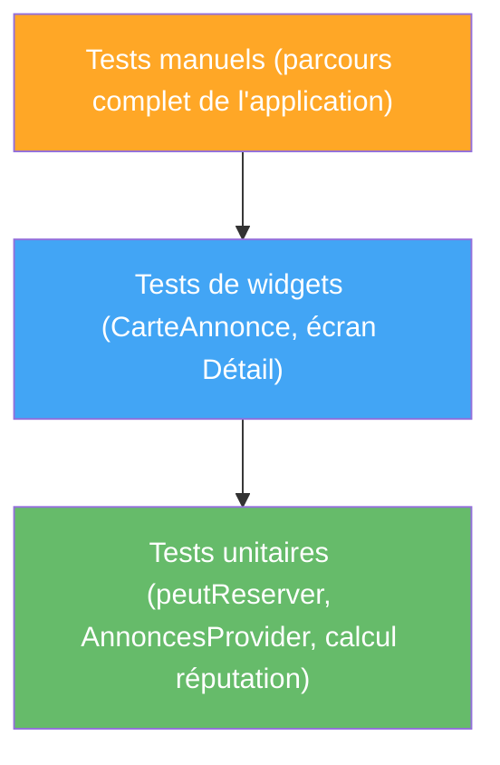

# TP9 — Tests unitaires et fonctionnels

## Objectifs
- Écrire des tests unitaires sur la logique métier de LocalSwap.
- Écrire des tests de widgets (`testWidgets`).
- Isoler une dépendance réseau avec un mock simple.

## Prérequis
- TP8 terminé (application connectée à l'API).

> Ce TP ne provient pas directement de la playlist vidéo fournie, mais complète le semestre par une compétence indispensable : vérifier que ce qui a été construit fonctionne réellement, y compris après une modification future.

---

## Rappel de cours — Notions et définitions

**Test unitaire** : vérifie une unité de code isolée (fonction, méthode), sans interface graphique. Packages : `test` (logique pure) ou `flutter_test`.

**Test de widget (`testWidgets`)** : vérifie l'affichage et le comportement d'un widget dans un environnement simulé (`WidgetTester`), sans lancer d'émulateur.

**Assertions courantes** : `expect(valeurObtenue, valeurAttendue)`, `find.text('...')`, `find.byType(...)`, `tester.tap(...)`, `tester.pump()`.

**Mock** : objet substitué à une vraie dépendance (ici, l'appel HTTP du TP8) pour isoler le comportement testé et rendre le test rapide, déterministe et indépendant du réseau. Package courant : `mocktail`.

**Pourquoi tester `peutReserver()` et les méthodes de `AnnoncesProvider`** : cette logique métier centrale (TP2/TP7) est critique et facilement vérifiable sans interface graphique — candidate idéale pour des tests unitaires robustes.

## Diagramme — Pyramide de tests appliquée à LocalSwap



---

## Partie A — Guidée

### Exercice 9.1 — Premier test unitaire
**Objectif :** écrire et exécuter un test isolé sur une fonction pure.

1. Créer le fichier `test/exemple_test.dart` et vérifier que le package `test` (ou `flutter_test`) est bien présent dans les `dev_dependencies` de `pubspec.yaml`.
2. Écrire une fonction pure simple hors de tout widget, par exemple `int addition(int a, int b) => a + b;`, dans `lib/utils/calculs.dart`.
3. Écrire le test :
   ```dart
   import 'package:flutter_test/flutter_test.dart';
   import 'package:localswap/utils/calculs.dart';

   void main() {
     test('addition de deux nombres positifs', () {
       expect(addition(2, 3), 5);
     });

     test('addition avec un nombre négatif', () {
       expect(addition(-2, 3), 1);
     });
   }
   ```
4. Exécuter `flutter test` et observer le résultat (succès/échec, temps d'exécution).
5. **Exercice de mise en échec volontaire :** modifier temporairement `addition` pour introduire un bug (ex. `a - b`), relancer `flutter test`, lire le message d'échec produit, puis corriger.

### Exercice 9.2 — Regrouper des tests avec `group`
**Objectif :** organiser plusieurs cas de test liés à une même fonctionnalité.

1. Ajouter une fonction `bool estPair(int n) => n % 2 == 0;`.
2. Regrouper les tests avec :
   ```dart
   group('estPair', () {
     test('nombre pair retourne true', () => expect(estPair(4), true));
     test('nombre impair retourne false', () => expect(estPair(3), false));
     test('zéro est pair', () => expect(estPair(0), true));
   });
   ```
3. Exécuter `flutter test` et observer comment les résultats sont regroupés dans la sortie console par rapport à l'exercice 9.1.

### Exercice 9.3 — Premier test de widget
**Objectif :** vérifier l'affichage d'un widget sans lancer d'émulateur.

1. Créer un widget simple `MessageBienvenue` (`StatelessWidget`) affichant `Text('Bienvenue sur LocalSwap')`.
2. Écrire le test :
   ```dart
   testWidgets('affiche le message de bienvenue', (WidgetTester tester) async {
     await tester.pumpWidget(MaterialApp(home: MessageBienvenue()));
     expect(find.text('Bienvenue sur LocalSwap'), findsOneWidget);
   });
   ```
3. Exécuter le test, puis le faire volontairement échouer en modifiant le texte affiché sans modifier le test, pour observer le message d'échec de `find.text`.

### Exercice 9.4 — Test d'interaction (tap)
**Objectif :** simuler une interaction utilisateur dans un test de widget.

1. Créer un petit widget `BoutonCompteur` (`StatefulWidget`) avec un `Text` affichant un compteur et un `ElevatedButton` qui l'incrémente.
2. Écrire un test qui :
   - construit le widget avec `pumpWidget`,
   - vérifie que `'0'` est affiché (`find.text('0')`, `findsOneWidget`),
   - simule un tap avec `await tester.tap(find.byType(ElevatedButton)); await tester.pump();`,
   - vérifie que `'1'` est désormais affiché.
3. **Question :** pourquoi doit-on appeler `tester.pump()` après le `tap()` pour que le test voie le nouvel état ?

### Exercice 9.5 — Introduction au mock avec `mocktail`
**Objectif :** isoler une dépendance externe (ici, un client HTTP fictif) avant l'application réelle en Partie B.

1. Ajouter `mocktail` aux `dev_dependencies`.
2. Créer une classe `ServiceMeteo` avec une méthode `Future<String> obtenirTemperature()` qui, en vrai, ferait un appel réseau.
3. Créer un mock : `class ServiceMeteoMock extends Mock implements ServiceMeteo {}`.
4. Dans un test, configurer le mock : `when(() => mock.obtenirTemperature()).thenAnswer((_) async => '25°C');`, puis appeler la méthode sur le mock et vérifier avec `expect` que la valeur retournée correspond bien à celle configurée, sans jamais effectuer de vrai appel réseau.

## Partie B — Application au projet LocalSwap

**Tests unitaires (au moins 3) :**
- `peutReserver()` retourne `true` uniquement pour une annonce `disponible`.
- `AnnoncesProvider.reserverAnnonce()` modifie bien le statut de l'annonce concernée sans affecter les autres.
- `AnnoncesProvider.terminerEchange()` incrémente correctement la réputation du propriétaire.

**Tests de widgets (au moins 2) :**
- `CarteAnnonce` affiche le badge vert et un bouton "Réserver" actif quand le statut est `disponible`.
- Le formulaire de publication (TP6) affiche bien un message d'erreur si on tente de le soumettre avec un titre vide.

**Isolation réseau :**
- Utiliser un mock du client `http` pour tester `AnnoncesProvider.chargerAnnoncesDepuisAPI()` (TP8) sans dépendre d'une vraie API, garantissant des tests rapides et reproductibles.

## Livrables
- Suite de tests exécutable avec `flutter test` (au moins 3 tests unitaires, 2 tests de widgets, 1 test avec mock réseau).
- Rapport de couverture basique (`flutter test --coverage`) ou synthèse manuelle des cas couverts.

## Grille d'évaluation

| Critère | Points |
|---|---|
| Tests unitaires pertinents et corrects | 7 |
| Tests de widgets fonctionnels | 6 |
| Mock réseau correctement utilisé | 5 |
| Synthèse de couverture | 2 |
| **Total** | **20** |
